<p align="center">
  
</p>

<h1 align="center">노포 패스포트 · 버전2</h1>

<p align="center">
  <b>세월을 맛보고, 추억을 모으다.</b><br>
  전국 백년가게·서울 오래가게 <b>1,277곳</b>을 찾아가 <b>방문 인증 도장</b>을 모으고,<br>
  쌓인 <b>세월 1,000년</b>을 채우면 <b>「천년 미식가」</b>가 되는 노포 여행 앱
</p>

<p align="center">
  
  
  
  
  
  
  
  
  
</p>

<p align="center">
  <a href="https://github.com/ohdangchan/NopoCheonnyeon/releases/latest"><b>⬇️ APK 내려받기</b></a> ·
  <a href="docs/v2/report/노포패스포트_버전2_발표자료.html"><b>🎞️ 발표자료(시뮬레이터)</b></a> ·
  <a href="https://www.figma.com/design/IP2EihmKnZEYYoGUKrYeYG"><b>🎨 Figma 구조도</b></a> ·
  <a href="docs/eval/노포패스포트_버전2_평가자료.pdf"><b>📑 평가자료 PDF</b></a>
</p>

<p align="center">
  
  
  
  
</p>

---

<details open>
<summary><b>📲 APK 내려받기 · QR로 설치하기</b></summary>

<br>

| 방법 | 안내 |
|---|---|
| 🔗 **링크** | **[릴리스 페이지의 최신 APK](https://github.com/ohdangchan/NopoCheonnyeon/releases/latest)** 에서 `app-release.apk`를 내려받습니다. |
| 📷 **QR** | 아래 QR을 폰 카메라로 비추면 릴리스 페이지가 열립니다. |

<p align="center"></p>

1. 폰에서 APK를 내려받아 누릅니다.
2. "출처를 알 수 없는 앱" 허용 창이 뜨면 내려받은 앱(크롬 등)의 설치를 허용합니다.
3. 설치 후 이메일로 가입하거나 로그인합니다. (구글 로그인은 Firebase 설정 후 켜집니다 — [설정 방법](docs/v2/google-login-setup.md))

자세한 안내: [APK 설치 안내](docs/v2/v2-apk-install-guide.md)
</details>

## 📌 목차
[1. 이 앱은?](#1--이-앱은) · [2. 핵심 흐름](#2--핵심-사용-흐름) · [3. 화면 갤러리](#3--화면-갤러리) · [4. 기능표](#4--기능표) · [5. 데이터](#5--데이터-노포-1277곳) · [6. 세월·칭호](#6--세월과-칭호-규칙) · [7. 방문 인증](#7--방문-인증-규칙) · [8. AI 기능](#8--ai-기능) · [9. 구조](#9--구조) · [10. 개인정보·보안](#10--개인정보와-보안-원칙) · [11. 빌드·실행](#11--빌드실행테스트) · [12. 폴더 지도](#12--폴더-지도) · [13. 문서](#13--문서와-산출물) · [14. QA](#14--qa-현황) · [15. 릴리스 노트](#15--릴리스-노트-200) · [16. 한계·계획](#16--한계와-계획) · [17. 출처](#17--출처와-라이선스)

---

## 1. 🍜 이 앱은?

> **노포(오래된 가게)를 찾아가 먹고, 영수증이나 간판으로 인증하면 그 가게의 업력만큼 "세월"이 쌓입니다.**
> 세월이 1,000년을 채우면 천년 미식가. 오래된 가게를 지키는 사람들의 시간을 내 여권에 도장으로 남깁니다.

| 🎯 문제 | 💡 해결 |
|---|---|
| 노포 정보는 흩어져 있고, 어디를 다녀왔는지 기록하기 어렵다 | 공식 지정 가게 1,277곳을 한 앱에 모으고 방문 인증으로 기록 |
| 인증이 허술하면 도장이 의미 없다 | 영수증(위치 미사용) 또는 간판·위치 30m 이내 인증으로 실제 방문만 인정 |
| 기록은 쌓이는데 목표가 없다 | 업력을 모아 칭호 11단계, 목표 "세월 1,000년" |
| 오늘 어디 갈지 고르기 어렵다 | 내 리뷰·방문을 읽는 AI 룰렛과 AI 노포 도우미 |

<p align="center">
  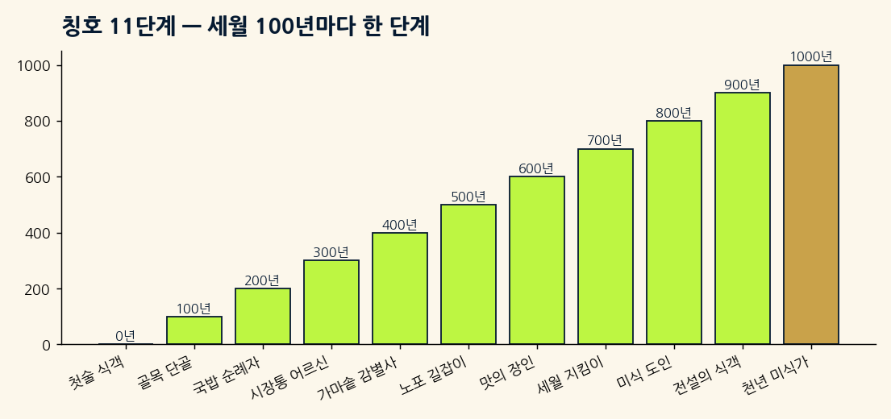
</p>

---

## 2. 🧭 핵심 사용 흐름

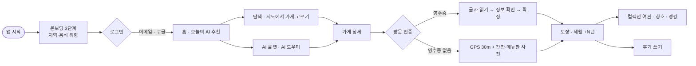

<p align="center">
  <a href="docs/v2/screens_overview/flow_2.png"></a><br>
  <sub>화면 흐름도 (클릭하면 크게 보입니다) · 전체: <a href="docs/v2/screens_overview/flow_1.png">①처음 실행</a> · <a href="docs/v2/screens_overview/flow_2.png">②인증·후기</a> · <a href="docs/v2/screens_overview/flow_3.png">③컬렉션·AI</a> · <a href="docs/v2/screens_overview/flow_4.png">④마이·설정</a></sub>
</p>

---

## 3. 📱 화면 갤러리

> 실제 폰(Galaxy S9+) 캡처입니다. 전체 한 장 모음: [`00_all_screens_8k.png`](docs/v2/screens_overview/00_all_screens_8k.png)

### ① 처음 실행 · 로그인
<table>
<tr>
<td align="center"><br><sub>시작 화면</sub></td>
<td align="center"><br><sub>설치 후 첫 화면</sub></td>
<td align="center"><br><sub>취향 고르기 2/3</sub></td>
<td align="center"><br><sub>준비 완료 3/3</sub></td>
<td align="center"><br><sub>로그인</sub></td>
<td align="center"><br><sub>회원가입</sub></td>
</tr>
</table>

### ② 메인 탭 — 홈 · 탐색 · 지도 · 컬렉션 · 마이페이지
<table>
<tr>
<td align="center"><br><sub>홈</sub></td>
<td align="center"><br><sub>탐색</sub></td>
<td align="center"><br><sub>지도</sub></td>
<td align="center"><br><sub>컬렉션(여권)</sub></td>
<td align="center"><br><sub>마이페이지</sub></td>
<td align="center"><br><sub>알림</sub></td>
</tr>
</table>

### ③ 가게 상세 → 방문 인증 → 후기
<table>
<tr>
<td align="center"><br><sub>가게 상세</sub></td>
<td align="center"><br><sub>인증 안내</sub></td>
<td align="center"><br><sub>영수증 촬영</sub></td>
<td align="center"><br><sub>정보 확인</sub></td>
<td align="center"><br><sub>인증 완료</sub></td>
<td align="center"><br><sub>후기 작성</sub></td>
</tr>
</table>

### ④ AI · 컬렉션 · 랭킹
<table>
<tr>
<td align="center"><br><sub>AI 노포 룰렛</sub></td>
<td align="center"><br><sub>룰렛 결과(이유+3곳)</sub></td>
<td align="center"><br><sub>AI 노포 도우미</sub></td>
<td align="center"><br><sub>칭호 도감</sub></td>
<td align="center"><br><sub>미식가 랭킹</sub></td>
<td align="center"><br><sub>방문한 노포</sub></td>
</tr>
</table>

### ⑤ 마이페이지 · 설정 · 권한 · 도움말
<table>
<tr>
<td align="center"><br><sub>설정</sub></td>
<td align="center"><br><sub>저장한 노포</sub></td>
<td align="center"><br><sub>알림 설정</sub></td>
<td align="center"><br><sub>앱 환경 설정</sub></td>
<td align="center"><br><sub>권한 관리</sub></td>
<td align="center"><br><sub>도움말 센터</sub></td>
</tr>
</table>

---

## 4. ✅ 기능표

| 영역 | 기능 | 상태 |
|---|---|---|
| 🔐 계정 | 이메일 가입·로그인, **구글 로그인**(Firebase 설정 후), 닉네임 중복 확인, 비밀번호 재설정, 로그인 유지 | ✅ (구글은 사용자 설정 필요) |
| 🌱 처음 실행 | 로딩 → 온보딩 3단계(취향 저장) → 로그인 | ✅ |
| 🏠 홈 | 오늘의 AI 추천(취향 반영), 알림 벨, 지금 가장 핫한 노포, 내 주변 노포 칩 → 탐색 연동 | ✅ |
| 🔎 탐색 | 검색, 음식 칩, 지역, "N년 전통" 카드, 검색창 AI 버튼, 저장하기 | ✅ |
| 🗺️ 지도 | 네이버 지도 마커·내 위치·목록 전환, 지도 오류 시 목록 자동 대체 | ✅ (폴드 기기 미확인) |
| 🏮 가게 상세 | 사진·메뉴·소개, 저장하기, 길찾기, 공유, 번역(소개글 먼저), 리뷰·평점 | ✅ |
| 🧾 방문 인증 | 영수증(글자 읽기→정보 확인→확정), GPS+간판·메뉴판 사진, AI 촬영 도우미 | ✅ |
| 📖 컬렉션 | 넘기는 여권(지역·가게 도장), 칭호 도감 11단계, 명예의 전당, 공유 카드 | ✅ |
| 🏆 랭킹 | 전국 랭킹 · 정렬 3종 (서울·친구 랭킹은 준비 중 표시) | ✅ 부분 |
| 🎰 AI 룰렛 | 지역·가격대·음식·도보 조건 → 3곳 추천, 최대 30곳 비중복 | ✅ |
| 🤖 AI 도우미 | 말로 찾기·천년 경로·오늘의 코스 | ✅ |
| 🔔 알림 | 도장·칭호·추천 알림, 눌러서 해당 화면 이동 | ✅ |
| ⚙️ 설정 | 프로필·알림·앱 환경·권한 관리·도움말 센터·통계 버튼 | ✅ |

<p align="center">
  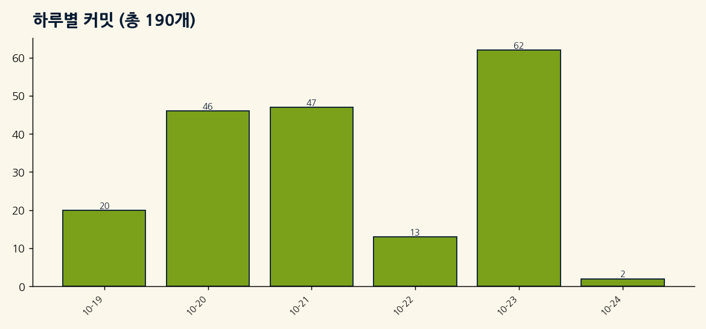
</p>

---

## 5. 📊 데이터: 노포 1,277곳

공식 지정 자료(중소벤처기업부 백년가게, 서울특별시 오래가게)를 정리한 `app/src/main/assets/stores.json` 기준입니다.

<table>
<tr>
<td>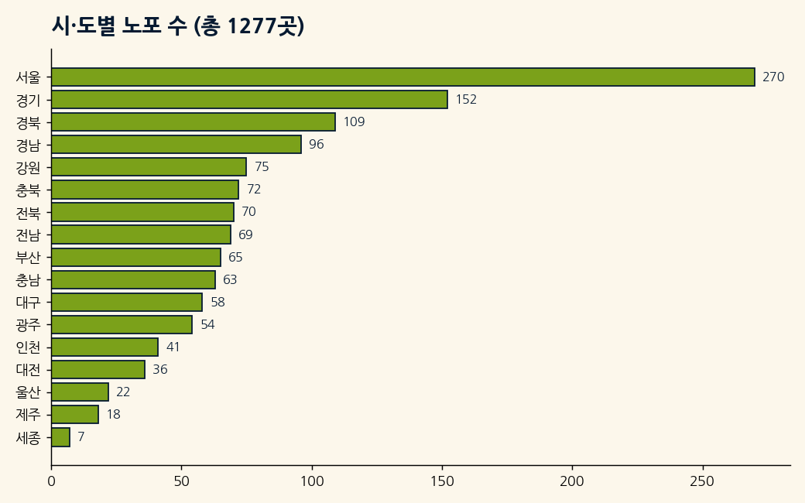</td>
<td>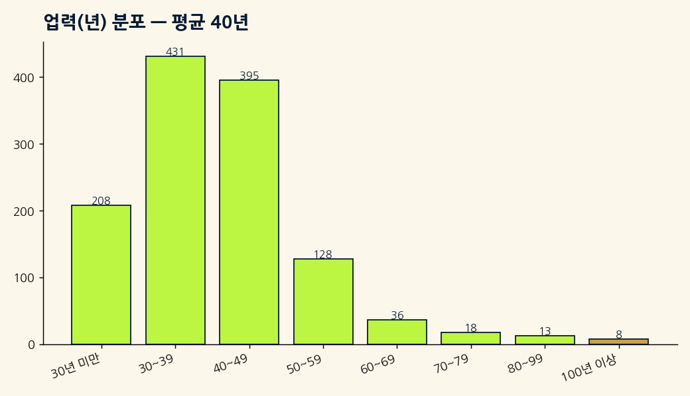</td>
</tr>
<tr>
<td>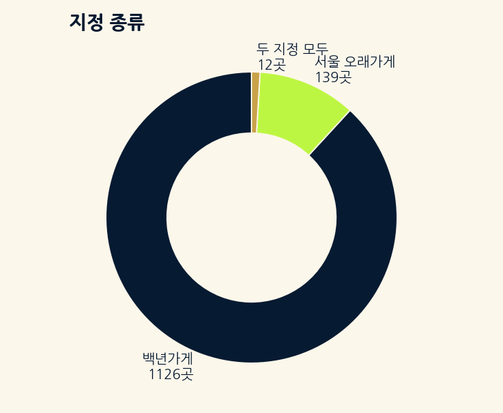</td>
<td>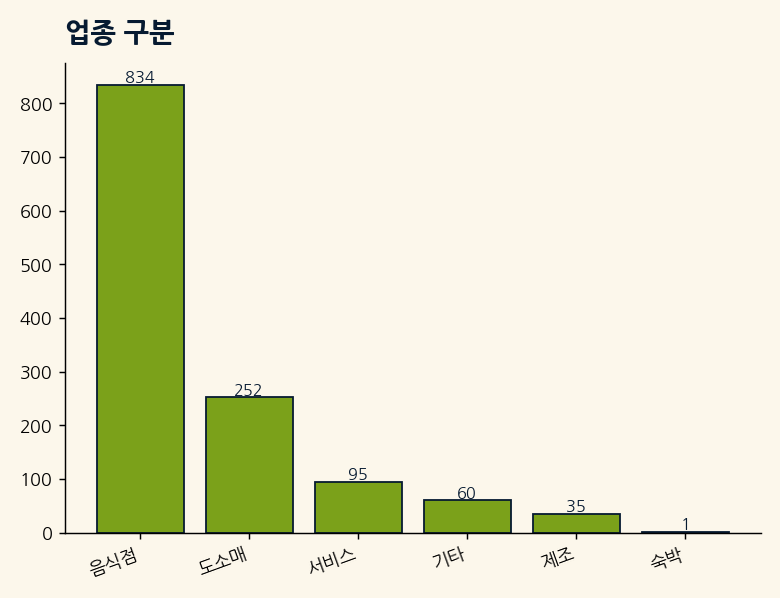</td>
</tr>
</table>

| 항목 | 값 |
|---|---|
| 전체 | **1,277곳** (백년가게 1,126 · 서울 오래가게 139 · 두 지정 12) |
| 업력 계산 | 연도 기준(올해 − 창업 연도), 업력 정보가 있는 1,237곳 평균 **약 40년**, 100년 이상 8곳 |
| 좌표 | 네이버 지오코딩으로 보강(`tools/geocode.py`) |
| 사진 | 백년가게 공식 사진 URL, 메뉴 사진은 위키미디어 CC 이미지 |

---

## 6. ⏳ 세월과 칭호 규칙

**세월 = 처음 인증한 가게의 업력(년)의 합.** 같은 가게는 한 번만 쌓입니다. 업력으로 도장 등급이 정해집니다.

| 도장 등급 | 업력 | 색 |
|---|---|---|
| 🟢 보통 | 30~49년 | 청록 |
| 🔴 붉은 | 50~99년 | 인주 빨강 |
| 🟡 금빛 | 100년 이상 | 금색 |

| 단계 | 칭호 | 필요한 세월 |
|---|---|---|
| 1 | 첫술 식객 | 0년 |
| 2 | 골목 단골 | 100년 |
| 3 | 국밥 순례자 | 200년 |
| 4 | 시장통 어르신 | 300년 |
| 5 | 가마솥 감별사 | 400년 |
| 6 | 노포 길잡이 | 500년 |
| 7 | 맛의 장인 | 600년 |
| 8 | 세월 지킴이 | 700년 |
| 9 | 미식 도인 | 800년 |
| 10 | 전설의 식객 | 900년 |
| 11 | **천년 미식가** | **1,000년** |

**계산 예시** (시연 패스포트: 15곳, 세월 737년)

| 가게 | 업력 | 누적 | 칭호 |
|---|---|---|---|
| 진미옥설농탕 | 45년 | 45 | 첫술 식객 |
| 성천막국수 | 46년 | 91 | 첫술 식객 |
| 청진옥 | 89년 | 180 | 골목 단골 |
| … 15곳 합계 | | **737년** | **미식 도인**(다음 단계까지 63년) |

---

## 7. 🧾 방문 인증 규칙

> 모든 기준값은 한 파일 `domain/rule/VerificationConfig.kt`에서만 읽습니다.

| 구분 | 영수증 인증 | 가게 사진(간판·메뉴판) 인증 |
|---|---|---|
| 위치 사용 | **사용 안 함** | GPS 사용(가게 **30m 이내**, 정확도 **30m 이하**) |
| 읽는 것 | 가게 이름 일치도 **0.70 이상**, 날짜·시간, 금액 | 가게 이름 일치도 **0.60 이상** 또는 전화번호 |
| 시간 | 결제 **24시간 이내**(미래 10분까지 허용) | — |
| 실패 | AI 촬영 도우미 안내(1.8초 안), 다시 찍기 | **3번 실패하면** "위치 확인 도장" 선택지(설정으로 끔 가능) |
| 하루 한도 | 하루 **5곳** | |
| 위치 측정 | | 최대 **10초**, 정확도 10m 이하면 일찍 종료 |
| 이미지 | **파일로 저장하지 않음** | 인증샷은 기기 안에만 보관 |

### 판정표

| 상황 | 결과 |
|---|---|
| 영수증 가게 이름 일치 0.70↑ · 24시간 이내 · 하루 5곳 이내 | ✅ 정보 확인 화면 → "확정" 누르면 도장 |
| 영수증 이름이 다르다 / 날짜를 못 읽음 | ❌ 실패 안내 + AI 촬영 도우미 → 다시 찍기 |
| 영수증 없음 → 가게와 25m, 정확도 12m, 간판 이름 0.8 | ✅ 통과 |
| 가게와 120m | ❌ "가게에서 120 m 떨어져 있어요" 큰 빨간 팝업 |
| 간판 3번 실패 + 30m 이내 + 설정 켬 | ⚠️ "위치 확인 도장" 선택 가능 |
| 오늘 이미 5곳 인증 | ⛔ "오늘은 더 인증할 수 없어요" |

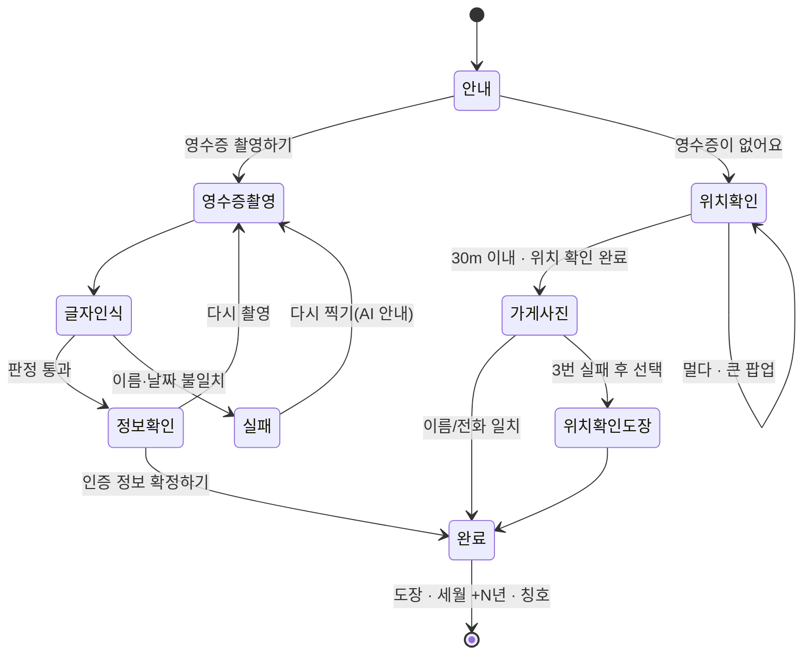

### 🎮 직접 해 보기
브라우저에서 바로 눌러 볼 수 있는 **시뮬레이터 3종**(세월·칭호, 방문 인증 판정, AI 룰렛)이 들어 있는 발표자료를 내려받아 여세요(GitHub 화면에서는 스크립트가 실행되지 않습니다).

👉 **[`노포패스포트_버전2_발표자료.html`](docs/v2/report/노포패스포트_버전2_발표자료.html)** — "Download raw file" 후 열기 · 서비스 기획 보고서에는 **월 운영비 산정기**도 있습니다 ([`서비스기획보고서.html`](docs/v2/report/노포패스포트_버전2_서비스기획보고서.html)).

---

## 8. 🤖 AI 기능

Firebase AI Logic(Gemini)을 쓰며 **앱에는 Gemini 키가 없습니다.** 처음 쓸 때 전송 동의를 받습니다.

| 기능 | 하는 일 | 속도 대책 |
|---|---|---|
| 🎰 **AI 노포 룰렛** | 지역·가격대·음식 종류·도보 거리로 후보를 좁혀 **3곳**을 고르고 AI가 추천 이유를 씁니다. **최대 30곳은 겹치지 않게** 추천 | 룰렛 화면을 열 때 AI 연결 예열, AI는 **4초까지만** 기다린 뒤 앱이 만든 이유로 대체 → 첫 응답 5초 안 |
| 💬 **AI 노포 도우미** | 말로 찾기("비 오는 날 종로 국밥"), 천년 경로 짜기, 오늘의 코스 | 후보 가게 축소, 답변 3문장 제한, "생각 중" 표시 |
| 🌐 **번역** | 가게 소개글·리뷰를 원하는 언어로 | 소개글 먼저, 리뷰는 4개씩 동시에 |
| 📷 **AI 촬영 도우미** | 인증 실패 이유와 다시 찍는 방법 | 글자 줄만 전송(영수증 사진 안 보냄), 1.8초 안에 답이 없으면 기본 안내문 |

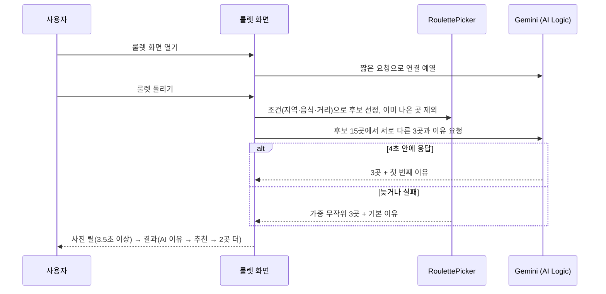

<table>
<tr>
<td align="center"><br><sub>코드로 그린 완전한 룰렛 판</sub></td>
<td align="center"><br><sub>이유 → 추천 → 2곳 더</sub></td>
<td align="center"><br><sub>AI 노포 도우미</sub></td>
</tr>
</table>

---

## 9. 🏗️ 구조

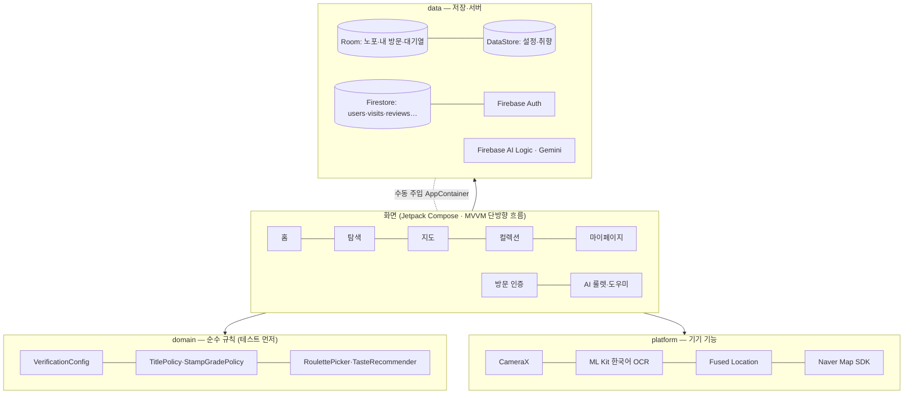

| 구분 | 기술 |
|---|---|
| 앱 | Kotlin, Jetpack Compose, MVVM + 단방향 흐름, 수동 주입(`AppContainer`) |
| 저장 | Room(노포·내 방문·전송 대기), DataStore(설정·취향), WorkManager(동기화) |
| 서버 | Firebase Authentication · Cloud Firestore · Crashlytics · AI Logic(Gemini) |
| 기기 | CameraX, ML Kit 한국어 텍스트 인식 16.0.1(앱 포함), Fused Location, 네이버 지도 SDK 3.24.0 |
| 빌드 | 패키지 `com.nopo.cheonnyeon`, minSdk 26, 릴리스 R8, **디버그·릴리스 패키지명 동일** |

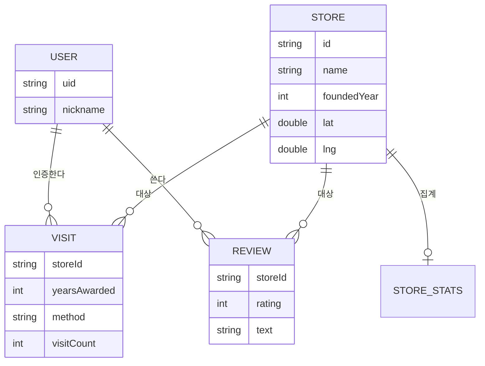

---

## 10. 🔒 개인정보와 보안 원칙

| 원칙 | 내용 |
|---|---|
| 📍 **영수증 인증은 위치를 쓰지 않는다** | 위치는 가게 사진 인증에서만 쓰고 지도에 표시만 합니다 |
| 🧾 **영수증 이미지는 저장하지 않는다** | 메모리에서만 쓰고 파일로 남기지 않습니다 |
| 🗄️ **좌표·영수증 내용은 서버에 저장하지 않는다** | 로그에도 남기지 않습니다 |
| 🔑 **키는 코드에 쓰지 않는다** | Gemini 키는 앱에 없고 Firebase가 보관, 서명 키·`google-services.json`은 저장소에 없음 |
| 🤖 **AI 전송은 동의 후** | 글·별점·음식 사진·메뉴·번역 글만, 위치·이메일은 보내지 않음 |
| 📊 **사용 데이터 수집** | 기본 켜짐(디버그 빌드는 수집 안 함), 마케팅 알림은 기본 꺼짐 |
| 📸 **카메라** | 방문 인증은 앱 안 카메라만(갤러리 금지). 리뷰 사진만 예외(최대 3장, 줄여서 문자열로 보관) |

자세히: [개인정보 안내](docs/v2/v2-privacy-notice.md)

---

## 11. 🛠️ 빌드·실행·테스트

```bash
# 빌드 (Windows PowerShell은 .\gradlew.bat)
./gradlew assembleDebug          # 디버그 APK
./gradlew assembleRelease        # 릴리스 APK(R8)
./gradlew testDebugUnitTest      # 단위 테스트
./gradlew lintDebug              # 린트
./gradlew installDebug           # 연결된 폰에 설치
adb logcat -d -v time Nopo:D AndroidRuntime:E *:S                    # 로그
adb shell monkey -p com.nopo.cheonnyeon --throttle 100 -v 5000       # 무작위 조작
```

```bash
# 데이터
python tools/build_catalog.py                  # data/nopo_stores.csv → stores.json
python tools/geocode.py --provider naver       # 좌표 보강
python tools/make_overview.py && python tools/make_flow.py   # 화면 모음·흐름도 다시 만들기
```

> 구글 로그인은 Firebase 콘솔 설정이 필요합니다 → [단계별 안내](docs/v2/google-login-setup.md)

---

## 12. 🗂️ 폴더 지도

```text
NopoCheonnyeon/
├─ app/src/main/java/com/nopo/cheonnyeon/
│  ├─ core/        designsystem(시안 복제 도구 MockKit·테마) · navigation · util
│  ├─ domain/      model · rule(인증·칭호·룰렛 규칙) · verify · catalog
│  ├─ data/        local(Room·DataStore) · remote(Firebase) · ai · visit · catalog
│  ├─ feature/     home explore map passport my store verify ai auth settings help …
│  └─ platform/    camera · ocr · location · map · permission · auth(Google)
├─ app/src/main/assets/   stores.json(1,277곳) · menu/ · demo_reviews.json
├─ app/src/test/          단위 테스트(@Test 331)
├─ design/                redesign·redesign2(시안) · brand(아이콘·로고) · stitch
├─ docs/                  기획안 · v2/(버전2 문서·캡처·보고서) · eval/(평가자료)
├─ tools/                 데이터·이미지·문서 생성 스크립트
└─ README.md
```

---

## 13. 📚 문서와 산출물

| 구분 | 파일 |
|---|---|
| 📘 **통합 개발 설계도** (기획→개발→QA 한 권) | [`노포패스포트_버전2_통합_개발설계도.md`](docs/v2/노포패스포트_버전2_통합_개발설계도.md) |
| ✅ **QA 전체 목록** | [`노포패스포트_버전2_QA_전체목록.md`](docs/v2/노포패스포트_버전2_QA_전체목록.md) |
| 🎞️ 발표자료(시뮬레이터 3종) | [`발표자료.html`](docs/v2/report/노포패스포트_버전2_발표자료.html) |
| 📖 제작기(제작 과정·시뮬레이터 7종) | [`제작기.html`](docs/v2/report/노포패스포트_버전2_제작기.html) |
| 📝 서비스 기획 보고서 | [`HTML`](docs/v2/report/노포패스포트_버전2_서비스기획보고서.html) · [`PDF`](docs/v2/report/노포패스포트_버전2_서비스기획보고서.pdf) |
| 🛠️ 만들기 가이드 | [`HTML`](docs/v2/report/노포패스포트_버전2_만들기.html) · [`DOCX`](docs/v2/report/노포패스포트_버전2_만들기.docx) |
| 📑 평가자료 | [`HTML`](docs/eval/노포패스포트_버전2_평가자료.html) · [`PDF`](docs/eval/노포패스포트_버전2_평가자료.pdf) |
| 🎨 Figma 구조도(편집 가능한 레이어) | [열기](https://www.figma.com/design/IP2EihmKnZEYYoGUKrYeYG) |
| 🧩 기획안 | [`docs/nopo-planning.html`](docs/nopo-planning.html) |
| 문서 원본 | [PRD](docs/v2/v2-01-PRD.md) · [아키텍처](docs/v2/v2-02-architecture.md) · [스토리](docs/v2/v2-03-stories.md) · [개발·QA 체크리스트](docs/v2/v2-04-dev-qa-checklist.md) · [실기기 QA](docs/v2/v2-09-real-device-qa.md) · [백로그](docs/v2/v2-11-backlog.md) · [미구현 목록](docs/v2/v2-12-unimplemented.md) · [변경 기록](docs/v2/v2-00-changes.md) · [개발 현황](docs/v2/v2-dev-status.md) · [시연 안내](docs/v2/v2-demo-guide.md) |

---

## 14. 🧪 QA 현황

| 항목 | 결과 |
|---|---|
| 단위 테스트 | `@Test` 331개(48개 파일) — 최종 점검 시 통과 |
| 린트 · 릴리스(R8) 빌드 | 통과(이전 확인), 2.0.0 릴리스 APK 빌드 |
| 실기기 | Galaxy S9+에서 화면별 눌러 보기·무작위 조작 3,000회 — 앱 꺼짐 1건(지도 로고) 수정 |
| 사용자 점검 반영 | 16건 · 8건 · 룰렛 · 최종 6건 |
| 미확인 | 폴드8 지도 탭, 처음 설치 권한 화면, 영수증 실촬영·오프라인, 접근성(48dp·TalkBack·큰 글자) |

전체 목록: [QA 전체 목록](docs/v2/노포패스포트_버전2_QA_전체목록.md) · [실기기 버튼 점검 결과](docs/v2/v2-13-device-qa.md)

---

## 15. 📝 릴리스 노트 2.0.0

- 🎨 시안 화면 전부를 앱으로 복제(1차 6 + 2차 28), 앱 이름 **노포 패스포트**·새 아이콘, 글자 크기 단계표 통일
- 🔐 간편 로그인은 **구글만**(카카오·네이버·휴대폰 가입·게스트 둘러보기 제외), 온보딩 3단계 취향 저장
- 🧾 영수증 **정보 확인 후 확정**, GPS 인증(실제 네이버 지도·큰 오류 팝업·10초 안내), 가게 사진 인증 화면 확대
- 🎰 **AI 룰렛 개편**: 완전한 원 룰렛, 큰 사진 릴, 분석 안내, 첫 응답 5초, 결과 = AI 이유 → 3곳, 30곳 비중복
- 💬 AI 도우미·번역·AI 촬영 도우미 속도 개선
- 🔔 알림 항목 이동, 홈 알림 벨, 탐색 "N년 전통" 표기·AI 버튼, 지도 AI 버튼, 설정 통계 버튼 이동
- 📖 컬렉션 여권 기울임, 권한 관리·도움말 센터, 사용 데이터 수집 기본 켜짐 안내
- 🐞 지도 로고를 눌러 앱이 꺼지던 문제 수정 외 실기기 점검 다수 수정

---

## 16. 🚧 한계와 계획

| 구분 | 내용 |
|---|---|
| ⚠️ 사용자 설정 필요 | 구글 로그인(Firebase 콘솔 + SHA 지문 + 새 `google-services.json`) |
| ⚠️ 미확인 | 폴드8 지도 탭(방어 코드만 적용), 릴리스 서명 키 SHA 등록 |
| ⚠️ 임시 | 고객센터 이메일은 임시 주소 |
| 🧩 준비 중 | 서울·친구 랭킹, 메뉴 가격대 필터(화면 선택만) |
| 📄 사용 허가 | 서울관광재단 사진·글은 서면 허가 대기(공개 배포 전 필요) |
| 🔭 계획 | 영수증 실촬영·오프라인 검증, 접근성(48dp·TalkBack), 서버 기반 랭킹, 릴리스 시작 속도 측정 |

---

## 17. 🙏 출처와 라이선스

- **노포 데이터:** 중소벤처기업부·소상공인시장진흥공단 백년가게, 서울특별시 오래가게 공개 정보. 가게 사진은 백년가게 공식 페이지 사진을 불러옵니다. 서울관광재단 사진·글은 서면 허가 후 사용 예정입니다.
- **메뉴 사진:** Wikimedia Commons(CC0 / CC BY), 저작자 표시는 앱 설정의 출처 목록과 `app/src/main/assets/menu/credits.json`에 있습니다.
- **지도:** 네이버 지도 SDK · 네이버 클라우드 지오코딩
- **글꼴:** 나눔명조 ExtraBold, Black Han Sans
- **라이브러리:** Firebase, ML Kit, CameraX, Coil, Jetpack Compose 등 각 라이선스를 따릅니다.

<p align="center"><sub>노포 패스포트 · 버전2 (2.0.0) · 세월을 맛보고, 추억을 모으다.</sub></p>
