<p align="center">
  
</p>

<h1 align="center">노포 패스포트</h1>
<p align="center"><b>세월을 맛보고, 추억을 모으다.</b><br>
전국 백년가게·서울 오래가게 1,277곳을 찾아가 <b>방문 인증 도장</b>을 모으고, 쌓인 <b>세월 1,000년</b>을 채우는 노포 여행 앱</p>

<p align="center">
  
  
  
  
  
  
  
  
</p>

> **평가 담당자께** — 한눈에 보는 순서: [① 이 앱은?](#1-이-앱은) → [② 핵심 흐름](#2-핵심-사용-흐름) → [③ 화면 갤러리](#3-화면-갤러리) → [④ 기능표](#4-기능표) → [⑤ 구조](#5-구조와-기술) → [⑥ 개인정보·안전](#6-개인정보와-안전-규칙) → [⑦ QA 현황](#9-qa-현황) → [⑧ 문서 색인](#11-문서-색인)

---

## 목차
1. [이 앱은?](#1-이-앱은) · 2. [핵심 사용 흐름](#2-핵심-사용-흐름) · 3. [화면 갤러리](#3-화면-갤러리) · 4. [기능표](#4-기능표) · 5. [구조와 기술](#5-구조와-기술) · 6. [개인정보와 안전 규칙](#6-개인정보와-안전-규칙) · 7. [데이터](#7-데이터) · 8. [빌드·실행·테스트](#8-빌드실행테스트) · 9. [QA 현황](#9-qa-현황) · 10. [이번 버전(v0.3 최종) 변경점](#10-이번-버전v03-최종-변경점) · 11. [문서 색인](#11-문서-색인) · 12. [폴더 지도](#12-폴더-지도) · 13. [한계와 로드맵](#13-한계와-로드맵) · 14. [라이선스·출처](#14-라이선스출처)

---

## 1. 이 앱은?

| | |
|---|---|
| **한 줄 정의** | 오래된 가게(노포)를 찾아가 **직접 먹고 인증**하면, 가게의 업력(년)만큼 **세월**이 쌓이는 방문 인증 여행 앱 |
| **목표 칭호** | 누적 세월 **1,000년** → "천년 미식가". 100년 단위로 칭호가 오른다 |
| **누구에게** | 노포를 좋아하지만 어디서 시작할지 모르는 사람, 지역을 돌며 기록을 모으고 싶은 사람, 외국인 친구에게 한국 노포를 소개하려는 사람 |
| **차별점** | ① 영수증 글자 인식 + 가게 사진 인증(**위치 좌표·영수증 이미지를 서버에 남기지 않음**) ② 여권을 넘겨 보는 컬렉션 ③ AI 룰렛·AI 노포 도우미 ④ 가게 소개·후기 AI 번역 |
| **데이터** | 중소벤처기업부 **백년가게** + 서울특별시 **오래가게** (1,277곳, 앱 안 JSON으로 동봉) |
| **로그인** | 이메일 + **구글** 간편 로그인(카카오·네이버·휴대폰 가입·게스트 둘러보기는 두지 않음) |

<p align="center">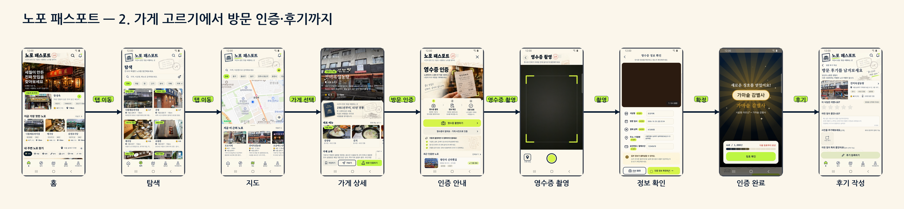</p>
<p align="center"><sub>가게 고르기 → 상세 → 방문 인증(영수증/GPS/가게 사진) → 완료 → 후기</sub></p>

---

## 2. 핵심 사용 흐름

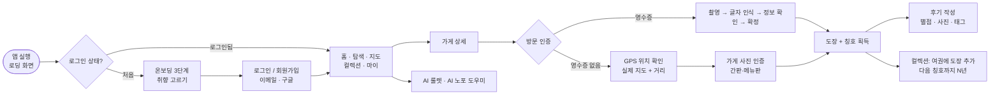

**영수증 인증은 위치를 쓰지 않습니다.** 영수증이 없을 때만 GPS 위치 확인(가게 반경 30m 안) → 가게 사진 인증으로 넘어갑니다.

---

## 3. 화면 갤러리

> 모든 화면은 `design/redesign`·`design/redesign2` 시안을 기준으로 복제했고, 폰(Galaxy S9+)에서 찍은 실제 화면입니다. 전체 개요: [`docs/v2/screens_overview/00_all_screens_8k.png`](docs/v2/screens_overview/00_all_screens_8k.png), 화면 흐름도: [`flow_1~4.png`](docs/v2/screens_overview/).

### ① 처음 실행과 로그인
<p>
  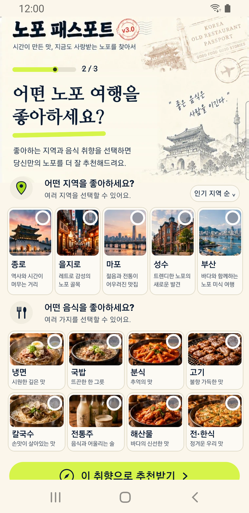 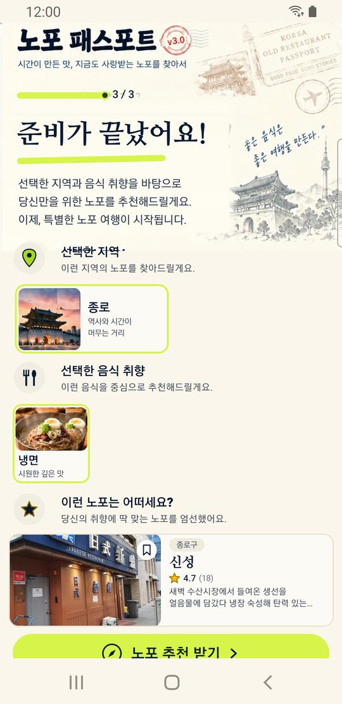  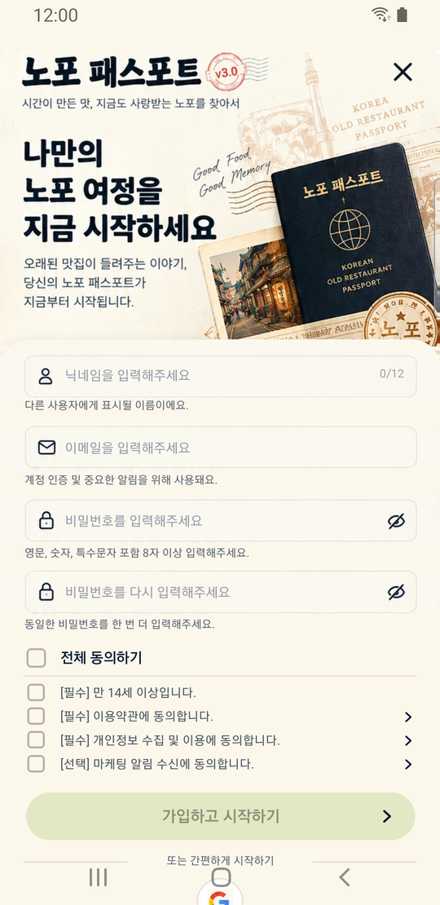
</p>

### ② 메인 탭 — 홈 · 탐색 · 지도 · 컬렉션 · 마이페이지
<p>
    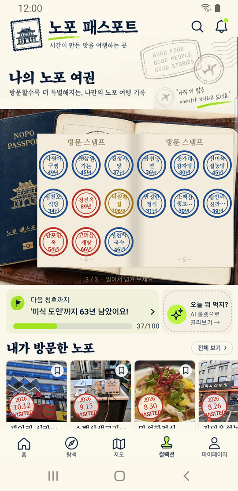 
</p>

### ③ 가게 상세 → 방문 인증 → 후기
<p>
 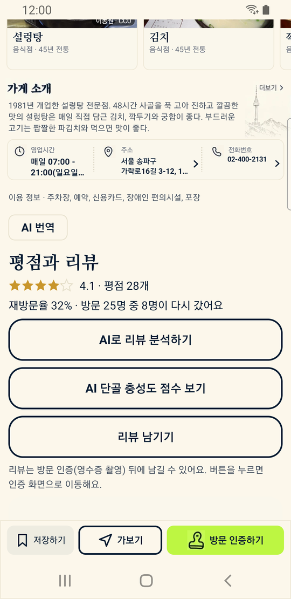  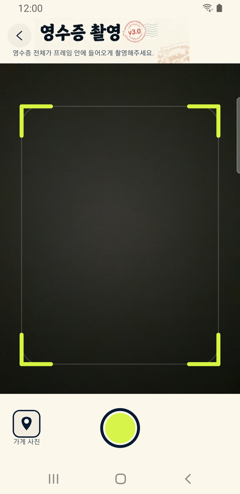  
</p>
<p>
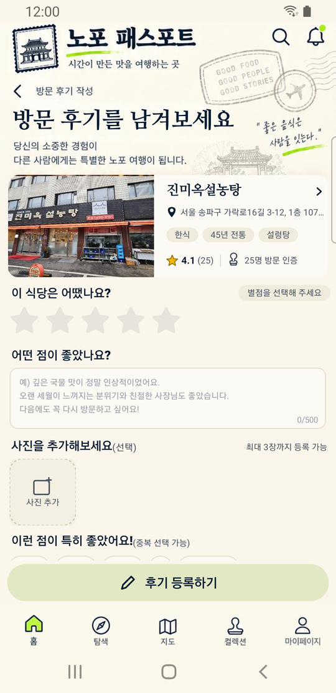 
</p>

### ④ 컬렉션 · AI · 랭킹
<p>
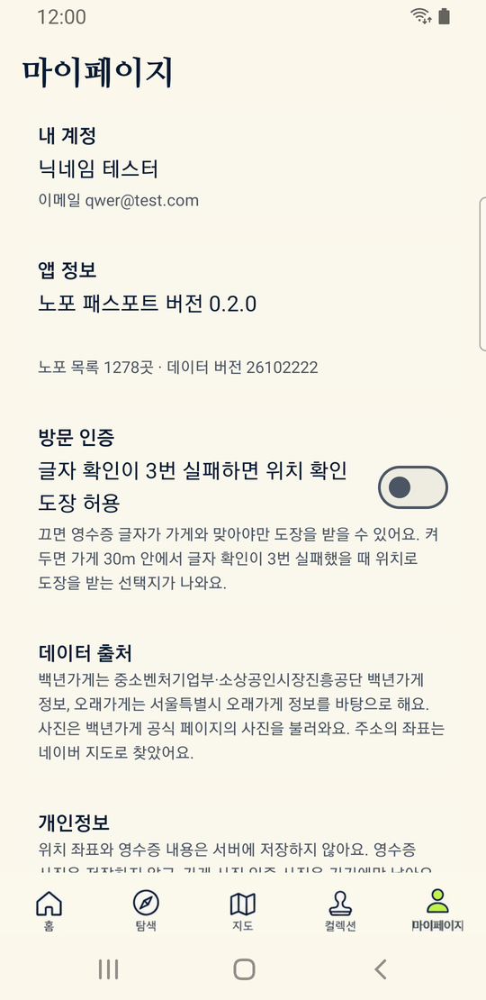 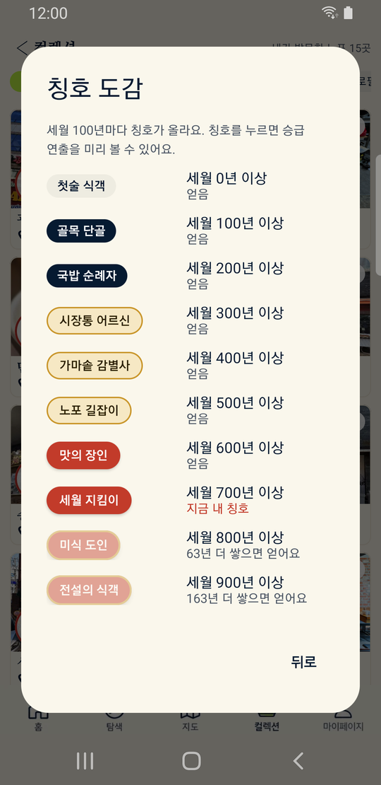 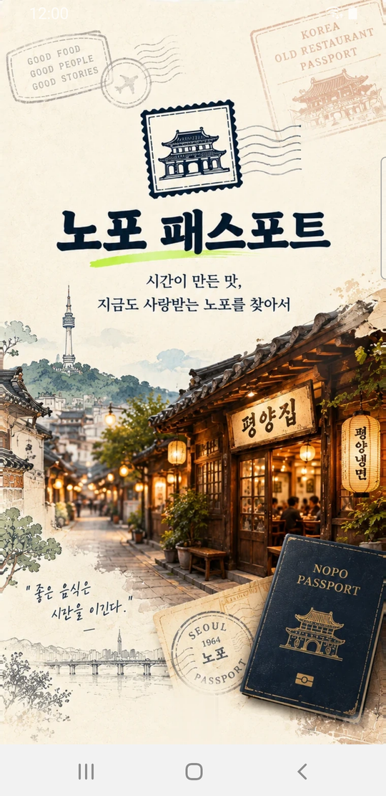   
</p>

### ⑤ 마이페이지 · 설정 · 권한 · 도움말
<p>
 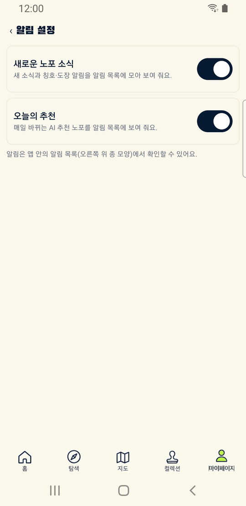    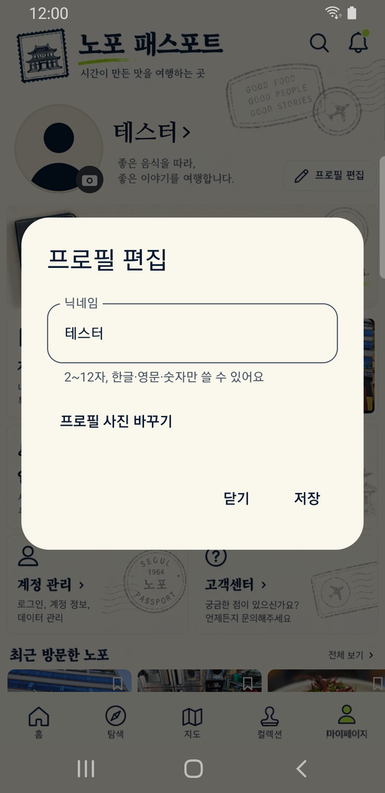
</p>

<details>
<summary><b>전체 화면 흐름도 4장 펼치기</b></summary>

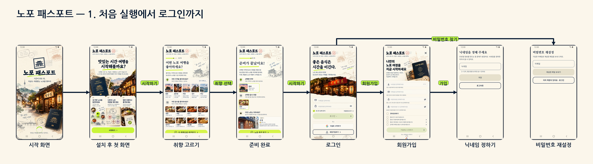

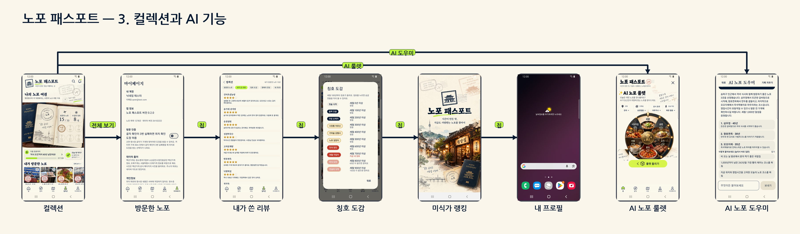
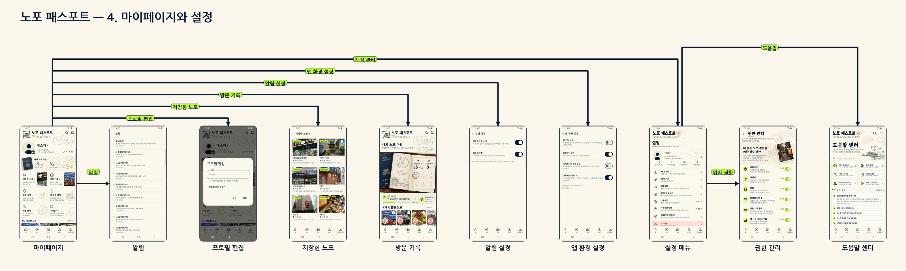

</details>

---

## 4. 기능표

| 영역 | 기능 | 상태 |
|---|---|---|
| **계정** | 이메일 가입·로그인, 비밀번호 재설정, 닉네임(중복 확인), **구글 간편 로그인**, 로그인 상태 유지, 탈퇴 | ✅ (구글은 Firebase 콘솔 설정 필요) |
| **처음 실행** | 로딩 → 온보딩 3단계(시작 → 좋아하는 지역·음식 고르기 → 취향 추천) → 로그인 | ✅ |
| **홈** | 오늘의 AI 추천(취향 반영), 지금 가장 핫한 노포, 내 주변 노포 찾기 칩 → 탐색 연동, AI 투어 코스 배너 | ✅ |
| **탐색** | 검색·음식 칩(국밥·면·고기·분식·카페)·지역 필터, 카드는 **"N년 전통"** 표기 통일, 검색창 오른쪽 **AI 원 버튼** → AI 도우미 | ✅ |
| **지도** | 네이버 지도, 내 위치, 가까운 노포 카드, 시·군·구 칩. 지도가 8초 안에 안 뜨면 목록으로 대체 | ✅ (폴드 기기 실기기 미확인) |
| **가게 상세** | 사진 넘기기, 대표 메뉴 사진(위키미디어 CC), 영업시간·주소·전화, 저장하기, 길찾기, 소개글·후기 **AI 번역**(소개글 먼저), AI 리뷰 분석 | ✅ |
| **방문 인증** | ① 영수증: 촬영 → 글자 인식(ML Kit) → **정보 확인 → 확정** ② 영수증 없음: **GPS 확인(실제 네이버 지도·거리·10초 안내)** → 가게 사진(간판·메뉴판, 확대 카메라·연두 스캔선) ③ 실패 시 **AI 촬영 도우미**(1.8초 안에, 늦으면 기본 안내) → 다시 찍기 | ✅ |
| **도장·칭호** | 업력만큼 세월 적립, 100년 단위 칭호, 지역 스탬프(시·도별), 하루 한도·중복 방지 | ✅ |
| **컬렉션** | 밀어서 넘기는 **여권 책**(배경 사진과 맞춰 기울임), 다음 칭호까지, 방문한 노포·내 리뷰·칭호 도감·명예의 전당·내 프로필 | ✅ |
| **AI 룰렛** | 지역·가격대·음식 종류·도보 거리 선택 → **큰 사진 릴이 돌아가는 연출**(분석 안내 팝업) → **AI가 추천한 이유 + 추천 노포 3곳**, 다시 돌려도 최대 **30곳 겹치지 않게** | ✅ |
| **AI 노포 도우미** | 말로 찾기·천년 경로 설계·오늘의 코스. "생각 중" 큰 글자 + 돌아가는 원 | ✅ |
| **후기** | 별점·글·사진 3장·태그, 방문 인증한 가게에만, 신고·AI 분석 | ✅ |
| **알림** | 방문 기록에서 만든 알림 목록, **누르면 가게·컬렉션·홈·마이로 이동** | ✅ |
| **마이페이지** | 프로필 사진·닉네임, 나의 노포 여정, 저장한 노포, 방문 기록, 알림 설정, 앱 환경 설정, 계정 관리, 고객센터 | ✅ |
| **권한·도움말** | 첫 실행 권한 안내, 카메라·위치·알림·사진 앨범 개별 안내, **권한 관리**, 도움말 센터(FAQ·검색·이메일 문의) | ✅ |
| **랭킹** | 미식가 랭킹(전국), 명예의 전당. 서울·친구 랭킹은 준비 중 표시 | ◐ |

---

## 5. 구조와 기술

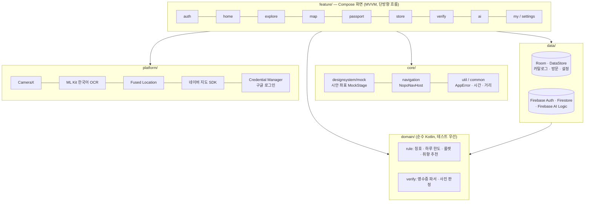

| 구분 | 사용 기술 |
|---|---|
| 언어·UI | Kotlin, Jetpack Compose, MVVM + 단방향 흐름, **수동 주입(`AppContainer`)** |
| 로컬 | Room(노포 카탈로그·방문 기록), DataStore(설정·저장하기·취향), WorkManager(동기화) |
| 서버 | Firebase Authentication(이메일·구글), Cloud Firestore(방문·후기·프로필), Crashlytics, Firebase AI Logic(Gemini, 키는 앱에 없음) |
| 지도·기기 | 네이버 지도 SDK 3.24.0(공식 MapView), CameraX, ML Kit 한국어 텍스트 인식 16.0.1(앱 포함), Fused Location, Credential Manager |
| 화면 복제 | 시안 폭 760px 기준 **`MockStage`/`Modifier.at(x, y)`** 로 좌표를 그대로 옮기고 화면 폭에 비례해 dp로 변환(600dp 초과는 가운데 정렬) |
| 글자 | 제목·가게 이름 나눔명조 ExtraBold, 글자 크기는 `snapTextPx` 단계표(18/20/22/24/26/28/30/34/40)로 통일, 시스템 글자 배율과 무관 |
| 테스트 | JUnit 단위 테스트(도메인 규칙 우선), 린트, 릴리스(R8) 빌드 |

---

## 6. 개인정보와 안전 규칙

- 🔒 **영수증 인증은 위치를 쓰지 않습니다.** 영수증 이미지는 파일로 저장하지 않고 메모리에서만 읽습니다.
- 🔒 **위치 좌표와 영수증 내용은 서버에 저장하지 않고 로그에도 남기지 않습니다.** 가게 사진 인증 사진은 이 기기에만 남습니다.
- 📷 방문 인증(영수증·가게 사진)은 **앱 안 카메라만** 사용(갤러리 선택 금지). 리뷰 사진만 예외: 카메라 또는 시스템 사진 선택기로 최대 3장, 줄여서 보관.
- 🔑 키·비밀번호를 코드나 로그에 쓰지 않습니다. AI 호출 키는 앱에 없고 Firebase 프로젝트가 보관합니다.
- ✅ AI 기능은 **동의 후** 가게 이름·리뷰 등 최소 정보만 전송합니다(위치 좌표·이메일은 보내지 않음).
- ⚙️ 사용 데이터 수집은 **기본 켜짐**(디버그 빌드는 수집 안 함), 마케팅 수신은 **기본 꺼짐**. 권한 관리 화면에서 언제든 바꿀 수 있습니다.
- 📦 디버그와 릴리스의 패키지명이 같습니다(`applicationIdSuffix` 금지).

자세한 내용: [`docs/v2/v2-privacy-notice.md`](docs/v2/v2-privacy-notice.md)

---

## 7. 데이터

| 항목 | 내용 |
|---|---|
| 노포 카탈로그 | `app/src/main/assets/stores.json` — 1,277곳(백년가게 + 서울 오래가게), 생성: `python tools/build_catalog.py` |
| 좌표 보강 | `python tools/geocode.py --provider naver\|kakao` (주소 없는 가게는 이름 검색) |
| 공식 지정 보충 | `python tools/import_official_list.py --csv 파일.csv` → `build_catalog.py` |
| 시연용 데이터 | 예시 리뷰·방문 기록(설정 > 앱 정보 5번 탭 > 개발자 도구, **시연용 패스포트 737년**), 기기 안에만 저장 |
| 메뉴 사진 | 위키미디어 공용(CC0/CC BY), `assets/menu/credits.json`, 설정의 출처 목록 |
| 원본 | `data/nopo_stores.csv`, 설명 `data/README.md` |

---

## 8. 빌드·실행·테스트

```bash
./gradlew assembleDebug            # 디버그 빌드
./gradlew assembleRelease          # 릴리스(R8) 빌드
./gradlew testDebugUnitTest        # 단위 테스트
./gradlew lintDebug                # 린트
./gradlew installDebug             # 연결된 폰에 설치
adb install -r app/build/outputs/apk/release/app-release.apk   # 릴리스 설치
adb logcat -d -v time Nopo:D AndroidRuntime:E *:S               # 로그
adb shell monkey -p com.nopo.cheonnyeon --throttle 100 -v 5000  # 무작위 조작
```
Windows PowerShell에서는 `.\gradlew.bat` 을 사용합니다. 요구사항: Android 8.0(API 26) 이상, 네이버 지도 키·Firebase 설정 파일(`google-services.json`, 저장소에는 올리지 않음).

📲 **APK 설치 안내**: [`docs/v2/v2-apk-install-guide.md`](docs/v2/v2-apk-install-guide.md) · 시연 시나리오: [`docs/v2/v2-demo-guide.md`](docs/v2/v2-demo-guide.md)

---

## 9. QA 현황

| 항목 | 결과 |
|---|---|
| 단위 테스트 | ✅ 통과 (도메인 규칙·알림·카드·룰렛·취향 추천·여권 등) |
| 린트·릴리스(R8) 빌드 | ✅ 통과 |
| 실기기 버튼 점검(Galaxy S9+) | 탭 5개·가게 상세·로그인·설정·룰렛·방문 인증을 눌러 확인, **임의 조작(monkey) 3,000회** 중 앱 종료는 지도 로고 1건(수정 완료) |
| 사용자 점검 반영 | 3차에 걸쳐 총 **24건** 수정 — 상세: [`docs/v2/v2-13-device-qa.md`](docs/v2/v2-13-device-qa.md) |
| 콜드 스타트 | 디버그 약 3.4초(목표 2.5초), 릴리스 미측정 |
| 미확인 | 폴드8 지도 탭(원인 미확인, 방어 처리만), 영수증 실촬영·오프라인 점검, 구글 로그인 실동작(Firebase 설정 대기) |

---

## 10. 이번 버전(v0.3 최종) 변경점

- **화면**: 시안 28장 전체 복제 완료, 앱 아이콘·브랜드 적용, 글자 크기 단계표 통일.
- **로그인**: 구글만 유지(카카오·네이버·휴대폰·게스트 삭제), 로그인 직후 화면 전환 지연 수정("로그인 중…" 유지).
- **AI 룰렛 개편**: 완전한 원 룰렛(코드로 그림), 큰 사진 릴, 상단 분석 안내 팝업, 첫 응답 5초 안, 결과는 AI 이유 → 추천 3곳 → 최대 30곳 비중복.
- **방문 인증 개선**: 영수증 정보 확인 단계, GPS 인증 실제 지도·팝업·10초 안내, 가게 사진 인증 카메라 확대, AI 안내 1.8초·다시 찍기 바로 촬영.
- **탐색·알림·컬렉션**: "N년 전통" 통일, AI 원 버튼, 알림에서 목적지로 이동, 여권 책 기울임, 홈 칩↔탐색 연동.
- **성능**: 번역(소개글 먼저·동시 번역), AI 도우미(후보 축소·답변 3문장), 룰렛 AI 연결 예열.
- 변경 전체 목록: [`docs/v2/v2-00-changes.md`](docs/v2/v2-00-changes.md) · [`docs/v2/v2-dev-status.md`](docs/v2/v2-dev-status.md)

---

## 11. 문서 색인

| 문서 | 내용 |
|---|---|
| [`docs/nopo-planning.html`](docs/nopo-planning.html) | 기획안(웹 문서) — 컨셉·규칙·화면 설계·데이터·기술 |
| [`docs/v2/v2-01-PRD.md`](docs/v2/v2-01-PRD.md) | 제품 요구사항(PRD) — 최신 |
| [`docs/v2/v2-02-architecture.md`](docs/v2/v2-02-architecture.md) | 구조·규칙·보안 |
| [`docs/v2/v2-03-stories.md`](docs/v2/v2-03-stories.md) | 개발 스토리 |
| [`docs/v2/v2-04-dev-qa-checklist.md`](docs/v2/v2-04-dev-qa-checklist.md) | 개발 QA 체크리스트 |
| [`docs/v2/v2-13-device-qa.md`](docs/v2/v2-13-device-qa.md) | 실기기 점검·수정 기록 |
| [`docs/v2/v2-00-changes.md`](docs/v2/v2-00-changes.md) | 시안 우선 변경 요약 |
| [`docs/v2/v2-dev-status.md`](docs/v2/v2-dev-status.md) | 개발 현황·인수인계 |
| [`docs/v2/v2-12-unimplemented.md`](docs/v2/v2-12-unimplemented.md) | 미구현·후속 목록 |
| [`docs/v2/google-login-setup.md`](docs/v2/google-login-setup.md) | 구글 로그인 설정(비개발자용 순서) |
| [`docs/v2/v2-privacy-notice.md`](docs/v2/v2-privacy-notice.md) | 개인정보 안내 |
| [`docs/v2/screens_overview/`](docs/v2/screens_overview/) | 전체 화면 개요·흐름도 이미지 |
| [`design/brand/`](design/brand/) | 앱 아이콘·로고 컨셉 |

원본(v0.2) 문서는 `docs/nopo-*.md`에 그대로 있으며, **v2와 다르면 v2가 우선**합니다.

---

## 12. 폴더 지도

```
NopoCheonnyeon/
├─ app/src/main/java/com/nopo/cheonnyeon/
│  ├─ app/            AppContainer(수동 주입), 앱 시작
│  ├─ core/           designsystem(mock 시안 좌표 키트), navigation, common, util
│  ├─ data/           local(Room·DataStore), remote(Firebase), catalog, visit, ai
│  ├─ domain/         model, rule(칭호·룰렛·취향), verify(영수증 파서)
│  ├─ feature/        auth · home · explore · map · passport · store · verify · ai · my · settings · permission · help · notifications
│  └─ platform/       camera · ocr · location · map · auth(구글) · permission
├─ app/src/main/assets/   stores.json, menu(사진·credits), demo_reviews.json
├─ app/src/main/res/      drawable-nodpi(mk_·mk2_ 시안 조각), values(strings_v2.xml)
├─ design/            redesign · redesign2 시안, brand(아이콘)
├─ docs/              v2 문서(최신), screens·screens_overview(화면 이미지), 원본 문서
├─ tools/             build_catalog · geocode · crop_mockups* · make_icon · make_overview · make_flow
├─ data/              노포 원본 CSV
└─ CLAUDE.md          작업 규칙
```

---

## 13. 한계와 로드맵

**사용자 확인·결정이 필요한 항목**
- [ ] **구글 로그인**: Firebase 콘솔에서 Google 사용 설정 + SHA 지문 등록 + 갱신한 `google-services.json` ([설정 순서](docs/v2/google-login-setup.md))
- [ ] **릴리스 서명 키 SHA**: 스토어 배포 전 Firebase에 등록
- [ ] **고객센터 이메일**: 현재 개발자 주소(`wow.sillyer@gmail.com`)를 임시 사용 → 운영 주소로 교체
- [ ] **서울관광재단 비짓서울 사진**: 전화로 활용 가능 답변만 받았고 **서면 허가 대기**(공개 배포 전 확인)
- [ ] 개인정보 처리방침에 사용 데이터 수집 기본 켜짐 문구 반영

**알려진 한계**: 폴드8 지도 탭 실기기 미확인(원인 미확인, 8초 방어 처리) · 48dp 터치 영역·TalkBack·큰 글자 보강 · 일부 한글 문구가 아직 코드에 있음 · 서울·친구 랭킹과 메뉴 가격 자료는 데이터가 없어 준비 중 · 룰렛 가격대는 화면 선택만 하고 AI 질문에만 반영 · 콜드 스타트 릴리스 미측정.

---

## 14. 라이선스·출처

- **노포 데이터**: 중소벤처기업부·소상공인시장진흥공단 *백년가게* 정보, 서울특별시 *오래가게* 정보를 바탕으로 정리. 주소 좌표는 네이버 지도 지오코딩.
- **가게 사진**: 백년가게 공식 페이지 사진을 불러와 표시. 서울 일부 사진은 **서울관광재단 비짓서울**(전화 답변 확인, **서면 허가 대기 중**).
- **대표 메뉴 사진**: 위키미디어 공용 CC0 / CC BY — 작성자·라이선스는 `app/src/main/assets/menu/credits.json`과 앱 설정의 출처 목록.
- **글꼴**: 나눔명조 ExtraBold, Black Han Sans (각 글꼴 라이선스를 따름).
- **지도·AI**: 네이버 지도 SDK, Google ML Kit, Firebase / Gemini — 각 약관을 따름.
- 앱 코드 라이선스는 저장소 소유자(`ohdangchan`)의 결정에 따릅니다.

<p align="center"><sub>© 노포 패스포트 · 시간이 만든 맛을 여행하는 곳</sub></p>
