# 노포 패스포트 — 통합 개발 설계도 (버전2)

> 문서 번호 **버전2 · 최종** · 작성 2026-10-24 · 저장소 `redesign/v1` · 앱 `versionName 2.0.0` / `versionCode 3`
> 이 문서는 `docs/nopo-planning.html`(기획안)과 `docs/nopo-01 ~ nopo-12` 번호 문서, 그리고 최신 `docs/v2/*.md`를 **한 문서로 합친 통합본**입니다.
> 기획 → 요구사항 → 구조 → 작업 단위(스토리) → 개발 → 품질 검증(QA) → 릴리스가 한 흐름으로 맞아떨어지도록, 서로 다른 내용은 **버전2 문서와 실제 코드를 기준**으로 정리했습니다.
> 번호 문서(v0.4 기준) 원문은 "옛 원문"으로 남겨 두었고, 각 절 맨 위의 **버전2 반영 메모**가 최신 상태입니다.

## 이 문서를 읽는 법

```
기획안 ─▶ 제품 요구사항 ─▶ 시스템 구조 ─▶ 개발 작업 단위 ─▶ 개발·품질 점검표 ─▶ 실제 휴대폰 검증 ─▶ 릴리스
 (왜·무엇)   (FR-… 요구사항)   (어떻게 만드나)   (스토리 E0~E10, V2-01~12)   (자동 검증+체크)      (QA 전체 목록)       (2.0.0)
     └──────────────── 사전 점검표 · 기술 사전 검증 · 서버 연동 · AI 도구 지침 · 디자인 대응표 ────────────────┘
                                     └─ 후속 개선 목록 · 구현 보류 항목서 · 개인정보 안내 · 개발 현황 · 변경 기록 ─┘
```

| 읽는 순서 | 절 | 한 줄 설명 | 원래 문서 |
|---|---|---|---|
| 1 | 1. 기획안 | 왜 만드는가, 누가 쓰는가, 무엇을 약속하는가 | `nopo-planning.html` |
| 2 | 2. 제품 요구사항 정의서 | 기능마다 번호(FR-…)와 통과 기준 | `nopo-01-PRD.md` / `v2-01-PRD.md` |
| 3 | 3. 시스템 구조 설계서 | 폴더·계층·데이터·보안 규칙 | `nopo-02-architecture.md` / `v2-02-architecture.md` |
| 4 | 4. 개발 작업 단위 명세서 | 스토리와 완료 기준(AC) | `nopo-03-stories.md` / `v2-03-stories.md` |
| 5 | 5. 개발 및 품질 점검표 | 테스트 번호표와 자동·실기기 점검 | `nopo-04-dev-qa-checklist.md` / `v2-04-…` |
| 6 | 6. 사전 준비 점검표 | 개발 전에 사람이 확인할 것 | `nopo-05-precheck-checklist.md` |
| 7 | 7. 핵심 기술 사전 검증 계획서 | 1일차 기능 검증(스파이크) | `nopo-06-spike-plan.md` |
| 8 | 8. 서버·인증 연동 설정서 | Firebase, 구글 로그인 설정 | `nopo-07-firebase-setup.md`, `google-login-setup.md` |
| 9 | 9. AI 개발 도구 운영 지침서 | Claude Code 작업 방식 | `nopo-08-claude-code-guide.md` |
| 10 | 10. 실제 휴대폰 품질 검증서 | 실기기 QA 전체 목록과 점검 결과 | `nopo-09-real-device-qa.md` / `v2-09`, `v2-13` |
| 11 | 11. 디자인 시안 구현 대응표 | 시안 ↔ 화면 구현 | `nopo-10-stitch-implementation-map.md` |
| 12 | 12. 후속 개선 목록 | 알려진 결함·요청 | `nopo-11-backlog.md` / `v2-11-backlog.md` |
| 13 | 13. 구현 보류·미완료 항목서 | 남은 일 | `nopo-12-unimplemented.md` / `v2-12-…` |
| 14~17 | 개인정보·개발 현황·변경 기록·릴리스 | 최종 상태와 설치·시연·롤백 | `v2-privacy-notice`, `v2-dev-status`, `v2-00-changes`, `v2-apk-install-guide` 외 |
| 18 | 추적표 | 기획 → 요구사항 → 스토리 → QA → 상태 | 이 문서 |

### 이 버전(버전2)의 한눈 요약
- **앱:** 노포 패스포트 — 전국 백년가게·서울 오래가게 **1,277곳**에서 방문 인증 도장을 모아 세월 **1,000년**을 채우는 Android 앱 (Kotlin · Jetpack Compose · MVVM · Room · DataStore · Firebase Auth/Firestore/AI Logic · 네이버 지도 · CameraX · ML Kit)
- **로그인:** 이메일 + **구글만** (카카오·네이버·휴대폰 가입·게스트 둘러보기 제외), 구글은 Firebase 설정 후 동작
- **처음 실행:** 로딩 → 온보딩 3단계(시작 → 지역·음식 취향 → 준비 완료) → 로그인
- **방문 인증 3종:** 영수증(위치 미사용·이미지 미저장·확인 후 확정) / GPS(실제 지도·10초 측정) / 가게 사진(간판·메뉴판)
- **AI 룰렛:** 코드로 그린 완전한 원, 큰 사진 릴, 첫 응답 5초 이내, 결과는 AI 이유 → 추천 + 2곳, 최대 30곳 비중복
- **AI 도우미·번역:** 후보 축소·3문장, 소개글 먼저 번역
- **화면:** 시안 34장을 같은 모양으로 복제(좌표 기반 무대), 앱 아이콘(로고 컨셉 5), 홈 알림 벨, 탐색 "N년 전통" + AI 원 버튼, 지도 AI 버튼, 설정 통계 4버튼, 서브 화면 굵은 글꼴
- **검증:** 단위 테스트 통과(`@Test` 331개), 린트·릴리스(R8) 빌드 통과, Galaxy S9+ 실기기 점검, 릴리스 `2.0.0`


---

## 1. 기획안 (제품 기획서) — 왜 만들고 누가 쓰며 무엇을 약속하는가

> 버전2 반영 메모: 아래 기획안은 2026-10-23 버전2 기준으로 정리된 `docs/nopo-planning.html`을 그대로 옮긴 것입니다. 맨 앞 "최종 개발 상태" 표가 기획이 앱이 된 결과입니다.

기획안 버전2 (최종) · 2026.10.23 · ANDROID · KOTLIN · APK

### 노포 패스포트 기획안 — 버전2 (최종) · 구 노포 천년 미식가

내가 먹어 온 노포의 세월을 모아 천 년을 채우는 안드로이드 미식 패스포트. 이번 버전은 APK를 폰에 설치했을 때 모든 기능이 버그 없이 도는 것을 최우선으로 다시 설계했습니다.
- 최종 개발 상태
- 완성도 목표
- 컨셉
- 사용자
- 세월 규칙
- 화면 설계
- 디자인
- 1일차 검증
- 노포 데이터
- 방문 인증
- 계정·서버
- 평점·리뷰
- 지도 SDK
- 백엔드
- 아키텍처
- Claude Code
- BMAD
- UX 도구
- 추가 기획
- 개발 문서
- 일정
- 범위
- 위험
- 체크리스트
- 결정
- **가입·로그인**이메일과 닉네임으로 시작
- **발견**전국 노포 1,277곳 지도
- **방문 인증**영수증, 안 되면 30m 안 가게 사진
- **도장·세월**업력만큼 세월 적립, 1,000년이면 칭호
- **평점·리뷰**다녀온 사람만 평점
- **미식가 프로필**남의 칭호·다녀온 노포·평점

442/ 1,000년 · 내 세월 (예시)
업력 40년 가게 25곳이면 1,000년
  100 300 600 1,000
 노포 데이터 백년가게 1,139곳서울 오래가게 173곳 → 창업연도로 업력 계산   버전2의 흐름입니다. 처음부터 계정(이메일 또는 구글)으로 로그인하고, 인증한 가게에만 평점을 남기며, 다른 미식가의 칭호와 다녀온 노포를 볼 수 있습니다.

버전2 최종 (2026-10-23)

#### 최종 개발 상태: 기획이 앱이 되었습니다

초기 기획의 목표(폰에 설치해 모든 기능이 버그 없이 도는 APK)를 이어, 마지막 주에는 **시안 그대로의 화면**과 **AI 기능의 속도·완성도**, **방문 인증의 사용성**을 끌어올렸습니다. 아래가 본문과 다르면 이 절이 맞습니다.
 ************************************************************

| 영역 | 초기 기획 | 버전2 최종 |
|---|---|---|
| 앱 이름·화면 | 노포 천년 미식가라는 이름, 기본 화면 | 노포 패스포트, 시안(design/redesign·redesign2 28장)을 좌표 그대로 복제, 앱 아이콘·브랜드 적용, 글자 크기 단계표 통일 |
| 로그인 | 이메일 + 게스트 둘러보기 | 이메일 + 구글만. 카카오·네이버·휴대폰 가입·게스트 삭제. 처음 실행은 온보딩 3단계(취향 고르기) |
| 홈·탐색 | 목록 중심 | 오늘의 AI 추천(취향 반영), 내 주변 칩 → 탐색 칩 연동, 카드는 "N년 전통" 통일, 검색창 AI 원 버튼 |
| 방문 인증 | 영수증 → 즉시 도장 / 30m 사진 | 영수증 정보 확인 → 확정, 영수증 없음: GPS(실제 지도·거리·10초 안내) → 가게 사진(확대 카메라·연두 스캔선), 실패 시 AI 촬영 도우미 2초 안 |
| 컬렉션 | 패스포트 목록 | 밀어서 넘기는 여권 책(배경 사진과 같은 각도), 칭호 도감, 명예의 전당, 시연 패스포트 737년 |
| AI | 메뉴 룰렛, 챗봇 | AI 노포 룰렛: 완전한 원 판, 큰 사진 릴, 분석 안내 팝업, 첫 응답 5초 안, 결과 AI 이유 → 3곳 → 최대 30곳 비중복 · AI 노포 도우미 속도 개선 · 소개글 먼저 번역 |
| 알림·권한·도움말 | 알림 목록만 | 알림을 누르면 가게·컬렉션·홈·마이로 이동, 권한 관리, 도움말 센터(이메일 문의) |
| 개인정보 | 분석 동의 기본 꺼짐 | 사용 데이터 수집 기본 켜짐(디버그 제외), 마케팅 기본 꺼짐. 영수증 미저장·위치 미저장 원칙은 그대로 |
| 검증 | 단위 테스트 293개 | 단위 테스트·린트·릴리스(R8) 빌드 통과, 실기기(S9+) 점검과 사용자 점검 24건 반영, 임의 조작 3,000회 |

화면 이미지와 흐름도는 `docs/v2/screens`, `docs/v2/screens_overview`에 있고, 저장소 첫 화면(README)에서 한눈에 볼 수 있습니다. 최신 요구사항은 `docs/v2/v2-01-PRD.md`, 구조는 `v2-02-architecture.md`입니다.

**아직 남은 것** — 구글 로그인 Firebase 설정(사용자), 릴리스 서명 키 SHA 등록, 고객센터 운영 주소, 서울관광재단 비짓서울 사진의 **서면 허가**, 폴드8 지도 탭 실기기 확인, 48dp 터치 영역·TalkBack.

완성도 목표 · 버전2의 출발점

#### 최우선 목표: 폰에서 버그 없이 도는 APK

버전2는 출시보다 **완성도**를 앞에 둡니다. Google Play 등록은 다음 버전으로 미루고, APK를 폰에 설치했을 때 기획한 모든 기능이 실제로 도는 것을 첫 번째 목표로 삼았습니다. 그래서 개발 첫날 오전을 실기기 기능 검증에 쓰고, 마지막 하루를 실기기 QA에 씁니다.
   붉은 상자가 모든 결정의 기준입니다. 나머지 일곱 가지 변화는 모두 이 목표를 위한 것입니다.

| 성공 기준 | 측정 방법 |
|---|---|
| 1일차 오전 기능 검증 5종(지도·카메라·한국어 OCR·위치·Firebase) 통과 | 실기기 2대, 검증 체크리스트 |
| 릴리스 서명 APK에서 핵심 시나리오 8개 통과 | 가입부터 리뷰·프로필까지 실제 노포에서 |
| 크래시 0, 응답 없음(ANR) 0 | Crashlytics, 무작위 조작 테스트 5,000회 |
| 가입부터 첫 도장까지 3분 이내 | 테스트 사용자 3명 |

Concept

#### 한 줄 정의와 차별점

노포 패스포트는 내가 먹어 온 세월을 모으는 앱입니다. 별점 대신 업력을 점수로 씁니다. 1964년에 문을 연 설렁탕집에 가면 62년이, 1990년에 문을 연 분식집에 가면 36년이 내 패스포트에 쌓입니다. 합계가 1,000년이 되면 ‘천년 미식가’ 칭호를 받습니다.

맛집 앱이 “어디가 맛있나”에 답한다면, 이 앱은 “나는 지금까지 얼마나 오래된 맛을 먹어 봤나”에 답합니다. 평점과 리뷰도 남길 수 있지만, **그 가게를 방문 인증한 사람만** 남길 수 있습니다. 그래서 이 앱의 평점은 “실제로 다녀온 사람의 평가”입니다.
   오른쪽 위가 비어 있다는 가설이 이 기획의 출발점입니다.
**제안**앱 이름은 ‘노포 패스포트’로 확정했고(구 노포 천년 미식가), 도장 속에 千年(천년) 문양을 넣어 이름과 보상을 하나로 묶습니다.

Users

#### 사용자와 사용 순간

처음에는 세 부류를 떠올리되, 이번 APK는 ‘노포 탐방러’ 한 부류에 맞춥니다.
 **** **** ****

| 사용자 | 상황 | 원하는 것 | 앱이 주는 것 | 우선순위 |
|---|---|---|---|---|
| 노포 탐방러20~30대 (가설) | 주말에 새로운 노포를 찾아다닌다 | 가 본 곳을 모으고 자랑하고 싶다 | 도장, 칭호, 공유 카드 | 첫 버전 |
| 단골 기록러40~50대 (가설) | 오래 다닌 가게가 있다 | 나만의 단골집을 남기고 싶다 | 재방문 횟수, 단골 배지 | 다음 버전 |
| 타지·외국인 방문객 | 여행 중 현지 노포를 찾는다 | 믿을 수 있는 노포 목록 | 공식 인증 표시, 영어 설명 | 이후 |

   설렘이 가장 높은 순간은 식후의 도장입니다. 이 순간에 연출 비용을 집중합니다.

Core loop

#### 핵심 규칙: 세월을 모은다
- 방문 인증 1회에 그 가게의 업력(올해 − 개업연도)만큼 세월이 쌓입니다.
- 같은 가게는 처음 한 번만 세월을 올리고, 다시 가면 단골 횟수만 늘어납니다.
- 가게가 문을 닫아도 이미 쌓은 세월은 그대로 남습니다.
- 노포의 기준은 업력 30년 이상으로 둡니다. 공공 인증 제도의 기준과 같습니다.
- 창업연도를 모르는 가게는 업력 30년(공식 지정 최소 기준)으로 계산하고 “업력 확인 중”으로 표시합니다.
   칭호는 5단계입니다. 숫자는 초안이며 시드 데이터의 평균 업력을 본 뒤 조정합니다.

##### 도장 등급은 업력으로 정합니다

**일반 도장**업력 30~49년

**붉은 도장**업력 50~99년

**금빛 도장**업력 100년 이상
**제안**세월 합계는 가게마다 올해가 바뀌면 1년씩 늘어납니다. 이미 적립한 값은 인증한 날의 업력으로 고정하는 안을 기본으로 둡니다. 계산이 단순해지고 기록이 흔들리지 않습니다.

UX flow

#### 화면 설계: 세 번 눌러 도장까지

수집 흐름의 핵심 화면은 다섯 개입니다. 지도에서 핀을 누르면 상세, 상세에서 인증, 인증이 끝나면 도장 연출, 마지막에 패스포트로 이어집니다. 주요 버튼은 모두 화면 아래쪽 엄지 영역에 둡니다. 로그인·리뷰·프로필 화면은 ‘평점·리뷰와 다른 미식가의 프로필’ 장에 있습니다.
   가게 이름과 숫자는 예시입니다. 모든 화면이 한 손 엄지 범위 안에서 끝나도록 배치했습니다.

| UX 원칙 | 적용 방식 |
|---|---|
| 세 번 안에 인증 | 지도 핀 → 상세 → 인증하기. 중간에 로그인이나 설문을 끼우지 않습니다. |
| 보상을 먼저 보여 주기 | 상세 화면에 “인증하면 세월 +62년”을 먼저 노출해 눌러 볼 이유를 만듭니다. |
| 빈 상태도 설계 | 아직 비어 있는 도장 칸은 점선으로 두고 “다음에 갈 노포 자리”라는 문구를 붙입니다. |
| 한 손 조작 | 주요 버튼은 화면 하단 3분의 1 안에 둡니다. |
| 읽기 쉬운 글자 | 본문 14sp 이상, 글자와 배경 대비 4.5:1 이상을 기준으로 삼습니다. |

Visual design

#### 디자인 시스템: 골목 간판과 인주

오래된 가게 간판의 청록 법랑, 종이 영수증의 회녹색 바탕, 도장의 붉은 인주를 기본 색으로 삼습니다. 붉은색은 도장과 핵심 버튼에만 쓰고, 나머지 화면은 청록과 종이 톤으로 차분하게 둡니다.

**간판 청록**`#17504A`상단 바, 칭호 배너
**포인트 청록**`#1F6B63`기본 버튼, 링크
**인주 빨강**`#C23B2A`도장, 인증 버튼
**놋쇠 노랑**`#D9A22C`금빛 도장, 보상
**종이 바탕**`#EDF0EA`화면 배경
**카드 면**`#F8F9F5`시트, 카드  다크 모드는 같은 이름의 색을 어둡게 바꿔 한 벌 더 준비합니다. 안드로이드 화면에서는 Material 3의 색 역할(primary, secondary, surface)에 이 값을 연결합니다.

##### 글꼴과 움직임

DISPLAY · Black Han Sans62년 업력 숫자와 칭호에만 사용
BODY · Noto Sans KR예시 설렁탕 1964년 개업 · 서울 중구 본문과 버튼 글자
DATA · JetBrains Mono442 / 1,000 게이지, 거리, 횟수 같은 숫자

| 요소 | 규격 | 이유 |
|---|---|---|
| 도장 찍는 모션 | 380ms · 크게 시작해 살짝 튕기며 안착 | 앱의 가장 큰 보상 순간입니다. 짧고 묵직해야 합니다. |
| 숫자 올라가기 | 600ms · 380 → 442 | 적립이 눈으로 확인되어 성취감이 생깁니다. |
| 진동 | 도장이 닿는 순간 1회, 가볍게 | 소리 없이도 도장 느낌을 줍니다. |
| 여백과 모서리 | 8dp 단위 · 카드 16dp 둥글기 | 간격이 일정해야 화면이 정돈되어 보입니다. |
| 터치 영역 | 최소 48dp | 안드로이드 접근성 기본 권장 크기입니다. |

Day 1 morning

#### 1일차 오전: 빈 앱으로 실기기 기능 검증

본 개발에 들어가기 전에 빈 앱 하나에 **지도·카메라·한국어 글자 인식·위치**만 넣고 실제 폰에서 도는지 확인합니다. 이 네 가지는 기기마다 다르게 동작하고, 나중에 문제가 드러나면 고치기 가장 비싼 부분입니다. 이때 만든 화면은 버리지 않고 최종 앱의 **진단 화면**으로 남깁니다. 계정과 서버는 처음부터 쓰기 때문에 **Firebase 가입·로그인·DB 왕복**도 같은 날 오전에 실기기에서 확인합니다.
   각 항목은 Claude Code에 그대로 붙여 넣을 요청문과 통과 기준이 `nopo-06-spike-plan.md`에 있습니다.
 ************************`

| 항목 | 통과 기준 (요약) | 실패하면 |
|---|---|---|
| 지도 | 5초 안에 지도 표시, 인증 오류 없음, 마커 1,000개에서 끊김 확인, 회전·앱 전환 후 정상 | 401 패키지명 / 429 Dynamic Map 미선택 / 800 키 미지정 확인, 그래도 안 되면 카카오맵으로 같은 시험 |
| 카메라 | 미리보기 1초, 사진 방향 정상, 권한 거부·“다시 묻지 않음” 처리 | 생명주기 바인딩, 해상도 낮추기 |
| 한국어 OCR | 영수증의 상호·전화·결제일시, 간판 이름이 인식됨. 3초 이내, 비행기 모드에서도 동작 | 한국어 모델 의존성, 사진 회전, 더 가까이·밝게 |
| 위치 | 실외·실내·실제 노포 문 앞 정확도 기록, 모의 위치 감지, 15초 후 측정 중지 | 측정값을 기록하고 30m 기준 유지 여부 결정 |
| Firebase | 테스트 계정 가입·로그인, Firestore 쓰기·읽기 왕복 2초 이내, 비행기 모드에서 쓴 값이 복귀 후 반영 | google-services.json 패키지명, 이메일 로그인 사용 설정, 보안 규칙 게시 확인 |
| 릴리스 APK | R8을 켠 릴리스 APK에서도 다섯 기능 동작, 서명 키가 없으면 디버그 키로 서명돼 설치됨 | SDK별 keep 규칙 추가 |

Q1 · Data · collected 2026-10-18

#### 노포 데이터: 전국 백년가게와 서울 오래가게

소상공인마당에 소개 페이지가 있는 백년가게 1,139곳은 목록과 상세(창업일·소개·영업시간·이용정보)를 **전부** 수집했고, 서울시 오래가게는 선정 발표 자료를 회차별로 모았습니다. 공식 지정리스트(공공데이터포털, 2026-08-20 기준)는 1,511행이라 소개 페이지가 없는 가게가 더 있습니다. 이 CSV는 이 작업 환경에서 내려받을 수 없어, 개발 컴퓨터에서 내려받아 `tools/import_official_list.py`로 대조하면 빠진 가게가 카탈로그에 더해집니다(이름·주소·전화, 창업연도는 미상이라 업력 30년).

**1,139**백년가게 (소상공인마당)
**751**그중 음식점업
**1,139**상세 정보 수집
**1,139**창업일 확보
**173**서울 오래가게
**0**좌표 (보강 전)
 `

| 공개 자료 | 담긴 것 | 가게 수 | 이 기획에서 쓰는 곳 |
|---|---|---|---|
| 소상공인마당 백년가게 목록·상세 | 이름, 업종, 주소, 전화, 창업일, 소개, 영업시간, 이용정보 | 1,139 | 카탈로그 본체 (전부 수집) |
| 공공데이터포털 백년가게 지정리스트 CSV | 연번, 업체명, 업체주소, 연락처 (4열) | 1,511행 | 빠진 가게 보충: tools/import_official_list.py |
| 서울시 오래가게 선정 발표·미디어허브 | 회차별 가게명, 업종, 창업연도, 대표 품목 | 173 / 175 | 오래가게 카탈로그 |
| 서울시 오래가게 누리집 | 가게별 소개·주소 | - | 이 작업 환경에서 접속되지 않음 → 주소는 좌표 보강 때 이름 검색으로 |
| 영문 위키백과 Oraegage 표 | 영문 가게명·업종 (2022년경 107곳) | - | 2017 회차 대조, 폐업 추정 |

   연한 막대 = 전체 진한 막대 = 음식점업 서울 오래가게는 이 그래프에 포함하지 않았습니다.
   1980~90년대 창업이 가장 많습니다. 소상공인마당의 창업일은 현재 사업자 기준이라 2000년 이후 날짜는 대를 이으며 다시 등록한 날짜로 보입니다. 소개글에 더 이른 창업연도가 있으면 그 연도를 썼고, 그래도 업력이 30년 미만으로 나오는 207곳은 앱에서 30년(지정 최소 기준)으로 계산합니다. 노란 막대는 1960년 이전입니다.
 ************

| 서울 오래가게 선정 회차 | 발표 | 수집 |
|---|---|---|
| 2017 종로·을지로 | 39 | 37 |
| 2018 서북권 | 26 | 26 |
| 2019 서남권 | 22 | 22 |
| 2020 동북권 | 21 | 21 |
| 2021 동남권 | 13 | 13 |
| 2024 도심권(중구·종로구 음식점 등) | 24 | 24 |
| 2025 서북권 음식점 | 15 | 15 |
| 2026 동북권 음식점 | 15 | 15 |
| 합계 | 175 | 173 |

2017년 첫 회차는 한글 명단 원문을 찾지 못해 39곳 중 2곳은 이름을 확인하지 못했습니다. 서울시는 2026년 9월 발표에서 현재 오래가게를 누적 150곳으로 안내했고, 앱 카탈로그의 오래가게는 폐업 의심·상호 미확인을 뺀 151곳입니다.

| 가장 오래된 백년가게 | 지역 | 창업 | 업력 |
|---|---|---|---|
| 경방루 | 전북 | 1909 | 117년 |
| 황산옥 | 충남 | 1915 | 111년 |
| 야래향 | 경남 | 1930 | 96년 |
| 주식회사 예향 | 전남 | 1930 | 96년 |
| ㈜한일관 | 서울 | 1939 | 87년 |
| 복화루 | 인천 | 1945 | 81년 |
| 남창문구사 | 인천 | 1945 | 81년 |
| 태화루 | 경남 | 1947 | 79년 |

   지도는 기본으로 음식점만 보여 주고, 필터로 전체 노포를 볼 수 있습니다.

 `

| 파일 | 내용 |
|---|---|
| data/nopo_stores.csv | 통합 카탈로그 1,300행: 가게명, 별칭(영수증·간판 대조용), 지정 제도, 업종, 시도·시군구, 주소, 전화, 창업일·창업연도와 출처, 현재 업력, n대째, 대표 메뉴, 영업시간, 이용정보, 홈페이지, 소개 요약, 출처 URL, 좌표, 데이터 상태 표시 |
| data/nopo_stores.db | 같은 내용의 SQLite (DB Browser 등으로 열람) |
| app/src/main/assets/stores.json | 앱이 첫 실행에 Room으로 적재하는 카탈로그 |
| data/raw/ | 수집 원본(JSON Lines)과 오래가게 발표 회차 정보 |

**알아 둘 점**소개글은 수집 도구가 원문을 짧게 요약한 문장이라 그대로 인용하지 않았습니다. 출시 전에는 가게별로 다시 쓰거나 출처를 함께 표시합니다. 창업연도가 비어 있는 가게는 앱에서 업력 30년으로 계산합니다. 상세 정보가 빠진 가게는 `tools/crawl_baeknyeon.py --only-missing`으로 컴퓨터에서 보충할 수 있습니다. 서울 오래가게 중 한글 상호를 확인하지 못했거나 폐업이 의심되는 22곳은 CSV에만 두고 앱 카탈로그(1,277곳)에서는 뺐습니다. 주소가 없는 오래가게는 좌표 보강 때 카카오 이름 검색으로 찾고 표시를 붙입니다.

Q6 · Verification

#### 방문 인증: 영수증 먼저, 안 되면 30m 안 가게 사진

요청하신 규칙 그대로입니다. **영수증 인증은 위치를 전혀 쓰지 않고**, 영수증이 없거나 인식되지 않을 때만 위치를 확인합니다. 가게에서 30m 안에 있으면 간판·메뉴판·출입문처럼 **가게 이름이나 전화번호가 보이는 사진**으로 대신 인증합니다.
   영수증 이미지는 판정 직후 메모리에서 지우고, 가게 사진은 기기에만 인증샷으로 남깁니다. 위치 좌표는 서버에 보내지 않습니다.

##### 왜 정확도도 30m 이하여야 하나

폰이 알려 주는 위치에는 “이 반경 안에 있을 확률이 약 68%”라는 정확도 값이 붙습니다. 정확도가 ±80m인 값으로 “가게에서 25m”라고 판정하면 실제로는 100m 밖일 수도 있습니다. 그래서 거리 30m와 정확도 30m를 함께 만족할 때만 판정하고, 둘 다 화면에 숫자로 보여 줍니다. 1일차 기능 검증에서 실제 노포 문 앞 측정값을 기록해 이 기준이 현장에서 통과되는지 먼저 확인합니다.
 `

| 설정값 (VerificationConfig) | 값 | 근거 |
|---|---|---|
| 영수증 결제일시 허용 | 24시간 | 당일 방문 인증 |
| 영수증 상호 유사도(전화가 없거나 맞지 않을 때) | 0.70 | 법인명·띄어쓰기 차이 흡수 |
| 사진 인증 거리 / 정확도 | 30m / 30m | 사용자 지정 거리 + 판정 신뢰도 |
| 사진 글자 유사도 | 0.60 | 간판의 생략·변형 표기 |
| 글자 확인 시도 | 3회 후 위치 확인 도장 | 한자·붓글씨 간판에서 막히지 않게 |
| 위치 측정 제한 | 15초 | 가장 정확한 값 선택 |
| 하루 인증 | 5곳, 같은 가게 1회 | 몰아 찍기 방지 |

**실기기에서 부딪힐 것**감열지가 흐린 영수증, 법인명이 찍힌 영수증, 종이 영수증을 받지 않은 경우가 영수증 경로의 주된 실패 원인입니다. 그래서 첫 화면부터 “가게 사진으로 인증하기” 버튼을 함께 둡니다. 화면에 띄운 남의 영수증은 완벽히 막을 수 없어 24시간·중복 해시·하루 5곳으로 피해를 제한합니다.

##### 폰에서 정말 되나: 부딪힐 문제와 대응
 ****

| 문제 | 영향 | 대응 |
|---|---|---|
| 영수증 양식이 단말기마다 다름 | 상호·일시 위치가 제각각 | 자리가 아니라 패턴(전화번호, 날짜 형식)으로 찾기. 요일 괄호·두 자리 연도도 인식 |
| 영수증 상호가 간판 이름과 다름(법인명) | 상호 대조 실패 | 전화 일치 또는 상호 0.70 이상이면 통과, 카탈로그 별칭(㈜·괄호를 뺀 이름)과도 비교 |
| 카탈로그 전화번호가 바뀌었거나 여러 개 | 정상 방문인데 전화 불일치 | 전화가 달라도 상호가 맞으면 통과, 형식이 틀린 번호는 비워 둠 |
| 감열지가 흐리거나 구겨짐 | 인식 실패 | 밝은 곳·평평하게 안내, 실패하면 가게 사진 경로 |
| 종이 영수증을 안 받음 | 영수증 경로 불가 | 30m 안 가게 사진 경로를 항상 열어 둠. 카드사 앱 결제내역 캡처는 위조가 쉬워 받지 않음 |
| 남의 영수증·화면에 띄운 영수증 | 부정 인증 | 24시간, 영수증 해시 중복 차단, 하루 5곳. 완벽 차단은 불가 |
| 카드번호·승인번호 노출 | 개인정보 | 영수증 사진은 저장하지 않고 폰 안에서 필요한 칸만 뽑은 뒤 버림 |
| 골목·실내 위치 오차, 주소→좌표 오차 | 30m 판정 실패 | 거리·정확도 모두 30m, 15초 측정 중 최선값. 1일차 실측 후 조정. 영수증 경로는 위치를 쓰지 않음 |

Accounts & server

#### 계정과 서버: 처음부터 로그인해서 쓰는 앱

앱을 처음 열면 가입·로그인 화면만 보입니다. 이메일과 비밀번호, 닉네임으로 가입하고, 로그인 상태는 앱을 다시 켜도 유지됩니다. 서버는 Firebase 하나로 로그인과 데이터베이스를 함께 처리합니다. 노포 카탈로그는 앱 안에 들어 있고, 서버에는 **유저가 만든 데이터**만 저장합니다.
   카탈로그를 서버에 두지 않는 이유: 무료 요금제의 하루 읽기 5만 건 한도에서, 지도를 열 때마다 1,000곳 넘게 읽으면 테스트 몇십 번에 한도가 찹니다.

| 기능 | 동작 | 막는 장치 |
|---|---|---|
| 회원가입 | 이메일·비밀번호(8자, 영문+숫자)·닉네임(2~12자) | 닉네임 문서로 중복 방지, 가입 중 실패하면 “닉네임 정하기”로 복구 |
| 로그인 유지 | 앱을 다시 켜면 바로 지도 | 로그인 게이트: 로그인 전에는 가입·로그인 화면만 |
| 비밀번호 재설정 | 메일 발송 | 계정 존재 여부를 알려 주지 않는 같은 문구 |
| 재설치·기기 변경 | 로그인하면 방문 기록·리뷰 복원 | 세월·도장 수 일치 확인 (QA M-6) |
| 로그아웃 | 보내지 못한 기록이 있으면 경고 | 다른 계정에 이전 데이터가 보이지 않음 |

Ratings & profiles

#### 평점·리뷰와 다른 미식가의 프로필

평점은 별 1~5개이고, 리뷰 글은 쓰고 싶을 때만 덧붙입니다. 가게 리뷰 목록에서 다른 유저의 닉네임이나 별점을 누르면 그 사람의 **칭호(등급)**, 쌓은 세월, 다녀온 노포, 매긴 평점을 볼 수 있습니다. 평점은 그 가게를 **방문 인증한 사람만** 남길 수 있게 했습니다. 이 앱의 평점이 다른 맛집 앱과 다른 점이 바로 “실제로 다녀온 사람의 평점”이기 때문입니다.
   이름과 숫자는 예시입니다. 리뷰 항목마다 작성자의 칭호 배지와 단골 횟수를 보여 줘 “얼마나 다녀 본 사람의 평가인지”를 바로 알 수 있게 했습니다.

| 규칙 | 내용 |
|---|---|
| 작성 자격 | 그 가게를 방문 인증한 유저 (보안 규칙으로도 확인) |
| 형식 | 별점 1~5 필수, 글 0~500자 선택, 유저당 가게당 1개(수정·삭제 가능) |
| 가게 평균 | 서버 집계(개수·평균)로 계산, 저장 직후 갱신 |
| 저장 시점 | 내 인증 기록이 서버에 올라간 뒤, 인터넷이 연결된 상태에서만 저장. 오프라인이면 쓰던 글을 그대로 두고 연결되면 저장 버튼이 다시 켜짐 (나중에 서버에서 거부돼 리뷰가 사라지는 버그 예방) |
| 프로필 공개 범위 | 칭호, 세월, 다녀온 노포(가게·날짜), 매긴 평점. 좌표·인증 방법·시각은 비공개 |
| 신고 | P1: 사유를 골라 신고 접수 |

Q2 · Map SDK

#### 지도 SDK: 비교 끝에 네이버 지도로 확정

**네이버 지도를 추천합니다.** 이 앱에서 지도는 디자인의 일부라서, 지도 색을 앱 색에 맞출 수 있는 커스텀 스타일과 Jetpack Compose 연동이 가장 중요합니다. 카카오는 장소 검색 API가 강점인데, 이 앱은 가게 목록을 직접 갖고 있어 그 강점을 쓸 일이 적습니다.
   네이버 카카오 점수는 아래 근거를 바탕으로 한 기획자 판단입니다.
 `****`****

| 항목 | 네이버 지도 Android SDK | 카카오맵 Android SDK v2 |
|---|---|---|
| Compose | 공식은 View 방식. 커뮤니티 래퍼 naver-map-compose가 Compose 1.9까지 지원 (비공식) | Compose 지원 언급 없음. AndroidView로 감싸 써야 함 |
| 꾸미기 | Map Style Editor로 지도 색·요소를 직접 꾸밀 수 있음. 마커 캡션, 겹침 처리, 야간 모드 | 라벨, 폴리곤, 경로선 지원. 커스텀 스타일 범위는 확인 필요 |
| 설정 | 네이버 클라우드에서 애플리케이션 등록, 패키지명 등록, Client ID | 카카오 디벨로퍼스 앱 등록, 네이티브 앱 키, 키 해시 등록. 액티비티 resume/pause 호출을 빠뜨리면 크래시 가능 |
| 버전·상태 | 3.x, Maven 배포 | 2.15.2. 구 SDK는 2024년에 종료되어 반드시 v2를 써야 함 |
| 무료 이용량 | 대표 계정에만 무료 이용량 제공. 모바일 지도 수치는 이번 조사에서 확인하지 못함 | 2026년 7월 21일 정책 변경. 지도·로컬 API는 기존 제공량 유지, 새 경로 API는 하루 1,000건 무료 |
| 장소 검색 | 지오코딩 API 제공 | 로컬 API(키워드 장소 검색) 강점 |
| 이 앱과의 궁합 | 디자인 일관성, Compose 개발 속도 | 나중에 사용자 제보로 장소를 찾을 때 유리 |

**버전2 결정**안정성을 위해 비공식 Compose 래퍼는 쓰지 않고 공식 `MapView`를 직접 감쌉니다. 1일차 오전 기능 검증의 첫 항목이 지도이며, 실패하면 같은 시험을 카카오맵으로 합니다.

Q3 · Backend

#### Firebase와 Vercel, 어느 쪽이 맞나

**Firebase를 추천합니다.** Vercel은 웹사이트와 서버 함수를 올리는 곳이라, 로그인과 데이터베이스는 다른 서비스를 붙이고 API 코드를 직접 써야 합니다. Firebase는 안드로이드용 SDK가 로그인, 데이터베이스, 오프라인 동기화까지 한 번에 줍니다. 짧은 개발 일정에서는 이 차이가 큽니다.

버전2에서 **Firebase로 확정**했습니다. 계정·평점·리뷰가 더해지면서 로그인과 데이터베이스, 오프라인 동기화를 한 곳에서 해결하는 장점이 더 커졌습니다. 앱은 Kotlin + Compose로 개발합니다.
   Vercel에서 붉은 칸이 많을수록 개발 기간에 직접 써야 할 코드가 늘어납니다.
 ****

| 항목 | Firebase (Spark 무료) | Vercel (Hobby 무료) |
|---|---|---|
| 무료 한도 | Firestore 하루 읽기 5만, 쓰기 2만. 넘으면 월말까지 정지 | 함수 호출 월 100만, CPU 4시간, 전송 100GB |
| 상업적 이용 | 가능 | Hobby는 비상업·개인용만. 수익이 생기면 Pro($20/월) 필요 |
| 서버 코드 | Cloud Functions는 Blaze(종량제) 필요 | 서버 함수는 무료 플랜에서도 가능 |
| Android 통합 | 공식 SDK, 오프라인 지원 | HTTP 통신을 직접 구현 |
| 심사용 데모 | 콘솔에서 데이터가 바로 보여 설명하기 좋음 | DB 콘솔은 연결한 서비스마다 다름 |
| Vercel이 나은 경우 | 나중에 웹 랜딩 페이지, 사장님용 웹 관리 화면을 만들 때. 앱 백엔드는 Firebase, 웹은 Vercel로 나눠 쓰면 됩니다 |  |

Q9 · Architecture

#### 아키텍처: Kotlin · Compose · MVVM, 공식 SDK를 직접

초기 기획보다 라이브러리를 줄였습니다. 의존성 주입 라이브러리(Hilt)와 비공식 지도 래퍼를 빼고, 네이버 지도는 공식 지도 화면을 직접 감쌉니다. 빌드 설정에서 생기는 오류와 기기별 호환 문제를 줄이기 위해서입니다.
   패키지 구조, Gradle·매니페스트 설정, Room 엔터티, Firestore 보안 규칙 전문은 `nopo-02-architecture.md`에 있습니다.

| 안정성 규칙 | 내용 |
|---|---|
| 제한 시간 | 위치 15초, 글자 인식 10초, 서버 15초. 넘으면 정해진 오류 코드 |
| 생명주기 | 카메라는 화면 생명주기에 연결, 지도 생명주기 전달, 인식기는 화면을 떠날 때 해제 |
| 복원 | 인증 단계·시도 횟수·리뷰 초안은 프로세스가 종료돼도 복원 |
| 기기 먼저 저장 | 방문 기록은 폰에 먼저 쓰고, 연결되면 WorkManager가 서버로 전송 |
| 조기 발견 | 디버그 빌드에서 StrictMode·LeakCanary 경고 0, QA는 릴리스 APK |

##### 왜 Kotlin인가: Flutter와 비교

개발 속도와 실기기 안정성을 함께 놓고 비교했습니다. 이 앱은 안드로이드 전용이고, 핵심 기능이 지도·카메라·글자 인식·위치처럼 **기기 기능**에 몰려 있습니다. 그래서 각 기능의 공식 안드로이드 라이브러리를 중간 층 없이 바로 쓰는 Kotlin이 “폰에서 버그 없이”라는 목표에 더 맞습니다.
 `********

| 기준 | Kotlin + Compose (선택) | Flutter |
|---|---|---|
| 네이버 지도 | 네이버 공식 Android SDK를 직접 사용 | 네이버가 아닌 외부 개발자가 만든 플러그인(flutter_naver_map)을 거침 |
| 한국어 글자 인식 | ML Kit 공식 Android 라이브러리 | Google이 직접 관리하지 않는 플러그인(google_mlkit_text_recognition)을 거침 |
| 카메라·위치 | CameraX, Fused Location 공식 API | camera·geolocator 플러그인을 거침 |
| 기기 버그 추적 | 오류가 Kotlin 코드 한 층에서 보임 | Dart ↔ 플러그인 ↔ Android 코드를 오가며 찾아야 함 |
| 개발 속도 | Compose 미리보기·Live Edit, Claude Code가 빌드·설치·로그까지 처리 | 핫 리로드가 빠름 |
| iOS | 이번 범위 밖 | 한 코드로 함께 낼 수 있음 |
| 결론 | 안드로이드 전용 + 기기 기능 중심 + 실기기 무결점 목표에 맞아 선택 | iOS를 함께 낼 다음 단계에서 다시 검토 |

Dev workflow

#### Android Studio + Claude Code로 개발하는 법

Claude Code가 코드를 쓰고, 빌드하고, 폰에 설치하고, 로그를 읽습니다. 사람은 **폰에서 직접 눌러 보고 결과를 알려 주는 일**과 **변경 내용 승인**을 맡습니다. BMAD 같은 별도 프레임워크는 설치하지 않습니다(이유는 아래 ‘BMAD를 쓸까’). 이 문서 묶음의 PRD·아키텍처·스토리·체크리스트가 같은 역할을 합니다.
   ⑥이 붉은 이유: 실기기에서 직접 눌러 보는 단계를 건너뛰면 “빌드는 되는데 폰에서 안 되는” 버그가 쌓입니다.
 `

| 준비 | 내용 |
|---|---|
| 요금제 | Claude Code는 Pro·Max·Team·Enterprise 또는 Console 계정이 필요합니다. 무료 요금제로는 쓸 수 없습니다 |
| 설치 | Windows PowerShell irm https://claude.ai/install.ps1 / iex · macOS curl -fsSL https://claude.ai/install.sh / bash → claude --version |
| Android Studio | 플러그인 “Claude Code [Beta]” 설치 → 프로젝트 루트 터미널에서 claude → 변경은 IDE 비교 화면으로 확인 |
| 프로젝트 파일 | CLAUDE.md(작업 지침), .claude/settings.json(빌드·설치 명령 허용, 키 파일 읽기 차단), .claude/agents/nopo-qa.md(QA 서브에이전트) |
| 요청문 틀 | “S-___ 를 구현해줘. 계획을 5줄로 말하고 진행, 테스트 먼저, 끝나면 빌드·설치하고 폰 확인 목록을 줘” |

Q5 · Method

#### BMAD를 쓸까: 방식만 빌려 Claude Code로

**전체 도입은 추천하지 않고, 방식만 빌려 쓰는 것을 추천합니다.** BMAD는 분석가, PM, 아키텍트, UX, 스크럼 마스터, 개발자, QA 역할의 AI 에이전트가 문서를 차례로 넘기며 개발하는 오픈소스 방법론입니다. 좋은 방법이지만, 지금 이 기획안에 들어 있는 PRD, 아키텍처, 스토리 분할, QA 체크리스트가 바로 BMAD가 앞 단계에서 만들어 내는 산출물입니다. 그 단계를 다시 도구로 돌리면 짧은 개발 기간 중 반나절 이상이 설치와 문서 재생성에 들어갑니다. 버전2에서는 남은 개발 단계를 Claude Code가 맡고, QA 역할은 `nopo-qa` 서브에이전트와 실기기 확인이 맡습니다.
   BMAD의 앞 다섯 단계가 만드는 문서를 이번에 만들었습니다. 남은 개발·QA 단계만 Claude Code로 진행하면 됩니다.
 `

|  | BMAD 전체 도입 | 방식만 차용 (추천) |
|---|---|---|
| 준비 | 안정판 v6.12는 Node.js 20.12 이상, uv와 Python 3.11 이상 필요. npx bmad-method install | 문서 묶음을 프로젝트 루트에 복사 (START-HERE.md) |
| 장점 | 역할별 프롬프트가 잘 짜여 있음. 스토리 파일에 변경 기록이 남음. 평가에서 “체계적 개발 방법론 사용”으로 설명 가능 | 바로 코딩 시작. 문서가 이 앱에 맞게 이미 다듬어져 있음 |
| 단점 | 설치·학습 시간. V7이 예고돼 있지만 10월 18일 확인 기준 GitHub의 최신 정식 릴리스는 v6.12. 큰 개편을 앞두고 있어 호환이 깨질 수 있음 | 스토리 진행 기록을 직접 관리해야 함 |
| 어울리는 경우 | 여러 주 진행, 팀 작업 | 개발 4일 + QA 1일, 혼자 |

 `

| BMAD 역할 | 이 묶음에서 맡는 것 |
|---|---|
| 분석가 · PM | docs/nopo-01-PRD.md (요구사항 80개, 수락 기준, 오류 코드) |
| 아키텍트 | docs/nopo-02-architecture.md (구조, 보안 규칙, Gradle) |
| UX | 이 기획안의 화면 설계·디자인 시스템 장 |
| 스크럼 마스터 | docs/nopo-03-stories.md (스토리 76개, 5일 일정, 컷라인) |
| 개발자 | Claude Code + CLAUDE.md (스토리 하나씩, 테스트 먼저) |
| QA | nopo-qa 서브에이전트 + docs/nopo-04-dev-qa-checklist.md + 실기기 확인 |

**쓰는 방법**Claude Code에 매번 “`docs/nopo-03-stories.md`의 S-207을 구현해. `nopo-04`의 U-207 항목을 먼저 작성해.”처럼 스토리 하나만 시킵니다. PRD·아키텍처는 `CLAUDE.md`가 필요한 부분만 읽게 안내합니다. 이것이 BMAD의 Dev 에이전트가 하는 일과 같습니다. 꼭 BMAD를 쓰고 싶다면 안정판을 쓰고, 문서 생성 단계는 건너뛰어 이 문서들을 넣고 개발 단계부터 시작하세요.

Q4 · Design tools

#### 평가위원 눈에 띄는 UX/UI 만드는 법

평가위원이 “예쁘다”고 느끼는 지점은 화려한 그림보다 **일관성, 빈 화면까지 챙긴 꼼꼼함, 한 번의 인상적인 순간**입니다. 이 앱에서는 도장이 찍히는 순간이 그 한 번입니다. 아래 순서로 도구를 쓰면 혼자서도 이 세 가지를 갖출 수 있습니다.
   ①과 ②는 1일차 오전 2시간 안에 끝내고, 디자인을 코드로 옮긴 뒤에는 Figma로 돌아가지 않는 것이 짧은 개발 일정에 맞습니다.

##### ① Google Stitch로 시안 뽑기

Google Labs의 AI 화면 디자인 도구입니다. 글로 설명하면 앱 화면을 한 번에 최대 5개까지 그려 주고, Figma로 보내거나 디자인 규칙 파일(`DESIGN.md`)로 내보낼 수 있습니다. 소개 자료 기준으로 Google 계정만 있으면 무료이며 월 생성 횟수 제한이 있습니다.
- stitch.withgoogle.com에 Google 계정으로 들어가 모바일 앱을 고릅니다.
- 아래 프롬프트를 붙여 넣습니다. 색 코드를 직접 주면 결과가 이 기획안과 맞게 나옵니다.
- 마음에 드는 화면을 고르고 “더 여백 넓게”, “도장을 더 크게”처럼 말로 고칩니다.
- Figma로 내보내거나, `DESIGN.md`를 내려받아 AI 코딩 도구에 같이 넘깁니다.
Android 앱 "노포 천년 미식가" 화면 5개: 지도(하단 시트), 가게 상세, 영수증 인증 카메라, 도장 획득 연출, 내 패스포트.
분위기: 오래된 골목 간판, 법랑 간판의 청록, 종이 영수증의 회녹색 바탕, 붉은 인주 도장.
색: 배경 #EDF0EA, 카드 #F8F9F5, 주색 #1F6B63, 간판 #17504A, 도장 #C23B2A, 보상 #D9A22C, 글자 #14201E.
글꼴: 큰 숫자와 제목은 굵은 한글 제목체(Black Han Sans 느낌), 본문은 Noto Sans KR.
가게 상세에는 업력 숫자 "62년"을 아주 크게, 버튼은 화면 아래 엄지 영역에.
Material 3 기준, 모서리 16dp, 터치 영역 48dp 이상.

Stitch는 실험 단계 서비스라 기능과 무료 한도가 바뀔 수 있습니다. 결과물을 그대로 쓰기보다 방향을 잡는 용도로 씁니다.
 `

| 넣는 것 | 받는 것 | 주의 |
|---|---|---|
| 화면 설명 프롬프트 + 색 코드 | 모바일 화면 시안 (한 번에 최대 5개) | 실험 단계 서비스, 월 생성 횟수 제한 |
| “여백 넓게”, “도장 더 크게” 같은 말 | 고친 시안 | 방향 잡기용. 그대로 쓰지 않음 |
| 내보내기 | Figma 파일 또는 DESIGN.md | DESIGN.md는 Claude Code에 같이 넘김 |

##### ② Figma와 Material Theme Builder로 토큰 고정
- Figma에서 Material Theme Builder 플러그인을 엽니다. 웹 버전(material-foundation.github.io/material-theme-builder)도 있습니다.
- 주색에 `#1F6B63`을 넣으면 라이트·다크 색 세트가 자동으로 만들어집니다. 도장 빨강은 보조색으로 직접 지정합니다.
- 내보내기에서 Jetpack Compose를 고르면 `Color.kt`, `Theme.kt`가 나옵니다. 이것을 그대로 프로젝트에 넣습니다.
- 이후 화면 코드에서는 색 코드를 직접 쓰지 않고 `MaterialTheme.colorScheme.primary`처럼 이름으로만 씁니다. 다크 모드가 자동으로 맞춰집니다.

##### ③ Compose Preview로 모든 상태 확인

화면 하나마다 `@Preview`를 라이트, 다크, 큰 글씨(`fontScale = 1.5f`) 세 개씩 만듭니다. 인증 화면은 “측정 중, 촬영, 분석 중, 실패, 성공” 상태마다 미리보기를 둡니다. 빈 화면과 오류 화면까지 디자인되어 있으면 평가에서 완성도가 확 올라갑니다.

| 화면 | 미리보기로 만들 상태 (각각 라이트·다크·큰 글씨) |
|---|---|
| 영수증 인증 | 권한 요청, 촬영, 분석 중, 실패(코드별), 성공, 확인 중(오프라인) |
| 사진·위치 인증 | 측정 중(남은 시간), 거리·정확도 미달, 촬영, 분석 중, 3회 실패 선택지 |
| 리뷰 작성 | 별점만, 글 포함, 글자 수 초과, 저장 중, 저장 실패, 오프라인 안내 |
| 패스포트 | 도장 0개, 1개 이상, 최고 칭호, 내 리뷰 0개 |
| 유저 프로필 | 로딩, 다녀온 노포 0개, 매긴 평점 0개, 존재하지 않는 유저 |

##### ④ 도장 연출: Compose 애니메이션 + Lottie
 `

| 도구 | 쓰는 곳 | 방법 |
|---|---|---|
| Compose 애니메이션 (Animatable, spring) | 도장 찍기, 숫자 올라가기 | 도장 크기를 1.6배에서 1.0배로 줄이며 살짝 튕기게(380ms), 동시에 회전 −10도. 닿는 순간 진동 1회. 앱 색 토큰을 그대로 써서 등급별 색이 자동으로 바뀜 |
| Lottie (lottie-compose) | 칭호 승급, 천년 미식가 달성 | LottieFiles에서 무료 축하 효과를 고르거나 After Effects로 만든 JSON을 res/raw에 넣고 LottieAnimation으로 재생 |
| Rive | (선택) 손으로 만지는 도장첩 | 상태 머신이 필요한 인터랙션에 강하지만 배우는 시간이 들어 이번 일정에는 비추천 |

##### ⑤ 평가 직전 스크린샷 보드

모든 화면을 라이트·다크로 캡처해 한 장에 늘어놓고 여백, 글자 크기, 색이 어긋나는 곳을 찾습니다. 시간이 있으면 Roborazzi 같은 스크린샷 테스트 도구로 자동화할 수 있지만, 이번 일정에서는 손 캡처로 충분합니다. 발표 자료에도 이 보드를 그대로 넣으면 “꼼꼼함”이 한눈에 보입니다.

| 평가위원이 보는 것 | 이 앱에서 보여 줄 장면 |
|---|---|
| 정체성 | 골목 간판 색, 千年 도장 아이콘, 업력 숫자를 크게 쓰는 일관된 규칙 |
| 인상적인 순간 | 도장이 쿵 찍히고 세월 숫자가 올라가는 1초 |
| 꼼꼼함 | 빈 패스포트, 위치 거부, 인식 실패 화면까지 디자인됨 |
| 접근성 | 다크 모드, 큰 글씨, 화면 읽기 지원 |
| 실제로 동작함 | 실제 노포에서 찍은 인증 영상, 측정한 정확도 수치 |

Q7 · Build-up

#### 빠져 있던 기획, 더하면 좋은 기획

지금까지의 기획은 사용자 한 명의 수집 경험에 집중되어 있었습니다. 평가에서 자주 나오는 질문은 “가게에는 무엇이 좋은가”, “부정 인증은 어떻게 막나”, “심사장에서 어떻게 보여 줄 건가”입니다. 이 세 질문에 답하는 기획을 더했습니다.
   이번 APK는 사용자 쪽만 만들고, 사장님과 기관 쪽은 발표에서 확장 계획으로 보여 줍니다.
 ********

| 추가 기획 | 내용 | 왜 필요한가 | 시점 |
|---|---|---|---|
| 테스트 가게 | 진단 화면에서 현재 위치에 가상 가게를 만들고, 샘플 영수증·간판 이미지로 실제 인증 로직을 그대로 시험. 서버·프로필에는 남지 않음 | 심사장은 노포가 아님. 우회 없이 실제 로직으로 시연 | 첫 버전 |
| 세 번째 인증: 가게 QR | 협조하는 가게에 QR 스탠드를 두고, 찍으면 바로 인증 | 영수증·간판보다 확실하고 사장님과 연결되는 고리 | 확장 |
| 사장님 상생 | 가게별 방문 수 통계, “천년 미식가 인증 노포” 스티커, 단골 혜택 등록 | “가게에는 무엇이 좋은가”에 대한 답 | 확장 |
| 지역 컬렉션·시즌 퀘스트 | “을지로 노포 5곳”, “평양냉면 노포 도장첩”, 완성 배지 | 다음 방문 이유. 구청·관광 기관 제휴 모델 | 확장 |
| 사라진 맛 기록관 | 폐업한 노포의 도장은 “기록된 가게”로 남기고 추억 한 줄 남기기 | 노포가 사라지는 문제를 다루는 사회적 가치 | 확장 |
| 오류 신고와 업력 검증 배지 | 창업연도·위치 오류 신고, 공식 출처 확인 가게에 배지 | 데이터 신뢰 | 첫 버전(신고 링크) |
| 오프라인 우선 | 가게 목록을 앱에 포함, 인증 기록을 먼저 폰에 저장 | 지하·골목 노포의 약한 전파 | 첫 버전 |
| 개인정보 최소화 | 좌표 대신 거리만 저장, 영수증 사진 비저장 | 심사 질문 대비, 법적 부담 축소 | 첫 버전 |
| 공유 카드 | 세월·칭호를 담은 세로 이미지 | 입소문 | 확장 |
| 수익 모델 가설 | 지자체 스탬프 투어 대행, 실물 패스포트 책자, 노포 굿즈 협업 | “어떻게 지속하나”에 대한 답 | 발표용 |

Q8–Q11 · 개발 문서 묶음 (버전2)

#### 개발자에게 넘기는 문서와 파일

아래 파일을 Android Studio 프로젝트 루트에 복사하면 Claude Code가 바로 1일차 오전 기능 검증부터 시작할 수 있습니다.
 `

| 파일 | 내용 | 분량 |
|---|---|---|
| START-HERE.md | 묶음을 받은 뒤 할 일 순서, 들어 있는 파일, 데이터 현황 | 5단계 |
| docs/nopo-planning.html | 이 기획안 (브라우저로 열기) | 1쪽 |
| docs/nopo-01-PRD.md | 목표·성공 기준, 기능 요구사항과 수락 기준, 인증 명세와 오류 코드, 데이터·서버 구조, 결정 기록 | 요구사항 80개 |
| docs/nopo-02-architecture.md | 기술 스택, 패키지 구조, 인증·동기화·리뷰 설계, Room 엔터티, 보안 규칙, Gradle·매니페스트 | 결정 12개 |
| docs/nopo-03-stories.md | 에픽 11개, 파일 단위 스토리, 5일 일정(개발 4 + QA 1), 컷라인 | 스토리 76개 |
| docs/nopo-04-dev-qa-checklist.md | 단위·통합·실기기·안정성·회귀 테스트, 디버깅 포인트 | 항목 130개 |
| docs/nopo-05-precheck-checklist.md | 개발 전에 직접 확인할 일 | 항목 40개 |
| docs/nopo-06-spike-plan.md | 1일차 오전 기능 검증: 요청문·통과 기준·보고서 양식 | 검증 7개 |
| docs/nopo-07-firebase-setup.md | Firebase 프로젝트·로그인·DB·규칙·색인 설정 | 10단계 |
| docs/nopo-08-claude-code-guide.md | 설치, 작업 루프, 요청문 예시, 폰 설치·로그 명령 |  |
| CLAUDE.md, .claude/ | Claude Code 작업 지침, 명령 허용 목록, QA 서브에이전트 |  |
| firebase/ | 보안 규칙, 색인, 설정 |  |
| data/, app/src/main/assets/stores.json | 노포 CSV·SQLite·앱용 카탈로그, 데이터 설명서 |  |
| tools/ | 카탈로그 생성, 좌표 보강, 상세 재수집, 공식 지정리스트 대조, 테스트 영수증·간판 이미지 |  |

   첫 에픽과 마지막 에픽이 모두 실기기 검증입니다. 시작과 끝을 폰에서 확인하는 구조입니다.

Schedule

#### 일정: 개발 4일(예비 포함) + 실기기 QA 1일

스토리 크기로 다시 더하면 개발이 약 43시간, QA가 8시간입니다. 하루 12시간이면 개발에 3일 반이 걸려, 4일차는 밀린 것을 흡수하는 예비 겸 개발일로 두고 5일차는 실기기 QA와 버그 수정에만 씁니다. 무결점 동작이 최우선이라 **QA 시간은 줄이지 않습니다.** 3일 안에 끝내야 하면 아래 컷라인을 처음부터 적용합니다.
   하루 12시간 기준 추정입니다(S≈25분, M≈50분, L≈1.5시간). 컷라인 순서: 닉네임 변경·탈퇴, 칭호 승급 연출, 리뷰 신고 → 지도 클러스터 연출 → 도장 세부 효과.

##### APK 배포: 다른 폰에 설치하고 업데이트하기
 `****

| 단계 | 할 일 | 주의 |
|---|---|---|
| 1. 만들기 | ./gradlew assembleRelease → app/build/outputs/apk/release/app-release.apk | 서명 키가 있으면 그 키, 없으면 디버그 키로 서명됨 |
| 2. 보내기 | 구글 드라이브·메신저 등으로 APK 파일 전달, 파일 이름에 버전 표기 | 내 폰은 USB 연결 후 adb install -r로 바로 설치 |
| 3. 설치 허용 | 폰에서 파일을 열면 “이 출처의 앱 설치 허용”을 묻는 화면 → 허용 → 설치 | Play 프로텍트 경고가 뜰 수 있음 |
| 4. 업데이트 | versionCode를 올린 새 APK를 같은 방법으로 설치 | 같은 서명 키여야 덮어 설치됨. 디버그 키 APK에서 정식 키 APK로 바꿀 때는 앱을 지우고 다시 설치(로그인하면 서버 기록 복원) |

**앞으로 바뀌는 것**Google은 2026년 9월 30일 인도네시아·싱가포르·태국부터 ‘개발자 인증’을 받은 앱만 설치되게 하고, 2027년에 전 세계 인증 기기로 넓힐 계획입니다. 한국은 아직 첫 대상에 들지 않았고, ADB 설치는 계속 허용됩니다. 테스트 기기 20대까지는 신분증 없이 무료인 ‘제한 배포 계정’으로 인증할 수 있습니다.

Scope

#### 범위: 요구사항 80개 중 73개가 이번 APK 필수
   노란 부분이 다음으로 미뤄도 되는 항목입니다: 닉네임 변경, 회원 탈퇴, 리뷰 신고, 칭호 승급 연출, 방문 기록 비공개, 전화 걸기·오류 신고, 공유 카드.

Risks

#### 위험과 대비
   오른쪽 위일수록 먼저 대비합니다.

| 번호 | 위험 | 대비 |
|---|---|---|
| R1 | 골목·실내 위치 오차로 30m 판정 실패 | 1일차 실측, 정확도 함께 표시, 기준은 설정값 한 곳에서 조정 |
| R2 | 일정 초과로 QA 시간 부족 | QA 하루 고정, 4일차를 예비로, 컷라인 순서 미리 확정 |
| R3 | 카탈로그 좌표 미보강으로 지도가 빔 | 1일차에 좌표 보강 스크립트 실행, 좌표 없는 가게는 목록·영수증 인증으로 대체 |
| R4 | 영수증 인식 실패(흐린 감열지, 법인명) | 전화번호 우선 비교, 사진 인증 버튼 상시 노출, 실제 영수증 20장 인식률 측정 |
| R5 | 네이버 지도 인증·요금 문제 | 1일차 오전 첫 검증 항목, 실패 시 카카오맵으로 같은 시험 |
| R6 | Firestore 규칙 오류로 저장 실패 | 규칙 플레이그라운드로 사전 확인, 오류 로그 표준화 |
| R7 | 방문 기록 공개에 대한 거부감 | 날짜만 공개, 좌표·시각 비공개, 비공개 설정은 P1 |
| R8 | 남의 영수증·화면 속 영수증으로 부정 인증 | 24시간, 중복 해시, 하루 5곳. 완전 차단은 다음 버전의 서버 판정·가게 QR |
| R9 | 업데이트 APK가 설치되지 않음(서명 키가 바뀜) | 정식 서명 키를 1일차에 만들어 처음부터 그 키로 배포, 키 백업 2곳 |
| R10 | Android 개발자 인증 확대(2027년 전 세계 예정)로 설치 제한 | ADB 설치는 계속 가능. 필요하면 무료 제한 배포 계정(기기 20대) |

Q12 · Before you start

#### 개발 전에 직접 확인할 것

체크하면 이 브라우저에 기억됩니다. 전체 40개 항목은 `nopo-05-precheck-checklist.md`에 있고, 여기에는 1일차를 막을 수 있는 항목만 모았습니다.

 꼭 먼저  Claude 요금제 확인 (Claude Code는 Pro 이상 또는 Console 계정 필요)  Claude Code 설치, Android Studio 플러그인 “Claude Code [Beta]”  테스트 폰 2대, USB 디버깅, `adb devices` 확인  패키지명 `com.nopo.cheonnyeon` 확정  계정과 키  네이버 Maps 애플리케이션: Dynamic Map·Geocoding 선택, 패키지명 등록, Key ID  네이버 Maps 무료 이용량·결제수단 필요 여부 확인  Firebase: 이메일 로그인 켜기, Firestore 서울 리전, 규칙·색인 적용  릴리스 서명 키 생성, 백업 2곳  데이터·재료  좌표 보강 스크립트 실행 후 카탈로그 다시 생성  자주 테스트할 가게 5곳 좌표를 지도에서 확인  실제 영수증, 한글 간판 사진, 테스트 간판 이미지 준비 (테스트 영수증은 현재 시각이 찍히는 `test_receipt_live.html`을 PC에 띄워 촬영)  근처 노포 1곳 (위치 정확도 실측)  심사·배포  테스트 참가자 안내: 수집 항목, 좌표·영수증 이미지 미저장  APK 설치 안내문 (알 수 없는 앱 설치 허용)  평가 기준표에서 UX/UI 가산점 항목 확인  테스트 가게로 3분 시연 3회 연습, 백업 영상

0 / 16 완료

Decisions

#### 확정한 것과 그 이유

“묻지 말고 진행”하라는 요청에 따라 아래 값은 기획 단계에서 정했습니다. 바꾸고 싶은 것만 말씀해 주시면 문서 전체에 반영하겠습니다.

| 항목 | 결정 | 이유 |
|---|---|---|
| 개발 | Kotlin · Compose · Android Studio + Claude Code | 사용자 결정 |
| 서버 | Firebase (Auth + Firestore + Crashlytics), 무료 요금제 | 로그인·DB·오프라인을 공식 SDK로 |
| 로그인 | 이메일·비밀번호 + 닉네임 | APK 직접 설치에서 설정이 가장 단순 |
| 평점 자격 | 방문 인증한 가게만 | “실제로 다녀온 사람의 평점”이 차별점 |
| 사진 인증 | 30m + 정확도 30m, 글자 확인 3회 실패 시 위치 확인 도장 | 사용자 기준 유지 + 판정 신뢰도 + 막힘 방지 |
| 창업연도 모름 | 업력 30년으로 계산 | 공식 지정 최소 기준 |
| 카탈로그 | 앱에 포함(JSON → Room), 서버에는 유저 데이터만 | 무료 한도 보호, 오프라인 |
| 지도 | 네이버 공식 MapView 직접 사용 | 비공식 래퍼 호환 위험 제거 |
| 시연 | 시연 모드 대신 테스트 가게 | 우회 로직은 실제 버그를 숨김 |
| 일정 | 개발 4일(예비 포함) + 실기기 QA 1일 | 개발 약 43시간, 무결점이 최우선이라 QA 하루는 지킴 |
| 방문 기록 공개 | 날짜만 공개, 좌표·시각 비공개 | 요구사항 7번 + 개인정보 최소화 |
| 영수증 대조 | 전화 일치 또는 상호 0.70 이상이면 통과 | 가게 전화번호가 바뀌었거나 여러 개여도 정상 방문이 막히지 않게 |
| 평점 저장 시점 | 인증 기록이 서버에 올라간 뒤, 온라인에서만 | 오프라인 저장이 나중에 거부돼 리뷰가 사라지는 버그 예방 |
| 릴리스 APK 서명 | 서명 키가 없으면 디버그 키로 서명 | 서명 없는 APK는 폰에 설치되지 않음 |

##### 참고한 자료

| 분야 | 자료 | 이 기획에서 확인한 것 |
|---|---|---|
| 노포 데이터 | 백년가게 목록·상세 (소상공인마당) | 백년가게 전체 목록과 상세의 창업일·소개·영업시간·이용정보 |
| 노포 데이터 | 전국 백년가게 지정리스트 (공공데이터포털) | 지정 목록 대조. 창업연도 항목은 없음 |
| 노포 데이터 | 서울 오래가게 서북권 선정 (서울시) | 오래가게 선정 발표 |
| 노포 데이터 | 오래가게 15곳 추가 선정 (서울시 미디어허브) | 추가 선정 가게와 업력 |
| 지도 | 네이버 지도 Android SDK 시작하기 | SDK 3.24.0, 저장소 주소, Key ID 설정, 인증 실패 처리 |
| 지도 | 네이버 클라우드 Maps API 개요 | Dynamic Map·Geocoding 서비스 구성과 이용 신청 |
| 서버 | Firebase 요금제 | Spark 무료 한도(Firestore 하루 읽기 5만·쓰기 2만)와 초과 시 정지 |
| 인증 | ML Kit 텍스트 인식 v2 (Android) | 한국어 모델, 앱 포함 방식 |
| 인증 | Android 위치 권한 | 정밀·대략 위치 권한 처리 |
| 개발 도구 | Claude Code JetBrains IDE 연동 | 플러그인, 단축키, IDE 비교 화면 |
| 개발 도구 | Claude Code 설치 | 설치 명령, 필요한 요금제 |
| 개발 도구 | Claude Code 서브에이전트 | .claude/agents 파일 형식 |
| APK 배포 | Android 개발자 인증 안내 (Google) | 2026-09-30 첫 적용 국가, 2027 전 세계 확대, ADB 허용, 제한 배포 계정(기기 20대) |
| 개발 방법 | BMAD-METHOD 릴리스 (GitHub) | 최신 정식 릴리스 v6.12, 설치 요건(Node.js 20.12+, uv·Python 3.11+), V7 예고 |
| Kotlin vs Flutter | flutter_naver_map (pub.dev) | 네이버가 아닌 외부 개발자(note11.dev)가 배포하는 플러그인 |
| Kotlin vs Flutter | google_mlkit_text_recognition (pub.dev) | “Google이 후원·관리하지 않는 플러그인”, 한국어는 별도 의존성 추가 |

노포 패스포트 기획안 버전2 (최종) · 가게 이름과 숫자는 모두 예시이며, 제도 기준은 해당 기관의 최신 공고로 다시 확인해야 합니다.

---

## 2. 제품 요구사항 정의서 (PRD) — 기능마다 번호와 통과 기준

> 버전2 반영 메모: 아래는 `v2-01-PRD.md`(최종)입니다. 한 가지 어긋남이 있습니다 — FR-VER-09의 "최대 15초 측정"은 **코드 기준 10초**(`VerificationConfig.LOCATION_TIMEOUT_MS = 10_000`)이며 GPS 인증 화면에 "AI가 10초 동안 정확한 위치를 찾고 있어요." 안내가 뜹니다. 충돌 시 코드와 이 메모를 따릅니다.

**원문 제목: 노포 패스포트 — 제품 요구사항서(PRD) (버전2)**

> **노포 패스포트 버전2 — 제품 요구사항서(PRD)**. 시안(design/redesign·redesign2) 기준으로 모든 화면을 다시 만든 최종 버전의 요구사항입니다. 이 문서가 원본 `docs/nopo-01-PRD.md`보다 우선합니다. 변경 이력은 [v2-00-changes.md](v2-00-changes.md).

| 항목 | 내용 |
|---|---|
| 문서 상태 | **버전2 최종본** (실기기 점검·평가 제출 기준) |
| 작성일 | 2026-10-17 (최초) · 2026-10-23 (버전2 최종 정리) |
| 이전 버전 | v0.4 (2026-10-17) → 시안 기준 전면 개편 → 버전2 |
| 최종 점검 | 2026-10-23: 전 화면 시안 복제, 실기기(Galaxy S9+) 버튼 점검, 단위 테스트·lint·릴리스(R8) 빌드 통과 |
| 대상 | Android 전용, Kotlin + Jetpack Compose |
| 배포 | APK 파일 직접 설치 (Google Play 등록은 다음 버전) |
| 관련 문서 | `v2-02-architecture.md`, `v2-03-stories.md`, `v2-04-dev-qa-checklist.md`, `v2-13-device-qa.md`, `google-login-setup.md`, `data/README.md` |
| 표기 | P0 = 이번 APK 필수, P1 = 시간이 되면, P2 = 다음 버전. `(결정)` = 사용자 확인 없이 정한 값, 14장에 근거 기록 |

---

---

#### 0. 버전2 최종 상태 요약

| 영역 | 최종 상태 |
|---|---|
| 로그인 | 이메일 + **구글만**(카카오·네이버·휴대폰 가입·게스트 둘러보기 삭제). 로그인 성공 뒤 화면이 넘어갈 때까지 "로그인 중…" 유지, 프로필 확인은 5초 제한 |
| 처음 실행 | 로딩(창 배경 + 겹침 글자·고리 정리) → 온보딩 3단계(시작 → 지역·음식 취향 → 준비 완료) → 로그인 |
| 홈 | 오늘의 AI 추천(취향 반영), 내 주변 노포 찾기 칩 → 탐색 탭의 같은 칩이 눌린 채로 열림 |
| 탐색 | 카드 표기 **"N년 전통"** 통일, 검색창 오른쪽 **연두색 AI 원 버튼**, 상단 돋보기 삭제 |
| 지도 | 실제 네이버 지도, 테스트 가게 제외, 8초 안에 지도가 안 뜨면 목록으로 대체 |
| 가게 상세 | 저장하기 버튼 복원(테스트 가게 포함), 번역: 소개글 먼저 + 리뷰 4개씩 동시, 로그 `Nopo AI <모델> <ms>` |
| 방문 인증 | 영수증 정보 확인 → 확정, **GPS 인증**(실제 지도 + 가게·내 위치 마커, 멀면 큰 빨간 팝업, "AI가 10초 동안 정확한 위치를 찾고 있어요", 위치 확인 버튼 연두 → 확인되면 방문 인증 시작 연두, 먼저 누르면 안내 팝업), **가게 사진 인증**(머리글 제거·카메라 확대·연두 스캔선), AI 촬영 도우미 **1.8초 제한**(늦으면 기본 안내)·"다시 찍기"는 바로 촬영 화면 |
| AI 룰렛 | 머리글 "노포 패스포트" 유지, **완전한 원 룰렛(코드로 그림)**, 돌리는 동안 판 전체를 덮는 큰 사진 릴(빨간 테두리 없음), 상단 분석 안내 팝업, **첫 응답 5초 안**(룰렛 열 때 AI 연결 예열, AI 4초 대기 후 기본 이유로 대체), 결과: AI 추천 이유 → "오늘의 추천이 정해졌어요!" 배너 → 추천 + 함께 가 볼 2곳(3곳), 최대 **30곳 비중복** |
| AI 도우미 | 후보 가게 24+10곳, 답변 3문장, "생각 중" 큰 글자 + 돌아가는 원, 위치는 저장된 마지막 값 우선 |
| 알림 | 항목을 누르면 가게 / 컬렉션(칭호) / 홈(추천) / 마이(환영)로 이동 |
| 컬렉션 | 여권 펼침면을 배경 사진과 같은 각도(4°)로 기울임, 시연 패스포트 **737년·후기 28개** |
| 설정·마이 | 권한 관리(위치 권한 설정 → 권한 설정), 도움말 센터(이메일 문의), 사용 데이터 수집 기본 켜짐·마케팅 기본 꺼짐 |

**요구사항 변경(FR)**
- FR-AUTH: 간편 로그인은 구글만. 카카오·네이버·휴대폰 번호 가입·게스트 둘러보기 요구는 **삭제**.
- FR-VER: 영수증 인증은 "정보 확인 → 확정"을 거친다. 영수증이 없으면 GPS(반경 30m) → 가게 사진(간판·메뉴판). 영수증 인증은 위치를 쓰지 않고, 영수증 이미지는 저장하지 않는다(변경 없음).
- FR-AI(룰렛): 첫 응답 5초 이내(AI 대기 4초 후 대체), 결과 3곳, 30곳 비중복. 이유는 최상단.
- FR-EXPLORE: 업력 표기는 "N년 전통"만 사용한다.
- FR-NOTI: 알림 항목은 해당 화면으로 이동한다.
- NFR: 사용 데이터 수집 기본 켜짐(디버그 빌드 수집 안 함), 마케팅 수신 기본 꺼짐. AI 안내(촬영 도우미)는 2초 안에 표시(늦으면 기본 안내문).

**남은 사용자 확인·결정 (아직 유효)**
- 구글 로그인: Firebase 콘솔 Google 사용 설정 + SHA 지문 + 새 `google-services.json` (`google-login-setup.md`)
- 릴리스 서명 키 SHA 등록, 고객센터 이메일 운영 주소 교체(지금은 `wow.sillyer@gmail.com` 임시)
- 서울관광재단 비짓서울 사진·이야기 글: 전화 답변만 있고 **서면 허가 대기**
- 폴드8 지도 탭은 실기기 미확인(테스트 가게 제외 + 8초 안에 지도가 안 뜨면 목록으로 대체하는 방어만 적용)

---

#### 1. 목표와 성공 기준

##### 1.1 최우선 목표
APK 파일을 안드로이드 폰에 내려받아 설치·실행했을 때, 이 문서의 P0 기능이 모두 실제 기기에서 오류 없이 동작한다.

##### 1.2 성공 기준
| ID | 기준 | 확인 방법 |
|---|---|---|
| G1 | 1일차 오전 기능 검증 5종(지도·카메라·한국어 OCR·위치·Firebase)이 실기기에서 통과 | `nopo-06-spike-plan.md` 체크리스트 |
| G2 | **릴리스 서명 APK**에서 P0 시나리오 SC-1~SC-8 전부 통과 | `nopo-04` M 항목 |
| G3 | QA 기간 크래시 0건, ANR 0건 | Crashlytics, `adb logcat` |
| G4 | 무작위 조작 테스트 5,000회에서 크래시 0건 | `adb shell monkey` |
| G5 | 단위 테스트 전부 통과, 빌드 경고 0 | `./gradlew testDebugUnitTest lintDebug` |
| G6 | 회원가입부터 첫 도장까지 3분 이내 | 테스트 사용자 3명 |

##### 1.3 비목표 (이번 버전에서 하지 않음)
- Google Play 등록과 스토어 정책 대응 (계정 삭제 웹페이지, 데이터 보안 양식 등)
- iOS, 웹, 관리자 웹
- 푸시 알림, 결제, 쿠폰
- 리뷰 사진 업로드
- 팔로우, 좋아요, 댓글
- 서버 쪽 인증 판정 (Cloud Functions). 이번 버전은 앱이 판정하고 보안 규칙으로 막는다

---

#### 2. 용어

| 용어 | 정의 |
|---|---|
| 노포 | 공식 기록상 30년 이상 영업한 가게. 이 앱에서는 백년가게(중소벤처기업부) 또는 오래가게(서울시)로 지정된 가게 |
| 카탈로그 | 수집한 노포 데이터를 앱에 넣은 것. `stores.json` → 기기 DB(Room) |
| 업력 | `방문한 해 − 창업연도`. 창업연도를 모르면 30(최소 인정) |
| 세월 | 사용자가 처음 인증한 가게들의 `인증 당시 업력` 합계 (단위: 년) |
| 도장 | 가게 하나를 처음 인증하면 패스포트에 찍히는 기록 |
| 칭호(등급) | 세월 합계로 정해지는 유저 등급. 다른 유저에게도 보인다 |
| 영수증 인증 | 결제 영수증을 찍어 방문을 확인하는 기본 인증. 위치를 쓰지 않는다 |
| 사진·위치 인증 | 영수증이 안 될 때, 가게 30m 이내에서 가게 정보가 보이는 사진을 찍는 대체 인증 |
| 단골 횟수 | 같은 가게를 다시 인증한 횟수. 세월에는 영향 없음 |
| 평점 | 1~5 별점. 리뷰 글은 선택 |
| 프로필 | 유저의 닉네임, 칭호, 세월, 다녀온 노포, 매긴 평점을 모은 화면 |
| 테스트 가게 | 진단 화면에서 현재 위치에 만드는 가상 가게. 실제 인증 로직으로 전체 흐름을 검증한다 |
| 진단 화면 | 1일차 기능 검증 화면을 그대로 남긴 개발자용 화면 |

---

#### 3. 핵심 시나리오 (전부 P0)

| ID | 시나리오 | 성공 기준 |
|---|---|---|
| SC-1 | 설치 → 회원가입(이메일·비밀번호·닉네임) → 지도에서 가게 선택 → 식사 후 영수증 촬영 → 도장 → 세월 적립 | 3분 이내, 오류 없음 |
| SC-2 | 영수증 인식 실패 또는 영수증 없음 → “가게 사진으로 인증” → 30m 이내 확인 → 간판 촬영 → 도장 | 거리·정확도 안내가 정확하고 도장까지 이어짐 |
| SC-3 | 인증한 가게 상세에서 별점만 매기고 저장 | 가게 평균과 개수가 즉시 갱신 |
| SC-4 | 별점 + 리뷰 글 작성 → 수정 → 삭제 | 목록·평균·내 리뷰가 매번 맞게 바뀜 |
| SC-5 | 가게 리뷰 목록에서 다른 유저의 평점 탭 → 그 유저 프로필 | 칭호, 세월, 다녀온 노포, 매긴 평점이 보임 |
| SC-6 | 내 패스포트: 세월 게이지, 도장 격자, 내 리뷰 | 기록과 숫자가 서버·기기에서 일치 |
| SC-7 | 앱 재시작 시 로그인 유지, 비행기 모드에서 지도 목록·패스포트 보기, 인증은 대기 후 연결되면 저장 | 데이터 손실 없음 |
| SC-8 | 설정 > 앱 정보 5번 탭 → 진단 화면 → 테스트 가게로 영수증·사진 인증 전체 흐름 | 실제 로직으로 통과 |

---

#### 4. 범위 요약

| 영역 | P0 | P1 | P2 |
|---|---|---|---|
| 기능 검증·진단 | 1일차 검증 화면, 진단 화면, 테스트 가게 | 진단 결과 공유 | |
| 계정 | 가입, 로그인, 로그인 유지, 비밀번호 재설정, 로그아웃, 로그인 게이트 | 닉네임 변경, 회원 탈퇴 | 구글 로그인, 이메일 인증 |
| 지도 | 지도, 내 위치, 마커, 필터, 검색, 목록 전환, 하단 시트 | 클러스터 연출 | 지역 컬렉션 |
| 가게 상세 | 정보, 업력, 평균 평점, 리뷰 목록, 길찾기 | 전화 걸기, 오류 신고 | |
| 인증 | 영수증 인증, 사진·위치 인증, 중복·한도, 오프라인 대기 | | 가게 QR 인증, 서버 판정 |
| 도장·세월 | 적립, 도장 연출, 칭호 | 칭호 승급 연출 | |
| 패스포트 | 게이지, 도장 격자, 도장 상세, 내 리뷰 | | 공유 카드 |
| 평점·리뷰 | 작성, 수정, 삭제, 평균, 목록 | 신고 | 사진, 욕설 필터 |
| 프로필 | 다른 유저 프로필, 다녀온 노포, 매긴 평점 | 방문 기록 비공개 설정 | 팔로우 |
| 데이터 | 카탈로그 적재, 좌표 없는 가게 처리 | | 원격 갱신 |
| 시스템 | 설정, 다크 모드, Crashlytics, 오프라인 배너 | | |

---

#### 5. 기능 요구사항

##### 5.0 기능 검증과 진단 (SPK, TST)
| ID | 요구사항 | 우선 | 수락 기준 |
|---|---|---|---|
| FR-SPK-01 | **1일차 오전**: 빈 앱에 진단 화면 하나를 만들고 탭 4개(지도·카메라·한국어 OCR·위치)를 넣는다. Firebase 가입·로그인·DB 왕복 확인은 다섯 번째 탭(필수 — 계정·서버를 처음부터 쓰기 때문) | P0 | `nopo-06` 항목 전부 통과, 결과를 `docs/spike-report.md`에 기록 |
| FR-SPK-02 | 진단 화면은 최종 앱에도 남긴다. 설정 > 앱 정보 5번 탭으로 열림 | P0 | 일반 사용자 화면에서는 보이지 않음 |
| FR-SPK-03 | 진단 화면 상단에 기기 모델, Android 버전, Play 서비스 버전, 권한 상태, 지도 인증 결과, 마지막 위치 정확도, 마지막 OCR 처리 시간을 표시하고 텍스트로 복사 | P0 | 복사한 텍스트를 버그 기록에 붙일 수 있음 |
| FR-TST-01 | 진단 화면에서 “여기에 테스트 가게 만들기”: 현재 위치에 가상 가게(이름 `노포천년테스트식당`, 전화 `02-000-0000`, 창업 1980) 생성. 시험 재료는 `tools/test-images/` (영수증은 현재 시각이 찍히는 `test_receipt_live.html`) | P0 | 지도에 테스트 마커 표시 |
| FR-TST-02 | 테스트 가게는 실제 인증 로직(OCR, 거리, 정확도, 해시)을 그대로 쓴다. 문서에 있는 샘플 영수증·간판 이미지를 다른 화면에 띄우거나 출력해 촬영. 반복 시험을 위해 테스트 가게는 하루 5곳·같은 가게 하루 1회 제한에서 빼고, 실제 한도 집계에도 넣지 않는다 | P0 | 같은 날 영수증·사진 인증을 연달아 시험해도 막히지 않음 |
| FR-TST-03 | 테스트 기록은 서버에 올리지 않고 프로필·리뷰에 나오지 않는다. “테스트 기록 삭제” 제공 | P0 | 서버에 테스트 데이터 0건 |

##### 5.1 계정 (AUTH)
| ID | 요구사항 | 우선 | 수락 기준 |
|---|---|---|---|
| FR-AUTH-01 | 회원가입: 이메일, 비밀번호(8자 이상, 영문과 숫자 포함), 비밀번호 확인, 닉네임(2~12자, 한글·영문·숫자만, 중복 불가) | P0 | 중복 닉네임은 입력 중 안내, 가입 즉시 로그인, `users`·`nicknames` 문서 생성 |
| FR-AUTH-02 | 로그인: 이메일 + 비밀번호. 실패 문구는 세 가지: 이메일·비밀번호 불일치(계정 없음과 구분하지 않음 — Firebase 이메일 열거 보호), 네트워크, 시도 과다 | P0 | 7.4 오류 표의 문구 사용 |
| FR-AUTH-03 | 로그인 유지: 앱을 다시 켜면 로딩 화면 뒤 바로 홈 | P0 | 재설치 전까지 유지 |
| FR-AUTH-04 | 비밀번호 재설정 메일 보내기 | P0 | 존재하지 않는 이메일이어도 같은 안내 문구(계정 존재 여부 노출 금지) |
| FR-AUTH-05 | 로그아웃: 동기화 안 된 기록이 있으면 경고 후 진행. 기기 캐시 정리 | P0 | 다른 계정으로 로그인해도 이전 계정 기록이 보이지 않음 |
| FR-AUTH-06 | **로그인 게이트**: 로그인 전에는 온보딩·로그인·가입·비밀번호 재설정 화면만 접근 | P0 | 딥링크·뒤로 가기로 우회 불가 |
| FR-AUTH-07 | 가입 시 `users/{uid}` 생성이나 닉네임 확보가 실패하면 “닉네임 정하기” 화면으로 보내 복구. 로그인 게이트는 프로필 문서가 없으면 이 화면을 먼저 띄운다 | P0 | 프로필 문서가 없는 계정으로 앱을 쓸 수 없음 |
| FR-AUTH-10 | 다른 기기나 재설치 후 로그인하면 서버의 방문 기록과 내 리뷰를 내려받아 패스포트를 복원 (인증샷은 기기에만 있어 기본 그림으로 표시) | P0 | 재설치 후 세월·도장 수 일치 |
| FR-AUTH-08 | 닉네임 변경 (중복 확인, 내 리뷰의 닉네임 일괄 갱신) | P1 | |
| FR-AUTH-09 | 회원 탈퇴: 내 리뷰·방문·프로필 삭제 후 계정 삭제 (최근 로그인 필요 시 비밀번호 재입력) | P1 | |

##### 5.2 지도 (MAP)
| ID | 요구사항 | 우선 | 수락 기준 |
|---|---|---|---|
| FR-MAP-01 | 네이버 지도, 내 위치 표시. 위치 권한이 없으면 서울시청 부근 중심 | P0 | 권한 거부에도 지도와 마커 표시 |
| FR-MAP-02 | 좌표가 있는 카탈로그 가게를 마커로 표시. 미방문 청록, 방문 붉은 도장, 업력 100년 이상 금빛 테두리 | P0 | 인증 직후 마커 갱신 |
| FR-MAP-03 | 필터 칩: 음식점만(기본) / 전체, 백년가게 / 오래가게, 안 가 본 곳 | P0 | 필터 조합이 목록·지도에 같게 적용 |
| FR-MAP-04 | 화면 영역 안의 가게만 그림. 축소 시 지역별 개수 원으로 묶음 | P0 | 전국 카탈로그 전체에서 스크롤 끊김 없음 |
| FR-MAP-05 | 마커 탭 → 하단 시트: 가게명, 업력, 거리, 공식 지정 배지, 평균 평점 | P0 | 시트가 지도 조작을 막지 않음 |
| FR-MAP-06 | 검색: 가게명, 지역(시·군·구), 대표 메뉴 | P0 | 좌표 없는 가게도 검색됨 |
| FR-MAP-07 | 목록 보기 전환 (가까운 순 / 업력 순) | P0 | 오프라인·지도 오류 시 목록으로 사용 가능 |

##### 5.3 가게 상세 (STORE)
| ID | 요구사항 | 우선 | 수락 기준 |
|---|---|---|---|
| FR-STORE-01 | 업력 큰 숫자, 가게명, 업종, 주소, 전화, 영업시간, 이용정보, 대표 메뉴, 소개, **가게 이야기(소상공인마당 '소개글' 원문, 길면 접기)**, 지정 배지, 출처 | P0 | 비어 있는 필드는 줄 자체를 숨김. 이야기는 백년가게 1,138곳에 있고 오래가게는 없음 |
| FR-STORE-02 | 첫 방문이면 “인증하면 세월 +N년”, 방문했으면 “방문 완료 · 단골 N회” | P0 | |
| FR-STORE-03 | 평균 평점(소수 첫째 자리)과 평점 개수, 리뷰 목록(최신순 20개씩 더보기) | P0 | 평점 0개면 “아직 평점이 없어요” |
| FR-STORE-04 | “평점 남기기” 버튼: 이 가게를 인증한 사용자만 활성. 이미 썼으면 “내 평점 수정”. 인증 기록이 아직 서버에 올라가지 않았으면(대기열·확인 중) 비활성 + `E_VISIT_SYNCING` 안내, 즉시 전송을 요청하고 올라가면 자동 활성 | P0 | 미인증 사용자는 “방문 인증 후 평점을 남길 수 있어요”. 서버 규칙이 방문 문서 없는 리뷰를 거부하므로 순서를 앱이 보장 |
| FR-STORE-05 | 길찾기: 네이버 지도 앱 URL, 앱이 없으면 웹 지도 | P0 | 두 경우 모두 열림 |
| FR-STORE-06 | 전화 걸기(다이얼러 열기), 정보 오류 신고 | P1 | 구현(사유 선택 → `reports` 문서) |
| FR-STORE-07 | 가게별 재방문율: 그 가게를 인증한 사용자 중 2회 이상 인증한 사용자 수. "방문 N명 중 재방문 K명", 방문자 5명 이상이면 퍼센트도 표시 | P1 | `storeStats/{storeId}`(visitors, revisitors) 카운터를 방문 기록 전송 때 +1. 방문자 0명이면 줄 숨김 |

##### 5.4 방문 인증 (VER)
| ID | 요구사항 | 우선 | 수락 기준 |
|---|---|---|---|
| FR-VER-01 | 인증은 가게 상세에서 시작하며 **영수증 인증 화면이 먼저** 열린다 | P0 | |
| FR-VER-02 | **영수증 인증은 위치 정보를 쓰지 않는다.** 위치 권한이 없어도 동작 | P0 | 위치 권한 거부 상태에서 영수증 인증 성공 |
| FR-VER-03 | 앱 안 카메라로만 촬영 (갤러리 선택 없음). 영수증 가이드 틀 표시 | P0 | |
| FR-AI-01 | AI 메뉴 추천 룰렛: 내 리뷰·가게 메뉴·올린 음식 사진을 Gemini가 분석해 메뉴 3개(이유·주재료·구성 성분, 그 메뉴가 있는 노포)를 추천. 다시 돌리면 이전 라운드를 제외 목록으로 기억(최근 9라운드), 최대 10번 = 서로 다른 메뉴 30개. 처음 사용 전 전송 동의 | P2 | 룰렛 규칙·AiRepository 시험 |
| FR-AI-02 | 가게 리뷰 AI 분석: 다른 이용자 리뷰를 분석해 한 줄 요약·특장점·추천 메뉴·아쉬운 점·어울리는 사람. 리뷰 3개 이상일 때, 같은 리뷰는 캐시 | P2 | AiRepository 시험 |
| FR-REV-10 | 한 사람이 한 가게에 남길 수 있는 리뷰는 최대 5개(서버 규칙: 문서 ID 슬롯 1~5, 예전 형식 1개 별도). 서버 규칙은 필드 화이트리스트·사진 원소 크기·닉네임 일치를 검사 | P1 | 규칙 시험 |
| FR-REV-09 | 리뷰 사진: 카메라 또는 시스템 사진 선택기로 최대 3장(방문 인증과 달리 갤러리 허용, 2026-10-20 결정). 긴 변 720px WebP ≤110KB로 줄여 리뷰 문서 `photos`에 저장, 파일로 남기지 않음 | P1 | 규칙 시험 |
| FR-VER-04 | 기기 안 한국어 글자 인식으로 상호, 전화번호, 사업자번호, 결제일시, 금액을 뽑는다 | P0 | 7.2 규칙 |
| FR-VER-05 | 판정: **(전화번호 일치) 또는 (상호 유사도 ≥ 0.70, 별칭 포함)** 그리고 **결제일시가 24시간 이내**(미래 10분 초과 불가) | P0 | 결제일시를 못 읽으면 `E_RECEIPT_NO_DATE` |
| FR-VER-06 | 같은 영수증 재사용 금지: 해시를 서버에 기록, 이미 있으면 거부 | P0 | 같은 영수증 두 번째 인증 거부 |
| FR-VER-07 | 영수증 이미지는 저장하지 않는다 (판정 후 즉시 메모리에서 제거) | P0 | 기기·서버 어디에도 영수증 이미지 없음 |
| FR-VER-08 | 영수증 실패(인식 불가·불일치·날짜 초과·날짜 없음) 화면과 첫 화면에 “가게 사진으로 인증하기” 버튼 | P0 | 한 번 탭으로 전환 |
| FR-VER-09 | **사진·위치 인증**: 정밀 위치 권한 확인 → 최대 15초 측정 → 모의 위치면 거부 → **거리 ≤ 30m 그리고 정확도 ≤ 30m**이면 촬영 단계 | P0 | 조건 미달 시 현재 거리·정확도와 함께 재측정 버튼 |
| FR-VER-10 | 촬영 대상: 가게 이름이나 전화번호가 보이는 사진(간판, 메뉴판, 출입문, 영업 신고증 등). 글자 인식 결과에 가게명(유사도 ≥ 0.60, 별칭 포함) 또는 전화번호가 있으면 통과 | P0 | |
| FR-VER-11 | (결정) 글자 확인이 3번 실패해도 30m 조건을 통과했다면 **‘위치 확인 도장’**으로 기록 (`photoVerified=false`, 도장에 작은 표시). 설정값으로 끌 수 있음 | P0 | 4번째 시도에서 기록 선택지 표시 |
| FR-VER-12 | 사진·위치 인증 사진은 기기에만 저장(인증샷), 서버 업로드 없음 | P0 | |
| FR-VER-13 | 좌표가 없는 가게는 사진·위치 인증 불가 → 영수증 인증만 안내 | P0 | `E_NO_COORD` |
| FR-VER-14 | 하루 5곳, 같은 가게 하루 1회 (Asia/Seoul 자정 기준) | P0 | |
| FR-VER-15 | 인증 기록은 기기에 먼저 저장하고 서버로 올린다. 오프라인이면 대기열 → 연결 시 자동 전송. 영수증 해시 확인 전까지 도장에 “확인 중” 표시 | P0 | 비행기 모드 인증 후 복귀 시 서버 반영 |
| FR-VER-16 | 결과 화면은 성공이면 도장 연출, 실패면 오류 코드별 문구와 다음 행동 | P0 | 7.4 표의 모든 코드에 문구 |

##### 5.5 도장·세월·칭호 (STP)
| ID | 요구사항 | 우선 | 수락 기준 |
|---|---|---|---|
| FR-STP-01 | 처음 인증한 가게는 인증 당시 업력만큼 세월 적립. 적립값은 이후 바뀌지 않음 | P0 | |
| FR-STP-02 | 도장 연출: 380ms 안에 찍힘, 숫자 600ms 카운트, 진동 1회. 애니메이션 끄기 설정이면 정적 화면 | P0 | |
| FR-STP-03 | 도장 등급: 30~49 일반(청록), 50~99 붉은, 100 이상 금빛 | P0 | 경계값 테스트 |
| FR-STP-04 | 칭호: 세월 100년마다 한 단계(11단계, 0 첫술 식객 … 1,000 천년 미식가, 6.2장) | P0 | 경계값 테스트 |
| FR-STP-05 | 재방문은 단골 횟수 +1만 | P0 | |
| FR-STP-06 | 칭호 승급 연출 | P1 | |
| FR-STP-07 | 창업연도를 모르는 가게는 업력 30년으로 계산하고 “업력 확인 중” 표시 | P0 | |

##### 5.6 패스포트 (PAS)
| ID | 요구사항 | 우선 | 수락 기준 |
|---|---|---|---|
| FR-PAS-01 | 세월 합계, 다음 칭호까지 게이지, 칭호 배지 | P0 | |
| FR-PAS-02 | 도장 격자(3열), 빈 칸은 “다음에 갈 노포 자리” | P0 | 도장 0개 빈 상태 |
| FR-PAS-03 | 도장 상세: 첫 방문일, 업력, 등급, 인증 방법 표시(영수증/사진/위치 확인), 인증샷, 단골 횟수 | P0 | |
| FR-PAS-04 | “내 리뷰” 탭 | P0 | |
| FR-PAS-05 | 공유 카드 | P2 | |

##### 5.7 평점·리뷰 (REV)
| ID | 요구사항 | 우선 | 수락 기준 |
|---|---|---|---|
| FR-REV-01 | 별점 1~5 정수 필수, 리뷰 글 0~500자 선택 | P0 | 별점만 저장 가능 (이때 `text`는 빈 문자열로 저장 — 보안 규칙이 문자열을 요구) |
| FR-REV-02 | (결정) 작성 자격: **그 가게를 방문 인증한 사용자** | P0 | 보안 규칙으로도 막음 |
| FR-REV-03 | 사용자당 가게당 1개. 다시 쓰면 수정, 삭제 가능 | P0 | |
| FR-REV-04 | 가게 평균·개수는 서버 집계(개수, 평균)로 계산해 저장 직후 갱신 | P0 | |
| FR-REV-05 | 리뷰 항목: 닉네임, 칭호 배지, 별점, 글, 작성일, 단골 횟수 | P0 | |
| FR-REV-06 | 작성 중인 글은 화면 회전·앱 전환에도 유지. 저장·삭제는 온라인에서만(트랜잭션) — 오프라인이면 `E_REVIEW_OFFLINE` 안내, 글은 그대로 두고 연결되면 저장 버튼 다시 활성 | P0 | 오프라인 저장이 나중에 서버에서 거부돼 리뷰가 사라지는 일을 막음 |
| FR-REV-07 | 공백만 있는 글 불가, 500자 초과 입력 불가, 줄바꿈 최대 10줄 | P0 | |
| FR-REV-08 | 리뷰 신고 (사유 선택 → `reports` 문서) | P1 | |

##### 5.8 프로필 (PRF)
| ID | 요구사항 | 우선 | 수락 기준 |
|---|---|---|---|
| FR-PRF-01 | 리뷰의 닉네임·별점 영역을 누르면 그 유저 프로필로 이동 | P0 | |
| FR-PRF-02 | 프로필 상단: 닉네임, 칭호(등급) 배지, 세월 합계와 게이지, 다녀온 노포 수, 리뷰 수, 가입일 | P0 | |
| FR-PRF-03 | 탭 1 “다녀온 노포”: 가게명, 지역, 업력, 도장 등급, 첫 방문일(날짜만), 단골 횟수. 최신순 20개씩 | P0 | 가게 탭 → 가게 상세 |
| FR-PRF-04 | 탭 2 “매긴 평점”: 가게명, 별점, 글 앞부분, 날짜. 최신순 20개씩 | P0 | |
| FR-PRF-05 | 내 프로필 = 패스포트와 같은 데이터 | P0 | |
| FR-PRF-06 | 프로필 화면에는 인증 방법과 시각(시:분)을 보여 주지 않는다. 서버에는 좌표·시:분 자체가 없고, 인증 방법은 방문 문서에 있어 로그인 사용자가 읽을 수는 있음 | P0 | |
| FR-PRF-07 | 방문 기록 비공개 설정 | P1 | |

##### 5.9 데이터 (DATA)
| ID | 요구사항 | 우선 | 수락 기준 |
|---|---|---|---|
| FR-DATA-01 | 수집 CSV로 만든 `stores.json`을 앱 assets에 넣고, 첫 실행과 카탈로그 버전이 바뀔 때 Room에 적재 | P0 | 적재 1초 이내(중급 기기), 실패 시 재시도 |
| FR-DATA-02 | 좌표 없는 가게는 지도에 표시하지 않고 목록·검색에는 “위치 준비 중”으로 표시 | P0 | |
| FR-DATA-03 | 카탈로그 버전, 가게 수, 출처를 설정 > 데이터 출처에 표시 | P0 | |
| FR-DATA-04 | 빌드 전에 좌표 보강 스크립트(`tools/geocode.py`)로 위·경도를 채운다. 주소가 없는 오래가게는 (개발 도구용) 이름 검색으로 찾고 `COORD_FROM_NAME` 표시 → 지도에서 위치 확인 | P0 | 좌표 채움 비율 리포트 |

##### 5.10 시스템 (SYS)
| ID | 요구사항 | 우선 | 수락 기준 |
|---|---|---|---|
| FR-SYS-01 | 설정: 계정(닉네임·이메일·로그아웃), 데이터 출처, 오픈소스 라이선스, 앱 버전, 개인정보 안내 | P0 | |
| FR-SYS-02 | 다크 모드 | P0 | 전 화면 대비 4.5:1 이상 |
| FR-SYS-03 | Crashlytics 크래시 수집 (개인정보 제외) | P0 | |
| FR-SYS-04 | 오프라인 배너 | P0 | |

---

##### 5.11 AI 노포 룰렛 (ROU)
| ID | 요구사항 | 우선 | 수락 기준 |
|---|---|---|---|
| FR-ROU-01 | 조건 선택: 지역·가격대·음식 종류(한식·중식·일식·양식·분식·카페)·도보 거리. 가격대는 화면 선택만 하고 AI 질문에만 반영 | P0 | 모든 드롭다운 동작 |
| FR-ROU-02 | 룰렛 판은 코드로 그린 **완전한 원**(국밥·냉면·고기·분식·카페·시장맛집 + 가운데 AI 메달) | P0 | 판이 잘려 보이지 않음 |
| FR-ROU-03 | "룰렛 돌리기"를 누르면 판 전체를 덮는 **큰 사진 릴**이 돌아간다(빨간 테두리·레이저 없음). 위에 "작성한 리뷰나 다녀온 가게를 분석해 AI가 취향 저격 맛집을 찾고 있어요! 조금만 기다려 주세요." 안내 팝업 | P0 | 돌리는 동안 판 그림이 보이지 않음 |
| FR-ROU-04 | **첫 응답은 5초 이내.** 룰렛 화면을 열 때 AI 연결을 미리 데우고(`warmUp`), AI는 최대 4초만 기다린 뒤 앱이 정한 이유로 대신한다. 연출은 최소 3.5초 | P0 | 보통 4~5초 안에 결과 |
| FR-ROU-05 | 결과 화면: 머리글 → **AI가 추천한 이유(맨 위)** → "오늘의 추천이 정해졌어요!" 배너 → 추천 가게 카드 → 함께 가 볼 만한 노포 2곳(**총 3곳**) → 가보러 가기·다시 돌리기·지도에서 보기 | P0 | 이유가 가장 위에 보임 |
| FR-ROU-06 | 다시 돌려도 **최대 30곳까지 서로 다른 가게**를 추천한다(겹치지 않음). 다 보면 처음부터 다시 시작하고 안내한다 | P0 | 30곳 안에서 중복 0 |

##### 5.12 AI 노포 도우미·번역 (AI)
| ID | 요구사항 | 우선 | 수락 기준 |
|---|---|---|---|
| FR-AI-01 | 말로 찾기·천년 경로 설계·오늘의 노포 코스. 후보 가게는 가까운 24곳 + 세월이 큰 10곳, 답변은 3문장 이내, 위치는 저장된 마지막 값을 우선 사용 | P0 | 후보에 없는 가게 ID는 버림 |
| FR-AI-02 | AI가 생각하는 동안 큰 글자 "생각 중"과 돌아가는 원 표시 | P0 | |
| FR-AI-03 | 가게 소개글·리뷰 번역: **소개글을 먼저**, 리뷰는 4개씩 동시에 번역해 도착하는 대로 보여 줌 | P0 | 소개글이 먼저 바뀜 |
| FR-AI-04 | AI 사용 전 전송 항목 안내와 동의(동의 전에는 사용자 정보를 보내지 않음). 위치 좌표·이메일은 보내지 않음 | P0 | 동의 창 표시 |
| FR-AI-05 | 영수증·간판 인식 실패 시 촬영 도우미 안내는 **1.8초 안에** 표시(늦으면 기본 안내문). "다시 찍기"는 바로 촬영 화면으로 간다 | P0 | |

##### 5.13 탐색·홈·알림·마이 (UX)
| ID | 요구사항 | 우선 | 수락 기준 |
|---|---|---|---|
| FR-UX-01 | 홈: 오른쪽 위에 검색·**알림(벨)** 아이콘. 오늘의 AI 추천은 취향 반영. "내 주변 노포 찾기" 칩을 누르면 탐색 탭에서 같은 칩이 눌린 채 열림 | P0 | |
| FR-UX-02 | 탐색: 카드 업력은 **"N년 전통"으로만** 표기. 검색창 오른쪽은 연두색 **AI 원 버튼**, 상단 돋보기 없음 | P0 | |
| FR-UX-03 | 지도: 상단 돋보기 없음, 검색창 오른쪽 AI 원 버튼. 테스트 가게는 지도에 넣지 않고, 8초 안에 지도가 안 뜨면 목록으로 대체 | P0 | |
| FR-UX-04 | 알림: 항목을 누르면 가게 / 컬렉션(칭호) / 홈(추천) / 마이(환영)로 이동 | P0 | |
| FR-UX-05 | 컬렉션: 여권 펼침면을 배경 사진과 같은 각도(4°)로 기울여 진짜 책처럼 보이게 함. 시연 패스포트는 737년·후기 28개(개발자 도구) | P1 | |
| FR-UX-06 | 마이 > 설정: 프로필 카드의 **방문한 노포 · 저장한 맛집 · 작성한 리뷰 · 획득한 칭호**는 버튼이며 각각 컬렉션 방문한 노포 / 저장한 노포 / 내가 쓴 리뷰 / 칭호 도감으로 이동 | P0 | |
| FR-UX-07 | 방문한 노포·저장한 노포·알림 설정·앱 환경 설정 화면의 제목과 닉네임은 로고와 비슷한 굵은 글꼴 | P1 | |
| FR-UX-08 | 시작: 로딩 화면(항상 첫 화면) → 온보딩 3단계(시작 → 지역·음식 취향 → 준비 완료) → 로그인 | P0 | |

##### 5.14 방문 인증 보강 (VER+)
| ID | 요구사항 | 우선 | 수락 기준 |
|---|---|---|---|
| FR-VER-20 | 영수증 인증은 읽은 정보를 **확인 화면**에서 보여 준 뒤 "인증 정보 확정하기"를 눌러야 도장이 찍힌다 | P0 | |
| FR-VER-21 | GPS 인증 화면: **실제 네이버 지도**에 가게(연두)·내 위치(파랑) 표시. 거리가 멀면 큰 빨간 글씨 팝업, 위치를 재는 동안(최대 10초) "AI가 10초 동안 정확한 위치를 찾고 있어요" 팝업. 위치 확인 버튼이 먼저 연두색, 확인되면 방문 인증 시작 버튼이 연두색, 먼저 누르면 "위치 확인을 먼저 눌러 주세요" 안내. 좌표는 지도 표시에만 쓰고 저장·전송하지 않음 | P0 | |
| FR-VER-22 | 가게 사진 인증 화면은 머리글을 줄여 카메라 화면을 크게 보여 주고, 스캔선·모서리는 앱의 연두색 | P0 | |

---

#### 6. 비즈니스 규칙

##### 6.1 업력과 세월
```
foundedYear  = 카탈로그 창업연도 (없으면 null)
yearsAtVisit = foundedYear == null ? 30 : max(30, visitYear - foundedYear)
totalYears   = Σ yearsAwarded (처음 인증한 가게만, 테스트 기록 제외)
```
- 공식 지정 가게는 모두 30년 이상이므로 30을 바닥값으로 둔다.

##### 6.2 칭호와 도장 등급
| 칭호 | 필요 세월(이상) | 배지 색 |
|---|---|---|
| 첫술 식객 | 0 | 연청록 |
| 골목 단골 | 100 | 청록 |
| 국밥 순례자 | 200 | 청록 |
| 시장통 어르신 | 300 | 놋쇠 |
| 가마솥 감별사 | 400 | 놋쇠 |
| 노포 길잡이 | 500 | 놋쇠 |
| 맛의 장인 | 600 | 인주 |
| 세월 지킴이 | 700 | 인주 |
| 미식 도인 | 800 | 인주 + 놋쇠 테두리 |
| 전설의 식객 | 900 | 인주 + 놋쇠 테두리 |
| 천년 미식가 | 1,000 | 금빛 + 인주 테두리 |

| 도장 등급 | 업력 |
|---|---|
| 일반 | 30~49 |
| 붉은 | 50~99 |
| 금빛 | 100 이상 |

##### 6.3 인증 설정값 `VerificationConfig` (코드 한 곳에서만 정의)
| 상수 | 값 | 설명 |
|---|---|---|
| `RECEIPT_MAX_AGE_HOURS` | 24 | 결제일시 허용 범위 |
| `RECEIPT_FUTURE_TOLERANCE_MIN` | 10 | 기기 시계 오차 허용 |
| `RECEIPT_NAME_SIM_MIN` | 0.70 | 전화번호가 없거나 맞지 않을 때 상호 유사도 (둘 중 하나면 통과, D-14) |
| `PHOTO_MAX_DISTANCE_M` | 30 | 사진·위치 인증 거리 (사용자 지정) |
| `PHOTO_MAX_ACCURACY_M` | 30 | (결정) 위치 정확도 상한 |
| `PHOTO_NAME_SIM_MIN` | 0.60 | 사진 글자와 가게명 유사도 |
| `PHOTO_OCR_MAX_ATTEMPTS` | 3 | 글자 확인 시도 횟수 |
| `ALLOW_LOCATION_ONLY_AFTER_OCR_FAIL` | true | 3회 실패 후 위치 확인 도장 허용 |
| `LOCATION_TIMEOUT_MS` | 15,000 | 위치 측정 제한 시간 |
| `DAILY_LIMIT` | 5 | 하루 인증 가게 수 |

##### 6.4 리뷰 규칙
| 상수 | 값 |
|---|---|
| `REVIEW_REQUIRES_VISIT` | true |
| `RATING_MIN..MAX` | 1..5 (정수) |
| `REVIEW_TEXT_MAX` | 500자 |
| `REVIEW_PAGE_SIZE` | 20 |

##### 6.5 30m 기준 운영
- 스마트폰 위치는 실외에서도 수 m~수십 m 흔들리고, 골목·실내에서는 더 커진다. 그래서 거리와 함께 **정확도도 30m 이하**일 때만 판정한다.
- 가게 좌표는 주소를 좌표로 바꾼 값이라 실제 입구와 어긋날 수 있다. 1일차 기능 검증에서 실제 노포 앞 측정값을 기록하고, 자주 가는 가게는 좌표를 눈으로 확인해 고친다.
- 기준값 조정은 `VerificationConfig`만 고친다.

---

#### 7. 인증 상세

##### 7.1 흐름
```
[가게 상세: 방문 인증하기]
  ├─ 로그인·일일 한도·오늘 같은 가게 확인
  ├─ ① 영수증 인증 (기본, 위치 사용 안 함)
  │     카메라 권한 → 촬영 → 기기 OCR → 필드 추출
  │     → 매칭(전화 일치 또는 상호 ≥ 0.70, 둘 중 하나면 통과) → 결제일시 24시간 이내
  │     → 기기 기록 저장 → 서버: 해시 + 방문 + 유저 합계 (한 묶음 쓰기)
  │     → 성공: 도장 / 해시 중복: E_RECEIPT_DUP / 오프라인: 대기열(확인 중 도장)
  │     실패 또는 "영수증이 없어요" → ②
  └─ ② 사진·위치 인증 (대체)
        가게 좌표 있음? (없으면 E_NO_COORD)
        → 정밀 위치 권한 → 최대 15초 측정, 가장 정확한 값 사용 → 모의 위치 거부
        → 거리 ≤ 30m 그리고 정확도 ≤ 30m ?
        → 촬영(간판·메뉴판·출입문 등) → OCR → 가게명 ≥ 0.60 또는 전화번호
        → 성공: 도장(사진 확인) / 3회 실패: 위치 확인 도장 선택지
```

##### 7.2 영수증 필드 추출 규칙
| 필드 | 규칙 |
|---|---|
| 전화번호 | `\(?0\d{1,3}\)?[-. ]?\d{3,4}[-. ]?\d{4}` (`(02) 123 4567`, `0507-1234-5678` 포함), 숫자만 남겨 비교. 카드번호 형태(`\d{4}-\d{2}\*\*`)는 제외 |
| 사업자번호 | `\d{3}-?\d{2}-?\d{5}` + 체크섬(7.5). 체크섬이 틀리면 버림 |
| 결제일시 | `\d{4}[-./]\d{1,2}[-./]\d{1,2}\s*(\([월화수목금토일]\))?\s*\d{1,2}:\d{2}` 와 같은 꼴의 두 자리 연도(`\d{2}[-./]…`). 요일 괄호 `(토)`가 끼어 있어도 인식 |
| 금액 | 합계·결제금액·총금액·받을금액 뒤 숫자. 못 찾아도 진행 |
| 상호 | 위쪽 5줄 중 한글이 가장 많은 줄, `상호:`·`가맹점명:` 뒤 값 우선 |
| OCR 보정 | `O→0`, `l·I→1`, `S→5`(숫자 맥락에서만) |
| 해시 | `SHA-256(사업자번호 또는 전화 + "|" + 결제일시(분 단위) + "|" + 금액)` |

##### 7.3 사진 판정
- 인식된 모든 줄과, 줄을 이어 붙인 문자열 각각을 정규화(공백·특수문자·`(주)`·`본점`·`원조` 제거) 후 가게명·별칭과 유사도 비교, 최댓값 사용.
- 전화번호가 보이면 이름 대신 통과.

##### 7.4 오류 코드와 문구
| 코드 | 상황 | 사용자 문구 | 다음 행동 |
|---|---|---|---|
| E_AUTH_REQUIRED | 로그인 만료 | 다시 로그인해 주세요 | 로그인 화면 |
| E_CAM_DENIED | 카메라 권한 없음 | 사진을 찍으려면 카메라 권한이 필요해요 | 설정 열기 |
| E_LOC_DENIED | 위치 권한 없음 | 가게 근처인지 확인하려면 위치 권한이 필요해요 | 설정 열기 |
| E_LOC_APPROX_ONLY | 대략적 위치만 허용 | 정확한 위치를 허용해 주세요 | 설정 열기 |
| E_LOC_TIMEOUT | 15초 안에 위치 실패 | 위치를 찾지 못했어요. 가게 밖 하늘이 보이는 곳에서 다시 시도해 주세요 | 재측정 |
| E_LOC_MOCK | 모의 위치 | 가상 위치가 켜져 있어 인증할 수 없어요 | 안내 |
| E_FAR | 30m 초과 | 가게에서 약 N m 떨어져 있어요 | 재측정 / 지도 |
| E_ACCURACY | 정확도 30m 초과 | 위치가 정확하지 않아요(±N m). 잠시 뒤 다시 측정해 주세요 | 재측정 |
| E_NO_COORD | 가게 좌표 없음 | 이 가게는 아직 위치 정보가 없어 영수증으로만 인증할 수 있어요 | 영수증 인증 |
| E_RECEIPT_UNREADABLE | 글자 인식 실패 | 영수증을 읽지 못했어요. 평평하게 펴고 밝은 곳에서 다시 찍어 주세요 | 재촬영 / 사진 인증 |
| E_RECEIPT_MISMATCH | 다른 가게 | 이 가게의 영수증이 아닌 것 같아요 | 재촬영 / 사진 인증 |
| E_RECEIPT_EXPIRED | 24시간 초과 | 24시간 안에 결제한 영수증만 인증할 수 있어요 | 사진 인증 |
| E_RECEIPT_NO_DATE | 날짜 인식 실패 | 결제 날짜가 보이게 다시 찍어 주세요 | 재촬영 / 사진 인증 |
| E_RECEIPT_DUP | 해시 중복 | 이미 사용된 영수증이에요 | 안내 |
| E_PHOTO_NO_MATCH | 사진에 가게 정보 없음 | 가게 이름이나 전화번호가 보이게 찍어 주세요 | 재촬영 (3회 후 위치 확인 도장) |
| E_DAILY_LIMIT | 하루 5곳 초과 | 오늘은 5곳까지 인증할 수 있어요 | 안내 |
| E_ALREADY_TODAY | 오늘 이미 인증 | 오늘 이미 다녀온 가게예요 | 안내 |
| E_NETWORK | 서버 저장 실패 | 인터넷이 연결되면 자동으로 저장할게요 | 대기열 |
| E_VISIT_SYNCING | 인증 기록이 아직 서버에 없음 | 방문 기록을 올리는 중이에요. 잠시 후 평점을 남길 수 있어요 | 즉시 전송 요청, 올라가면 버튼 활성 |
| E_REVIEW_OFFLINE | 오프라인에서 평점 저장·삭제 | 인터넷에 연결되면 저장할 수 있어요. 쓰던 글은 그대로 둘게요 | 연결되면 저장 버튼 활성 |
| E_AI_FAILED | AI(Gemini) 호출 실패·응답 없음·키 없음(2026-10-21 추가) | AI 분석을 가져오지 못했어요. 잠시 뒤 다시 해 주세요 | 다시 시도 |
| E_REVIEW_LIMIT | 한 가게에 리뷰 5개를 이미 남김(2026-10-21 추가) | 한 가게에는 리뷰를 5개까지 남길 수 있어요. 이전 리뷰를 고치거나 지운 뒤 다시 써 주세요 | 이전 리뷰 수정·삭제 |
| AUTH_EMAIL_IN_USE | 가입 이메일 중복 | 이미 가입된 이메일이에요 | 로그인 |
| AUTH_WEAK_PASSWORD | 약한 비밀번호 | 영문과 숫자를 섞어 8자 이상 입력해 주세요 | |
| AUTH_WRONG_CREDENTIAL | 로그인 실패 | 이메일 또는 비밀번호가 맞지 않아요 | |
| AUTH_TOO_MANY | 시도 과다 | 잠시 후 다시 시도해 주세요 | |
| AUTH_NICK_TAKEN | 닉네임 중복 | 이미 사용 중인 닉네임이에요 | |

##### 7.5 사업자등록번호 체크섬
```
weights = [1,3,7,1,3,7,1,3,5]
sum = Σ d[i] * weights[i] (i = 0..8) + floor(d[8] * 5 / 10)
valid = (10 - sum % 10) % 10 == d[9]
```
테스트 값(가상): `123-45-67891` 유효, `123-45-67890` 무효.

---

#### 8. 데이터

##### 8.1 카탈로그 (앱에 포함)
- 원천: 소상공인마당 백년가게 목록·상세(소개 페이지가 있는 가게 전부), 서울시 오래가게 발표 자료. 공식 지정리스트(공공데이터포털 CSV)는 `tools/import_official_list.py`로 대조해 빠진 가게를 더한다. 수집 결과와 가게 수는 `data/README.md`.
- 파이프라인: `data/raw/*.jsonl` → `tools/build_catalog.py` → `data/nopo_stores.csv`, `data/nopo_stores.db`(확인용 SQLite), `app/src/main/assets/stores.json`(앱용).
- `stores.json` 항목:

| 키 | 타입 | 설명 |
|---|---|---|
| `id` | string | `BN-<소상공인마당 번호>` 또는 `OR-<해시 8자>` |
| `name` | string | 가게명 |
| `aliases` | string[] | 별칭 (간판 표기, 상호 변형) |
| `programs` | string[] | `BAEKNYEON`, `ORAE` |
| `categoryGroup` | string | 음식점, 도소매, 서비스, 제조, 숙박, 기타 |
| `isFood` | bool | 지도 기본 필터 |
| `sido`, `sigungu`, `address` | string | 주소 |
| `phone` | string? | 숫자만 |
| `foundedYear` | int? | 창업연도 |
| `foundedDate` | string? | 원문 창업일 |
| `lat`, `lng` | double? | 좌표 (보강 전에는 null) |
| `menuItems` | string[] | 대표 메뉴·품목 |
| `hours` | string? | 영업시간 원문 |
| `amenities` | string[] | 이용정보 |
| `summary` | string? | 소개(요약문) |
| `story` | string? | 가게 이야기: 소상공인마당 상세 페이지 '소개글' 원문(문단은 줄바꿈). `tools/fetch_stories.py` → `data/raw/bn_story.jsonl` → `build_catalog.py` |
| `generation` | int? | n대째 |
| `sourceUrl` | string? | 출처 |

##### 8.2 서버 (Firebase Firestore)
| 경로 | 주요 필드 | 읽기 | 쓰기 |
|---|---|---|---|
| `users/{uid}` | `nickname`, `nicknameLower`, `titleId`, `totalYears`, `visitCount`, `reviewCount`, `createdAt`(생성 시 서버 시각), `updatedAt` | 로그인 사용자 | 본인 |
| `nicknames/{소문자 닉네임}` | `uid` | 누구나 단건 조회만 (가입 전 중복 확인, 목록 조회 불가) | 본인 생성·삭제 |
| `users/{uid}/visits/{storeId}` | `storeId`, `storeName`, `sigungu`, `yearsAwarded`, `grade`, `method`, `photoVerified`, `firstVisitedAt`, `lastVisitedAt`, `visitCount` | 로그인 사용자 | 본인 (`yearsAwarded` 변경 불가) |
| `reviews/{storeId}_{uid}` | `storeId`, `storeName`, `uid`, `nickname`, `titleId`, `rating`, `text`(별점만이면 빈 문자열), `visitCount`, `createdAt`(생성 시 서버 시각), `updatedAt` | 로그인 사용자 | 본인, 방문 문서가 있을 때만 |
| `receiptHashes/{hash}` | `uid`, `storeId`, `createdAt` | 불가 | 생성만 |
| `reports/{autoId}` | `reviewId`, `reason`, `reporterUid`, `createdAt` | 불가 | 생성만 (P1) |

- 보안 규칙·색인 원문: `firebase/firestore.rules`, `firebase/firestore.indexes.json`.
- 위치 좌표, 영수증 이미지, 인증 시각의 시:분은 서버에 저장하지 않는다. 그래서 `firstVisitedAt`·`lastVisitedAt`과 `receiptHashes.createdAt`은 **서울 기준 그날 0시로 잘라** 저장한다(리뷰의 작성·수정 시각은 정렬에 필요해 그대로 저장).
- `diagnostics/{uid}`: 1일차 기능 검증(SPK-5)에서 쓰기·읽기 왕복을 시험하는 문서. 본인만 읽고 쓴다.

##### 8.3 기기 저장
- Room: `stores`(카탈로그, 테스트 가게는 `isTest=true`), `my_visits`(내 방문 캐시, 테스트 기록은 `isTest=true`로 같은 표에 두고 서버로 보내지 않음), `pending_ops`(서버 전송 대기열)
- DataStore: 온보딩 완료, 카탈로그 버전, 필터 상태, 진단 화면 열림 여부
- 파일: `filesDir/stamps/{storeId}.jpg` (사진·위치 인증샷, 긴 변 1080px)

---

#### 9. 비기능 요구사항 (안정성 우선)

| 영역 | 요구 |
|---|---|
| 안정성 | 크래시·ANR 0. 카메라·위치·OCR·네트워크 호출마다 제한 시간과 예외 처리. 화면 회전, 앱 전환, 권한 철회, 프로세스 종료 후 복귀에서 상태 유지 |
| 기기 | minSdk 26. 실기기 2대 이상(Android 12 이상 1대 필수, 저사양 1대) |
| 빌드 | QA는 **릴리스 서명 APK(R8 켬)**로 한다. 디버그에서만 되는 기능은 실패로 본다 |
| 성능 | 콜드 스타트 2.5초 이내, 전체 카탈로그 지도에서 스크롤 끊김 없음, OCR 3초 이내 |
| 오프라인 | 카탈로그·내 기록 보기 가능, 인증은 대기열 |
| 보안·개인정보 | 키는 `local.properties`, 저장소에 올리지 않음. 비밀번호는 Firebase Auth만 처리. 좌표·영수증 이미지 서버 저장 금지 |
| 접근성 | 터치 48dp, 글자 14sp 이상, 대비 4.5:1, 글자 크기 200%에서 잘림 없음 |
| 앱 크기 | 60MB 이하 (한국어 OCR 모델 포함, `arm64-v8a`·`armeabi-v7a`만 포함) |
| 배터리 | 위치는 인증 중에만, 백그라운드 위치 없음 |

---

#### 10. UX·UI

##### 10.1 디자인 토큰
| 토큰 | 라이트 | 다크 |
|---|---|---|
| 간판 청록 `sign` | #17504A | #0F2E2A |
| 포인트 청록 `primary` | #1F6B63 | #5DB3A6 |
| 인주 빨강 `stamp` | #C23B2A | #E8664F |
| 놋쇠 노랑 `brass` | #D9A22C | #E4B64A |
| 종이 바탕 `paper` | #EDF0EA | #0D1614 |
| 카드 면 `surface` | #F8F9F5 | #15221F |
| 먹색 글자 `ink` | #14201E | #E7EEEA |

글꼴: 제목·숫자 Black Han Sans, 본문 Noto Sans KR (`res/font`에 포함). 카드 모서리 16dp, 간격 8dp 단위.

##### 10.2 화면과 필수 상태
| 화면 | 필수 상태 |
|---|---|
| 온보딩 | 3장, 건너뛰기 |
| 로그인 / 가입 / 비밀번호 재설정 | 입력 오류, 진행 중, 네트워크 오류, 성공 |
| 지도 | 로딩, 권한 없음, 0건, 오프라인, 지도 인증 오류(목록으로 전환) |
| 가게 상세 | 첫 방문, 방문 완료, 정보 일부 없음, 평점 없음, 리뷰 더보기, 평점 버튼 대기(방문 기록 올리는 중) |
| 영수증 인증 | 권한 요청, 촬영, 분석 중, 실패(코드별), 성공, 확인 중(오프라인) |
| 사진·위치 인증 | 측정 중(남은 시간), 거리·정확도 미달, 촬영, 분석 중, 3회 실패 선택지 |
| 도장 연출 | 일반·붉은·금빛, 위치 확인 표시, 승급(P1) |
| 패스포트 | 도장 0개, 1개 이상, 최고 칭호, 내 리뷰 0개 |
| 리뷰 작성 | 별점만, 글 포함, 글자 수 초과, 저장 중, 저장 실패, 오프라인 안내(글 유지) |
| 유저 프로필 | 로딩, 다녀온 노포 0개, 매긴 평점 0개, 더보기, 존재하지 않는 유저 |
| 설정 | 계정, 데이터 출처, 라이선스, 버전(진단 진입) |
| 진단 | 탭 4~5개, 기기 정보, 테스트 가게 |

모든 화면은 라이트·다크·큰 글씨에서 확인한다.

---

#### 11. 분석과 크래시
- Crashlytics: 크래시 + 인증 실패 비치명 로그(오류 코드만, 개인정보 제외).
- Analytics 이벤트(선택): `sign_up`, `login`, `verify_start`, `verify_result(method, result, code)`, `stamp_awarded(years, grade)`, `review_saved(has_text)`, `profile_open`.

#### 12. 외부 연동
| 항목 | 내용 |
|---|---|
| 네이버 지도 SDK | `com.naver.maps:map-sdk:3.24.0`, 저장소 `https://repository.map.naver.com/archive/maven`. NCP 콘솔에서 Maps 애플리케이션 등록 시 **Dynamic Map 선택**(안 하면 429)과 **패키지명 정확히 등록**(틀리면 401). 매니페스트 `com.naver.maps.map.NCP_KEY_ID` |
| 네이버 지오코딩 | 좌표 보강 스크립트에서 사용 (같은 애플리케이션에서 Geocoding 선택) |
| Firebase | Authentication(이메일/비밀번호), Firestore(서울 리전), Crashlytics. Spark(무료) 요금제 |
| ML Kit 한국어 텍스트 인식 | `com.google.mlkit:text-recognition-korean:16.0.1` (앱에 포함) |
| 위치 | Google Play 서비스 위치(Fused Location) |
| 카메라 | CameraX |

#### 13. APK 배포 기준 (완료 정의)
- [ ] P0 FR 전부 수락 기준 통과
- [ ] `nopo-04`의 단위·통합 테스트 통과
- [ ] 릴리스 서명 APK로 실기기 2대에서 SC-1~SC-8 통과
- [ ] Monkey 5,000회 크래시 0, QA 기간 Crashlytics 크래시 0
- [ ] 라이트·다크·큰 글씨 캡처 확인
- [ ] 서명 키 백업 2곳, 업데이트 APK는 같은 키로 서명 (키가 바뀌면 덮어 설치가 안 돼 지우고 재설치해야 함)
- [ ] APK 파일과 설치 안내(알 수 없는 앱 설치 허용 방법) 준비

#### 14. 결정 기록 (사용자 확인 없이 정한 값)
| ID | 결정 | 이유 | 바꾸려면 |
|---|---|---|---|
| D-01 | 평점은 방문 인증한 가게에만 | 인증된 방문자 평점이 이 앱의 차별점, 가짜 리뷰 방지 | `REVIEW_REQUIRES_VISIT=false` + 규칙 수정 |
| D-02 | 사진 글자 확인 3회 실패 시 위치 확인 도장 허용 | 한자·붓글씨 간판에서 막히지 않게. 30m 조건은 유지 | `ALLOW_LOCATION_ONLY_AFTER_OCR_FAIL=false` |
| D-03 | 30m 판정 시 정확도도 30m 이하 요구 | 정확도가 나쁜 위치값으로 판정하면 결과가 무의미 | `PHOTO_MAX_ACCURACY_M` |
| D-04 | 백엔드 Firebase (Vercel 미사용) | 로그인·DB·오프라인을 안드로이드 공식 SDK로 해결 | |
| D-05 | 이메일·비밀번호 로그인만 | APK 직접 설치에서 가장 설정이 단순 | 구글 로그인은 P2 |
| D-06 | 카탈로그는 앱에 포함, 서버에는 유저 데이터만 | Firestore 무료 읽기 한도 보호, 오프라인 지원 | |
| D-07 | 창업연도 모르면 30년 | 공식 지정 최소 기준 | |
| D-08 | 일정: 개발 4일(4일차는 예비 겸 개발) + 실기기 QA 1일 | 스토리 합산 개발 약 43시간이라 3일(36시간)로는 부족. 최우선 목표가 무결점 동작이라 QA 하루를 지킴 | `nopo-03` 컷라인을 처음부터 적용하면 3일 개발 가능 |
| D-09 | 패키지명 `com.nopo.cheonnyeon` | NCP·Firebase 등록에 필요, 나중에 바꾸기 어려움 | 1일차 오전 전에만 변경 |
| D-10 | 시연 모드 대신 테스트 가게 | 우회 로직은 실제 버그를 숨김 | |
| D-11 | 다른 유저에게 방문 기록 공개(날짜만) | 요구사항 7번 | 비공개 설정은 P1 |
| D-12 | 평점 저장은 내 인증 기록이 서버에 올라간 뒤, 온라인에서만 | 보안 규칙(방문 문서 필요)과 트랜잭션 특성상, 오프라인 저장은 나중에 거부돼 리뷰가 사라짐 | 서버 함수로 판정을 옮기면 완화 가능 |
| D-13 | `keystore.properties`가 없으면 릴리스 APK를 디버그 키로 서명 | 서명 없는 APK는 폰에 설치되지 않음. 첫날부터 릴리스 APK로 확인 | 서명 키를 만들면 자동으로 그 키 사용 |
| D-14 | 영수증은 전화 일치 **또는** 상호 유사도 0.70 이상이면 통과 (전화가 달라도 상호가 맞으면 통과) | 카탈로그 전화번호가 바뀌었거나 여러 개인 가게가 있어 전화 불일치만으로 거절하면 정상 방문이 막힘 | `ReceiptMatcher` 한 곳 |
| D-15 | 릴리스 APK는 `arm64-v8a`만 포함 | 147MB → 약 48MB. x86 에뮬레이터는 디버그 빌드로 | `app/build.gradle.kts` `abiFilters` |
| D-16 | R8은 `-dontoptimize`(축소·난독화만) | 최적화를 켜면 Crashlytics와 충돌해 릴리스가 시작 시 종료(2026-10-20 실기기 확인) | `rules.keep` |
| D-17 | Crashlytics는 릴리스에서만 수집 | 디버그 크래시가 섞이지 않게 | `NopoApp` |
| D-18 | 방문 기록 공개 범위(전체/횟수만/비공개)는 `users.visitsVisibility`와 보안 규칙으로 강제, 남긴 평점은 항상 공개 | FR-PRF-07 구현 | `firestore.rules` |
| D-19 | 재방문율은 집계 카운터(`storeStats`)로, 컬렉션 그룹 쿼리를 쓰지 않음 | 공개 범위 규칙과 충돌하지 않게(그룹 쿼리는 모든 사용자 `visits`를 읽어야 함) | `VisitRepository` |

---

## 3. 시스템 구조 설계서 (아키텍처) — 폴더·계층·데이터·보안

> 버전2 반영 메모: 아래는 `v2-02-architecture.md`(최종)입니다. 새 화면 모음(룰렛 판 `RouletteWheel`, 지도 `VerifyMap`, `MockBrush` 글꼴, 홈 칩 `requestedExploreChip`, 설정 통계 `onStat`)이 반영되어 있습니다.

**원문 제목: 노포 패스포트 — 아키텍처 (버전2)**

> **노포 패스포트 버전2 — 아키텍처 설계서(최종)**. 이 문서가 원본 `docs/nopo-02-architecture.md`보다 우선합니다. 변경 이력은 [v2-00-changes.md](v2-00-changes.md).

#### 0. 버전2 구조 요약
- **화면 복제 방식**: `core/designsystem/mock` — 시안 폭 760px 좌표(`MockStage`·`Modifier.at`), 글자는 `snapTextPx` 단계표, 시안 조각은 `res/drawable-nodpi/mk_*·mk2_*` (생성 도구 `tools/crop_mockups*.py`, 아이콘 `tools/make_icon.py`).
- **로그인 게이트**: `AuthRepository.sessionState`(프로필 확인 5초 제한) + `AuthViewModel.settle()`로 로그인 직후 화면 전환까지 busy 유지. 구글은 Credential Manager(`platform/auth/GoogleSignIn`).
- **AI**: `GeminiClient`(Firebase AI Logic, 호출 시간 로그) · `AiRepository.warmUp()`(룰렛 열 때 연결 예열) · 룰렛 AI는 4초 제한 후 `fallbackReason` · 촬영 도우미 1.8초 제한 · 번역은 `StoreTranslator`가 소개글(2개)을 먼저, 나머지를 4개씩 동시 번역.
- **룰렛**: `feature/ai/RouletteWheel.kt`(Canvas로 그린 완전한 판) + `PhotoReel(rows, frame)`, 상태 `picks`·`shownIds`(30곳 비중복).
- **인증**: `VerifyViewModel`에 `myLat/myLng`(지도 표시 전용, 저장·전송 안 함), GPS 화면의 `VerifyMap`(네이버 지도 마커 2개), 가게 사진 단계 레이아웃 재구성, `ReceiptScanOverlay` 연두 스캔선.
- **탭 연동**: `AppContainer.requestedTab`·`requestedExploreChip`(홈 칩 → 탐색), 알림 `onOpenTab`.
- **위치 제한**: `VerificationConfig.LOCATION_TIMEOUT_MS = 10초`.
- 변경 없음: 수동 주입, Room·DataStore·WorkManager, 영수증 위치 미사용·이미지 미저장 규칙, 패키지명 동일 규칙.


관련 문서: `nopo-01-PRD.md`(요구사항), `nopo-03-stories.md`(구현 단위), `nopo-06-spike-plan.md`(1일차 기능 검증), `nopo-07-firebase-setup.md`(서버 설정)

> **⚠ 2026-10-20 현황 주의**: 이 문서는 설계 기준이며 구현과 다른 곳이 있다 — Room은 `fallbackToDestructiveMigration` 사용 중(6.1), 실제 보안 규칙(`firebase/firestore.rules`)은 닉네임 변경 허용(6.3), 릴리스 abi는 `arm64-v8a`만(7.3), R8은 `-dontoptimize`(7.4), 패키지 `feature/stamp`·`feature/review`·`platform/haptics`·`data/sync`·`domain/repository`는 만들어지지 않았다. 자세한 목록은 `docs/nopo-11-backlog.md` C-01.

> 설계 원칙은 하나입니다. **실제 폰에서 버그 없이 도는 것.** 그래서 이전 버전(v0.3)보다 라이브러리를 줄이고(Hilt·비공식 지도 래퍼 제거), 공식 SDK를 직접 쓰며, 모든 기기 기능 호출에 제한 시간과 실패 처리를 둡니다.

> 라이브러리 버전: 확인된 값은 네이버 지도 SDK `3.24.0`, ML Kit 한국어 `16.0.1`뿐입니다. 나머지는 Android Studio 최신 안정판의 새 프로젝트 템플릿이 만든 버전과, Android Studio가 제안하는 최신 안정 버전을 쓰고 `libs.versions.toml`에 고정합니다.

---

#### 1. 기술 스택

| 영역 | 선택 | 이유 |
|---|---|---|
| 개발 도구 | Android Studio + Claude Code (JetBrains 플러그인) | 사용자 결정. Claude Code가 빌드·설치·로그 확인까지 터미널에서 수행 |
| 언어 / UI | Kotlin, Jetpack Compose, Material 3 | |
| 구조 | MVVM + 단방향 데이터 흐름 | 화면 상태가 한 방향으로만 바뀌어 상태 버그가 줄어듦 |
| 의존성 주입 | **수동 주입 (`AppContainer`)** | Hilt의 플러그인·코드 생성 설정 오류를 없앰. 화면 수가 적어 충분 |
| 비동기 | Coroutines, Flow, `kotlinx-coroutines-play-services`(`await()`) | |
| 내비게이션 | Navigation Compose | 로그인 게이트 그래프 |
| 지도 | **네이버 지도 SDK 3.24.0 공식 `MapView`를 `AndroidView`로 직접 사용** | v0.3의 비공식 Compose 래퍼 제거. 공식 SDK의 마커·클러스터링 사용 |
| 위치 | Play 서비스 Fused Location | 정확도·모의 위치 판정 |
| 카메라 | CameraX (`ImageCapture`) | 기기별 차이를 라이브러리가 흡수 |
| QR 만들기 | ZXing core 3.5.3(Apache-2.0, 2026-10-20 추가) | 패스포트 공유 카드의 QR. 읽기는 하지 않음 |
| 글자 인식 | ML Kit Text Recognition v2 한국어, **앱에 포함** | 첫 사용 다운로드 없음, 오프라인 동작 |
| 로그인·서버 | Firebase Authentication(이메일/비밀번호), Cloud Firestore | 공식 Android SDK, 오프라인 캐시 내장 |
| 크래시 | Firebase Crashlytics | QA 중 크래시 0 확인 |
| 기기 DB | Room (KSP) | 카탈로그, 내 방문, 전송 대기열 |
| 설정 저장 | DataStore (Preferences) | |
| 백그라운드 전송 | WorkManager | 앱을 닫아도 연결되면 대기열 전송 |
| JSON | kotlinx.serialization | `stores.json` 파싱 |
| 이미지 | Coil | 인증샷 표시 |
| (선택, P1) 연출 | Lottie (`lottie-compose`) | 칭호 승급 연출 S-705. P0에는 넣지 않음 |
| 디버그 도구 | LeakCanary(디버그만), StrictMode(디버그만) | 메모리 누수·메인 스레드 작업 조기 발견 |
| 테스트 | JUnit4, MockK, Turbine, kotlinx-coroutines-test, Compose UI Test | |

---

#### 2. 프로젝트 구조

단일 앱 모듈 + 패키지 분리. 저장소 루트에 문서·데이터·도구·Firebase 설정을 함께 둔다.

```
NopoCheonnyeon/
├─ CLAUDE.md                     Claude Code 작업 지침
├─ .claude/settings.json         명령 허용 목록
├─ .claude/agents/nopo-qa.md     QA 서브에이전트
├─ docs/                         PRD·아키텍처·스토리·체크리스트·기획안 HTML
├─ data/                         수집 CSV, 확인용 SQLite, README
├─ tools/                        수집·좌표 보강·카탈로그 생성 스크립트
├─ firebase/                     firestore.rules, firestore.indexes.json, firebase.json
├─ gradle/libs.versions.toml
└─ app/src/main/
    ├─ AndroidManifest.xml
    ├─ assets/stores.json         카탈로그 (tools/build_catalog.py 출력)
    ├─ res/font/                  black_han_sans.ttf, noto_sans_kr_*.ttf
    └─ java/com/nopo/cheonnyeon/
        ├─ NopoApp.kt              Application: AppContainer, 지도 SDK·Firebase·카탈로그 초기화
        ├─ MainActivity.kt         단일 액티비티, NopoNavHost
        ├─ AppContainer.kt         수동 주입: 저장소·포트·유스케이스 생성
        ├─ core/
        │   ├─ designsystem/       theme(Color, Type, Shape, NopoTheme), component(StampView, YearsGauge, TitleBadge, StarRating, NopoButton, EmptyState, OfflineBanner)
        │   ├─ common/             AppResult, AppError, Clock, DispatcherProvider
        │   └─ util/               GeoDistance, TextNormalizer, Similarity, BusinessNumber, PhoneNumber
        ├─ domain/
        │   ├─ model/              Store, Visit, Review, UserProfile, Title, StampGrade, VerifyMethod
        │   ├─ rule/               YearsCalculator, StampGradePolicy, TitlePolicy, DailyLimitPolicy, VerificationConfig, ReviewRules
        │   ├─ verify/             ReceiptParser, ReceiptMatcher, ReceiptHasher, PhotoMatcher, VerifyReceiptUseCase, VerifyPhotoUseCase
        │   └─ repository/         CatalogRepository, AuthRepository, ProfileRepository, VisitRepository, ReviewRepository (인터페이스)
        ├─ data/
        │   ├─ catalog/            StoreJson(직렬화 모델), CatalogSeeder
        │   ├─ local/              AppDatabase, StoreDao, MyVisitDao, PendingOpDao, 엔터티, SettingsStore(DataStore)
        │   ├─ remote/             AuthRemote, UserRemote, VisitRemote, ReviewRemote, ReceiptHashRemote, NicknameRemote
        │   ├─ sync/               SyncWorker, SyncScheduler
        │   └─ repository/         각 저장소 구현
        ├─ platform/
        │   ├─ location/           LocationPort, FusedLocationAdapter, MockDetector, LocationSettingsChecker
        │   ├─ camera/             CameraCapture (CameraX)
        │   ├─ ocr/                TextRecognizerPort, MlKitKoreanRecognizer
        │   ├─ map/                NaverMapView (AndroidView + 생명주기 전달), MarkerFactory, ClusterSupport
        │   └─ haptics/            Haptics
        └─ feature/
            ├─ diagnostics/        DiagnosticsScreen(탭: 지도·카메라·OCR·위치·Firebase), TestStoreFactory  ← 1일차 오전에 가장 먼저 만듦
            ├─ auth/               OnboardingScreen, LoginScreen, SignUpScreen, ResetPasswordScreen, NicknameSetupScreen, AuthViewModel
            ├─ map/                MapScreen, StoreListScreen, MapViewModel
            ├─ store/              StoreDetailScreen, StoreDetailViewModel, StoreReviewsSection
            ├─ verify/             ReceiptVerifyScreen, PhotoVerifyScreen, VerifyResultScreen, VerifyViewModel
            ├─ stamp/              StampCeremonyScreen
            ├─ passport/           PassportScreen, StampDetailSheet, MyReviewsTab, PassportViewModel
            ├─ review/             ReviewEditorScreen, ReviewEditorViewModel
            ├─ profile/            UserProfileScreen, UserProfileViewModel
            └─ settings/           SettingsScreen, DataSourceScreen, LicensesScreen
```

의존 방향: `feature → domain ← data / platform`. `domain`은 안드로이드 코드에 의존하지 않는다(순수 Kotlin) → 핵심 규칙은 폰 없이 단위 테스트로 검증.

---

#### 3. 화면 흐름과 로그인 게이트

```
앱 시작(로딩 화면 최소 1.4초) → CatalogSeeder(필요 시) → 로그인 상태?
  ├─ 아니오 → [auth 그래프] 온보딩 3단계(시작 → 취향 → 준비 완료) → 로그인(이메일·구글) ↔ 가입 ↔ 비밀번호 재설정
  └─ 예 → users/{uid} 문서 있음?(5초 제한, 늦으면 있는 것으로 간주)
        ├─ 아니오 → 닉네임 정하기
        └─ 예 → [main 그래프] 하단 탭: 홈 | 탐색 | 지도 | 컬렉션 | 마이페이지
              홈 → 알림 / 가게 상세 / 탐색(칩) / AI 도우미 / AI 룰렛
              탐색·지도 → 가게 상세 → 방문 인증(영수증 → 정보 확인 → 도장) / (영수증 없음: GPS → 가게 사진) → 인증 완료 → 후기 작성
              컬렉션 → 여권 / 전체 보기(방문한 노포·내가 쓴 리뷰·칭호 도감·명예의 전당·내 프로필) / AI 룰렛(결과 3곳)
              마이 → 저장한 노포·방문 기록·알림 설정·앱 환경 설정·계정 관리(설정 통계 버튼 → 컬렉션·저장·리뷰·칭호)·고객센터(도움말)
              알림 → 가게 / 컬렉션 / 홈 / 마이
              설정 → 앱 정보 5회 탭 → 진단(테스트 가게)
```
- `NopoNavHost`는 `AuthRepository.sessionState: StateFlow<SessionState>`(SignedOut / NeedsNickname / SignedIn)만 보고 그래프를 바꾼다. 화면 코드가 직접 이동 판단을 하지 않는다.
- 경로 인자: `store/{storeId}`, `verify/{storeId}`, `profile/{uid}`, `review/{storeId}`.

---

#### 4. 계층별 책임과 상태 모델

| 계층 | 책임 | 하지 않는 일 |
|---|---|---|
| Composable | 상태 그리기, 이벤트 전달 | 규칙 판단, 저장소 호출 |
| ViewModel | `StateFlow<UiState>` 노출, 이벤트 처리, `SavedStateHandle`로 복원 | `Context` 보관 |
| UseCase | 사용자 행동 하나(영수증 인증, 사진 인증) | UI |
| Repository | 기기 DB·서버·대기열을 하나로 | 화면 로직 |
| Port | 위치·카메라·OCR·지도 감싸기 | 규칙 판단 |

인증 화면 상태 예:
```kotlin
sealed interface ReceiptUiState {
    data object Ready : ReceiptUiState
    data object Analyzing : ReceiptUiState
    data class Failed(val error: VerifyError, val attempts: Int) : ReceiptUiState
    data class Success(val award: AwardResult) : ReceiptUiState
    data class PendingSync(val award: AwardResult) : ReceiptUiState   // 오프라인, 확인 중
}
sealed interface PhotoUiState {
    data class Locating(val secondsLeft: Int, val bestAccuracyM: Int?) : PhotoUiState
    data class TooFar(val distanceM: Int, val accuracyM: Int) : PhotoUiState
    data object ReadyToCapture : PhotoUiState
    data object Analyzing : PhotoUiState
    data class NoMatch(val attempts: Int, val canRecordLocationOnly: Boolean) : PhotoUiState
    data class Success(val award: AwardResult) : PhotoUiState
    data class Failed(val error: VerifyError) : PhotoUiState
}
```
일회성 효과(진동, 화면 이동)는 `Channel` → `receiveAsFlow()`.

---

#### 5. 핵심 컴포넌트

##### 5.1 영수증 인증 (위치 사용 안 함)
```
VerifyReceiptUseCase(storeId, image):
  1 DailyLimitPolicy.check(uid, today, storeId)          → E_DAILY_LIMIT / E_ALREADY_TODAY
  2 TextRecognizerPort.read(image)  (withTimeout 10s)     → E_RECEIPT_UNREADABLE
  3 ReceiptParser.parse(text)                             → ParsedReceipt(phone, bizNo, paidAt, amount, nameLine)
  4 ReceiptMatcher.match(parsed, store, now)              → E_RECEIPT_MISMATCH / E_RECEIPT_EXPIRED / E_RECEIPT_NO_DATE
  5 ReceiptHasher.hash(parsed)
  6 VisitRepository.recordVisit(store, RECEIPT, hash)     → 기기 저장 + 대기열 → 서버 묶음 쓰기
       서버 거부(해시 중복) → 기기 기록 되돌림 + E_RECEIPT_DUP
  7 TitlePolicy 비교 → AwardResult(years, grade, titleUp, pending)
```
- 이미지는 `ImageProxy`에서 바로 `InputImage`로 넘기고 파일로 저장하지 않는다. 처리 후 `close()`.

##### 5.2 사진·위치 인증
```
VerifyPhotoUseCase(storeId):
  1 store.lat/lng 없음 → E_NO_COORD
  2 권한: FINE 없음 → E_LOC_APPROX_ONLY / E_LOC_DENIED
  3 LocationSettingsChecker: 기기 위치 꺼짐 → 시스템 켜기 대화상자
  4 FusedLocationAdapter.bestFix(15s): 1초 간격 업데이트, 정확도 ≤ 10m면 조기 종료, 가장 작은 accuracy 선택
     isMock(API 31+) / isFromMockProvider(이하) → E_LOC_MOCK
  5 distance ≤ 30 && accuracy ≤ 30 ? 아니면 E_FAR / E_ACCURACY (값 표시, 재측정)
  6 촬영 → 파일 저장(filesDir/stamps/{storeId}.jpg, 긴 변 1080px) → OCR
  7 PhotoMatcher: 가게명·별칭 유사도 ≥ 0.60 또는 전화번호 → 성공(photoVerified=true)
     실패 → attempts++, 3회 실패 && ALLOW_LOCATION_ONLY_AFTER_OCR_FAIL → '위치 확인 도장' 선택지(method=LOCATION_ONLY)
  8 VisitRepository.recordVisit(...)
```
- 위치 업데이트는 `callbackFlow` + `awaitClose { removeLocationUpdates }`로 반드시 해제.
- 측정 중 남은 초와 현재 최선 정확도를 화면에 보여 준다.

##### 5.3 방문 기록과 서버 동기화
- 기기 먼저: `my_visits`에 기록하고 UI를 즉시 갱신 → `pending_ops`에 작업 추가 → `SyncScheduler.enqueue()`.
- `SyncWorker`(네트워크 연결 조건, 지수 백오프): 작업마다 Firestore **묶음 쓰기(batch)** 한 번:
  - 첫 방문: `receiptHashes/{hash}` 생성(영수증일 때) + `users/{uid}/visits/{storeId}` 생성 + `users/{uid}` 합계 갱신(`totalYears += years`, `visitCount += 1`, `titleId`)
  - 재방문: `visits/{storeId}`의 `visitCount += 1`, `lastVisitedAt`
- 해시 문서가 이미 있으면 보안 규칙상 “수정”으로 처리돼 거부(PERMISSION_DENIED) → 중복으로 판정하고 기기 기록을 되돌린 뒤 알림.
  - 단, 되돌리기 전에 `users/{uid}/visits/{storeId}`를 서버에서 한 번 읽는다. 문서가 있으면 이미 올라간 기록(앞선 전송이 성공했는데 응답만 못 받은 경우)이므로 **성공으로 처리**하고, 없을 때만 중복으로 본다. 다른 이유의 거부를 “중복 영수증”으로 잘못 알리고 기록을 지우는 일을 막기 위함.
- 동기화는 한 길로만: `WorkManager.enqueueUniqueWork("sync", ExistingWorkPolicy.APPEND_OR_REPLACE, …)`. 같은 작업이 동시에 두 번 돌지 않게 한다.
- 앱이 화면에 있을 때 네트워크 조건 작업은 보통 몇 초 안에 실행되어 인증 직후 평점 버튼이 곧 켜진다. 실기기 확인(M-48)에서 지연이 길면 expedited 작업으로 바꾼다(API 30 이하는 `getForegroundInfo()` 구현이 필요하므로 그때만).
- 내 패스포트 숫자는 기기 `my_visits` 합으로 계산(오프라인에서도 일치), 다른 유저는 서버 `users/{uid}` 값.
- 로그인 직후 `VisitRepository.restoreFromServer()`로 서버 방문 기록을 내려받아 `my_visits`를 채운다.

##### 5.4 리뷰
- 문서 ID `"{storeId}_{uid}"` → 사용자당 가게당 1개가 구조로 보장.
- 별점만 저장할 때도 `text`는 빈 문자열 `""`로 넣는다(규칙이 문자열을 요구). 새 리뷰의 `createdAt`은 `FieldValue.serverTimestamp()`(규칙이 서버 시각과 같은지 확인), 수정 때는 기존 값을 그대로 둔다.
- 저장: 트랜잭션으로 기존 리뷰 읽기 → 새 글이면 `users/{uid}.reviewCount + 1`, 수정이면 `createdAt` 유지 → `set`.
- 삭제: 트랜잭션으로 리뷰 삭제 + `reviewCount - 1`.
- 평균·개수: Firestore 집계 쿼리
```kotlin
val q = db.collection("reviews").whereEqualTo("storeId", storeId)
val snap = q.aggregate(AggregateField.count(), AggregateField.average("rating"))
    .get(AggregateSource.SERVER).await()
val count = snap.count
val avg = snap.get(AggregateField.average("rating"))   // Double?
```
- 목록: `whereEqualTo("storeId", id).orderBy("updatedAt", DESC).limit(20)`, 다음 페이지는 `startAfter(마지막 문서)`.
- 리뷰 저장·삭제는 트랜잭션이라 **온라인에서만** 된다(Firestore 트랜잭션은 오프라인에서 실패). 오프라인이면 저장 버튼을 막고 `E_REVIEW_OFFLINE`, 초안은 `SavedStateHandle`에 유지.
- 보안 규칙은 `visits/{storeId}` 문서가 서버에 있어야 리뷰를 허용한다. 그래서 평점 버튼은 `my_visits.syncState == SYNCED`일 때만 활성. 그 전에는 `E_VISIT_SYNCING` 표시 + `SyncScheduler.enqueueNow()`, 동기화 완료를 관찰해 자동 활성.

##### 5.5 계정과 닉네임
```
가입: 닉네임 형식 검사 → nicknames/{소문자} 존재 확인(공개 읽기)
    → createUserWithEmailAndPassword
    → 트랜잭션: nicknames/{소문자} 없음 확인 후 생성 + users/{uid} 생성
    → 실패(경합) → NeedsNickname 상태 → 닉네임 정하기 화면
로그인: signInWithEmailAndPassword → users 문서 확인 → restoreFromServer
로그아웃: 대기열이 비어 있지 않으면 경고 → Room의 사용자 데이터 삭제(카탈로그 유지) → signOut
```
- 오류 매핑: `FirebaseAuthUserCollisionException` → AUTH_EMAIL_IN_USE, `FirebaseAuthWeakPasswordException` → AUTH_WEAK_PASSWORD, `FirebaseAuthInvalidCredentialsException`·`FirebaseAuthInvalidUserException` → AUTH_WRONG_CREDENTIAL, `FirebaseTooManyRequestsException` → AUTH_TOO_MANY, `FirebaseNetworkException` → E_NETWORK.

##### 5.6 지도
- `NaverMapView`: `AndroidView(factory = { MapView(it).apply { onCreate(null) } })` + `LocalLifecycleOwner`의 생명주기를 `onStart/onResume/onPause/onStop/onDestroy`로 전달, `onSaveInstanceState`, `onLowMemory` 처리. **`onCreate`를 빠뜨리면 지도가 빈 화면일 수 있다**(공식 문서는 8개 메서드 전달을 요구). `getMapAsync`로 `NaverMap` 획득.
- 인증 실패 리스너(`NaverMapSdk.onAuthFailedListener`)로 401/429/800을 받아 진단 화면과 지도 오류 상태(목록으로 전환)에 표시.
- 마커: 공식 SDK의 클러스터링 기능을 우선 사용. 1일차 기능 검증에서 카탈로그 전체(1,000개 이상) 마커로 끊김을 확인하고, 문제가 있으면 화면 영역 안 가게만 표시 + 축소 시 격자 묶음으로 대체.
- 마커 아이콘 `OverlayImage`는 등급별 3개만 만들어 재사용.

##### 5.7 카탈로그 적재
- `assets/stores.json` = `{ "version": <int>, "generatedAt": "...", "stores": [ ... ] }`
- `CatalogSeeder`: DataStore의 `catalogVersion`과 다르면 파일을 읽어 한 트랜잭션으로 `stores` 테이블 교체. 실패 시 이전 데이터 유지, 다음 실행에 재시도. 첫 실행은 스플래시에서 진행 표시.

##### 5.8 테스트 가게
- `TestStoreFactory.createAt(lat, lng)` → `stores`에 `id="TEST-0001"`, `isTest=true` 행 추가.
- 인증은 같은 유스케이스를 쓰되 `SyncWorker`가 `isTest` 기록을 건너뛰고, 영수증 해시 중복은 기기에서만 검사.
- `DailyLimitPolicy`는 테스트 가게를 검사하지도, 세지도 않는다(같은 날 반복 시험 가능). 도장 연출을 다시 보려면 진단 화면의 “테스트 기록 삭제”.

---

#### 6. 데이터 모델

##### 6.1 Room
```kotlin
@Entity(tableName = "stores")
data class StoreEntity(
    @PrimaryKey val id: String,
    val name: String,
    val aliases: String,          // '|' 구분
    val programs: String,         // "BAEKNYEON|ORAE"
    val categoryGroup: String,
    val isFood: Boolean,
    val sido: String,
    val sigungu: String,
    val address: String,
    val phone: String?,
    val foundedYear: Int?,
    val foundedDate: String?,
    val lat: Double?,
    val lng: Double?,
    val menuItems: String,        // '|' 구분
    val hours: String?,
    val amenities: String,        // '|' 구분
    val summary: String?,
    val generation: Int?,
    val sourceUrl: String?,
    val isTest: Boolean = false
)

@Entity(tableName = "my_visits")
data class MyVisitEntity(
    @PrimaryKey val storeId: String,
    val storeName: String,
    val sigungu: String,
    val yearsAwarded: Int,
    val grade: String,            // NORMAL | RED | GOLD
    val method: String,           // RECEIPT | PHOTO | LOCATION_ONLY
    val photoVerified: Boolean,
    val firstVisitedAt: Long,     // epoch ms
    val lastVisitedAt: Long,
    val visitCount: Int,
    val photoPath: String?,
    val receiptHash: String?,
    val syncState: String,        // SYNCED | PENDING | FAILED
    val isTest: Boolean
)

@Entity(tableName = "pending_ops")
data class PendingOpEntity(
    @PrimaryKey(autoGenerate = true) val id: Long = 0,
    val type: String,             // VISIT_FIRST | VISIT_REPEAT
    val payloadJson: String,
    val createdAt: Long,
    val attempts: Int,
    val lastError: String?
)
```
- 데이터베이스 버전 1부터 시작. 스키마를 바꾸면 버전을 올리고 마이그레이션을 쓴다. **현재(v2)**: v1에서만 `fallbackToDestructiveMigrationFrom(true, 1)`로 다시 만들고(개발 중 DB), v2 이상은 `Migration`을 추가해야 한다. 스키마는 `app/schemas/`에 기록(`room.schemaLocation`). 실제 엔터티는 이 절의 예와 다르다(`MyVisitEntity`는 `synced: Boolean`, `StoreEntity`는 목록을 JSON 문자열로 저장 + `photoUrls`).
- 카탈로그는 Room에 미리 만든 DB 파일을 넣지 않고 JSON을 적재한다. 미리 만든 DB는 스키마가 조금만 달라도 앱이 시작되지 않는 위험이 있다.

##### 6.2 Firestore
PRD 8.2 표 참고. 시간은 `Timestamp`, 화면 표시는 `Asia/Seoul` 날짜만. 방문 문서의 `firstVisitedAt`·`lastVisitedAt`과 `receiptHashes.createdAt`은 서울 기준 그날 0시로 잘라 저장한다(인증 시각의 시:분 비저장). 기기 `my_visits`에는 정확한 시각을 둬도 된다.

##### 6.3 보안 규칙 (`firebase/firestore.rules`)
> **정본은 `firebase/firestore.rules` 파일이다.** 아래 예는 초기 설계이며 실제 규칙은 닉네임 변경 허용(+`nicknameLower` 일치 검사), `users.visitsVisibility`(방문 기록 공개 범위, 본인 외에는 ALL일 때만 `visits` 읽기), `storeStats/{storeId}`(방문자·재방문자 카운터, 한 번에 +1까지) 등이 추가돼 있다.
```
rules_version = '2';
service cloud.firestore {
  match /databases/{database}/documents {

    function signedIn() { return request.auth != null; }
    function isMe(uid) { return signedIn() && request.auth.uid == uid; }
    function userKeys() {
      return ['nickname','nicknameLower','titleId','totalYears','visitCount','reviewCount','createdAt','updatedAt'];
    }

    match /users/{uid} {
      allow read: if signedIn();
      allow create: if isMe(uid)
        && request.resource.data.keys().hasOnly(userKeys())
        && request.resource.data.nickname is string
        && request.resource.data.nickname.size() >= 2
        && request.resource.data.nickname.size() <= 12
        && request.resource.data.nicknameLower == request.resource.data.nickname.lower()
        && request.resource.data.totalYears == 0
        && request.resource.data.visitCount == 0
        && request.resource.data.reviewCount == 0
        && request.resource.data.createdAt == request.time;   // FieldValue.serverTimestamp()
      allow update: if isMe(uid)
        && request.resource.data.keys().hasOnly(userKeys())
        && request.resource.data.nickname == resource.data.nickname
        && request.resource.data.createdAt == resource.data.createdAt
        && request.resource.data.totalYears >= resource.data.totalYears
        && request.resource.data.totalYears <= resource.data.totalYears + 200
        && request.resource.data.visitCount >= resource.data.visitCount
        && request.resource.data.visitCount <= resource.data.visitCount + 1
        && request.resource.data.reviewCount >= 0;
      allow delete: if isMe(uid);

      match /visits/{storeId} {
        allow read: if signedIn();
        allow create: if isMe(uid)
          && request.resource.data.storeId == storeId
          && request.resource.data.yearsAwarded is int
          && request.resource.data.yearsAwarded >= 30
          && request.resource.data.yearsAwarded <= 200
          && request.resource.data.visitCount == 1
          && request.resource.data.method in ['RECEIPT', 'PHOTO', 'LOCATION_ONLY'];
        allow update: if isMe(uid)
          && request.resource.data.yearsAwarded == resource.data.yearsAwarded
          && request.resource.data.firstVisitedAt == resource.data.firstVisitedAt
          && request.resource.data.visitCount == resource.data.visitCount + 1;
        allow delete: if isMe(uid);
      }
    }

    match /nicknames/{name} {
      allow get: if true;    // 가입 전 중복 확인용 단건 조회만 (목록 조회 불가)
      allow create: if signedIn()
        && request.resource.data.uid == request.auth.uid
        && name == name.lower()
        && name.size() >= 2 && name.size() <= 12;
      allow delete: if signedIn() && resource.data.uid == request.auth.uid;
    }

    match /reviews/{reviewId} {
      function validReview() {
        let d = request.resource.data;
        return d.uid == request.auth.uid
          && reviewId == d.storeId + '_' + request.auth.uid
          && d.rating is int && d.rating >= 1 && d.rating <= 5
          && d.text is string && d.text.size() <= 500
          && exists(/databases/$(database)/documents/users/$(request.auth.uid)/visits/$(d.storeId));
      }
      allow read: if signedIn();
      allow create: if signedIn() && validReview()
        && request.resource.data.createdAt == request.time;
      allow update: if signedIn() && validReview()
        && resource.data.uid == request.auth.uid
        && request.resource.data.createdAt == resource.data.createdAt;
      allow delete: if signedIn() && resource.data.uid == request.auth.uid;
    }

    match /receiptHashes/{hash} {
      allow create: if signedIn() && request.resource.data.uid == request.auth.uid;
    }

    match /reports/{id} {
      allow create: if signedIn() && request.resource.data.reporterUid == request.auth.uid;
    }

    // 1일차 기능 검증(SPK-5)과 진단 화면의 쓰기·읽기 왕복 시험용
    match /diagnostics/{uid} {
      allow read, write: if isMe(uid);
    }
  }
}
```
> 이 규칙은 앱이 판정하는 구조의 방어선입니다. 조작된 앱이 세월 값을 부풀리는 것까지 완전히 막지는 못합니다(상한 200년/회로 제한). 실제 출시 전에는 인증 판정을 서버 함수로 옮깁니다.

##### 6.4 색인 (`firebase/firestore.indexes.json`)
```json
{
  "indexes": [
    { "collectionGroup": "reviews", "queryScope": "COLLECTION",
      "fields": [ { "fieldPath": "storeId", "order": "ASCENDING" }, { "fieldPath": "updatedAt", "order": "DESCENDING" } ] },
    { "collectionGroup": "reviews", "queryScope": "COLLECTION",
      "fields": [ { "fieldPath": "uid", "order": "ASCENDING" }, { "fieldPath": "updatedAt", "order": "DESCENDING" } ] }
  ],
  "fieldOverrides": []
}
```

---

#### 7. Gradle 구성

##### 7.1 저장소 (`settings.gradle.kts`)
```kotlin
dependencyResolutionManagement {
    repositoriesMode.set(RepositoriesMode.FAIL_ON_PROJECT_REPOS)
    repositories {
        google()
        mavenCentral()
        maven("https://repository.map.naver.com/archive/maven")
    }
}
```

##### 7.2 플러그인과 의존성 (`libs.versions.toml` 발췌)
```toml
[versions]
naverMap = "3.24.0"
mlkitKorean = "16.0.1"
# 나머지(agp, kotlin, ksp, composeBom, firebaseBom, room, camerax, playServicesLocation,
# navigation, lifecycle, workmanager, datastore, coil, serialization, coroutines)는
# Android Studio 최신 안정판 기준 값으로 채운다.

[libraries]
naver-map = { module = "com.naver.maps:map-sdk", version.ref = "naverMap" }
mlkit-text-korean = { module = "com.google.mlkit:text-recognition-korean", version.ref = "mlkitKorean" }
firebase-bom = { module = "com.google.firebase:firebase-bom", version.ref = "firebaseBom" }
firebase-auth = { module = "com.google.firebase:firebase-auth" }
firebase-firestore = { module = "com.google.firebase:firebase-firestore" }
firebase-crashlytics = { module = "com.google.firebase:firebase-crashlytics" }
```
플러그인: `com.android.application`, `org.jetbrains.kotlin.plugin.compose`, `org.jetbrains.kotlin.plugin.serialization`, `com.google.devtools.ksp`(Room), `com.google.gms.google-services`, `com.google.firebase.crashlytics`.
- **AGP 9.0 이상은 Kotlin이 내장**이라 `org.jetbrains.kotlin.android`(kotlin-android)를 넣으면 “no longer required … since AGP 9.0” 오류로 동기화가 실패한다. 새 프로젝트 템플릿에 그 플러그인이 **있을 때만** 유지하고, 없으면 넣지 않는다. 이때 `android.kotlinOptions {}` 대신 `kotlin { compilerOptions {} }`를 쓰고, kapt는 쓰지 않는다(Room은 KSP).

##### 7.3 앱 모듈 핵심 (`app/build.gradle.kts`)
```kotlin
val localProps = java.util.Properties().apply {
    val f = rootProject.file("local.properties"); if (f.exists()) f.inputStream().use { load(it) }
}
val keystoreProps = java.util.Properties().apply {
    val f = rootProject.file("keystore.properties"); if (f.exists()) f.inputStream().use { load(it) }
}

android {
    namespace = "com.nopo.cheonnyeon"
    defaultConfig {
        applicationId = "com.nopo.cheonnyeon"
        minSdk = 26
        versionCode = 1
        versionName = "0.1.0"
        manifestPlaceholders["NAVER_MAP_KEY_ID"] = localProps.getProperty("NAVER_MAP_KEY_ID", "")
    }
    signingConfigs {
        create("release") {
            if (keystoreProps.isNotEmpty()) {
                storeFile = rootProject.file(keystoreProps.getProperty("storeFile"))
                storePassword = keystoreProps.getProperty("storePassword")
                keyAlias = keystoreProps.getProperty("keyAlias")
                keyPassword = keystoreProps.getProperty("keyPassword")
            }
        }
    }
    buildTypes {
        // debug 블록에 패키지 접미사를 두지 않는다 — NCP·Firebase에 등록한 패키지명과 같아야 지도·로그인이 동작
        release {
            isMinifyEnabled = true
            isShrinkResources = true
            // keystore.properties가 없으면 디버그 키로 서명 — 서명 없는 APK는 폰에 설치되지 않는다
            signingConfig = if (keystoreProps.isNotEmpty()) signingConfigs.getByName("release")
                            else signingConfigs.getByName("debug")
            ndk { abiFilters += listOf("arm64-v8a") }   // (실제) arm64만 — D-15, 147MB → 약 48MB. 네이버 Client Secret은 릴리스에 넣지 않는다(B-14)
            proguardFiles(getDefaultProguardFile("proguard-android-optimize.txt"), "proguard-rules.pro")
        }
    }
    buildFeatures { compose = true; buildConfig = true }
}
```
- 디버그와 릴리스 패키지명이 같아야 네이버 지도 인증(패키지명 기준)과 Firebase가 둘 다 동작한다. `applicationIdSuffix`를 붙이지 않는다.
- `local.properties`, `keystore.properties`, `*.jks`, `google-services.json`은 `.gitignore`.

##### 7.4 R8 (`proguard-rules.pro`)
```
# kotlinx.serialization 카탈로그 모델
-keepclassmembers class com.nopo.cheonnyeon.data.catalog.** { *; }
# Firestore toObject() 로 매핑하는 클래스를 쓰는 경우
-keepclassmembers class com.nopo.cheonnyeon.data.remote.dto.** { *; }
# 네이버 지도·ML Kit·Firebase는 라이브러리에 포함된 규칙을 사용. 릴리스에서 문제가 생기면 각 SDK 문서의 keep 규칙을 추가
```
QA는 반드시 릴리스 APK로 한다(디버그에서 되던 것이 R8 때문에 깨지는 경우를 잡기 위해).
> **(실제)** R8 최적화를 켜면 Crashlytics와 충돌해 릴리스가 시작 시 `IllegalAccessError`로 종료되어 `app/src/main/keepRules/rules.keep`에 `-dontoptimize`를 넣었다(축소·난독화는 유지). 지우지 말 것.

---

#### 8. 매니페스트
```xml
<uses-permission android:name="android.permission.INTERNET"/>
<uses-permission android:name="android.permission.ACCESS_NETWORK_STATE"/>
<uses-permission android:name="android.permission.ACCESS_COARSE_LOCATION"/>
<uses-permission android:name="android.permission.ACCESS_FINE_LOCATION"/>
<uses-permission android:name="android.permission.CAMERA"/>
<uses-permission android:name="android.permission.VIBRATE"/>
<uses-feature android:name="android.hardware.camera.any" android:required="false"/>
<uses-feature android:name="android.hardware.location.gps" android:required="false"/>

<application ...>
    <meta-data android:name="com.naver.maps.map.NCP_KEY_ID" android:value="${NAVER_MAP_KEY_ID}"/>
</application>
```
- 정밀·대략 위치를 함께 선언하고, 사용자가 대략적 위치만 허용한 경우를 처리한다.
- 백그라운드 위치·저장소 권한은 쓰지 않는다(인증샷은 앱 내부 저장소).

---

#### 9. 안정성 설계 규칙 (코드 리뷰 기준)

| 영역 | 규칙 |
|---|---|
| 상태 수집 | `collectAsStateWithLifecycle()`만 사용 |
| 제한 시간 | 위치 15초, OCR 10초, 서버 15초 `withTimeout`. 초과 시 정해진 오류 코드 |
| 예외 | 기기·서버 호출은 `runCatching` 후 `AppError`로 변환. UI까지 예외를 던지지 않음 |
| 권한 | `rememberLauncherForActivityResult`, “다시 묻지 않음”이면 설정 화면 이동 버튼. 화면 복귀(`ON_RESUME`) 때 권한 다시 확인 |
| 생명주기 | CameraX는 `bindToLifecycle`, 화면 이탈 시 `unbindAll`. MapView 생명주기 전달. ML Kit 인식기는 ViewModel `onCleared`에서 `close()` |
| 프로세스 종료 | 인증 단계·시도 횟수·리뷰 초안은 `SavedStateHandle` |
| 메인 스레드 | DB·파일·이미지 처리는 `Dispatchers.IO`/`Default`. 디버그에서 StrictMode 경고 0 |
| 메모리 | 사진은 긴 변 1,600px(OCR)/1,080px(저장)로 줄여 처리, 처리 후 해제. 디버그에서 LeakCanary 경고 0 |
| 시간 | `java.time` + `ZoneId.of("Asia/Seoul")`. 기기 시계 의존 판단(24시간)은 서버 시간과 10분 이상 차이 나면 경고 |
| 문자열 | 사용자 문구는 전부 `strings.xml` |
| 키 | 코드·저장소에 키 문자열 금지 |
| 로그 | 태그 `Nopo`, 개인정보(이메일, 좌표, 영수증 내용) 로그 금지. Crashlytics에는 오류 코드만 |

---

#### 10. 테스트 전략

| 층 | 도구 | 대상 |
|---|---|---|
| 단위 | JUnit4, MockK, Turbine, coroutines-test | `domain/*`, `core/util`, ViewModel 상태 전이 |
| UI | Compose UI Test | 로그인 오류 표시, 리뷰 작성 검증, 도장 0개 화면, 오류 코드별 문구 |
| 계측 | AndroidX Test | Room DAO, CatalogSeeder |
| 서버 규칙 | Firebase 콘솔 규칙 플레이그라운드(필수), 에뮬레이터(P1) | 남의 문서 쓰기 거부, 미방문 리뷰 거부 |
| 실기기 | 수동 + `adb shell monkey` | 위치·카메라·OCR·지도·회전·백그라운드·오프라인 |
| OCR 샘플 | 영수증 20장, 간판 10장 + 테스트 이미지 | 인식률 |

목록과 케이스는 `nopo-04-dev-qa-checklist.md`.

---

#### 11. 결정 기록 (ADR)

| ID | 결정 | 이유 | v0.3 대비 |
|---|---|---|---|
| ADR-01 | 단일 모듈 + 패키지 분리 | 빌드 설정 단순화 | 유지 |
| ADR-02 | 지도는 공식 `MapView`를 직접 감쌈 | 비공식 래퍼의 호환성 위험 제거 | 변경 |
| ADR-03 | OCR은 기기 안(앱 포함) | 개인정보, 오프라인 | 유지 |
| ADR-04 | 영수증 기본, 사진·위치 대체 | 사용자 요구 | 변경 |
| ADR-05 | 서버 판정 없음, 규칙으로 방어 | 무료 요금제로 시작 | 유지 |
| ADR-06 | 수동 주입(Hilt 제거) | 빌드 오류 위험 감소 | 변경 |
| ADR-07 | 이메일 로그인 + 닉네임 문서로 중복 방지 | 계정 필수 요구 | 변경 |
| ADR-08 | 카탈로그는 JSON → Room 적재 | 미리 만든 DB의 스키마 불일치 위험 회피 | 변경 |
| ADR-09 | 기기 먼저 기록, WorkManager로 서버 전송 | 오프라인·불안정 연결에서 데이터 손실 방지 | 변경 |
| ADR-10 | 리뷰 문서 ID = `storeId_uid` | 1인 1리뷰를 구조로 보장 | 신규 |
| ADR-11 | 평균은 집계 쿼리 | 별도 합계 문서·서버 함수 불필요 | 신규 |
| ADR-12 | QA는 릴리스 APK로 | R8로 인한 릴리스 전용 버그 조기 발견 | 신규 |

#### 12. 남은 사용자 확인·결정
- 구글 로그인: Firebase 콘솔 Google 사용 설정 + SHA 지문 + 새 `google-services.json` (`google-login-setup.md`)
- 릴리스 서명 키 SHA 등록, 고객센터 이메일 운영 주소 교체(지금은 `wow.sillyer@gmail.com` 임시)
- 서울관광재단 비짓서울 사진·이야기 글: 전화 답변만 있고 **서면 허가 대기**
- 폴드8 지도 탭은 실기기 미확인(테스트 가게 제외 + 8초 안에 지도가 안 뜨면 목록으로 대체하는 방어만 적용)

---

## 4. 개발 작업 단위 명세서 (스토리) — 무엇부터 어떻게 나눠 만드는가

> 버전2 반영 메모: 앞부분은 `v2-03-stories.md`(최종 상태), 뒷부분 "부록"은 옛 원문의 상세 완료 기준(AC)입니다.

**원문 제목: 노포 패스포트 — 개발 스토리 (버전2)**

> 최종 갱신 2026-10-23 · 브랜치 `redesign/v1` · 기준 문서: `v2-01-PRD.md`, `v2-02-architecture.md`, 디자인 시안(`design/redesign`, `design/redesign2`).
> 옛 스토리 원문(E0~E10 상세 AC)은 `docs/nopo-03-stories.md`에 보관되어 있고, 이 문서가 최종 상태입니다.

#### 1. 스토리 묶음별 최종 상태

| 묶음 | 내용 | 상태 |
|---|---|---|
| E0 기능 검증 | 지도·위치·OCR·카메라·Firestore 1일차 검증 | ✅ |
| E1 기반 | 프로젝트·AppContainer·테마·내비게이션·Room·DataStore | ✅ |
| E2 도메인 규칙 | 업력·등급·칭호, 영수증 파서·판정, 사진 판정, 일일 한도, 룰렛·취향 규칙 | ✅ (단위 테스트) |
| E3 데이터·동기화 | 노포 카탈로그 1,277곳, 방문 기록 오프라인 큐·동기화 | ✅ |
| E4 계정 | 이메일 가입·로그인·비밀번호 재설정·닉네임, **구글 로그인**(Firebase 설정 후 동작) | ✅ 카카오·네이버·휴대폰 가입·게스트 둘러보기는 제외 |
| E5 지도·가게 | 네이버 지도, 탐색, 가게 상세, 번역, 길찾기 | ✅ |
| E6 방문 인증 | 영수증(위치 미사용)·GPS·가게 사진 인증, AI 촬영 도우미 | ✅ |
| E7 도장·패스포트 | 여권(책 넘김), 지역 스탬프, 칭호·세월 1,000년, 명예의 전당 | ✅ |
| E8 리뷰·프로필 | 후기 작성(별점·태그·사진 3장), 프로필 편집·사진 | ✅ |
| E9 알림·설정 | 알림, 알림 설정, 앱 환경 설정, 권한 관리, 도움말 센터 | ✅ |
| E10 릴리스·QA | 린트·R8 릴리스 빌드·실기기 점검 | ✅ 실기기 영수증 실촬영·오프라인은 후속 |

#### 2. 이번 기간 추가·변경된 스토리 (버전2)

| 번호 | 스토리 | 완료 기준(AC) | 상태 |
|---|---|---|---|
| V2-01 | 구글 로그인 | 로그인·회원가입 화면의 "구글로 시작하기"가 Credential Manager → Firebase 로그인으로 이어진다. 설정 전에는 "설정 중" 안내 | ✅ (사용자 Firebase 설정 대기) |
| V2-02 | 처음 실행·온보딩·취향 | 로딩 → 3단계(시작 → 지역·음식 취향 → 준비 완료) → 로그인, 취향이 홈 추천에 반영 | ✅ |
| V2-03 | AI 룰렛 개편 | 완전한 원 룰렛, 돌리는 동안 큰 사진 릴, 상단 분석 안내 팝업, 첫 응답 5초 이내, 결과는 AI 이유 → 추천 노포 + 2곳(총 3곳), 최대 30곳 비중복, 머리글 유지 | ✅ |
| V2-04 | 방문 인증 개선 | 영수증 정보 확인 → 확정, GPS 인증(실제 지도·마커·큰 오류 팝업·10초 안내·버튼 색 전환), 가게 사진 인증(큰 카메라·연두 스캔선), AI 안내 1.8초 제한과 "다시 찍기" | ✅ |
| V2-05 | 알림 이동 | 알림 항목을 누르면 가게 / 컬렉션 / 홈 / 마이로 이동 | ✅ |
| V2-06 | 설정 통계 버튼 | 설정 화면의 방문한 노포·저장한 맛집·작성한 리뷰·획득한 칭호를 눌러 해당 화면으로 이동 | ✅ (방문한 노포 실기기 확인, 나머지 코드 연결) |
| V2-07 | 홈 알림 아이콘 | 홈 오른쪽 위 아이콘이 알림 벨이며 알림 화면으로 이동 | ✅ |
| V2-08 | 지도 검색 AI 버튼 | 지도 상단 돋보기 삭제, 검색창 오른쪽에 탐색 탭과 같은 연두색 "AI" 원 버튼 | ✅ |
| V2-09 | 탐색 표기 통일 | 카드 표기는 "N년 전통"만, 홈 칩을 누르면 탐색 탭의 같은 칩이 눌린 채 열림 | ✅ |
| V2-10 | 제목 글꼴 | 저장한 노포·알림 설정·앱 환경 설정·방문한 노포 제목과 닉네임에 로고풍 굵은 글꼴 | ✅ |
| V2-11 | 속도 개선 | 번역(소개글 먼저·리뷰 4개씩 동시), AI 도우미(후보 축소·3문장), AI 안내 시간 제한, 로그인 직후 프로필 확인 5초 제한 | ✅ |
| V2-12 | 시연·브랜드 | 시연 패스포트 737년·후기 28개, 앱 아이콘(로고 컨셉 5), 화면 이미지·흐름도·평가자료 | ✅ |

#### 3. 후속(미완) 스토리
- 서울·친구 랭킹(데이터·서버 없음, "준비 중" 표시), 메뉴 가격 자료, 룰렛 가격대 실제 필터
- 터치 영역 48dp·TalkBack·큰 글자, 남은 한글 문구 `strings_v2.xml` 이전
- 릴리스 콜드 스타트 측정(목표 2.5초), 확인 단계 프로세스 종료 시 복원
- 폴드8 지도 탭 실기기 확인

#### 4. 사용자 확인이 필요한 항목
구글 로그인 Firebase 설정(`google-login-setup.md`), 릴리스 서명 키 SHA 등록, 고객센터 이메일 운영 주소 교체(지금은 임시), 서울관광재단 서면 허가.


### 부록: 옛 스토리 원문 (E0~E10 상세 완료 기준)

**원문 제목: 노포 패스포트 — 샤딩 및 스토리 분할 v0.4**

관련 문서: `nopo-01-PRD.md`, `nopo-02-architecture.md`, `nopo-06-spike-plan.md`, `nopo-04-dev-qa-checklist.md`

> **진행 상태는 이 문서에 체크하지 않는다.** 스토리별 완료·미완 현황은 `docs/dev-status.md` 4장과 `docs/nopo-11-backlog.md`, 실기기 시험 결과는 `docs/nopo-09-real-device-qa.md`가 기준이다.

##### 사용법 (Claude Code)
1. 위에서부터 **스토리 하나씩** Claude Code에 맡긴다. 요청문 틀은 `nopo-08-claude-code-guide.md` 3장.
2. 스토리 = 만들 파일 + 수락 기준(AC) + 먼저 쓸 테스트(U-번호, `nopo-04`). AC와 테스트가 모두 통과해야 완료.
3. 완료할 때마다 `./gradlew testDebugUnitTest assembleDebug` → 폰 설치 → 확인 → 커밋 `S-xxx: 요약`.
4. 규모: S ≈ 25분, M ≈ 50분, L ≈ 1.5시간. Claude Code가 코드를 쓰고 사람은 계획 확인·폰 테스트를 하는 기준이며, 처음 해 보면 1.5배로 잡는다.
5. ★ = 실기기 확인 필수 스토리.

---

##### 일정과 시간 예산

| 일차 | 오전 | 오후·저녁 |
|---|---|---|
| 1 | **E0 기능 검증(스파이크)** — 지도·카메라·한국어 OCR·위치·Firebase 실기기 확인 | E1 기반, 좌표 보강 후 S-301 카탈로그 적재, E2 규칙 시작 |
| 2 | E2 규칙 나머지, E3 데이터·동기화 | E4 계정 |
| 3 | E5 지도·가게 | E6 방문 인증(영수증·사진·위치) |
| 4 (예비 겸 개발) | E7 도장·패스포트, E8 리뷰·프로필 | E9 테스트 가게·설정, 밀린 스토리 |
| 5 | **E10 실기기 QA·버그 수정** | 릴리스 APK 확정 |

| 에픽 | 스토리 수 | 추정 |
|---|---|---|
| E0 기능 검증 | 8 | 4.5h |
| E1 기반 | 6 | 3h |
| E2 도메인 규칙 | 12 | 7h |
| E3 데이터·동기화 | 8 | 5.5h |
| E4 계정 | 8 | 4.5h |
| E5 지도·가게 | 6 | 4.5h |
| E6 방문 인증 | 9 | 5.5h |
| E7 도장·패스포트 | 5 | 3h |
| E8 리뷰·프로필 | 5 | 4h |
| E9 테스트 가게·설정 | 3 | 1.5h |
| E10 릴리스·QA | 6 | 8h |
| **합계** | **76** | **개발 약 43h + QA 8h = 약 51h** |

> 스토리 크기(S≈25분, M≈50분, L≈1.5시간)로 더하면 개발이 약 43시간이라, 하루 12시간이면 3일 반이 걸린다. 그래서 **4일차는 예비를 겸한 개발일, 5일차는 QA만** 한다. **QA 하루는 줄이지 않는다.** 3일 안에 끝내야 하면 처음부터 P1 스토리(S-408, S-705, S-805)와 연출 다듬기를 빼고 E9 설정 화면을 최소로 만든다.

---

##### E0. 1일차 오전 기능 검증 (모두 ★, 상세는 `nopo-06`)

| ID | 내용 | 파일 | AC |
|---|---|---|---|
| S-001 | 프로젝트 생성 + 진단 화면 뼈대 | `MainActivity.kt`, `feature/diagnostics/DiagnosticsScreen.kt` | 폰에 설치·실행, 회전 시 크래시 없음 |
| S-002 | 지도 탭 | `platform/map/NaverMapView.kt`, `DiagnosticsMapTab.kt` | SPK-1 체크 전부 |
| S-003 | 카메라 탭 | `platform/camera/CameraCapture.kt`, `DiagnosticsCameraTab.kt` | SPK-2 체크 전부 |
| S-004 | 한국어 OCR 탭 | `platform/ocr/MlKitKoreanRecognizer.kt`, `DiagnosticsOcrTab.kt` | SPK-3 체크 전부 |
| S-005 | 위치 탭 | `platform/location/FusedLocationAdapter.kt`, `MockDetector.kt`, `DiagnosticsLocationTab.kt` | SPK-4 체크 전부, 노포 앞 측정값 기록 |
| S-006 | Firebase 탭(필수) | `DiagnosticsFirebaseTab.kt` | SPK-5 체크 전부 |
| S-007 | 릴리스 APK | `app/build.gradle.kts`, `proguard-rules.pro`, `keystore.properties.sample` | 릴리스 APK에서 다섯 탭(지도·카메라·OCR·위치·Firebase) 동작, `keystore.properties`가 없으면 디버그 키로 서명돼 폰에 설치됨 |
| S-008 | 보고서 | `docs/spike-report.md` | 기기 2대 결과와 결정 기록 |

**게이트**: S-002~S-006(기기 기능 네 가지 + Firebase) 통과 전에는 E1 이후로 넘어가지 않는다.

---

##### E1. 기반

| ID | 규모 | 내용 | 파일 | AC |
|---|---|---|---|---|
| S-101 | S | 빌드 정리 | `libs.versions.toml`, `.gitignore`, `local.properties.sample` | 버전이 카탈로그 한 곳, 키 파일 무시 |
| S-102 | S | 디자인 토큰·글꼴 | `core/designsystem/theme/*`, `res/font/*` | PRD 10.1 색, 라이트·다크 프리뷰. 글꼴은 Google Fonts(OFL)의 Black Han Sans·Noto Sans KR TTF를 소문자 파일명으로 넣음(내려받기는 Claude Code에 맡겨도 됨). 릴리스 APK 크기를 확인해 너무 크면 본문은 시스템 글꼴로 대체 |
| S-103 | M | 공통 컴포넌트 | `StampView`, `YearsGauge`, `TitleBadge`, `StarRating`, `NopoButton`, `EmptyState`, `OfflineBanner` | 프리뷰, 터치 48dp, 접근성 설명 |
| S-104 | S | 수동 주입·앱 초기화 | `NopoApp.kt`, `AppContainer.kt` | 지도 SDK·Firebase·Crashlytics 초기화, 디버그 StrictMode·LeakCanary |
| S-105 | M | 내비게이션 + 로그인 게이트 | `core/navigation/NopoNavHost.kt`, `Routes.kt` | SessionState에 따라 그래프 전환, 뒤로 가기로 우회 불가 |
| S-106 | S | 오류 모델·문구 | `core/common/AppError.kt`, `res/values/strings.xml` | PRD 7.4 표의 모든 코드에 문구 |

##### E2. 도메인 규칙 (순수 Kotlin, 테스트 먼저)

| ID | 규모 | 내용 | 파일 | 테스트 |
|---|---|---|---|---|
| S-201 | S | 업력 계산(30 바닥) | `domain/rule/YearsCalculator.kt` | U-201-* |
| S-202 | S | 도장 등급 | `StampGradePolicy.kt` | U-202-* |
| S-203 | S | 칭호 | `TitlePolicy.kt` | U-203-* |
| S-204 | S | 거리 | `core/util/GeoDistance.kt` | U-204-* |
| S-205 | M | 정규화·유사도 | `TextNormalizer.kt`, `Similarity.kt` | U-205-* |
| S-206 | S | 사업자번호·전화번호 | `BusinessNumber.kt`, `PhoneNumber.kt` | U-206-* |
| S-207 | L | 영수증 파서 | `domain/verify/ReceiptParser.kt` | U-207-* |
| S-208 | M | 영수증 판정 | `ReceiptMatcher.kt` | U-208-* |
| S-209 | S | 영수증 해시 | `ReceiptHasher.kt` | U-209-* |
| S-210 | M | 사진 판정 | `PhotoMatcher.kt` | U-210-* |
| S-211 | S | 하루 한도 | `DailyLimitPolicy.kt` | U-211-* |
| S-212 | S | 리뷰 검증 | `ReviewRules.kt` | U-212-* |

##### E3. 데이터·동기화

| ID | 규모 | 내용 | 파일 | AC |
|---|---|---|---|---|
| S-301 | M | 카탈로그 적재 | `data/catalog/StoreJson.kt`, `CatalogSeeder.kt`, `AppDatabase.kt`, `StoreDao.kt`, `assets/stores.json` | 적재 전에 `tools/geocode.py` → `tools/build_catalog.py`로 좌표를 채운 `stores.json` 사용(좌표 채움 비율 기록), 첫 실행 적재, 버전 변경 시 교체, 실패 시 이전 데이터 유지, **릴리스 빌드에서도** 파싱 |
| S-302 | S | 내 방문·대기열 테이블 | `MyVisitEntity`, `PendingOpEntity`, DAO | 같은 가게 재기록 시 `yearsAwarded` 유지 |
| S-303 | S | 설정 저장 | `SettingsStore.kt` (DataStore) | 온보딩·카탈로그 버전·필터 |
| S-304 | M | 카탈로그 질의 | `CatalogRepository` | 영역 질의, 검색(이름·지역·메뉴), 필터 조합 |
| S-305 | M | Firestore 원격 클래스 | `data/remote/*` | 경로·필드가 PRD 8.2와 일치 |
| S-306 | L | 방문 기록·동기화 ★ | `VisitRepository`, `SyncWorker`, `SyncScheduler` | 기기 먼저 기록, 묶음 쓰기, 해시 중복 시 되돌림, 비행기 모드 → 복귀 시 전송, 서버 방문 시각은 서울 0시로 잘라 저장, 동기화 상태를 화면이 관찰 가능 |
| S-307 | S | 서버 기록 복원 ★ | `VisitRepository.restoreFromServer()` | 재설치 후 로그인 시 세월·도장 수 일치 |
| S-308 | S | 보안 규칙·색인 배포 | `firebase/*` | 콘솔 규칙 플레이그라운드로 I-1~I-10 확인 (진단 문서 규칙 포함) |

##### E4. 계정 (모두 ★)

| ID | 규모 | 내용 | 파일 | AC |
|---|---|---|---|---|
| S-401 | M | 인증 저장소 | `AuthRepository`, `AuthRemote`, `NicknameRemote` | SessionState(SignedOut/NeedsNickname/SignedIn), 오류 매핑 |
| S-402 | S | 온보딩 | `OnboardingScreen` | 3장, 건너뛰기, 재실행 시 안 나옴 |
| S-403 | M | 가입 | `SignUpScreen`, `AuthViewModel` | 입력 검증, 닉네임 중복 안내, 가입 즉시 지도 |
| S-404 | S | 로그인 | `LoginScreen` | 오류 문구, 로그인 유지 |
| S-405 | S | 비밀번호 재설정 | `ResetPasswordScreen` | 계정 존재 여부와 무관한 같은 안내 |
| S-406 | S | 닉네임 정하기(복구) | `NicknameSetupScreen` | users 문서 없는 계정이 앱을 못 씀 |
| S-407 | S | 로그아웃 | `SettingsScreen` 일부 | 대기열 경고, 사용자 데이터 정리 |
| S-408 | M | (P1) 닉네임 변경·탈퇴 | | |

##### E5. 지도·가게

| ID | 규모 | 내용 | 파일 | AC |
|---|---|---|---|---|
| S-501 | M | 지도 정식화 ★ | `platform/map/*` | 진단 코드 재사용, 마커 등급 아이콘 재사용, 클러스터링 또는 영역 표시 |
| S-502 | M | 지도 화면 ★ | `MapScreen`, `MapViewModel` | 권한 4경우, 필터 칩, 오류 시 목록 전환 |
| S-503 | S | 하단 시트 | `StoreSheet` | 업력·거리·배지·평점 |
| S-504 | M | 검색·목록 | `StoreListScreen` | 좌표 없는 가게 검색, 가까운 순/업력 순 |
| S-505 | M | 가게 상세 | `StoreDetailScreen`, `StoreDetailViewModel` | 빈 필드 숨김, 보상 미리보기, 길찾기 |
| S-506 | M | 평점 요약·리뷰 목록 | `StoreReviewsSection` | 집계 쿼리 평균·개수, 20개씩 더보기, 평점 버튼 자격(인증 + 서버 동기화 완료, 그 전에는 `E_VISIT_SYNCING`) |

##### E6. 방문 인증 (모두 ★)

| ID | 규모 | 내용 | 파일 | AC |
|---|---|---|---|---|
| S-601 | S | 카메라 정식화 | `CameraCapture` | 영수증 모드는 파일 저장 없음, 사진 모드는 1080px 저장 |
| S-602 | S | OCR 정식화 | `MlKitKoreanRecognizer` | 10초 제한, 축소, close |
| S-603 | M | 영수증 유스케이스 | `VerifyReceiptUseCase` | 위치 미사용, 7.1 흐름, 모든 실패가 코드 |
| S-604 | M | 영수증 화면 | `ReceiptVerifyScreen` | 가이드 틀, 분석 중, 실패별 문구, “가게 사진으로 인증” |
| S-605 | S | 위치 정식화 | `FusedLocationAdapter`, `LocationSettingsChecker` | 15초, 최선값, 해제 보장 |
| S-606 | M | 사진·위치 유스케이스 | `VerifyPhotoUseCase` | 30m·정확도 30m, 모의 위치, 좌표 없음, 3회 실패 처리 |
| S-607 | M | 사진·위치 화면 | `PhotoVerifyScreen` | 남은 초·정확도 표시, 재측정, 3회 후 위치 확인 도장 선택지 |
| S-608 | S | 결과 화면 | `VerifyResultScreen` | 코드별 다음 행동 버튼 |
| S-609 | M | 오프라인 대기 | `VerifyViewModel`, `SyncWorker` 연동 | “확인 중” 도장, 연결 후 확정 또는 중복 알림 |

##### E7. 도장·패스포트

| ID | 규모 | 내용 | 파일 | AC |
|---|---|---|---|---|
| S-701 | M | 도장 연출 ★ | `StampCeremonyScreen` | 380ms, 600ms 카운트, 진동 1회, 애니메이션 끄기 대응 |
| S-702 | M | 패스포트 | `PassportScreen` | 게이지, 3열 격자, 빈 상태 |
| S-703 | S | 도장 상세 | `StampDetailSheet` | 인증 방법 표시, 인증샷 없으면 그림 |
| S-704 | S | 내 리뷰 탭 | `MyReviewsTab` | 수정·삭제 이동 |
| S-705 | S | (P1) 칭호 승급 연출 | `TitleUpOverlay` | |

##### E8. 리뷰·프로필 (모두 ★)

| ID | 규모 | 내용 | 파일 | AC |
|---|---|---|---|---|
| S-801 | M | 리뷰 저장소 | `ReviewRepository`, `ReviewRemote` | 트랜잭션 저장·삭제(온라인 전용, 오프라인이면 `E_REVIEW_OFFLINE`), reviewCount 일치, 미방문 거부 |
| S-802 | M | 리뷰 작성 | `ReviewEditorScreen`, `ReviewEditorViewModel` | 별점만 저장 가능, 500자, 초안 보존(오프라인 안내 뒤에도), 수정·삭제 |
| S-803 | S | 리뷰 → 프로필 이동 | `StoreReviewsSection` | 닉네임·별점 영역 탭 |
| S-804 | L | 유저 프로필 | `UserProfileScreen`, `UserProfileViewModel` | 칭호·세월·다녀온 노포·매긴 평점, 페이징, 없는 유저 |
| S-805 | S | (P1) 리뷰 신고 | | |

##### E9. 테스트 가게·설정

| ID | 규모 | 내용 | 파일 | AC |
|---|---|---|---|---|
| S-901 | S | 진단 화면 정리 | `DiagnosticsScreen` | 앱 정보 5회 탭 진입, 정보 복사 |
| S-902 | M | 테스트 가게 ★ | `TestStoreFactory` | 현재 위치 생성, 실제 로직으로 인증, 서버 미전송, 삭제 |
| S-903 | S | 설정 화면 | `SettingsScreen`, `DataSourceScreen`, `LicensesScreen` | 카탈로그 버전·가게 수·출처 |

##### E10. 릴리스·QA

| ID | 규모 | 내용 | AC |
|---|---|---|---|
| S-1001 | M | 카탈로그 최종 점검 | 공식 지정리스트 CSV를 받았으면 `tools/import_official_list.py` → `tools/build_catalog.py`, 주소 없는 오래가게는 `--provider kakao` 이름 검색으로 좌표, `COORD_FROM_NAME` 가게 위치 확인 → 앱 재적재 확인 |
| S-1002 | S | 릴리스 서명·R8 | 릴리스 APK가 전 기능 동작 |
| S-1003 | L | 실기기 QA 1차 ★ | `nopo-04`의 M 항목 전부 기록 |
| S-1004 | M | 안정성 테스트 ★ | Monkey 5,000회, 회전·백그라운드·프로세스 종료·권한 철회 |
| S-1005 | L | 버그 수정 | 막힘·높음 0건 |
| S-1006 | S | 최종 APK 배포 | APK + 설치 안내, 서명 키 백업 2곳 |

---

##### 의존 관계
```
E0(게이트) → E1 → E2(병렬 가능) ─┐
                 S-301 → S-302 → S-306 → S-307
E4(S-401→…) ─────────────────────┤
E5(S-501→S-502→S-505→S-506) ─────┤
E6(S-601,S-602,S-605 → S-603,S-606 → S-604,S-607 → S-608 → S-609)
E7(S-701 → S-702 → S-703,S-704)
E8(S-801 → S-802 → S-803 → S-804)
E9(S-901 → S-902), S-903
E10(S-1001 → S-1002 → S-1003 → S-1004 → S-1005 → S-1006)
```

##### 컷라인 (밀릴 때 빼는 순서)
1. P1: S-408, S-705, S-805
2. 지도 클러스터 연출 다듬기(기능은 유지)
3. 도장 연출 세부(380ms 연출은 유지, 효과음·입자 효과 제외)
4. **QA·버그 수정 시간은 절대 줄이지 않는다**

---

## 5. 개발 및 품질 점검표 (개발·QA 체크리스트) — 자동 검증과 점검 번호

> 버전2 반영 메모: 앞부분은 `v2-04-dev-qa-checklist.md`(최종 점검 결과), 뒷부분 "부록"은 옛 U·I·M·S·R 번호표 원문입니다.

**원문 제목: 노포 패스포트 — 개발·QA 체크리스트 (버전2)**

> 최종 갱신 2026-10-23. 옛 상세 항목(U·I·M·S·R 번호표)은 `docs/nopo-04-dev-qa-checklist.md`에 보관되어 있고, 이 문서가 최신 점검 결과입니다. 점검 기록은 `v2-13-device-qa.md`.

#### 1. 자동 검증
- [x] 단위 테스트(`./gradlew testDebugUnitTest`) 통과
- [x] 린트(`./gradlew lintDebug`) 통과
- [x] 릴리스 빌드(`./gradlew assembleRelease`, R8) 통과
- [x] 규칙: 영수증 인증은 위치를 쓰지 않음, 영수증 이미지는 파일로 저장하지 않음, 위치·영수증 내용은 서버·로그에 남기지 않음

#### 2. 실기기(Galaxy S9+) 점검 — 화면·버튼
- [x] 탭 5개와 상세·마이 하위 화면의 모든 버튼을 눌러 앱이 꺼지지 않음 (임의 조작 3000회 포함)
- [x] 지도 NAVER 로고를 눌러도 앱이 꺼지지 않음(AppCompat 테마)
- [x] 회원가입에 카카오·네이버·휴대폰 표시 없음, 설정 "연결된 계정"에도 없음
- [x] 홈 오른쪽 위가 알림 벨, 알림 항목을 누르면 이동
- [x] 탐색: "N년 전통" 표기, 연두색 AI 버튼, 홈 칩 → 탐색 칩 연동
- [x] 지도: 상단 돋보기 삭제, 검색창 AI 버튼, 테스트 가게 제외
- [x] 컬렉션: 여권 기울임, 설정 통계 → 방문한 노포 전체 보기 이동
- [x] 방문 인증: 영수증 AI 안내 몇 초 안, "다시 찍기" → 촬영 화면, GPS 팝업·10초 안내·버튼 색 전환
- [x] AI 룰렛: 완전한 원, 돌리는 동안 판이 안 보임, 분석 안내 팝업, 결과(이유 → 추천 → 2곳), 30곳 비중복
- [x] 로딩 화면 겹침 글자·고리 정리, 온보딩 머리글 번짐 수정
- [ ] 설정 통계 중 저장한 맛집·작성한 리뷰·획득한 칭호 이동(코드 연결, 실기기 미확인)
- [ ] 룰렛 첫 화면 머리글, 저장한 노포·앱 환경 설정 제목 글꼴(실기기 미확인)
- [ ] 폴드8 지도 탭
- [ ] 영수증 실촬영·오프라인·두 번째 기기
- [ ] 큰 글자·TalkBack·48dp 터치 영역

#### 3. 지침 준수 점검
- [x] 사용자에게 보이는 문구는 strings, 색은 테마 토큰(대부분 — 남은 한글 문구는 후속)
- [x] 인증 기준값은 `VerificationConfig` 한 곳(위치 확인 제한 10초)
- [x] 디버그·릴리스 패키지명 동일, 키·비밀번호를 코드·로그에 쓰지 않음


### 부록: 옛 번호표 원문 (U·I·M·S·R)

**원문 제목: 노포 패스포트 — Dev/QA 체크리스트 v0.4**

관련 문서: `nopo-01-PRD.md`, `nopo-03-stories.md`, `nopo-06-spike-plan.md`

##### 사용법
- **Dev(Claude Code)**: 스토리마다 해당 `U-` 테스트를 **먼저** 쓰고 구현한다. 전부 통과해야 완료.
- **QA(`nopo-qa` 서브에이전트 + 사람)**: 기능이 모이면 `I-`(통합), `M-`(실기기), `S-`(안정성), `R-`(회귀)를 실행한다.
- 결과는 줄 끝에 `PASS / FAIL / 보류 (날짜)`. FAIL은 6장 디버깅 포인트부터 본다.
- QA는 **릴리스 서명 APK**로 한다.
- 명령
  - 단위: `./gradlew testDebugUnitTest`
  - 린트: `./gradlew lintDebug`
  - 릴리스: `./gradlew assembleRelease` → `adb install -r app/build/outputs/apk/release/app-release.apk`
  - 로그: `adb logcat -v time Nopo:D AndroidRuntime:E *:S`
  - 무작위 조작: `adb shell monkey -p com.nopo.cheonnyeon --throttle 100 -v 5000`

---

##### 1. 단위 테스트 (U)

###### 1.1 업력·등급·칭호 (S-201~S-203)
- [ ] U-201-1 창업 1996, 방문 2026 → 30
- [ ] U-201-2 창업 2000, 방문 2026 → 26이 아니라 **30**(바닥값)
- [ ] U-201-3 창업연도 null → 30
- [ ] U-201-4 창업 1964, 방문 2026 → 62, 2027년 재계산해도 적립값 62 유지
- [ ] U-201-5 창업연도가 미래 → 오류
- [ ] U-202-1 30, 49 → 일반 / U-202-2 50, 99 → 붉은 / U-202-3 100, 150 → 금빛
- [ ] U-203-1 100년마다 칭호가 바뀐다: 0·99 → 첫술 식객 / 100 → 골목 단골 / 300 → 시장통 어르신 / 600 → 맛의 장인 / 900·999 → 전설의 식객 / 1000·1500 → 천년 미식가
- [ ] U-203-2 280 → 620: titleUp = 맛의 장인 (중간 단계 건너뜀)
- [ ] U-203-3 변화 없음 → titleUp = null

###### 1.2 유틸 (S-204~S-206)
- [ ] U-204-1 같은 좌표 → 0m
- [ ] U-204-2 서울시청(37.5663, 126.9779) ↔ 광화문(37.5759, 126.9769) → 약 1,071m (±1%)
- [ ] U-204-3 29.9m / 30.0m / 30.1m 경계 판정
- [ ] U-205-1 `"예시 설렁탕"` vs `"예시설렁탕"` → 1.0
- [ ] U-205-2 `"(주)예시식당 본점"` vs `"예시식당"` → 1.0
- [ ] U-205-3 `"예시설렁탕"` vs `"예시냉면"` → 0.6 미만
- [ ] U-205-4 빈 문자열·공백·이모지·한자 → 예외 없음
- [ ] U-206-1 사업자번호 `123-45-67891` 유효 / `123-45-67890` 무효 / 9·11자리 무효
- [ ] U-206-2 `02-123-4567`, `021234567`, `(02) 123 4567`, `010-1234-5678`, `0507-1234-5678` 정규화

###### 1.3 영수증 (S-207~S-209)
- [ ] U-207-1 날짜 `2026-10-17 12:31`, `2026.10.17 12:31`, `26/10/17 12:31`, `2026-10-17 9:05`, `2026-10-17(토) 12:31:05` 인식 (네 자리 연도를 먼저 시도)
- [ ] U-207-2 `O2-l23-4567` → `02-123-4567` 보정 (숫자 맥락에서만)
- [ ] U-207-3 카드번호 `1234-56**-****-7890`을 전화번호로 잡지 않음
- [ ] U-207-4 승인번호(8자리)를 사업자번호로 잡지 않음
- [ ] U-207-5 `합계 12,000` / `결제금액 12000원` → 12000, 금액 없음 → null이어도 파싱 성공
- [ ] U-207-6 `가맹점명: 예시설렁탕` 줄이 있으면 상호로 우선
- [ ] U-208-1 전화 일치 + 3시간 전 → 성공
- [ ] U-208-2 전화 없음 + 상호 유사도 0.75 → 성공
- [ ] U-208-3 전화 불일치 + 상호 유사도 0.70 미만 → `E_RECEIPT_MISMATCH` / 전화가 달라도 상호 0.70 이상이면 성공 (가게 번호 변경·여러 번호 대비)
- [ ] U-208-4 25시간 전 → `E_RECEIPT_EXPIRED`
- [ ] U-208-5 미래 15분 → 실패 / 미래 5분 → 허용
- [ ] U-208-6 날짜 없음 → `E_RECEIPT_NO_DATE`
- [ ] U-208-7 **위치 값이 전혀 없어도** 판정이 끝까지 진행
- [ ] U-208-8 경계값: 전화 없음 + 상호 유사도 0.69 → `E_RECEIPT_MISMATCH` / 0.70 → 성공
- [ ] U-209-1 같은 입력 → 같은 해시 / 금액 1원 차이 → 다른 해시 / 초 단위 차이 → 같은 해시

###### 1.4 사진 판정·한도·리뷰 (S-210~S-212)
- [ ] U-210-1 간판 줄에 가게명 → 통과 / 두 줄로 나뉜 이름 → 이어 붙여 통과 / 별칭 → 통과
- [ ] U-210-2 전화번호만 보임 → 통과
- [ ] U-210-3 관계없는 글자·0줄 → `E_PHOTO_NO_MATCH`
- [ ] U-210-4 거리 30m·정확도 30m → 통과 / 31m → `E_FAR` / 정확도 31m → `E_ACCURACY`
- [ ] U-210-5 3회 실패 + 30m 통과 → 위치 확인 도장 선택지 / 설정값 false → 선택지 없음
- [ ] U-210-6 경계값: 사진 글자 유사도 0.59 → `E_PHOTO_NO_MATCH` / 0.60 → 통과
- [ ] U-211-1 하루 6번째 → `E_DAILY_LIMIT` / 같은 가게 2번째 → `E_ALREADY_TODAY` / 서울 자정 기준 초기화(기기 시간대가 UTC여도)
- [ ] U-211-2 테스트 가게는 하루 한도·같은 가게 제한에서 제외되고 실제 가게 집계에도 들어가지 않음
- [ ] U-212-1 별점 0·6 거부, 1~5 허용 / 글 501자 거부 / 공백만 있는 글은 빈 글로 처리 / 줄바꿈 11줄 거부

###### 1.5 ViewModel (Turbine)
- [ ] U-VM-1 영수증: Ready → Analyzing → Success 순서
- [ ] U-VM-2 영수증 실패 → Failed + “가게 사진으로 인증” 가능
- [ ] U-VM-3 사진: Locating(남은 초 감소) → ReadyToCapture → Analyzing → Success
- [ ] U-VM-4 성공 시 진동·이동 이벤트 각 1회만
- [ ] U-VM-5 `SavedStateHandle` 복원: 시도 횟수·리뷰 초안 유지
- [ ] U-VM-6 가입: 닉네임 중복 → 오류 상태, 성공 → SignedIn
- [ ] U-VM-7 프로필: 다녀온 노포 더보기 시 중복 항목 없음

###### 1.6 데이터 (S-301~S-307)
- [ ] U-301-1 샘플 stores.json 적재 / 알 수 없는 키 무시 / 좌표 null 허용
- [ ] U-301-2 버전 같으면 다시 적재하지 않음, 다르면 교체
- [ ] U-302-1 같은 가게 재기록 → `yearsAwarded` 유지, `visitCount` +1
- [ ] U-306-1 해시 중복 응답 → 기기 기록 되돌림 + 중복 알림 / 거부됐지만 서버에 방문 문서가 이미 있으면 성공 처리(되돌리지 않음)
- [ ] U-306-2 테스트 가게 기록은 대기열에 들어가지 않음
- [ ] U-306-3 합계 = 테스트 제외 방문의 `yearsAwarded` 합

---

##### 2. 통합 테스트 (I) — Firebase 콘솔 규칙 플레이그라운드 또는 에뮬레이터
- [ ] I-1 로그인 사용자는 다른 사람 `users/{uid}`를 **읽을 수 있고** 쓸 수 없다
- [ ] I-2 `visits` 생성 시 `yearsAwarded` 29 또는 201 → 거부
- [ ] I-3 `visits` 수정으로 `yearsAwarded` 변경 → 거부
- [ ] I-4 방문 문서 없는 가게에 리뷰 → 거부 / 있으면 허용
- [ ] I-5 남의 리뷰 수정·삭제 → 거부
- [ ] I-6 리뷰 ID가 `storeId_uid` 형식이 아니면 거부
- [ ] I-7 같은 `receiptHashes/{hash}` 두 번째 쓰기 → 거부
- [ ] I-8 `nicknames/{name}` 이미 있으면 생성 거부, 대문자 키 거부
- [ ] I-9 `users` 수정으로 닉네임·createdAt 변경 → 거부 / `totalYears` 감소 → 거부
- [ ] I-10 비로그인 상태는 `nicknames` 단건 조회(get)만 허용, 목록 조회는 거부
- [ ] I-11 집계 쿼리(count·average)가 리뷰 3개에서 정확한 값
- [ ] I-12 릴리스 APK(R8)에서 카탈로그 파싱·Firestore 매핑·지도·OCR 동작

---

##### 3. 실기기 수동 테스트 (M) — 기기 A(Android 12+), 기기 B(구형·저사양)

###### 3.1 계정
- [ ] M-1 가입 → 바로 지도 / 이메일 중복·약한 비밀번호·닉네임 중복 문구
- [ ] M-2 로그인 실패 문구 / 5회 이상 실패 시 잠시 후 문구
- [ ] M-3 앱 재시작 시 로그인 유지
- [ ] M-4 비밀번호 재설정 메일 수신
- [ ] M-5 로그아웃 → 다른 계정 로그인 → 이전 계정 데이터가 보이지 않음
- [ ] M-6 앱 삭제·재설치 후 로그인 → 세월·도장 수 복원

###### 3.2 권한
- [ ] M-7 첫 실행에 권한 팝업이 바로 뜨지 않음 (맥락 있는 시점에 요청)
- [ ] M-8 위치 거부 상태에서도 **영수증 인증 성공**
- [ ] M-9 대략적 위치만 → 사진 인증 시 정밀 위치 안내 → 설정 → 복귀 후 진행
- [ ] M-10 카메라 “다시 묻지 않음” → 설정 이동 버튼 동작
- [ ] M-11 앱 사용 중 설정에서 권한 철회 → 복귀 시 크래시 없음

###### 3.3 영수증 인증 (실제 영수증 20장 + 샘플 이미지)
- [ ] M-12 인식률: 20장 중 전화번호 또는 상호 + 결제일시 추출 성공 ___장 (목표 16장)
- [ ] M-13 흐린 감열지 / 구겨진 영수증 / 긴 영수증 일부 촬영 결과 기록
- [ ] M-14 다른 가게 영수증 → 거부
- [ ] M-15 같은 영수증 두 번째 → 이미 사용된 영수증
- [ ] M-16 화면에 띄운 영수증 촬영 시 동작 기록 (차단 불가, 24시간·중복·한도로 제한됨을 확인)
- [ ] M-17 인증 후 기기 저장소에 영수증 이미지가 없음 (Device Explorer `files/`, `cache/`)

###### 3.4 사진·위치 인증 (실제 노포 3곳 이상)
- [ ] M-18 가게 문 앞: 거리 ___m, 정확도 ±___m, 통과 여부
- [ ] M-19 가게 안 테이블: 거리 ___m, 정확도 ±___m, 통과 여부
- [ ] M-20 50m 떨어진 곳 → `E_FAR`와 거리 표시
- [ ] M-21 간판(낮/밤), 메뉴판, 출입문 스티커 각각 결과
- [ ] M-22 한자·붓글씨 간판 → 3회 실패 후 위치 확인 도장 선택지
- [ ] M-23 모의 위치 앱 → 거부
- [ ] M-24 좌표 없는 가게 → 영수증만 안내

###### 3.5 오프라인
- [ ] M-25 비행기 모드: 지도 목록·패스포트 보기 가능, 오프라인 배너
- [ ] M-26 비행기 모드에서 영수증 인증 → “확인 중” 도장 → 복귀 후 확정
- [ ] M-27 같은 영수증을 두 기기에서 오프라인 인증 → 나중에 올린 쪽이 중복 알림 + 기록 되돌림

###### 3.6 도장·패스포트
- [ ] M-28 3등급 도장 연출, 진동 1회 / 애니메이션 끄기 설정 시 정적
- [ ] M-29 칭호 경계 넘을 때 배지 변경
- [ ] M-30 도장 상세: 인증 방법·인증샷·단골 횟수

###### 3.7 리뷰·프로필
- [ ] M-31 미인증 가게: 평점 버튼 비활성과 안내
- [ ] M-32 별점만 저장 → 평균·개수 즉시 반영
- [ ] M-33 글 포함 저장 → 수정 → 삭제, 매번 평균·내 리뷰·리뷰 수 일치
- [ ] M-34 작성 중 화면 회전·홈 버튼 → 초안 유지
- [ ] M-35 리뷰 20개 이상인 가게에서 더보기
- [ ] M-36 다른 유저 평점 탭 → 프로필: 칭호·세월·다녀온 노포·매긴 평점
- [ ] M-37 프로필에 좌표·인증 시각(시:분)이 보이지 않음
- [ ] M-38 두 계정으로 같은 가게 리뷰 → 서로의 프로필에서 확인
- [ ] M-48 비행기 모드에서 인증 직후 그 가게의 평점 버튼 → 비활성 + “방문 기록을 올리는 중” / 연결되어 올라가면 자동 활성
- [ ] M-49 오프라인에서 평점 저장 시도 → 연결 안내, 쓰던 글 유지 / 연결 후 저장 성공, 리뷰가 사라지지 않음

###### 3.8 지도·데이터
- [ ] M-39 전국 카탈로그에서 확대·축소·이동 끊김 없음
- [ ] M-40 필터(음식점만/전체, 백년가게/오래가게, 안 가 본 곳) 조합
- [ ] M-41 검색: 가게명·지역·메뉴
- [ ] M-42 길찾기: 네이버 지도 앱 있음/없음
- [ ] M-43 지도 인증 오류를 일부러 만들었을 때 목록 화면으로 전환

###### 3.9 테스트 가게·진단
- [ ] M-44 진단 화면 진입(앱 정보 5회), 기기 정보 복사
- [ ] M-45 테스트 가게 생성 → `test_receipt_live.html`(현재 시각) 촬영으로 영수증 인증 성공 / `test_receipt.png`(날짜 고정)는 24시간 뒤 `E_RECEIPT_EXPIRED`
- [ ] M-46 테스트 가게 → 샘플 간판 이미지로 사진 인증 성공
- [ ] M-47 테스트 기록이 서버·프로필에 없음, 삭제 동작

---

##### 4. 안정성 (S) — G3·G4 기준
- [ ] S-1 Monkey 5,000회 × 기기 2대, 크래시 0
- [ ] S-2 모든 화면에서 회전 10회, 크래시·상태 손실 0
- [ ] S-3 개발자 옵션 “활동 보관 안 함” 켜고 인증·리뷰 작성 중 앱 전환 → 복귀 시 상태 복원
- [ ] S-4 인증 도중 전화 수신·알림 창 열기
- [ ] S-5 배터리 절약 모드에서 위치 측정
- [ ] S-6 저장 공간 부족·메모리 부족 경고 상태에서 촬영
- [ ] S-7 30분 사용 후 LeakCanary(디버그) 경고 0, StrictMode 경고 0
- [ ] S-8 콜드 스타트 시간 측정 (목표 2.5초)
- [ ] S-9 QA 기간 Crashlytics 크래시 0, ANR 0

##### 5. 회귀 (R) — 스토리 완료 때마다
- [ ] R-1 단위 테스트 전부 통과
- [ ] R-2 `lintDebug` 오류 0
- [ ] R-3 진단 화면 5탭(지도·카메라·OCR·위치·Firebase) 정상 (기기 기능 회귀 확인)
- [ ] R-4 가입 → 지도 → 상세 → 테스트 가게 영수증 인증 → 도장 → 패스포트 한 바퀴
- [ ] R-5 `assembleRelease` 성공

---

##### 6. 디버깅 포인트

| 증상 | 먼저 볼 곳 |
|---|---|
| 지도 회색 | NCP 패키지명(401), Dynamic Map 선택(429), Key ID 주입(800), 저장소 URL, `applicationIdSuffix` |
| 릴리스에서만 지도·파싱 실패 | R8 keep 규칙, kotlinx.serialization 플러그인 |
| 가입 후 화면이 멈춤 | users 문서 생성 실패 → NeedsNickname 처리, 규칙 위반 로그 |
| PERMISSION_DENIED | 규칙과 필드 이름 대조(`nicknameLower`, `storeId_uid` 형식, `createdAt` 유지) |
| 평균 평점이 안 바뀜 | 집계 쿼리를 `AggregateSource.SERVER`로 다시 호출하는지, 저장 성공 후 호출하는지 |
| 위치가 늘 타임아웃 | 정밀 권한, 기기 위치 꺼짐, Play 서비스 업데이트, 실내 |
| 정확도가 늘 30m 초과 | 실내·골목 정상 범위 → 측정값 기록 후 `VerificationConfig` 조정 |
| OCR 빈 결과 | 이미지 회전, 너무 작은 이미지, 한국어 모델 대신 라틴 모델 의존성 |
| 도장 연출 끊김 | 디버그 빌드로 측정 중인지(릴리스로 측정), 리컴포지션 과다 |
| 세월 합계 불일치 | 테스트 기록 포함 여부, 복원 시 중복, 합계를 따로 누적하는 코드 |
| 자정 한도 오류 | `ZoneId.of("Asia/Seoul")` |
| 카메라 검은 화면 | 생명주기 바인딩, 다른 앱 점유 |
| 오프라인 기록이 안 올라감 | WorkManager 제약(네트워크), 대기열 상태, 로그인 만료 |
| 리뷰가 저장 직후 사라짐 | 방문 문서가 서버에 올라가기 전에 저장했는지(`E_VISIT_SYNCING` 처리), 오프라인에서 트랜잭션을 시도했는지 |
| 릴리스 APK 설치 실패(`NO_CERTIFICATES`) | 서명 없는 APK. `keystore.properties`가 없으면 디버그 키로 서명되게 했는지 |

##### 7. 버그 기록 양식
```
ID: BUG-001
스토리/화면:
기기/OS/APK(디버그·릴리스):
재현 단계:
기대 결과:
실제 결과:
진단 화면 정보(복사):
로그/캡처:
심각도: 막힘 / 높음 / 보통 / 낮음
상태: 열림 / 수정됨 / 확인됨
```

---

## 6. 사전 준비 점검표 (직접 확인할 것) — 개발 전에 사람이 확인할 일

> 버전2 반영 메모: 이 점검표는 **개발 시작 전**(v0.4) 기준입니다. 현재 상태 — A~D(계정·키·데이터·검증 재료)는 완료, E~F는 릴리스 단계에서 사용자 확인(서명 키 SHA, 고객센터 이메일, 서울관광재단 서면 허가), G(심사·발표)는 `docs/eval/`·`docs/v2/report/` 자료로 준비되었습니다.

**원문 제목: 노포 패스포트 — 직접 확인할 것 체크리스트 v0.4**

개발 전에, 또는 개발 중에 **직접** 확인하거나 정해야 하는 항목입니다. 위에서부터 처리하세요.

#### A. 꼭 먼저 (모르면 1일차가 멈춤)
- [ ] **Claude 요금제 확인**: Claude Code는 Pro·Max·Team·Enterprise 요금제 또는 Console(API) 계정이 필요합니다. 무료 요금제로는 쓸 수 없습니다
- [ ] Claude Code 설치 후 `claude --version` 확인, 첫 실행 시 로그인
- [ ] Android Studio 최신 안정판 설치, JetBrains Marketplace에서 “Claude Code [Beta]” 플러그인 설치 후 재시작
- [ ] Windows라면 Git for Windows 설치 (Claude Code가 Git Bash로 `./gradlew`를 실행)
- [ ] 테스트 폰 2대 (Android 12 이상 1대 필수, 구형·저사양 1대), 개발자 옵션·USB 디버깅, `adb devices` 확인
- [ ] 패키지명 확정: `com.nopo.cheonnyeon` (NCP·Firebase 등록 후 바꾸기 어려움)

#### B. 계정과 키 (1일차 09:00 전)
- [ ] 네이버 클라우드 플랫폼 가입 → Maps → 애플리케이션 등록: **Dynamic Map**과 **Geocoding** 선택, Android 패키지명 입력 → Key ID·Key 확보
- [ ] 네이버 Maps 무료 이용량과 결제수단 등록 필요 여부를 요금 페이지에서 확인 (대표 계정만 무료 이용량 제공)
- [ ] (좌표 보강을 카카오로 할 경우) 카카오 디벨로퍼스 앱 등록 → REST API 키
- [ ] Firebase 프로젝트 생성, Android 앱 등록, `google-services.json` 받기 (`nopo-07`)
- [ ] Firebase Authentication에서 이메일/비밀번호 켜기, Firestore 서울 리전 생성, 규칙·색인 적용
- [ ] 키는 `local.properties`에만 저장 (`NAVER_MAP_KEY_ID=...`), 저장소에 올리지 않기
- [ ] 릴리스 서명 키(.jks) 만들기, 비밀번호 기록, **백업 2곳**

#### C. 데이터
- [ ] 이 패키지의 `data/nopo_stores.csv`, `app/src/main/assets/stores.json` 확인 (가게 수·창업연도 채움 비율은 `data/README.md`)
- [ ] 상세 정보가 비어 있는 가게가 있으면 컴퓨터에서 `pip install requests beautifulsoup4` 후 `python tools/crawl_baeknyeon.py --only-missing` 실행으로 보충 (요청 간격 1초, robots.txt 준수, 결과는 `data/raw/`에 쌓이고 카탈로그 생성 때 자동으로 합쳐짐)
- [ ] `python tools/geocode.py --provider naver` (또는 `kakao`)로 좌표 채우기 → `python tools/build_catalog.py` 다시 실행. 주소가 없는 오래가게는 `--provider kakao`만 이름으로 찾을 수 있음(네이버로 먼저 돌린 뒤 카카오로 한 번 더 돌리면 빈 것만 채움). `COORD_FROM_NAME` 표시 가게는 지도에서 위치 확인
- [ ] (권장) 공식 지정리스트 CSV(https://www.data.go.kr/data/15132695/fileData.do, 1,511행)를 내려받아 `python tools/import_official_list.py --csv 파일.csv` → `python tools/build_catalog.py` (소상공인마당에 소개 페이지가 없는 백년가게 보충)
- [ ] 자주 테스트할 가게 5곳은 지도에서 좌표를 눈으로 확인
- [ ] 소개글은 수집 도구가 요약한 문장입니다. 출시 전에는 가게별로 직접 다시 쓰거나 출처를 표시

#### D. 1일차 기능 검증 재료
- [ ] 실제 영수증 1장 이상(카드번호 가림), 한글 간판 사진·인쇄물
- [ ] 테스트 영수증: `tools/test-images/test_receipt_live.html`을 PC 브라우저로 열면 **현재 시각**이 찍힌 영수증이 나옴 → 화면을 폰으로 촬영. `test_receipt.png`는 날짜가 2026-10-17로 고정이라 24시간이 지나면 ‘기간 지남(E_RECEIPT_EXPIRED)’ 확인용으로 씀. 다시 시험할 때는 1분 뒤 새로고침(같은 분이면 중복 영수증)
- [ ] 테스트 간판: `tools/test-images/test_sign.png`를 다른 화면에 띄우거나 출력해 두기
- [ ] 근처 노포 1곳 (위치 정확도 현장 측정용)

#### E. 법·개인정보 (APK 테스트 단계 기준)
- [ ] 테스트 참가자에게 수집 항목 안내: 이메일, 닉네임, 방문 기록(가게·날짜), 리뷰. 위치 좌표와 영수증 이미지는 서버에 저장하지 않음
- [ ] 위치 좌표를 서버에 저장하지 않는 설계 유지 확인 (저장하게 되면 위치정보 관련 신고·동의 절차를 출시 전에 검토)
- [ ] “백년가게”, “오래가게”는 공식 인증처럼 오해되지 않도록 출처 표기, 앱이 기관과 무관함을 설정 화면에 표기
- [ ] 오픈소스 라이선스 화면 (글꼴 OFL, 라이브러리 Apache 2.0 등)

#### F. APK 배포 (스토어 출시는 다음 버전)
- [ ] 릴리스 APK 설치 방법 안내문: 파일 받기 → “출처를 알 수 없는 앱 설치” 허용 → 설치 (Play 프로텍트 경고가 뜰 수 있음)
- [ ] 테스트 참가자 기기 목록과 Android 버전 기록
- [ ] Crashlytics에서 테스트 기기 크래시가 보이는지 확인
- [ ] 업데이트 APK는 같은 서명 키로 (디버그 키 APK → 정식 키 APK로 바꿀 때는 지우고 재설치)
- [ ] Android 개발자 인증: 2026-09-30 인도네시아·싱가포르·태국부터, 2027년 전 세계 확대 예정. 한국 적용 시점을 확인하고, 필요하면 무료 제한 배포 계정(기기 20대) 등록. ADB 설치는 계속 허용

#### G. 심사·발표
- [ ] 평가 기준표에서 UX/UI 가산점 항목 확인
- [ ] 테스트 가게로 인터넷 없이도 시연 가능한지 3회 연습, 백업 영상 녹화
- [ ] 발표에 실제 측정값 넣기: 영수증 인식률, 노포 앞 위치 정확도, Monkey 결과, 크래시 0
- [ ] 예상 질문 대비: 부정 인증 방지, 데이터 출처와 정확성, 개인정보, 가게에 주는 이득

#### H. 개발 습관
- [ ] 스토리 하나 = 커밋 하나 (`S-xxx: 요약`)
- [ ] Claude Code에는 한 번에 스토리 하나만
- [ ] 변경 내용은 IDE 비교 화면에서 확인 후 승인
- [ ] 매일 저녁 릴리스 APK로 한 바퀴 (R-4)

---

## 7. 핵심 기술 사전 검증 계획서 (1일차 스파이크) — 폰에서 되는지 먼저 확인

> 버전2 반영 메모: SPK-0~6(진단 화면·지도·카메라·OCR·위치·Firebase·릴리스 APK)은 모두 통과했고 진단 화면은 앱에 남아 있습니다(설정 > 앱 정보 5번 탭). 결과 요약은 `docs/spike-report.md`.

**원문 제목: 노포 패스포트 — 1일차 오전 기능 검증(스파이크) 계획 v0.4**

> 최우선 목표는 **APK를 실제 폰에 설치했을 때 기획한 모든 기능이 버그 없이 동작**하는 것입니다. 이 오전 검증이 그 첫 관문입니다.

**목표**: 본 개발 전에, 빈 앱 하나에 **지도·카메라·한국어 글자 인식·위치** 네 가지만 넣고 **실제 폰**에서 도는지 확인한다. 여기서 막히는 것은 나중에 고치기 가장 비싼 문제들이다.

**결과물**: 설치 가능한 APK 1개, 진단 화면(최종 앱에 그대로 남김), `docs/spike-report.md`

**소요**: 약 4시간 30분 (09:00~13:30). 계정·서버를 처음부터 쓰므로 Firebase 확인(SPK-5)도 필수입니다.

---

#### 0. 전날까지 준비 (막히면 오전이 통째로 날아감)

| 준비 | 확인 |
|---|---|
| Claude 유료 요금제(Pro 이상) 또는 Console 계정 — 무료 요금제는 Claude Code를 쓸 수 없음 | ☐ |
| Claude Code 설치 (`claude --version`), Android Studio 최신 안정판, JetBrains 플러그인 “Claude Code [Beta]” | ☐ |
| 폰: 개발자 옵션, USB 디버깅 켜기, PC와 USB 연결 후 `adb devices`에 표시 | ☐ |
| 네이버 클라우드: Maps 애플리케이션 등록 — **Dynamic Map 선택**, Android 패키지명 `com.nopo.cheonnyeon` 정확히 입력, Key ID 확보 | ☐ |
| Firebase 프로젝트와 `google-services.json`, 이메일 로그인 켜기, 보안 규칙 게시 (`nopo-07` 참고, 필수) | ☐ |
| 테스트 재료: 실제 영수증 1장, 한글 간판 사진 또는 인쇄물, `tools/test-images/`의 간판 이미지와 현재 시각이 찍히는 영수증(`test_receipt_live.html`을 PC 브라우저로 열기) | ☐ |

---

#### 1. 일정

| 시간 | 작업 | 통과 기준 |
|---|---|---|
| 09:00–09:30 | SPK-0 프로젝트 생성, Claude Code 연결, 진단 화면 뼈대 | 빈 진단 화면이 폰에 설치됨 |
| 09:30–10:15 | SPK-1 지도 | 2-1 항목 |
| 10:15–11:00 | SPK-2 카메라 | 2-2 항목 |
| 11:00–11:45 | SPK-3 한국어 글자 인식 | 2-3 항목 |
| 11:45–12:30 | SPK-4 위치 | 2-4 항목 |
| 12:30–13:00 | SPK-5 Firebase 가입·로그인·쓰기·읽기 | 2-5 항목 |
| 13:00–13:30 | SPK-6 릴리스 APK 빌드·설치, 보고서 작성 | 릴리스 APK에서도 다섯 탭 모두 동작 |

---

#### 2. 항목별 구현 범위·Claude Code 요청문·통과 기준

##### SPK-0 프로젝트와 진단 화면 뼈대
Android Studio > New Project > **Empty Activity (Compose)**, 이름 `NopoCheonnyeon`, 패키지 `com.nopo.cheonnyeon`, Minimum SDK **API 26**, 빌드 언어 Kotlin DSL. 프로젝트 루트에 `CLAUDE.md`, `.claude/`, `docs/`, `tools/`, `firebase/`, `data/`를 복사한 뒤 Android Studio 터미널에서 `claude` 실행.

> **Claude Code 요청문**
> docs/nopo-06-spike-plan.md의 SPK-0을 해줘. feature/diagnostics 패키지에 DiagnosticsScreen을 만들고 상단 탭 4개(지도, 카메라, 글자 인식, 위치)를 둬. 탭 내용은 아직 “준비 중” 문구만. 화면 맨 위에는 기기 모델, Android 버전, 앱 버전을 표시해. MainActivity는 지금은 DiagnosticsScreen만 보여줘. 끝나면 ./gradlew assembleDebug 로 빌드하고 ./gradlew installDebug 로 연결된 폰에 설치해.

- [ ] 빌드 성공, 폰에 설치·실행됨
- [ ] 화면 회전 시 크래시 없음

##### SPK-1 지도
> **Claude Code 요청문**
> SPK-1 지도 탭을 구현해줘. 네이버 지도 SDK 3.24.0을 settings.gradle.kts에 저장소 https://repository.map.naver.com/archive/maven 추가 후 의존성으로 넣고, AndroidManifest의 meta-data 이름 com.naver.maps.map.NCP_KEY_ID 값은 local.properties의 NAVER_MAP_KEY_ID를 manifestPlaceholders로 주입해. 지도는 공식 MapView를 AndroidView로 감싸고 생명주기를 빠짐없이 전달해(onCreate, onStart, onResume, onPause, onStop, onDestroy, onSaveInstanceState, onLowMemory — onCreate를 빠뜨리면 빈 화면). AGP 9 이상이면 org.jetbrains.kotlin.android 플러그인은 넣지 마. NaverMapSdk의 인증 실패 리스너를 등록해서 오류 코드를 화면에 표시해. 서울시청(37.5663, 126.9779)에 마커 1개, 그리고 “마커 1,000개” 버튼을 누르면 서울 주변에 무작위 마커 1,000개를 찍어 성능을 볼 수 있게 해줘. 끝나면 빌드하고 폰에 설치해.

- [ ] 지도 타일이 5초 안에 보인다
- [ ] 인증 오류 표시 없음 (401이면 패키지명, 429면 Dynamic Map 미선택, 800이면 Key ID 미지정)
- [ ] 확대·축소·이동이 부드럽다
- [ ] 마커 1,000개에서 끊김이 심하지 않다 (심하면 본 개발에서 클러스터링 필수로 표시)
- [ ] 다른 앱 다녀오기·화면 회전 후에도 지도가 정상
- [ ] 비행기 모드에서 앱이 죽지 않는다

##### SPK-2 카메라
> **Claude Code 요청문**
> SPK-2 카메라 탭을 구현해줘. CameraX로 미리보기와 촬영 버튼 두 개를 만들고, 권한 요청·거부·“다시 묻지 않음”(설정 이동 버튼)을 처리해. ① “메모리로 촬영”은 OnImageCapturedCallback으로 ImageProxy를 받아 회전값과 해상도만 표시하고 파일을 만들지 말고 close() 해(본 개발의 영수증 경로). ② “파일로 촬영”은 앱 내부 저장소(filesDir/diag/)에 JPEG로 저장하고 썸네일과 촬영~저장 시간을 표시해(본 개발의 인증샷 경로). 회전 정보(EXIF)를 반영해 썸네일이 똑바로 보이게 해줘. 카메라는 화면 생명주기에 바인딩하고 화면을 떠나면 해제해.

- [ ] 미리보기가 1초 안에 뜬다
- [ ] 메모리 촬영 후 `files/`·`cache/`에 새 파일이 생기지 않는다 (Device Explorer)
- [ ] 파일 촬영 사진이 똑바로(세로/가로) 저장된다
- [ ] 권한 거부 → 안내, 다시 묻지 않음 → 설정 이동
- [ ] 앱 전환·전화 수신 후 돌아와도 미리보기 복구

##### SPK-3 한국어 글자 인식
> **Claude Code 요청문**
> SPK-3 글자 인식 탭을 구현해줘. com.google.mlkit:text-recognition-korean:16.0.1(앱 포함 방식)을 넣고, 카메라로 찍은 사진을 긴 변 1,600px로 줄여 인식한 뒤 결과 텍스트 전체, 줄 수, 처리 시간(ms)을 표시해. 인식기는 ViewModel이 사라질 때 close() 해줘. 아래에 tools/test-images의 샘플 영수증 텍스트에서 전화번호와 결제일시를 정규식으로 찾아 보여주는 간단한 확인 영역도 넣어줘.

- [ ] 실제 영수증: 상호·전화번호·결제일시가 텍스트에 나온다
- [ ] 간판(한글): 가게 이름이 나온다
- [ ] 처리 시간 3초 이내 (중급 기기)
- [ ] 비행기 모드에서도 인식된다 (앱 포함 모델이므로)
- [ ] 연속 10회 인식해도 메모리 경고·크래시 없음

##### SPK-4 위치
> **Claude Code 요청문**
> SPK-4 위치 탭을 구현해줘. 정밀·대략 위치 권한을 함께 요청하고, 사용자가 대략적 위치만 허용한 경우를 구분해서 표시해. 기기 위치 설정이 꺼져 있으면 켜기 대화상자를 띄워. “측정” 버튼을 누르면 Fused Location으로 1초 간격 업데이트를 최대 15초 받아서 가장 정확한 값을 고르고, 위도·경도·정확도(m)·첫 값까지 걸린 시간·모의 위치 여부(API 31 이상 isMock, 미만 isFromMockProvider)를 표시해. 목표 지점 위도·경도를 입력하면 거리(m)와 “30m 이내 & 정확도 30m 이하” 판정을 보여줘. 측정이 끝나면 위치 업데이트를 반드시 해제해.

- [ ] 실외에서 정확도 값 기록 (3회): ____ m / ____ m / ____ m
- [ ] 실내(가게 안)에서 정확도 값 기록 (3회): ____ m / ____ m / ____ m
- [ ] **실제 노포 문 앞**에서 가게 좌표까지 거리와 정확도: ____ m / ±____ m → 30m 판정 통과? ☐
- [ ] 대략적 위치만 허용 → “정확한 위치 필요” 표시
- [ ] 개발자 옵션 모의 위치 앱 → 모의 위치 감지
- [ ] 15초 후 업데이트가 멈춘다 (배터리)

##### SPK-5 Firebase (필수)
> **Claude Code 요청문**
> SPK-5를 해줘. google-services.json을 app/에 두었어. Firebase BoM으로 Auth와 Firestore를 넣고, 진단 화면 다섯 번째 탭에 테스트 이메일·비밀번호로 가입/로그인 버튼, Firestore에 diagnostics/{uid} 문서를 쓰고 다시 읽는 버튼, 걸린 시간 표시를 만들어줘. 보안 규칙은 firebase/firestore.rules(진단 문서 diagnostics/{uid} 규칙 포함)를 콘솔에 붙여 넣었어.

- [ ] 가입·로그인 성공
- [ ] 쓰기·읽기 왕복 2초 이내
- [ ] 비행기 모드에서 쓰기 → 복귀 후 서버 반영

##### SPK-6 릴리스 APK
> **Claude Code 요청문**
> 릴리스 서명 설정을 keystore.properties에서 읽도록 app/build.gradle.kts를 고쳐줘. 파일이 없으면 릴리스 빌드를 디버그 키로 서명해서(서명 없는 APK는 폰에 설치되지 않음) 바로 설치할 수 있게 해. R8을 켠 상태로 ./gradlew assembleRelease 하고, 생성된 APK를 adb install -r 로 폰에 설치해서 다섯 탭(지도·카메라·글자 인식·위치·Firebase)을 다시 확인할 수 있게 해줘.

- [ ] 릴리스 APK에서도 지도·카메라·글자 인식·위치·Firebase 모두 동작 (R8 문제 없음)
- [ ] APK 크기: ____ MB

---

#### 3. 통과하지 못했을 때

| 증상 | 먼저 볼 것 | 대안 |
|---|---|---|
| 지도 회색·인증 오류 | NCP 콘솔 패키지명, Dynamic Map 선택, Key ID 주입, 저장소 URL | 그래도 안 되면 카카오맵 SDK v2로 같은 테스트(키 해시 등록 필요) |
| 카메라 검은 화면 | 권한, 생명주기 바인딩, 다른 앱의 카메라 점유 | `ImageCapture` 해상도 낮추기 |
| 한국어가 깨지거나 빈 결과 | 한국어 모델 의존성(라틴 모델이 아닌지), 이미지 회전 | 사진을 더 가까이, 밝게 |
| 위치 정확도가 늘 30m 초과 | 실내 여부, 기기 위치 정확도 설정, 15초 기다리기 | 결과를 기록하고 `PHOTO_MAX_DISTANCE_M`·`PHOTO_MAX_ACCURACY_M` 조정 검토 |
| 릴리스에서만 실패 | R8 keep 규칙 | 해당 SDK 문서의 keep 규칙 추가 |

**게이트**: SPK-1~SPK-5(기기 기능 네 가지 + Firebase)가 모두 통과해야 본 개발(스토리 S-101 이후)로 넘어간다. 실패 항목은 보고서에 원인과 결정을 적는다.

---

#### 4. `docs/spike-report.md` 양식
```
# 1일차 기능 검증 보고서 (YYYY-MM-DD)
기기 A: 모델 / Android 버전 / Play 서비스 버전
기기 B: 모델 / Android 버전 / Play 서비스 버전

| 항목 | 기기 A | 기기 B | 메모 |
| SPK-1 지도 | 통과/실패 | | 마커 1,000개 체감: |
| SPK-2 카메라 | | | |
| SPK-3 글자 인식 | | | 처리 시간: ms |
| SPK-4 위치 | | | 실외 ±m / 실내 ±m / 노포 앞 거리 m |
| SPK-5 Firebase | | | |
| SPK-6 릴리스 APK | | | 크기 MB |

결정: (예) 30m 기준 유지 / 정확도 상한 조정 / 클러스터링 필수
```

---

## 8. 서버·인증 연동 설정서 (Firebase · 구글 로그인) — 서버와 로그인 연결

> 버전2 반영 메모: 버전2에서 **구글 로그인**이 추가되었습니다. 설정 순서는 아래 "구글 로그인 켜기"를 따릅니다(Firebase Authentication에서 Google 사용 → SHA-1/SHA-256 등록 → 새 `google-services.json`). 파일 자체는 저장소에 넣지 않고 채팅에도 올리지 않습니다.

**원문 제목: 노포 패스포트 — 서버·DB 설정 가이드 (Firebase) v0.4**

> 최우선 목표는 APK를 폰에 설치했을 때 모든 기능이 버그 없이 동작하는 것입니다. 계정과 서버는 처음부터 실제 Firebase로 연결해, 가입·평점·프로필을 실기기에서 그대로 확인합니다.

이 앱의 서버는 Firebase 하나입니다. **로그인(Authentication)** 과 **데이터베이스(Cloud Firestore)**, **크래시 수집(Crashlytics)** 만 씁니다. 노포 카탈로그는 앱 안에 들어 있고, 서버에는 유저가 만든 데이터(계정·방문·리뷰)만 저장합니다. 무료 요금제(Spark)로 시작합니다.

소요 시간: 약 30분. 준비물: Google 계정, 패키지명 `com.nopo.cheonnyeon`.

---

#### 1. 프로젝트 만들기
1. https://console.firebase.google.com 에서 **프로젝트 추가** → 이름 `nopo-cheonnyeon` (아무 이름이나 가능)
2. Google 애널리틱스는 켜도 되고 꺼도 됩니다 (Crashlytics만 쓸 거면 꺼도 됨)

#### 2. Android 앱 등록
1. 프로젝트 개요 → Android 아이콘
2. **Android 패키지 이름**: `com.nopo.cheonnyeon` (앱의 `applicationId`와 정확히 같아야 함)
3. 디버그 서명 SHA-1은 이메일 로그인만 쓰면 없어도 됩니다. 나중에 구글 로그인을 붙일 때 `./gradlew signingReport`로 확인해 추가
4. **`google-services.json` 다운로드** → Android Studio 프로젝트의 `app/` 폴더에 넣기
5. Gradle 설정은 Claude Code에게 맡깁니다 (S-006 / SPK-5)

> 콘솔 메뉴 이름과 위치는 개편 때마다 바뀝니다. 아래에서 메뉴를 못 찾으면 콘솔 위쪽 검색창에 제품 이름(Authentication, Firestore, Crashlytics)을 입력하세요.

#### 3. 로그인(Authentication)
1. 왼쪽 메뉴에서 **Authentication** → **시작하기**
2. 로그인 방법 → **이메일/비밀번호** → 사용 설정 → 저장 (이메일 링크 로그인은 끔)
3. 템플릿 → 비밀번호 재설정 메일의 언어를 한국어로 바꾸면 테스트 사용자가 덜 헷갈립니다

#### 0. 이 저장소의 실제 연결 정보 (2026-10-19 설정)
| 항목 | 값 |
|---|---|
| 계정 | songpa24@iceu.kr |
| 프로젝트 ID | `nopocheonnyeon` (표시 이름 NopoCheonnyeon, `firebase/.firebaserc`) |
| Android 앱 | `com.nopo.cheonnyeon`, App ID `1:401283218421:android:1cf2a80d59a68bf853bebc` |
| 설정 파일 | `app/google-services.json` (git 제외, `firebase apps:sdkconfig ANDROID <App ID> -o app/google-services.json`로 다시 받기) |
| Firestore | `(default)`, **asia-northeast3 (서울)**, Standard |

> ⚠️ **데이터베이스를 만들기 전에 `firebase deploy --only firestore`를 실행하지 않는다.** 데이터베이스가 없으면 CLI가 자동으로 만드는데, 위치가 **nam5(미국)**로 정해지고 나중에 바꿀 수 없다(2026-10-19 실제로 발생 → 삭제 후 재생성, 같은 ID는 삭제 5분 뒤 재사용 가능).
> 순서: `firebase firestore:databases:create "(default)" --location asia-northeast3` → 위치 확인(`firebase firestore:databases:get "(default)"`) → `firebase deploy --only firestore` (프로젝트 루트가 아니라 `firebase/` 폴더에서 실행)

#### 4. 데이터베이스(Cloud Firestore)
1. 왼쪽 메뉴에서 **Firestore Database** → **데이터베이스 만들기** (에디션을 고르라고 하면 **Standard**, 데이터베이스 ID는 기본값 `(default)`)
2. 위치: **`asia-northeast3` (서울)** — 한 번 정하면 바꿀 수 없음
3. **프로덕션 모드**로 시작
4. **규칙** 탭 → 패키지의 `firebase/firestore.rules` 내용을 전부 붙여 넣기 → **게시**
5. **색인** 탭 → 복합 색인 추가 2개

| 컬렉션 | 필드 1 | 필드 2 | 범위 |
|---|---|---|---|
| `reviews` | `storeId` 오름차순 | `updatedAt` 내림차순 | 컬렉션 |
| `reviews` | `uid` 오름차순 | `updatedAt` 내림차순 | 컬렉션 |

> 색인을 빠뜨리면 앱 로그에 `FAILED_PRECONDITION ... create it here: https://console.firebase.google.com/...` 링크가 나옵니다. 그 링크를 열면 같은 색인이 만들어집니다.

#### 5. 크래시 수집(Crashlytics)
1. 왼쪽 메뉴에서 **Crashlytics** → **사용 설정**
2. 앱에 Crashlytics 플러그인이 들어간 뒤 첫 실행(또는 테스트 크래시) 이후 대시보드가 보입니다

#### 6. (선택) 명령줄로 규칙·색인 배포
Node.js가 있으면 콘솔에 붙여 넣는 대신 명령으로 배포할 수 있습니다.
```bash
npm install -g firebase-tools
firebase login
cd firebase
firebase use --add            # 만든 프로젝트 선택
firebase deploy --only firestore:rules,firestore:indexes
```

#### 7. 규칙이 제대로 막는지 확인 (규칙 플레이그라운드)
Firestore → 규칙 → **규칙 플레이그라운드**에서 아래를 시험합니다 (`nopo-04`의 I-1~I-10).

| 시험 | 설정 | 기대 |
|---|---|---|
| 남의 프로필 수정 | update `/users/OTHER`, 인증 uid=`ME` | 거부 |
| 업력 29 방문 | create `/users/ME/visits/BN-1`, `yearsAwarded: 29` | 거부 |
| 미방문 가게 리뷰 | create `/reviews/BN-2_ME` (visits/BN-2 없음) | 거부 |
| 영수증 해시 재사용 | 같은 `/receiptHashes/H`에 두 번째 쓰기 | 거부 |
| 비로그인 닉네임 확인 | get `/nicknames/hong`, 인증 없음 | 허용 |
| 남의 진단 문서 | write `/diagnostics/OTHER`, 인증 uid=`ME` | 거부 |

#### 8. 데이터 구조 요약
```
users/{uid}                     nickname, nicknameLower, titleId, totalYears, visitCount, reviewCount, createdAt, updatedAt
users/{uid}/visits/{storeId}    storeId, storeName, sigungu, yearsAwarded, grade, method, photoVerified, firstVisitedAt, lastVisitedAt, visitCount
nicknames/{소문자닉네임}          uid
reviews/{storeId}_{uid}         storeId, storeName, uid, nickname, titleId, rating, text, visitCount, createdAt, updatedAt
receiptHashes/{hash}            uid, storeId, createdAt
reports/{autoId}                reviewId, reason, reporterUid, createdAt   (P1)
diagnostics/{uid}               1일차 기능 검증용 쓰기·읽기 시험 문서
```
- 방문 문서의 `firstVisitedAt`·`lastVisitedAt`과 `receiptHashes.createdAt`은 서울 기준 그날 0시로 잘라 저장합니다(인증 시각의 시:분은 서버에 남기지 않음).

#### 9. 무료 요금제 한도와 설계
- Spark 요금제 Firestore 무료 한도는 하루 **읽기 5만, 쓰기 2만** (Firebase 요금제 문서 기준). 한도를 넘으면 그달 말까지 해당 제품이 멈춥니다.
- 그래서 노포 카탈로그(1,000곳 이상)는 서버에 두지 않고 앱에 넣었습니다. 지도를 열 때마다 1,000번씩 읽으면 테스트 몇십 번에 한도가 찹니다.
- 가게 평균 평점은 집계 쿼리(개수·평균)로 계산합니다. 리뷰 문서를 전부 내려받지 않습니다.
- Cloud Functions(서버 판정)는 종량제(Blaze)가 필요해 이번 버전에서는 쓰지 않습니다.

#### 10. 테스트 데이터 정리
- Authentication → 사용자 탭에서 테스트 계정 삭제
- Firestore → 데이터 탭에서 `users/{uid}`, `nicknames/{이름}`, 해당 유저의 `reviews` 문서 삭제
- 실제 사용자 데이터가 쌓이기 전, QA 마지막 날 한 번 비우는 것을 권장


### 부록: 구글 로그인 켜기 (비개발자용 순서)

**원문 제목: 노포 패스포트 — 구글 로그인 설정 (버전2)**

**원문 제목: 구글 로그인 켜기 (비개발자용 순서)**

앱 쪽 코드는 이미 연결돼 있습니다. 아래 5단계를 사용자가 한 번 해 주면 "구글로 시작하기"가 동작합니다. 필요한 것: 이 앱의 Firebase 프로젝트를 만든 **구글 계정**, 이 PC.

##### 0. 먼저 알아 둘 것
- 아래 "SHA 지문"은 앱이 진짜 우리 앱인지 구글에 알려 주는 일종의 신분증 번호입니다. 비밀번호가 아니라서 Firebase 화면에 붙여 넣어도 안전합니다.
- 지금 폰에 설치한 앱(디버그 버전)의 지문은 아래에 적어 두었습니다.
  - SHA-1: `DC:6F:4E:E8:47:44:EC:E4:34:4B:23:9B:BA:9C:84:E4:C0:D8:E7:62`
  - SHA-256: `1B:FE:31:E7:84:3B:D3:5F:0A:81:B5:C8:8E:A0:D0:06:7E:2C:F6:A3:65:E6:B8:70:2C:4F:4D:3F:68:EE:42:C1`
- 스토어에 올릴 릴리스 버전의 지문은 서명 열쇠 파일의 비밀번호가 있어야 알 수 있어서 제가 읽지 않습니다. 출시할 때 따로 안내합니다(지금은 필요 없음).

##### 1. Firebase 콘솔에 들어가기
1. 크롬에서 https://console.firebase.google.com 을 엽니다.
2. 프로젝트를 만든 구글 계정으로 로그인합니다.
3. 프로젝트 목록에서 이 앱의 프로젝트를 누릅니다. (노포 패스포트/노포천년 같은 이름. 여러 개면 앱 이름 `com.nopo.cheonnyeon` 이 등록된 것)

##### 2. 구글 로그인 사용 설정
1. 화면 왼쪽 메뉴에서 **빌드(Build)** 를 눌러 펼치고 **Authentication(인증)** 을 누릅니다. ("시작하기" 버튼이 보이면 누릅니다.)
2. 위쪽 탭에서 **로그인 방법(Sign-in method)** 을 누릅니다.
3. **새 공급업체 추가(Add new provider)** → 목록에서 **Google** 을 누릅니다.
4. 오른쪽 위 **사용 설정(Enable)** 스위치를 켭니다.
5. **프로젝트의 공개용 이름**에 `노포 패스포트` 를 입력하고, **프로젝트 지원 이메일**은 목록에서 본인 이메일을 고릅니다.
6. **저장** 을 누릅니다.

##### 3. SHA 지문 등록
1. 왼쪽 위 **프로젝트 개요(Project Overview)** 옆의 톱니바퀴 ⚙ → **프로젝트 설정(Project settings)** 을 누릅니다.
2. **일반(General)** 탭을 아래로 내려 **내 앱(Your apps)** 카드를 찾습니다.
3. Android 앱(`com.nopo.cheonnyeon`)을 누릅니다. 앱이 여러 개면 이 이름인 것을 고릅니다.
4. 아래쪽 **SHA 인증서 지문(SHA certificate fingerprints)** 에서 **지문 추가(Add fingerprint)** 를 누릅니다.
5. 위 0번의 SHA-1 값을 복사해서 붙여 넣고 **저장** 합니다.
6. 같은 방법으로 **지문 추가**를 한 번 더 눌러 SHA-256 값도 저장합니다.

##### 4. 설정 파일 새로 받아서 넣기 (가장 중요)
1. 같은 화면(내 앱 카드)에서 **google-services.json 다운로드** 버튼을 누릅니다. (3번에서 지문을 저장한 **뒤에** 받아야 합니다. 먼저 받은 파일은 낡은 것입니다.)
2. 다운로드 폴더에 `google-services.json` 파일이 생깁니다.
3. 이 파일을 `C:\Users\HB_OPERATION_NICK\AndroidStudioProjects\NopoCheonnyeon\app\` 폴더에 복사해서 **같은 이름의 기존 파일을 덮어씁니다.**
4. 이 파일 안에는 프로젝트 정보가 들어 있으니 채팅에 붙여 넣거나 올리지 마세요. 저도 이 파일은 열어 보지 않습니다.

##### 5. 저에게 알려 주기
- "구글 로그인 설정 끝났어"라고 말씀해 주세요. 제가 앱을 다시 빌드해서 폰에 설치하고, 구글로 시작하기가 동작하는지 확인합니다. (구글 계정 선택 화면에서 계정을 고르는 것은 폰에서 사용자가 직접 해 주셔야 합니다.)

##### 잘 안 될 때
- 앱에서 "구글 로그인은 아직 설정 중이에요"가 계속 뜬다 → 4번의 새 파일을 덮어쓰지 않았거나 3번 전에 받은 낡은 파일입니다. 3번 후 다시 받아서 덮어쓰세요.
- "구글 로그인에 실패했어요 (…)"가 뜬다 → 괄호 안 글자를 알려 주세요. 보통 지문 입력 실수이거나 구글 계정이 폰에 없는 경우입니다.
- 3번에서 SHA 지문 칸이 보이지 않는다 → 4번과 같은 **내 앱** 카드가 맞는지, 앱을 눌러 펼쳤는지 확인하세요.
- 확인용 참고: 공식 안내 https://firebase.google.com/docs/auth/android/google-signin

---

## 9. AI 개발 도구 운영 지침서 (Claude Code 개발 가이드) — 작업 루프와 규칙

> 버전2 반영 메모: 개발은 이 지침(`CLAUDE.md`)대로 스토리 하나씩 진행했고, 이번 기간에는 `nopo-qa` 서브에이전트 검증, 자동 탭·임의 조작(monkey) 점검, Figma MCP 구조도 작성이 추가되었습니다. 이 PC는 램이 작아 빌드를 한 번에 하나씩만 돌립니다.

**원문 제목: 노포 패스포트 — Android Studio + Claude Code 개발 가이드 v0.4**

> 최우선 목표: **APK를 실제 폰에 설치했을 때 기획한 모든 기능이 버그 없이 동작**하는 것. 그래서 모든 작업 루프는 “폰에 설치해 확인”으로 끝나고, QA는 릴리스 APK로 합니다.

Claude Code가 코드를 쓰고, 빌드하고, 폰에 설치하고, 로그를 읽습니다. 사람은 **폰에서 직접 눌러 보고 결과를 알려 주는 일**과 **변경 내용 승인**을 맡습니다.

---

#### 1. 설치 (한 번만)

##### 1.1 요금제
Claude Code는 **Pro·Max·Team·Enterprise 요금제 또는 Console(API) 계정**이 필요합니다. 무료 요금제로는 쓸 수 없습니다.

##### 1.2 Claude Code 설치
| 운영체제 | 명령 (터미널) |
|---|---|
| Windows PowerShell | `irm https://claude.ai/install.ps1 \| iex` |
| macOS / Linux | `curl -fsSL https://claude.ai/install.sh \| bash` |

- 설치 후 **새 터미널**에서 `claude --version` → 버전 번호가 나오면 성공
- Windows는 **Git for Windows** 설치 권장 (Claude Code가 Git Bash로 `./gradlew`를 실행)
- 처음 `claude`를 실행하면 브라우저 로그인 안내가 나옵니다

##### 1.3 Android Studio 플러그인
1. Android Studio → Settings → Plugins → Marketplace에서 **Claude Code [Beta]** 설치 → 재시작
2. 프로젝트를 연 뒤 Android Studio 아래쪽 **Terminal**에서 프로젝트 루트로 이동해 `claude` 실행
3. 연결되면 Claude의 코드 변경이 **IDE의 비교(diff) 화면**으로 열립니다
4. 단축키
   - Claude Code 열기: Windows/Linux `Ctrl+Esc`, macOS `Cmd+Esc`
   - 파일 참조 넣기: Windows/Linux `Alt+Ctrl+K`, macOS `Cmd+Option+K`
5. ESC로 Claude 작업이 멈추지 않으면: Settings → Tools → Terminal → “Move focus to the editor with Escape” 해제
6. 외부 터미널에서 `claude`를 실행했다면 `/ide`로 Android Studio와 연결

---

#### 2. 프로젝트 준비

1. Android Studio → New Project → **Empty Activity**, 이름 `NopoCheonnyeon`, 패키지 `com.nopo.cheonnyeon`, Minimum SDK **API 26**, Kotlin DSL
2. 내려받은 `NopoCheonnyeon-v0.4` 폴더 안의 내용을 프로젝트 루트에 그대로 복사 (`app` 폴더는 기존 폴더와 합쳐짐, 숨김 폴더 `.claude`도 함께)
   ```
   CLAUDE.md
   .claude/settings.json          자주 쓰는 빌드·설치 명령 허용, 키 파일 읽기 차단
   .claude/agents/nopo-qa.md      QA 서브에이전트
   docs/                          PRD·아키텍처·스토리·체크리스트·기획안
   firebase/                      보안 규칙·색인
   tools/                         수집·좌표 보강·카탈로그 생성·테스트 이미지
   data/                          노포 CSV·DB
   app/src/main/assets/stores.json
   ```
3. `local.properties`에 키 추가 (저장소에 올리지 않음)
   ```
   NAVER_MAP_KEY_ID=발급받은_Key_ID
   ```
4. `.gitignore` 끝에 아래 세 줄을 더한 뒤 `git init` → 첫 커밋 (Android Studio 기본 `.gitignore`가 `local.properties`는 이미 제외)
   ```
   keystore.properties
   *.jks
   app/google-services.json
   ```

---

#### 3. 작업 루프 (스토리 하나마다)

```
① 요청: 스토리 번호와 함께 요청 (아래 틀)
② 계획 확인: Claude가 말한 계획(파일·테스트)이 스토리와 맞는지 보고 진행
③ 테스트 먼저: domain 규칙은 U-테스트를 먼저 작성
④ 구현 → 빌드 → 폰 설치: Claude가 ./gradlew 와 adb 로 직접
⑤ 폰에서 확인: Claude가 준 확인 목록대로 눌러 보고 결과를 그대로 알려 줌
⑥ QA: "nopo-qa 에이전트로 S-xxx 검증해줘"
⑦ 커밋: "S-xxx: 요약"
⑧ 새 스토리는 /clear 후 시작 (대화가 길어지면 지시를 덜 지킴)
```

##### 3.1 기본 요청문 틀
```
docs/nopo-03-stories.md 의 S-___ 를 구현해줘.
- 관련 요구사항: docs/nopo-01-PRD.md 의 FR-___
- 먼저 계획(만들 파일, 먼저 쓸 테스트 U-___)을 5줄 이내로 말하고 진행해.
- 끝나면 testDebugUnitTest, assembleDebug 를 돌리고, 폰이 연결돼 있으면 installDebug 까지 해줘.
- 내가 폰에서 확인할 항목을 체크리스트로 줘.
```

##### 3.2 예시
**1일차 오전 (지도)**
```
docs/nopo-06-spike-plan.md 의 SPK-1 을 해줘. 요청문은 문서에 있는 그대로야.
```

**규칙 스토리**
```
S-207 영수증 파서를 구현해줘. nopo-04 의 U-207-1~6 테스트를 먼저 작성하고, PRD 7.2 규칙을 따라.
위치 정보는 전혀 쓰지 마.
```

**버그 수정**
```
버그: 리뷰를 삭제해도 가게 평균이 그대로야. (재현: 가게 상세 → 내 리뷰 삭제 → 평균 그대로)
adb logcat 로그를 확인하고, 원인을 먼저 설명한 뒤 고쳐줘. 고친 뒤 같은 재현 순서로 확인할 방법을 알려줘.
```

**QA**
```
nopo-qa 에이전트로 S-604 를 검증해줘.
```

---

#### 4. 폰 연결·설치·로그

| 할 일 | 명령 |
|---|---|
| 폰 연결 확인 | `adb devices` (목록에 기기가 보여야 함, 폰에서 USB 디버깅 허용) |
| 디버그 설치 | `./gradlew installDebug` |
| 릴리스 빌드 | `./gradlew assembleRelease` |
| 릴리스 설치 | `adb install -r app/build/outputs/apk/release/app-release.apk` |
| 앱 로그 | `adb logcat -d -v time Nopo:D AndroidRuntime:E *:S` |
| 무작위 조작 | `adb shell monkey -p com.nopo.cheonnyeon --throttle 100 -v 5000` |

Windows PowerShell에서는 `./gradlew` 대신 `.\gradlew.bat`.

##### 다른 폰에 설치 (테스트 참가자)
1. `./gradlew assembleRelease` → `app/build/outputs/apk/release/app-release.apk`
2. 파일을 구글 드라이브·메신저로 전달 → 폰에서 열기 → “이 출처의 앱 설치 허용” → 설치 (Play 프로텍트 경고가 뜰 수 있음)
3. 업데이트는 `versionCode`를 올린 APK를 같은 방법으로. **같은 서명 키여야 덮어 설치됨** — 키를 바꾸면 지우고 다시 설치(로그인하면 서버 기록 복원)

##### 무선 디버깅 (선택)
Android 11 이상: 개발자 옵션 → 무선 디버깅 → 페어링 코드로 기기 페어링 → `adb pair IP:포트` → `adb connect IP:포트`. 노포 현장에서 노트북과 같은 핫스팟에 연결하면 로그를 실시간으로 볼 수 있습니다.

---

#### 5. 권한 설정

- `.claude/settings.json`에서 `./gradlew`, `adb`, `git status/diff/add/commit/log` 명령은 묻지 않고 실행하도록 허용했습니다.
- `local.properties`, `keystore.properties`, `*.jks`, `google-services.json`은 Claude가 **읽지 못하게** 막았습니다.
- 코드 변경은 **매번 비교 화면에서 확인 후 승인**하는 기본 모드를 권장합니다. JetBrains IDE에서 자동 승인 모드(acceptEdits)를 쓰면 IDE 설정 파일까지 자동으로 바뀔 수 있다고 공식 문서가 경고합니다.

---

#### 6. 서브에이전트 `nopo-qa`
- 위치: `.claude/agents/nopo-qa.md`
- 하는 일: 단위 테스트·린트·빌드 실행, 해당 스토리의 체크리스트 항목 확인, 금지 규칙 위반 검색(영수증 이미지 저장, 키 하드코딩, 문자열 하드코딩), 폰에서 확인할 목록 정리
- 코드를 고치지 않고 보고만 합니다. 고칠 것은 메인 대화에서 요청하세요.

---

#### 7. 컨텍스트 관리 요령
- 스토리 하나 끝나면 `/clear`로 새로 시작. `CLAUDE.md`는 매번 자동으로 읽힙니다.
- 긴 문서는 “PRD 7.4 표만 읽어” 처럼 범위를 지정
- 같은 버그를 두 번 고쳐도 안 되면, 진단 화면 정보 복사본과 logcat 전체를 붙여 다시 요청

---

#### 8. 자주 막히는 상황

| 상황 | 해결 |
|---|---|
| `claude` 명령을 못 찾음 | 새 터미널 열기, `claude --version`, 플러그인 설정의 Claude command에 전체 경로 |
| IDE 비교 화면이 안 뜸 | 프로젝트 루트에서 `claude` 실행했는지, `/ide`로 연결, IDE 재시작 |
| `adb` 를 못 찾음 | Android SDK의 `platform-tools`를 PATH에 추가 |
| 폰이 `unauthorized` | 폰 화면의 USB 디버깅 허용 팝업 승인 |
| Gradle 동기화 실패 | Claude에게 오류 전체를 주고 “버전은 올리지 말고 원인부터” 요청 |
| 지도가 회색 | `nopo-04` 6장 디버깅 포인트 |

---

## 10. 실제 휴대폰 품질 검증서 (실기기 QA) — 전체 점검 목록과 결과

> 버전2 반영 메모: 앞부분은 `v2-09-real-device-qa.md`(실기기 QA 전체 목록)이고, 맨 뒤 "버전2 실기기 버튼 점검 결과"(`v2-13`)가 이번 기간의 실제 점검·수정 기록입니다.

**원문 제목: 노포 패스포트 — 실기기 QA (버전2)**

> **[v2 문서]** 2026-10-23 작성. 원본 `docs/nopo-09-real-device-qa.md` 를 복사해 시안(design/redesign/1~6.webp) 우선 기준으로 고친 문서입니다.
> 원본은 그대로 두며, 이 문서와 원본이 다르면 **이 v2 문서가 우선**입니다. 변경 요약은 [v2-00-changes.md](v2-00-changes.md) 참조.

**원문 제목: 실기기 QA 전체 목록 (v1, 2026-10-20 재작성)**

`nopo-04-dev-qa-checklist.md`(130개 계획)와 `qa-report.md`(2026-10-20 결과), 그리고 전체 코드 재독에서 나온 시험 항목을 **실기기에서만 확인할 수 있는 것** 중심으로 하나로 모았다. 이 문서가 앞으로 실기기 QA의 기준이다. 결과는 "상태" 열에 `PASS / FAIL / 보류 (날짜, 기기, 빌드)`로 적는다.

**상태 표기**: `PASS(1020)` = 2026-10-20 qa-report에서 실기기 확인됨(별도 표기 없으면 디버그 빌드), `코드` = 코드·단위 테스트로만 확인(실기기 미실시), `미실시` = 아직 안 함, `일부` = 일부만 확인. 빌드 열: **D**=디버그, **R**=릴리스(서명 APK). **QA의 최종 판정은 릴리스(R)로 한다.** 디버그에서만 되는 기능은 실패다.

#### 0. 준비물과 환경

##### 0-1. 기기
| 기기 | 요구 | 현황 |
|---|---|---|
| A | Android 12 이상 | Galaxy Z Fold SM-F971N, Android 17 (보유) |
| B | 구형·저사양(Android 8~11 권장, minSdk 26 확인용) | **없음 → 구해야 함** |
| 전용 기기 | Monkey 안정성(S-1) 전용(개인 폰 금지) | 없음 |

##### 0-2. 계정·데이터 (시험 계정으로만)
- 계정 2개 이상(리뷰 신고·타 유저 프로필·같은 영수증 두 계정 시험에 필요). 비밀번호 영문+숫자 8자 이상, 닉네임 2~12자.
- 시험이 끝나면 설정 > 회원 탈퇴로 지우거나 Firebase 콘솔에서 `users/{uid}`, `nicknames/{이름}`, `reviews`, 해당 `visits` 삭제(`nopo-07` 10장).
- **실제 영수증 20장**(카드번호 가림, 다양한 감열지 상태) + 한글 간판/메뉴판 사진. 테스트용: `tools/test-images/test_receipt_live.html`(PC에서 열어 **현재 시각** 영수증 표시, 같은 분에 다시 찍으면 중복 영수증), `test_receipt.png`(날짜 2026-10-17 고정 → 만료 확인용), `test_sign.png`.
- 실제 노포 3곳 이상(좌표 있는 가게, 가급적 실내 영업) — 문 앞/안/50m 밖 위치 측정용.
- 좌표 없는 가게(`E_NO_COORD`) 1곳: 앱 목록에서 "위치 준비 중"인 가게.
- 테스트 가게는 **설정 > 앱 정보 5번 탭 > 개발자 도구 > "테스트 가게 만들기(현재 위치)"** (위치 권한 필요). 디버그 전용 "가상 방문 기록" 버튼은 서버에 실제 방문 문서를 만든다.
- 두 번째 폰 또는 PC 화면: 화면에 띄운 영수증 촬영용.

##### 0-3. 명령
```
adb devices
.\gradlew.bat assembleRelease        # app\build\outputs\apk\release\app-release.apk (서명 키 필요: keystore.properties)
adb uninstall com.nopo.cheonnyeon    # 디버그↔릴리스는 서명이 달라 덮어쓰기 불가
adb install -r app\build\outputs\apk\release\app-release.apk
adb logcat -d -v time Nopo:D AndroidRuntime:E *:S
adb shell dumpsys package com.nopo.cheonnyeon | findstr versionName
```
앱 파일 확인: Android Studio Device Explorer 또는 `adb shell run-as`(디버그만) → `files/`, `cache/`. 릴리스에서는 `run-as`가 안 되므로 파일 검사(M-17, R-02)는 **디버그 빌드로** 한다.

#### 1. 계정·세션 (AUTH)
| ID | 시험 | 절차 | 기대 | 빌드 | 상태 |
|---|---|---|---|---|---|
| A-01 | 가입 성공 | 온보딩 → 가입(이메일·비번·확인·닉네임) | 즉시 지도 탭(로그인 상태), 서버 `users/{uid}`·`nicknames/{소문자}` 생성(콘솔 확인) | D·R | PASS(1020, D) / R 미실시 |
| A-02 | 닉네임 중복 실시간 안내 | 가입 화면에서 이미 있는 닉네임 입력 | 0.4초 뒤 "이미 사용 중인 닉네임" + 가입 버튼 비활성. 대소문자만 다른 닉네임도 중복 | D | 코드 |
| A-03 | 입력 오류 문구 | 이메일 형식 오류, 7자 비번, 숫자만/영문만 비번, 확인 불일치, 닉네임 1자·13자·공백·이모지 | 각각 해당 문구(`auth_invalid_*`) | D | 코드 |
| A-04 | 이메일 중복·약한 비번 | 이미 가입된 이메일로 가입 | "이미 가입된 이메일이에요" | D | 미실시 |
| A-05 | 로그인 실패 문구 | 틀린 비번 / 없는 이메일 | 둘 다 "이메일 또는 비밀번호가 맞지 않아요"(구분 안 함) | D | 코드 |
| A-06 | 시도 과다 | 틀린 비번 5회 이상 연속 | "시도가 너무 많아요…"(Firebase가 막을 때) | D | 미실시 |
| A-07 | 로그인 유지 | 로그인 후 앱 강제 종료·재실행, 기기 재부팅 후 실행 | 로그인 화면 없이 지도 | D·R | PASS(1020, D) |
| A-08 | 비밀번호 재설정 | 가입 이메일/없는 이메일 각각 | 두 경우 **같은 안내 문구**, 가입 이메일은 메일 수신(한국어 템플릿) | D | 일부(문구 코드, 메일 수신 미실시) |
| A-09 | 로그아웃(정상) | 설정 > 로그아웃 | 로그인 화면, 뒤로 가기로 홈 복귀 불가 | D·R | PASS(1020, D) |
| A-10 | 로그아웃 경고 | 비행기 모드에서 인증 → 대기열 1건 이상 → 로그아웃 | "아직 올라가지 않은 기록 N개" 경고, 계속하면 기록 삭제 | D | 미실시 |
| A-11 | 계정 전환 격리 | A 계정 인증 후 로그아웃 → B 로그인 | B에게 A의 도장·세월·인증샷이 **안 보임**(`my_visits`, `pending_ops`, `filesDir/proofs/` 삭제) | D·R | 미실시 |
| A-12 | 게이트 우회 불가 | 로그아웃 상태에서 뒤로 가기·앱 전환 반복 | 온보딩/로그인/가입/재설정 외 화면 없음 | D | 코드 |
| A-13 | 프로필 문서 없는 계정 복구 | (Firebase 콘솔에서 `users/{uid}` 삭제 후 앱 재실행) 또는 가입 중 네트워크 차단 | "닉네임을 정해 주세요" 화면, 저장 후 앱 사용 가능. 로그아웃 버튼 동작 | D | **수동 필요** |
| A-14 | 서버 복원 | 앱 데이터 삭제(또는 재설치) → 로그인 | 세월·도장 수 서버와 일치, 인증샷은 없어 기본 그림 | D·R | PASS(1020, D) |
| A-15 | 닉네임 변경 | 설정 > 닉네임 변경 | 프로필·내 리뷰의 닉네임 갱신, `nicknames` 옛 키 삭제·새 키 생성, 중복 닉네임 거부 | D | PASS(1020, 프로필 반영) / 리뷰 닉네임 일괄 갱신 미실시 |
| A-16 | 회원 탈퇴 | 설정 > 회원 탈퇴 > 비밀번호 | 리뷰·방문·프로필·닉네임 문서 삭제 → 계정 삭제 → 로그인 화면, 같은 이메일 재가입 가능. 틀린 비번이면 실패 문구 | D | **수동 필요**(코드만) |
| A-17 | 오프라인 로그인/시작 | 로그인 상태에서 비행기 모드로 앱 시작 | 지도 목록·패스포트 열람 가능(프로필 확인 실패 시 SignedIn 간주) | D·R | 미실시 |
| A-18 | 온보딩 | 첫 설치 → 3장, 건너뛰기, 재실행 | 첫 실행에만 표시. 앱 데이터 삭제 후 다시 표시 | D | PASS(1020) |

#### 2. 권한 (PERM)
| ID | 시험 | 절차 | 기대 | 빌드 | 상태 |
|---|---|---|---|---|---|
| P-01 | 첫 실행 권한 팝업 시점 | 설치 직후 실행 | 권한 팝업이 바로 뜨지 않고, 필요한 화면에서만 요청 | D·R | 미실시 |
| P-02 | 위치 거부 + 영수증 인증 | 위치 권한 거부/없음 상태에서 영수증 인증 | **성공해야 함**(FR-VER-02) | R | 미실시 |
| P-03 | 대략적 위치만 허용 | 사진 인증 > 위치 확인 | "정확한 위치를 허용해 주세요" → 설정 이동 → 복귀 후 진행 | D | 코드 |
| P-04 | 카메라 "다시 묻지 않음" | 거부 2회 | "설정 열기" 버튼 → 설정 화면 → 허용 후 복귀 시 미리보기 | D | 미실시 |
| P-05 | 사용 중 권한 철회 | 인증 화면에서 설정으로 나가 카메라/위치 철회 후 복귀 | 크래시 없이 권한 안내로 전환 | D·R | 미실시 |
| P-06 | 기기 위치 꺼짐 | 시스템 위치 끄고 측정 | 진단 위치 탭: 위치 켜기 대화상자. **인증 화면(`VerifyViewModel`)은 `checkSettings()`를 호출하지 않아 켜기 대화상자가 없고 15초 뒤 `E_LOC_TIMEOUT`만 나온다(확인된 미구현, backlog B-05)** — 이 동작을 실기기에서 확인하고 기록 | D | 미구현 확인됨 |
| P-07 | 지도 탭 위치 권한 | 지도 탭에서 거부/허용 | 거부해도 서울시청 중심 지도·마커 표시, 허용 시 내 위치 | D | PASS(1020, 허용) / 거부 미실시 |

#### 3. 지도·목록·검색 (MAP)
| ID | 시험 | 절차 | 기대 | 빌드 | 상태 |
|---|---|---|---|---|---|
| M-01 | 지도 표시·인증 | 지도 탭 | 타일 5초 안, 인증 오류 배너 없음 | R | PASS(1020, D) / R 일부 |
| M-02 | 마커·시트 | 확대 후 마커 탭 | 하단 시트(업력·거리·배지·보상), 지도 조작 가능, 빈 곳 탭 시 닫힘 | D·R | 일부(핀치 불가) |
| M-03 | 축소 시 개수 원 | 지도를 줄여 줌 <9 | 시·도별 "서울 123" 원, 탭하면 그 지역 확대 | D | **수동 필요** |
| M-04 | 스크롤 성능 | 전국 이동·확대·축소 | 끊김 없음(체감 60fps), 마커 최대 250 | R | 미실시 |
| M-05 | 필터 칩 | 음식점만/백년가게/오래가게/안 가 본 곳 조합 | 지도·목록 같은 결과, 앱 재시작 시 음식점만 기본 | D | PASS(1020) |
| M-06 | 검색 | 이름·지역(시군구)·메뉴 검색, 여러 단어 | 검색어 있으면 목록 고정, 좌표 없는 가게도 검색됨 | D | PASS(1020) |
| M-07 | 목록 정렬 | 가까운 순/업력 순 | 거리 표시, 좌표 없는 가게는 맨 뒤 | D | PASS(1020) |
| M-08 | 내 위치 | "내 위치" 버튼 | 파란 점·정확도 원, 최초 1회 이동 | D | PASS(1020) |
| M-09 | 지도 오류 시 목록 | NCP 키 오류/패키지명 오류를 일부러(디버그 키 사용 등) | 상단 오류 배너 + 목록 보기로 사용 가능 | D | 미실시 |
| M-10 | 오프라인 지도 | 비행기 모드 | 앱이 죽지 않음, 목록·패스포트 열람, 오프라인 배너 | R | 미실시 |
| M-11 | 회전·앱 전환 후 지도 | 회전 10회, 다른 앱 다녀오기 | 지도 정상, 카메라 위치 유지 | D | 일부(진단 탭만) |
| M-12 | 카탈로그 적재 | 첫 실행/데이터 삭제 후 | 1초~수 초 내 1,277곳 적재, 적재 중 목록은 "불러오는 중", 설정에 "노포 목록 1,277곳 · 데이터 버전 26101921" | D·R | PASS(1020, D) |
| M-13 | 큰 화면(폴더블) | 접힘/펼침 상태 | 레이아웃 깨짐 없음 | D | 미실시 |

#### 4. 가게 상세 (STORE)
| ID | 시험 | 절차 | 기대 | 빌드 | 상태 |
|---|---|---|---|---|---|
| S-01 | 상세 표시 | 임의 가게 | 큰 업력, 배지, 보상 박스(+N년·다음 칭호), 영업·메뉴·전화(비어 있으면 줄 숨김) | D·R | PASS(1020) |
| S-02 | 공식 사진 | 사진 있는 86곳 중 하나 / 없는 가게 | 사진 페이저 / 글자 카드. 오프라인에서도 크래시 없음 | R | PASS(1020, R) |
| S-03 | 업력 확인 중 | 창업연도 없는 가게 | 업력 30년 + "업력 확인 중" | D | 미실시 |
| S-04 | 길찾기 | 네이버 지도 앱 있음/없음 | 앱 열림 / 웹 지도 열림 | D | **수동 필요** |
| S-05 | 전화 걸기 | 전화 있는 가게 | 다이얼러에 번호 | D | 미실시 |
| S-06 | 방문 상태 | 인증 전/후 | "보상 박스" → "방문 완료 · 단골 N회" | D | PASS(1020) |
| S-07 | 평점 요약 | 리뷰 0개/여러 개 | "아직 평점이 없어요" / "평균 · 평점 N개" | D | PASS(1020) |
| S-08 | 리뷰 목록 더보기 | 리뷰 20개 초과 가게 | "리뷰 더보기"로 20개씩, 중복 없음 | D | **수동 필요**(20개 이상 데이터 필요) |

#### 4-1. 방문 인증 — 영수증 (VER-R)
| ID | 시험 | 절차 | 기대 | 빌드 | 상태 |
|---|---|---|---|---|---|
| R-01 | 영수증 인식률 | 실제 영수증 20장 | 전화 또는 상호 + 결제일시 추출 **16장 이상**(목표). 장수 기록 | R | 미실시 |
| R-02 | 이미지 비저장 | 영수증 인증 후 `files/`, `cache/` 검사 | 영수증 이미지 파일 **없음** | D(run-as) | 미실시 |
| R-03 | 정상 영수증 | 테스트 가게 + `test_receipt_live.html` 촬영 | 도장 연출, 세월 반영 | R | 미실시(디버그 샘플 OCR만 개발 중 사용) |
| R-04 | 다른 가게 영수증 | 다른 상호 영수증 | `E_RECEIPT_MISMATCH` + "가게 사진으로 인증" 가능 | D | 미실시 |
| R-05 | 24시간 초과 | `test_receipt.png`(고정 날짜) | `E_RECEIPT_EXPIRED` | D | 미실시 |
| R-06 | 날짜 인식 실패 | 날짜 가린 영수증 | `E_RECEIPT_NO_DATE` | D | 미실시 |
| R-07 | 글자 인식 실패 | 어둡거나 흐린 사진 | `E_RECEIPT_UNREADABLE`, 10초 안에 응답 | D | 미실시 |
| R-08 | 같은 영수증 두 번째 | 같은 영수증(같은 분) 두 번 | 두 번째 거부(기기 내 또는 서버 해시) "이미 사용한 영수증". 같은 계정 재시도는 보통 `E_ALREADY_TODAY`가 먼저 막는다. **서버 거부로 기록이 되돌려질 때 사용자 알림이 없다(backlog B-02, `duplicates` 흐름 미수집)** — 현재 동작을 기록 | D | 미실시 |
| R-09 | 두 계정 같은 영수증 | 계정 A 인증 후 계정 B로 같은 영수증 | B의 서버 쓰기 거부 → B 기기 기록 되돌림("확인 중" 도장이 사라짐). **알림은 아직 구현 안 됨(B-02)**이므로 기대 동작=알림은 수정 후 확인 | D | **수동 필요**(계정 2개) |
| R-10 | 화면 속 영수증 | 다른 화면에 띄운 영수증 촬영 | 동작은 하되 24시간·중복·하루 한도로 제한됨을 기록(차단 불가) | D | 미실시 |
| R-11 | 흐린·구겨진·긴 영수증 | 각각 촬영 | 결과 기록(인식 여부) | R | 미실시 |
| R-12 | 가이드 틀 | 영수증 화면 | (미구현) 가이드 틀 없음 — 구현 후 확인 | D | 미구현 |
| R-13 | 갤러리 선택 없음 | 인증 화면 전체 | 갤러리/파일 선택 UI **없음** | D | 코드 |
| R-14 | 영수증 인증은 위치 미사용 | 위치 권한 꺼짐 + 영수증 | 위치 요청 없이 성공(= P-02) | R | 미실시 |

#### 4-2. 방문 인증 — 사진·위치 (VER-P)
| ID | 시험 | 절차 | 기대 | 빌드 | 상태 |
|---|---|---|---|---|---|
| L-01 | 가게 문 앞 | 실제 노포 문 앞에서 측정 | 거리 ___m, 정확도 ±___m, 통과 여부 기록 | R | 미실시 |
| L-02 | 가게 안 테이블 | 실내 측정 | 거리·정확도 기록(정확도 30m 초과 가능) | R | 미실시 |
| L-03 | 50m 떨어진 곳 | 같은 가게에서 50m | `E_FAR` + 거리 표시, 재측정 | R | 미실시 |
| L-04 | 정확도 미달 | 지하·골목·실내 | `E_ACCURACY`(±N m) 표시 | D | 미실시 |
| L-05 | 측정 진행 표시 | 측정 중 | "위치 확인 중 · 가장 정확한 값 ±N m", 정확도 ≤10m이면 일찍 종료, 최대 15초 | D | PASS(1020) |
| L-06 | 측정 타임아웃 | 위치 신호 없는 곳 | `E_LOC_TIMEOUT` + 재측정, 15초 후 업데이트 해제(배터리) | D | 미실시 |
| L-07 | 모의 위치 | 개발자 옵션 모의 위치 앱 | `E_LOC_MOCK` 거부 | D | 미실시 |
| L-08 | 간판 촬영(낮/밤) | 간판·메뉴판·출입문 스티커 각각 | 가게명 유사도 ≥0.60 또는 전화 → 도장. 결과 기록 | R | 미실시 |
| L-09 | 한자·붓글씨 간판 | 인식 어려운 간판 3회 | 3회 실패 후 "위치 확인 도장" 선택지 | D | PASS(1020, 테스트 가게로 3회 불일치→위치 확인 도장) |
| L-10 | 위치 확인 도장 표시 | 위 결과 | 도장 상세 인증 방법 "위치 확인", 결과 화면에 "위치로 확인한 도장이에요." | D | PASS(1020) |
| L-11 | 좌표 없는 가게 | 좌표 없는 가게에서 사진 인증 시도 | `E_NO_COORD` + 영수증으로 안내 | D | **수동 필요** |
| L-12 | 인증샷 저장 | 사진 인증 성공 후 도장 상세 | 인증샷 표시("이 기기에만 저장돼요"), 서버에는 업로드 없음(Storage 사용 없음) | D | 미실시 |
| L-13 | 글자 인식 시도 횟수 복원 | 사진 단계에서 회전·앱 전환 후 복귀 | 단계·시도 횟수·"30m 안" 상태 유지(SavedStateHandle) | D | 코드 |
| L-14 | 실제 가게 앞 30m 전체 흐름 | 실제 노포 앞: 위치 확인 → 간판 촬영 → 도장 | 정상 도장 + 세월 +N년 | R | **수동 필요** |

#### 4-3. 한도·중복·오프라인 (VER-L)
| ID | 시험 | 절차 | 기대 | 빌드 | 상태 |
|---|---|---|---|---|---|
| D-01 | 같은 가게 하루 1회 | 방금 인증한 가게 재인증 | `E_ALREADY_TODAY`, 인증 화면 진입 즉시 안내 | D | 코드 |
| D-02 | 하루 5곳 | 6번째 가게 | `E_DAILY_LIMIT`(디버그 가상 방문으로 5곳 채움 가능) | D | 미실시 |
| D-03 | 서울 자정 경계 | 기기 시간대를 UTC/미국으로 바꾸고 23:50~00:10 전후 | 하루 구분은 **서울 기준** | D | 미실시 |
| D-04 | 테스트 가게 제외 | 테스트 가게로 여러 번 반복 | 한도·같은 가게 제한 없음, 실제 한도에 안 셈 | D | PASS(1020) |
| O-01 | 오프라인 인증 | 비행기 모드에서 영수증(또는 위치 확인) 인증 | 도장 "확인 중" 표시, 오프라인 배너, 연결 복귀 후 서버 반영·"확인 중" 사라짐 | R | **수동 필요** |
| O-02 | 오프라인 중 평점 버튼 | 인증 직후(미동기) 그 가게 | 비활성 + "방문 기록을 올리는 중…", 올라가면 자동 활성(화면 새로고침 필요 여부 확인) | D | **수동 필요** |
| O-03 | 오프라인 리뷰 저장 | 오프라인에서 저장 시도 | `E_REVIEW_OFFLINE` 안내(12초 타임아웃 포함), **쓰던 글 유지**, 연결 후 저장 성공, 리뷰가 사라지지 않음 | D | **수동 필요** |
| O-04 | 앱 종료 후 전송 | 오프라인 인증 후 앱 강제 종료 → 온라인 | WorkManager가 대기열 전송 | D | 미실시 |
| O-05 | 두 기기 같은 영수증 오프라인 | 두 기기에서 오프라인 인증 후 복귀 | 늦게 올린 쪽 되돌림(알림은 B-02 수정 후) | D | **수동 필요**(= R-09 연계) |
| O-06 | 오프라인 배너 | 비행기 모드 on/off | 배너 표시/사라짐, 대기 개수 표시, 온라인 복귀 시 자동 동기화 시도 | D | 미실시 |
| O-07 | 서버 동기화 | 디버그 가상 방문 | 방문·사용자 합계 묶음 쓰기 성공, 서버 시각 서울 0시 | D | PASS(1020) |

#### 5. 도장·패스포트 (STAMP)
| ID | 시험 | 절차 | 기대 | 빌드 | 상태 |
|---|---|---|---|---|---|
| T-01 | 도장 연출 | 인증 성공 | 380ms 확대(2.2→1), 숫자 600ms 카운트, 진동 1회 | D·R | 코드 / 체감 **수동 필요** |
| T-02 | 애니메이션 끄기 | 개발자 옵션 애니메이터 배율 0 | 정적 화면(바로 최종 상태), 진동 없음 | D | 미실시 |
| T-03 | 3등급 도장 | 30~49/50~99/100+년 가게 인증 | 청록/붉은/금빛 도장 | D | 미실시 |
| T-04 | 칭호 승급 | 세월 경계(100/300/600/1,000) 넘김 | "새 칭호: …" 표시, 배지 변경(별도 연출은 미구현) | D | 미실시 |
| T-05 | 패스포트 화면 | 도장 0개/여러 개 | 게이지·칭호·3열 격자·빈 칸("다음에 갈 노포 자리")·도장 상세 | D | PASS(1020) |
| T-06 | 도장 상세 | 도장 탭 | 첫 방문일, 업력, 인증 방법, 단골 횟수, 인증샷, 테스트 도장 안내 | D | PASS(1020) |
| T-07 | 내 리뷰 탭 | 패스포트 > 내 리뷰 | 내가 쓴 리뷰 목록, 탭하면 가게로 이동, 0개 안내 | D | 일부 |
| T-08 | 세월 합계 일치 | 지도 알약 / 패스포트 / 상세 보상 박스 / 프로필 | **모두 같은 값**(테스트 방문 제외). 지도 알약은 현재 테스트 방문을 포함할 가능성(`backlog` B-03) | D | **확인 필요** |
| T-09 | 100년 이상 마커 색 | 지도 | 미방문 청록, 방문 붉은, 100년 이상 금빛 | D | 미실시 |

#### 6. 리뷰·프로필 (REV/PRF)
| ID | 시험 | 절차 | 기대 | 빌드 | 상태 |
|---|---|---|---|---|---|
| V-01 | 미인증 가게 | 인증 안 한 가게 상세 | 평점 버튼 없음 + "방문 인증한 사람만…" | D | PASS(1020) |
| V-02 | 별점만 저장 | 별 5, 글 없음 | 저장 성공, 평균·개수 즉시 갱신(서버 집계) | D·R | PASS(1020, D) |
| V-03 | 글 포함·수정·삭제 | 글 입력→저장→수정→삭제 | 매번 평균·내 리뷰·`reviewCount` 일치 | D·R | PASS(1020, 별점 저장/삭제) / 글 포함 일부 |
| V-04 | 입력 제한 | 500자 초과, 공백만, 11줄 | 500자 초과/11줄은 저장 불가·안내, 공백만은 별점만 저장 | D | 코드 |
| V-05 | 초안 보존 | 작성 중 회전·홈 버튼·앱 전환 | 별점·글 유지(`rememberSaveable`) | D | 코드 / **수동 필요** |
| V-06 | 다른 유저 프로필 | 리뷰의 닉네임 탭 | 칭호·세월·방문 수·리뷰 수, 다녀온 노포·매긴 평점(최대 60개), 가게로 이동 | D | PASS(1020, 내 프로필) / 타 유저 **수동 필요** |
| V-07 | 프로필 개인정보·항목 | 프로필 화면 | 좌표·시:분 **미표시**. 현재 UI는 가게명·세월만 표시하며 지역·등급·첫 방문일·단골 횟수·가입일·게이지·탭 분리·20개 더보기가 없음(FR-PRF-02·03·04 부분 구현, backlog B-08) | D | 일부 |
| V-08 | 없는 유저/오류 | 삭제된 uid, 오프라인 | "찾을 수 없는 사용자예요" / 다시 불러오기 | D | **수동 필요** |
| V-09 | 두 계정 같은 가게 | 계정 A·B가 같은 가게 리뷰 | 서로의 프로필·목록에서 확인 | D | **수동 필요** |
| V-10 | 리뷰 신고 | 타인 리뷰 신고 사유 선택 | "신고했어요", `reports` 문서 생성(콘솔 확인). 내 리뷰엔 신고 버튼 없음 | D | **수동 필요**(계정 2개) |
| V-11 | 규칙 방어 | 방문 문서 없는 가게에 리뷰 시도(앱에선 불가, 콘솔 플레이그라운드) | 거부 | 콘솔 | 미실시 (I-4) |

#### 7. 설정·진단·테스트 가게 (SYS/TST)
| ID | 시험 | 절차 | 기대 | 빌드 | 상태 |
|---|---|---|---|---|---|
| Y-01 | 개발자 도구 진입 | 설정 > 앱 정보 5번 탭 | "개발자 도구" 섹션(진단, 테스트 가게), 일반 화면엔 안 보임 | D·R | PASS(1020) |
| Y-02 | 진단 정보 복사 | 진단 화면 상단 | 현재 구현: 기기 모델·Android 버전·앱 버전 3줄만 표시. **복사 버튼, 권한 상태, Play 서비스 버전, 지도 인증 결과, 마지막 위치 정확도, 마지막 OCR 시간은 없음(FR-SPK-03·S-901 미충족, backlog B-06)** | D | 미구현 확인됨 |
| Y-03 | 테스트 가게 생성 | 위치 권한 허용 후 버튼 | 현재 위치에 "노포천년테스트식당", 지도·목록 0m | D | PASS(1020) |
| Y-04 | 테스트 영수증 | 테스트 가게 + `test_receipt_live.html` | 도장 | R | 미실시 |
| Y-05 | 테스트 간판 | `test_sign.png` | 사진 인증 성공 | D | 미실시 |
| Y-06 | 테스트 기록 서버 미반영 | 테스트 인증 후 콘솔 확인 | 서버에 테스트 데이터 0건, 프로필·리뷰에 없음 | D | 미실시 |
| Y-07 | 테스트 기록 삭제 | "테스트 기록 삭제" 버튼(FR-TST-03). 현재 UI에는 생성 버튼과 디버그 가상 방문만 있음 | 삭제 가능 | D | 미구현 확인됨(코드에 삭제 기능 없음, backlog B-07 — 테스트 도장을 지우려면 앱 데이터 삭제) |
| Y-08 | 설정 화면 | 설정 탭 | 닉네임·이메일, 버전, 카탈로그 정보, 데이터 출처, 개인정보, 라이선스 접기/펼치기 | D·R | PASS(1020) |
| Y-09 | 디버그 도구 릴리스 제외 | 릴리스 설치 후 5탭 | "가상 방문 기록" 버튼·로그인 화면 진단 버튼 **없음**, 샘플 OCR 버튼 없음 | R | 미실시 |
| Y-10 | 진단 5탭(R-3 회귀) | 지도·카메라·글자 인식·위치·Firebase 탭 | 각각 정상 동작 | D | 일부 |

#### 8. 안정성·성능·접근성 (S)
| ID | 시험 | 절차 | 기대 | 빌드 | 상태 |
|---|---|---|---|---|---|
| Z-01 | Monkey 5,000회 × 기기 2대 | **전용 기기**에서 `adb shell monkey -p com.nopo.cheonnyeon --throttle 100 -v 5000` | 크래시 0 | R | 부분(1차 4,329·2차 3,647회 중단 — 앱 크래시 아님, 개인 폰 금지) |
| Z-02 | 화면 회전 10회 | 모든 주요 화면 | 크래시·상태 손실 0 | D | 일부(진단만) |
| Z-03 | 활동 보관 안 함 | 개발자 옵션 on, 인증·리뷰 작성 중 앱 전환 | 복귀 시 상태 복원, 지도 위치 유지 | D | 미실시 |
| Z-04 | 인증 중 방해 | 전화 수신·알림 창 | 복귀 후 카메라 미리보기 복구, 도중 중단 안전 | D | 미실시 |
| Z-05 | 절전 모드 위치 | 배터리 절약 모드에서 측정 | 타임아웃/오류 안내, 크래시 없음 | D | 미실시 |
| Z-06 | 저장 공간·메모리 부족 | 저장 공간 부족 상태 촬영 | 크래시 없이 오류 안내 | D | 미실시 |
| Z-07 | 누수·StrictMode | 30분 사용 | LeakCanary 경고 0, StrictMode 로그 경고 0 | D | 미실시 |
| Z-08 | 콜드 스타트 | `adb shell am start -W` | 2.5초 이내(목표), 값 기록 | R | 미실시 |
| Z-09 | Crashlytics | QA 기간 릴리스 사용 후 콘솔 | 크래시 0, ANR 0, 이벤트 수신 확인 | R | 미실시 |
| Z-10 | 큰 글씨 200% | 시스템 글꼴 최대 | 잘림·겹침 없음(도장 안 글자는 dp 고정) | R | 미실시 |
| Z-11 | 다크/라이트 | 전 화면 | 대비 4.5:1 이상, 깨짐 없음, 스크린샷 보드 작성 | R | 미실시 |
| Z-12 | TalkBack | 주요 흐름 | 도장·게이지·별점 설명 읽힘, 터치 48dp | R | 미실시 |
| Z-13 | 구형 기기(minSdk 26) | 기기 B | 설치·실행·주요 흐름, 진동·카메라 정상 | R | **기기 없음** |
| Z-14 | 프로세스 종료 후 복귀 | `adb shell am kill com.nopo.cheonnyeon` 후 복귀 | 로그인 유지, 인증 단계·시도 횟수 복원 | D | 미실시 |
| Z-15 | 시계 오차 | 기기 시계를 일부러 틀리게 | 24시간 영수증 판정 영향 기록(서버 시간 비교 경고는 미구현) | D | 미실시 |
| Z-16 | 메모리 | 인증 10회 반복 | 메모리 급증 없음(영수증 비트맵 recycle) | D | 미실시 |

#### 9. 릴리스 APK 전용 (REL)
| ID | 시험 | 절차 | 기대 | 상태 |
|---|---|---|---|---|
| L-R1 | 서명·설치 | `assembleRelease` → `adb install -r` | 사용자 서명 키로 서명(`apksigner verify --print-certs`), 설치 성공, 크기 ≈48.8MB | PASS(1020) |
| L-R2 | R8 | 카탈로그 파싱·Firestore 매핑·지도·OCR·Crashlytics 동작 | 시작 시 종료 없음(`-dontoptimize` 유지) | PASS(1020, 온보딩~상세) / OCR·리뷰·인증은 R에서 미실시 |
| L-R3 | 릴리스 전 기능 한 바퀴(R-4) | 가입 → 지도 → 상세 → 테스트 가게 영수증 → 도장 → 패스포트 → 리뷰(실제 가게 필요) | 전부 동작 | 일부 |
| L-R4 | 덮어쓰기 설치 | versionCode 올린 같은 키 APK | 업데이트 설치 성공 | 미실시 |
| L-R5 | 설치 안내 | `docs/apk-install-guide.md` 대로 다른 폰에 설치 | "출처를 알 수 없는 앱" 허용 후 설치 | 미실시 |

#### 10. 서버 규칙 (콘솔 규칙 플레이그라운드, I-1~I-12)
실기기는 아니지만 인수 시 **한 번도 기록되지 않았으므로** 함께 수행한다(`nopo-04` 2장).
- [ ] I-1 타 유저 문서 읽기 허용·쓰기 거부 · [ ] I-2 `yearsAwarded` 29/201 거부 · [ ] I-3 `yearsAwarded` 수정 거부 · [ ] I-4 방문 없는 리뷰 거부 · [ ] I-5 남의 리뷰 수정·삭제 거부 · [ ] I-6 리뷰 ID 형식 · [ ] I-7 같은 영수증 해시 두 번째 쓰기 거부 · [ ] I-8 닉네임 중복·대문자 키 거부 · [ ] I-9 users 닉네임·createdAt 변경 거부/ **현재 규칙은 닉네임 변경 허용(+nicknameLower 일치)이므로 기대값이 다름**, `totalYears` 감소 거부 · [ ] I-10 비로그인은 `nicknames` 단건 get만 · [ ] I-11 집계 쿼리 정확 · [ ] I-12 릴리스(R8)에서 파싱·매핑·지도·OCR.

#### 11. 시연(해커톤) 리허설 (G)
- [ ] 테스트 가게로 3분 시연을 **인터넷 있는 상태/없는 상태** 각 3회 연습, 백업 영상 녹화
- [ ] 발표에 쓸 실측값(영수증 인식률, 노포 앞 정확도, Monkey, 크래시 0)을 `spike-report.md` 6장과 이 문서 결과로 채움
- [ ] 예상 질문 대비: 부정 인증 방지(24h·해시·하루 5곳·30m+정확도·모의 위치), 데이터 출처, 개인정보(좌표·영수증 이미지 비저장), 가게에 주는 이득

#### 13. 2026-10-20 추가 기능 시험 (모두 구현됨·실기기 미실시)
**준비:** `firebase/firestore.rules` 배포가 필요한 항목(★)은 `firebase login --reauth` 후 `cd firebase && firebase deploy --only firestore:rules --project nopocheonnyeon`을 먼저 한다.
| ID | 시험 | 절차 | 기대 | 빌드 | 상태 |
|---|---|---|---|---|---|
| N-01 | ★ 재방문율 | 계정 A로 가게 X를 첫 인증(서버 동기화) → 상세의 리뷰 영역 확인 → 다른 날 X를 다시 인증 | 첫 인증 후 "재방문 0명 / 방문 1명", 두 번째 인증이 올라가면 "재방문 1명 / 방문 1명". 계정 B가 같은 가게를 인증하면 방문 2명. 방문자 5명 이상이면 "재방문율 N%" 문구 | R | 미실시 |
| N-02 | 재방문율 0명 숨김 | 아무도 인증하지 않은 가게 상세 | 재방문 줄이 없음 | R | 미실시 |
| N-03 | ★ 방문 기록 공개 범위 | 설정 > 방문 기록 공개 범위에서 "방문 횟수만 공개"/"나만 보기" 저장 → 계정 B로 내 프로필 열기 | B에게 "방문 기록은 횟수만 공개돼요" 또는 "공개하지 않아요" 표시, 오류 화면 없음. 내가 내 프로필을 열면 목록이 보임. 남긴 평점은 항상 보임 | R | 미실시 |
| N-04 | 프로필 보강 | 다녀온 노포 2곳 이상인 계정의 프로필 | 가입일, 세월 게이지, 탭 2개(개수 표시), 도장(등급 색), 첫 방문일·단골 횟수, 21개 이상이면 "리뷰 더보기" | R | **일부 PASS(2026-10-20 릴리스, 내 프로필: 가입일·탭 2개·도장·첫 방문일·단골 1회 표시, 노포 1곳 계정). 2곳 이상·더보기는 미실시** |
| N-05 | 중복 영수증 알림 | 계정 A가 쓴 영수증을 계정 B가 오프라인에서 인증 → 온라인 복귀 | B의 "확인 중" 도장이 사라지고 "이미 사용한 영수증이에요" 안내창이 뜬다 | R | 미실시 |
| N-06 | 응답 유실 재전송 | 인증 직후 동기화 도중 네트워크를 껐다 켜기(여러 번) | 중복 영수증 안내가 뜨지 않고 도장은 유지, 대기 개수 0 | R | 미실시 |
| N-07 | 위치 켜기 대화상자 | 기기 위치를 끄고 사진·위치 인증 "내 위치 확인" | 시스템 "위치 켜기" 대화상자 → 허용하면 측정이 이어지고, 거부하면 E_LOC_TIMEOUT 문구 | R | 미실시 |
| N-08 | 영수증 가이드 틀 | 영수증 인증 화면 | 카메라 위에 금빛 네 모서리 틀 | R | 미실시 |
| N-09 | 가게 정보 오류 제보 | 가게 상세 "정보가 달라요? 제보하기" → 사유 선택 | 접수 안내 문구, 서버 `reports`에 `kind=STORE_INFO` 문서(콘솔 확인). 테스트 가게에는 버튼 없음 | R | 미실시 |
| N-10 | 칭호 승급 연출 | 세월이 100/300/600/1,000 경계를 넘는 인증(디버그 가상 방문으로 가능) | 결과 화면 위에 승급 팝업(배지가 커졌다 자리 잡음). 애니메이터 배율 0이면 바로 표시. "칭호 확인"으로 닫힘 | D·R | 미실시 |
| N-11 | 도장 결과 화면 | 첫 방문 인증 | "내 세월 A년 → B년", 게이지, 현재 칭호 배지, 진동 1회 | R | 미실시 |
| N-12 | 하루 한도 화면 | 오늘 5곳 인증 후 6번째 가게 인증 시도(디버그 가상 방문으로 5곳 채움) | "오늘 인증한 노포 5곳" 목록과 한도 안내 | D | 미실시 |
| N-13 | 지도 인증 오류 자동 전환 | 네이버 지도 키/패키지명 오류 상태(예: 디버그 키로 서명된 빌드) | 지도 탭이 목록으로 바뀌고 상단에 안내 띠 | D | 미실시 |
| N-14 | 로그아웃 경고 목록 | 오프라인에서 인증 → 로그아웃 | "올라가지 않은 기록 N개"와 가게 이름 목록 | R | 미실시 |
| N-15 | 서버 복원 배너 | 로그인 직후(기록 많은 계정) | 상단에 "서버에서 내 기록을 불러오는 중이에요…"가 잠깐 보였다 사라짐. 복원 중 인증해도 세월이 중복되지 않음 | R | 미실시 |
| N-16 | 개인정보 처리방침·라이선스 | 설정 > 전체 보기 / 라이선스 | 처리방침 6개 항목, 라이브러리별 목록 | R | 일부(버튼 표시·탭 시 크래시 없음 확인, 펼친 본문 내용은 미확인) |
| N-17 | 테스트 기록 삭제 | 개발자 도구 > 테스트 가게·기록 삭제 | 테스트 가게가 지도·목록에서 사라지고 테스트 도장도 패스포트에서 사라짐. 실제 도장은 그대로 | D | 미실시 |
| N-18 | 진단 정보 복사 | 진단 화면 상단 "정보 복사" → 메모장에 붙여넣기 | 기기·Android·앱·Play 서비스·권한·지도 인증 오류·마지막 위치 정확도·마지막 글자 인식 시간. 이메일·좌표 없음 | D | 미실시 |
| N-19 | 지도 세월 합계 일치 | 테스트 가게 인증 후 지도 알약·패스포트·상세 비교 | 세 값이 같음(테스트 제외) | D | 미실시 |
| N-20 | 오프라인 리뷰(트랜잭션) | 비행기 모드에서 리뷰 저장 | 즉시(최대 12초) 오프라인 안내, 글 유지. 연결 후 저장하면 한 번만 반영, 평균·개수 일치 | R | 미실시 |
| N-21 | 릴리스에 Client Secret 없음 | `unzip -p app-release.apk 'classes*.dex'`에 키 문자열 검색 | 0건(2026-10-20 개발 PC에서 확인함) | R | PASS(dex 검색) |
| N-22 | 송파구 가게 예시 사진·리뷰 | 오금버드나무집 상세: 사진 "1 / 3", 리뷰 15개, "시연용 예시 리뷰" 배지, 신고·프로필 이동 없음 | M | 사진·리뷰 10개 PASS(2026-10-20), 15개·명예의 전당 미확인 |
| N-23 | 시연용 패스포트 637년 | 설정 5탭 > 개발자 도구 > "채우기" → 패스포트 637년·맛의 장인, 도장 12개, "내 리뷰" 탭에 예시 8개 | M | PASS(2026-10-20 실기기: 도장 12개 추가, 합계 668년=예시 637+기존 31) |
| N-24 | 식객 명예의 전당 | 패스포트 > 명예의 전당: 내 순위 카드, 탭 3개, 시상대, "시연용 예시 순위" 표시, 인기 노포 탭에서 가게 열기 | M | PASS(2026-10-20 실기기: 19위·상위 16%, 탭 3개, 인기 노포 목록) |
| N-25 | 패스포트 지역 탭·공유 카드 | 지역별 진행도 막대, "패스포트 카드 공유" → 공유 시트·이미지(닉네임·칭호·세월·최근 도장만) | M | 일부 PASS(지역 탭·공유 시트 열림 확인, 받은 앱의 이미지 미확인) |
| N-26 | 금빛 테두리 핀·위치 확인 스위치 | 지도에서 100년 이상 가게 핀 금빛 테두리, 설정 > 방문 인증 스위치 끄면 3번 실패해도 위치 확인 도장 선택지 없음 | M | 일부 PASS(스위치 토글·재시작 후 유지 확인, 핀 모양은 단위 시험으로 확인, 지도 화면 육안 확인은 위치 노출 때문에 사용자 확인 필요) |
| N-27 | 시연용 패스포트 지우기 | 지우기 → 패스포트가 비고 서버(Firestore)에는 변화 없음 | M | PASS(2026-10-20 실기기: 지우기→31년만 남음, 다시 채우기→12개) |
| N-29 | Google 대표 사진 | 가게 상세 사진 1장(오금버드나무집 등), "사진: Google 지도" 표시, 사진 없는 가게는 글자 카드 | M | 설치만 함, 미확인 |
| N-30 | 가입 동의·패스포트 통계 | 가입 화면 체크박스를 켜야 가입 버튼 활성, 패스포트 상단 통계 3칸 | M | 미확인 |
| N-28 | 사용 통계(Analytics) 수집 | 릴리스 사용 후 Firebase 콘솔 이벤트(sign_up·login·verify_start·verify_result·stamp_awarded·review_saved·profile_open) 확인, 개인정보 없음 | M | 미확인 |

#### 14. 가게 이야기·자동 시험 (2026-10-20)
| ID | 시험 | 기대 | 상태 |
|---|---|---|---|
| G-01 | 가게 상세 "가게 이야기" | 백년가게 상세에 이야기 문단·출처 표시, 길면 "이야기 더 보기"로 펼침, 오래가게는 섹션 없음 | **PASS(2026-10-20 디버그, 모꼬지에: 섹션·출처 표시). 펼치기·오래가게는 미확인** |
| G-02 | 카탈로그 v26102013 적재·DB 마이그레이션 | 기존 계정의 도장·세월이 유지된 채 앱 시작 | **PASS(2026-10-20 실기기 실제 데이터 DB v2→v3, 시작 후 내 패스포트 정상)** |
| G-03 | 계측 시험(`adb shell am instrument`) | `AppDatabaseMigrationTest`·`RoomOnDeviceTest`·`AppLaunchSmokeTest` 등 6개 | **PASS(2026-10-20, 폰 R5KL806MA4W)** |
> 폰 계측 시험 방법: `./gradlew assembleDebug assembleDebugAndroidTest` → `adb install -r app-debug.apk` → `adb install -r app-debug-androidTest.apk` → `adb shell am instrument -w com.nopo.cheonnyeon.test/androidx.test.runner.AndroidJUnitRunner`. 디버그 빌드도 `keystore.properties`가 있으면 릴리스 키로 서명돼 폰의 릴리스 앱 위에 **데이터를 지우지 않고** 덮어 설치된다. 끝나면 릴리스 APK를 다시 설치한다.

#### 12. 요약 (2026-10-20 기준)
- **실기기 확인됨(PASS)**: 계정 기본 흐름, 로그인 유지, 복원, 온보딩, 지도·필터·검색·목록, 상세·사진, 테스트 가게, 위치 → 글자 3회 실패 → 위치 확인 도장, 패스포트, 서버 동기화, 별점 저장·삭제, 내 프로필, 닉네임 변경, 설정, 릴리스 서명·시작.
- **가장 먼저 해야 할 수동 시험**: O-01 오프라인 인증, R-03/Y-04 릴리스에서 영수증 실촬영, L-14 실제 노포 앞 30m, R-09 두 계정 같은 영수증, A-16 회원 탈퇴, V-10 리뷰 신고, Z-13 구형 기기.
- **코드 재독으로 확인된 미구현(실기기에서도 동작을 확인해 기록)**: P-06 인증 화면의 위치 켜기 대화상자, Y-02 진단 정보 복사·상세 정보, Y-07 테스트 기록 삭제, V-07 프로필 상세 항목, R-12 영수증 가이드 틀. **T-08 지도 세월 합계는 테스트 방문 포함 가능성이 있어 실기기로 확인 필요.**

> **개발 PC에서 폰을 UI 텍스트 덤프로 확인하는 방법(스크린샷 없이, 개인 위치가 찍히지 않음):** `adb shell uiautomator dump` 후 텍스트·bounds를 읽어 탭하는 스크립트(2026-10-20 사용). 폰은 잠금 해제·화면 켜짐 상태여야 하고 우리 앱이 맨 앞에 있어야 한다.


### 버전2 실기기 버튼 점검 결과

**원문 제목: 실기기 버튼 점검 결과 (2026-10-23, Galaxy S9+) — 버전2**

방법: 화면마다 눌러 볼 수 있는 모든 컨트롤을 자동으로 하나씩 누르고, 앱이 꺼지거나 반응이 없는지 확인. 임의 조작(monkey) 3000회도 실행.

##### 찾은 문제와 처리
| 번호 | 화면 | 증상 | 처리 |
|---|---|---|---|
| F-01 | 지도 | 왼쪽 아래 NAVER 로고를 누르면 앱이 꺼짐 (지도 SDK가 AppCompat 테마를 요구) | 앱 테마의 부모를 AppCompat 으로 변경, 로고 눌러 법적 고지 창이 뜨는 것 확인 |
| F-02 | 회원가입 | "휴대폰 번호" 버튼이 "준비 중" 창만 띄움 | 시안의 칩을 가려 제거, 로그인 입력창 안내문도 "이메일"로 |
| F-03 | 회원가입 | 카카오·네이버 아이콘이 "준비 중" 창만 띄움 | 삭제 (간편 가입은 구글만) |
| F-04 | 설정 > 연결된 계정 | 카카오·네이버 연동 문구 | 문구 삭제 |

| F-05 | 설정 > 연결된 계정 | 카카오·네이버 문구가 실제로는 남아 있었음(첫 수정 누락) | 문구 삭제, 폰에서 확인 |
| F-06 | 온보딩 2·3 | 머리글 그림의 글자 지운 자리에 번짐 띠와 글자 조각("!")이 남음 | 지우는 방식을 가장자리 부드럽게 섞는 방식으로 바꿔 다시 만들고 폰에서 확인 |
| F-07 | 미식가 랭킹 | 이용자가 모이지 않으면(예시 데이터 끔) 목록이 통째로 비어 보임 | 안내 문구 추가, 내 순위 한 줄은 목록에 표시 |
| F-08 | 설정 > 연결된 계정 줄 | 그림에 "(카카오, 네이버, 구글)" 문구가 박혀 있음 | 그림에서 지움 |

##### 남은 점검 (로그인 필요)
설정·알림·권한·도움말·상세·인증·룰렛·후기 화면의 버튼 점검은 로그인 상태에서 이어서 진행.

##### 화면 캡처와 흐름도 (2026-10-23)
- 캡처 49장(1080x2220): `docs/v2/screens/` (용량이 커서 저장소에는 올리지 않음)
- 구역별 개요 이미지와 전체 개요: `docs/v2/screens_overview/00_all_screens.png` 외 6장, 흐름도 `flow_1~4.png` (저장소 제외)
- 다시 만들기: `python tools/make_overview.py`, `python tools/make_flow.py`
- 아직 못 찍은 화면: 처음 권한 안내·알림 권한·GPS 인증·영수증 실패 안내(처음 설치 상태나 실제 가게 근처가 필요), 룰렛 결과(AI 동의 필요), 후기 제출 후

##### 사용자 점검 반영 (2026-10-23, 16건)
로그인 입력창 그림자·가입 아이콘 잘림·로그인 뒤 화면 전환 지연("로그인 중…" 유지)·로딩 화면 겹침글자와 고리·머리글 동그란 로고와 문구·설정 "권한 설정"·번역 속도(소개글 먼저, 4개씩 동시)·인증 실패 AI 안내 2.5초 제한과 "다시 찍기" 바로 촬영·실패 화면 화살표 삭제·GPS 인증(실제 지도, 위치 확인 안내 팝업, 버튼 색 전환, 10초 안내)·가게 사진 인증 화면 확대와 연두색 스캔선·AI 도우미 속도(후보 축소, 응답 3문장)·홈 칩→탐색 칩 연동, 메뉴 버튼→마이페이지.

##### 2차 사용자 점검 반영 (2026-10-23, 8건)
GPS 거리 오류를 큰 빨간 글씨 팝업으로·단계 안내 글자 잘림 수정 / AI 도우미 생각 중 표시를 큰 글자+회전 원으로 / 인증 실패 AI 안내 1.8초 제한·다시 찍기는 촬영 화면으로 / 가게 상세 저장하기 복원(테스트 가게 포함) / 탐색 카드를 "N년 전통"으로 통일·검색창 오른쪽을 연두색 "AI" 원 버튼으로·상단 돋보기 삭제 / 알림을 누르면 가게·컬렉션·홈·마이로 이동 / 여권 펼침면을 배경 사진과 같은 각도(4°)로 기울임 / 지도: 테스트 가게를 지도에서 제외, 8초 안에 지도가 안 뜨면 목록으로 전환(폴드 기기는 실기기 확인 필요).

##### 3차 반영 — AI 룰렛 (2026-10-23)
머리글 삭제 / 룰렛 판을 코드로 완전한 원으로 다시 그림(시안 그림은 아래가 버튼에 가려져 잘림) / 돌리는 동안 판 전체를 덮는 큰 사진 릴(빨간 테두리·레이저 제거) / 돌리는 동안 상단 안내 팝업 / 첫 응답 5초 안(AI 4초 대기 후 기본 이유로 대체, 룰렛 열 때 AI 연결 예열) / 결과 화면: AI 추천 이유를 맨 위, 추천 노포 아래 2곳 더(총 3곳), 최대 30곳 겹치지 않게 추천.

---

## 11. 디자인 시안 구현 대응표 (Stitch 구현 맵) — 시안 화면과 구현의 짝

> 버전2 반영 메모: 아래 대응표는 Stitch 시안 51장 기준(2026-10-20)입니다. 버전2에서는 사용자가 준 시안(`design/redesign` 6장 + `design/redesign2` 28장)을 **같은 모양으로 복제**했고, 시안이 PRD와 다른 곳은 `design/stitch/PRD-차이점.md`를 따릅니다. 최종 화면 모음은 `docs/v2/screens`, `docs/v2/screens_overview`.

**원문 제목: Stitch 화면 51개 ↔ 구현 현황 (2026-10-20)**

`design/stitch/screens/*/*/code.html`(텍스트)와 대표 `screen.png`(영수증 인증·지도)를 직접 읽고, 실제 코드(`app/src/main/java/com/nopo/cheonnyeon`)와 대조했다. 기준은 PRD이며 Stitch는 참고용이다(`design/stitch/PRD-차이점.md` 필독 — 시안에 있는 갤러리 버튼·사진 첨부·공인/블록체인 문구·가짜 사업자번호 등은 **쓰지 않는다**).
**범례**: ✔ 구현 / ◐ 일부(기능은 있으나 시안보다 단순) / ✖ 없음 / ⛔ 만들지 않기로 함(PRD 외·P2·금지).

#### 공통 디자인 규칙 (시안 → 코드)
- 색·글꼴은 `core/designsystem/theme` 토큰만 사용(시안의 Tailwind 색 금지). 토큰은 PRD 10.1·`reference/DESIGN.md`와 일치: sign #17504A / primary #1F6B63 / stamp #C23B2A / brass #D9A22C / paper #EDF0EA / surface #F8F9F5 / ink #14201E (다크 값 별도, `values-night`, `Color.kt`).
- 글꼴: 숫자·제목 Black Han Sans, 본문은 **시스템 한글 글꼴**(Noto Sans KR 미포함, APK 크기), 수치 JetBrains Mono(가변). 간격 8dp 격자, 모서리 8/12/16/20dp, 터치 48dp.
- 시안의 한자 장식(百年·契印·官印)은 도장 컴포넌트(`StampView`)의 GOLD "百年"만 사용. 나머지 장식 문구("공인", "호적부", "보존위원회" 등)는 쓰지 않는다.
- 시안 하단 탭: 지도 탐색/내 패스포트/설정 — 구현됨(`MainScreen`, 아이콘 없음).
- 시안의 숫자(442년, 이문설농탕 4.7점 등)는 예시. 지도 시안의 핀(등급별 색 + 말풍선 "120년 이문설농탕")은 구현이 `MarkerIcons.BLACK` + 틴트 색(방문=붉은, 100년+=금빛, 그 외 청록) + 줌 ≥14에서 캡션.

#### auth
| 시안 | 상태 | 구현 위치 / 시안과의 차이 |
|---|---|---|
| login | ✔ | `AuthScreens.LoginScreen`. 시안의 "자동 로그인 유지" 체크박스 없음(항상 유지, PRD). "5회 초과 일시 제한" 문구는 Firebase가 막을 때만 `AUTH_TOO_MANY` |
| sign_up | ◐ | `SignUpScreen`. 닉네임 실시간 중복 안내·비번 검증 있음. **약관·개인정보 동의 체크박스 없음**(개인정보 한 줄 안내만, `auth_privacy_note`). "보존위원회 공인 규격" 문구 쓰지 않음 |
| reset_password | ◐ | `ResetPasswordScreen`. 같은 안내 문구 정책 준수. 시안의 "help@nopo.kr" 문의 메일은 가짜(쓰지 않음) |
| nickname_setup | ✔ | `NicknameSetupScreen`(+ 다른 계정으로 로그인=로그아웃) |
| onboarding | ◐ | `OnboardingScreen` 3장 텍스트 페이저(건너뛰기·다음·시작). 시안의 패스포트 일러스트·가짜 데이터 카드 없음 |

#### map
| 시안 | 상태 | 비고 |
|---|---|---|
| map | ◐ | `MapScreen`: 검색창, 필터 칩 4개, 내 세월 알약, 내 위치 버튼, 하단 시트(`StoreSheet`). 시안의 상단 지도 아이콘·필터 설정 버튼·레이어 버튼·북마크 버튼 없음 |
| store_list | ✔ | `StoreListScreen`(가까운 순/업력 순, 방문 표시). 시안의 "종로 시즌 1.5배 보너스" 배너는 **쓰지 않음**(보너스 없음) |
| map_fallback_list | ◐ | 목록 모드 + 지도 인증 오류 빨간 배너. **자동 전환 없음**(B-18). "마지막 동기화" 표시 없음 |
| map_filter | ⛔/◐ | 별도 설정 시트 없음. P0 필터는 칩으로 충분(PRD 5.2). 업력 50·100년 필터·평점순·최다 방문순은 PRD 외 |
| location_permission | ✖ | 전용 화면 없음. 대신 인증 화면의 `E_LOC_DENIED`/`E_LOC_APPROX_ONLY` 문구 + 설정 열기 버튼. 시안의 "±2,000m" 정밀도 표·"배경 위치 0%" 문구는 근거가 불명확해 쓰지 않음 |

#### store
| 시안 | 상태 | 비고 |
|---|---|---|
| store_detail | ✔ | `StoreDetailScreen`: 사진 페이저, 큰 업력, 배지, 보상 박스, 영업·전화·이용정보·메뉴·업종, 길찾기·전화·방문 인증. 시안의 "종로 길손" 같은 가짜 칭호, 메뉴 가격·메뉴 설명은 데이터에 없어 제외 |
| store_reviews | ◐ | `StoreReviewsSection`: 평균·개수, 20개 더보기, 신고. 시안의 5점~1점 분포 막대·도움됨·댓글·사진·해시태그·정렬은 **PRD 비목표라 제외** |
| directions | ⛔/◐ | 별도 화면 없음, 상세의 "길찾기" 버튼이 네이버 지도 앱(`nmap://route/walk`) → 웹 지도 대체 호출. 시안의 대중교통 하차 안내·카카오맵·주소 복사는 데이터가 없어 제외 |
| report | ◐ | **리뷰 신고만**(사유 4종 다이얼로그). 정보 오류 신고(FR-STORE-06)는 없음(B-10). 시안의 사진 첨부·"10년 포인트" 보상 문구는 쓰지 않음 |
| closed_memorial | ⛔ | 확장 계획(가상 인물·미확인 사실 금지) |

#### verify
| 시안 | 상태 | 비고 |
|---|---|---|
| receipt_verify | ◐ | `VerifyScreen` RECEIPT 단계: 카메라 미리보기 + 촬영 버튼 + "영수증이 없어요" 버튼. **가이드 틀·실시간 필드 오버레이 없음(B-09)**, 갤러리 버튼 **의도적으로 없음**, 탭 전환 대신 하단 버튼 |
| photo_verify | ◐ | LOCATE(위치 측정)→PHOTO(촬영) 단계. 측정 중 최선 정확도 표시, 실패 횟수 표시. 시안의 실시간 간판 탐지 오버레이·일치도 표시 없음 |
| location_only_fallback | ◐ | 3회 실패+30m 안이면 PHOTO 단계에 "위치 확인 도장 받기" 버튼과 안내문. 시안의 시도 로그·거리 상세 없음 |
| verify_result | ◐ | 실패는 같은 화면에 오류 문구(코드별 `err_*`)와 다음 행동 버튼. 성공은 도장 연출(`ResultSection`). "테스트 가게로 모의 인증" 링크·오류 코드 "E-VER-402"는 **쓰지 않음** |
| receipt_duplicate | ✖ | **알림 자체가 없음(B-02)**. 시안의 해시 원문 표시는 금지 |
| daily_limit | ◐ | 인증 화면 진입 시 `E_DAILY_LIMIT`/`E_ALREADY_TODAY` 문구 + 돌아가기. 오늘 인증한 5곳 목록·인증 시각 없음 |

#### stamp
| 시안 | 상태 | 비고 |
|---|---|---|
| stamp_ceremony | ◐ | 인증 결과 화면 안에서 연출(2.2→1.0 380ms, 숫자 600ms, 진동 40ms). 시안의 인증 전/후 세월 비교·게이지·"평점 남기기" 버튼은 없음(B-16) |
| title_promotion | ✖ | P1 (B-11). "東네 어른" 오타·특권 문구 쓰지 말 것 |

#### passport
| 시안 | 상태 | 비고 |
|---|---|---|
| passport | ◐ | `PassportScreen`: 칭호 배지, 세월 게이지(눈금), 도장/내 리뷰 칩, 3열 격자(빈 칸 포함). 시안의 방문 노포·평균 업력·남긴 기록 통계, 타임라인, "500년 특전 잠금"은 없음 |
| passport_empty | ◐ | `EmptyState`(흐린 도장). 시안의 추천 노포 카드·"QR/GPS" 문구는 **쓰지 않음**(영수증은 위치 미사용) |
| stamp_detail | ◐ | 다이얼로그: 도장, 인증샷, 첫 방문일(날짜), 업력, 인증 방법, 단골 횟수. 해시·시각(시:분)·가짜 "분산 서버" 문구 제외, 내 평점 미표시 |
| my_reviews | ◐ | "내 리뷰" 칩 → 목록(가게명·별점·글). **수정/삭제 버튼 없음**(가게 상세로 이동해 수정). 통계 카드·정렬 없음 |
| chronicle_stats / hall_of_fame / gold_certificate | ⛔ | PRD 외 (`PRD-차이점.md`: 승급 기준 700년 오류, "블록 검증" 문구 등) |
| collections / share_card | ⛔ | 확장/P2 |

#### profile · review
| 시안 | 상태 | 비고 |
|---|---|---|
| user_profile | ◐ | `ProfileScreen`: 닉네임·칭호 배지·세월/방문/리뷰 수, 다녀온 노포, 남긴 평점(한 화면 스크롤). 게이지·가입일·탭·등급·첫 방문일·단골 횟수·더보기 없음(B-08). 시안의 게이지 눈금 라벨 오류(새싹 100) 주의 |
| review_editor / review_edit / review_offline | ◐ | 별도 화면 없이 `AlertDialog`: 별점 입력(48dp), 글(500자·10줄), 저장/삭제, 오류(`E_REVIEW_OFFLINE`) 표시, 초안 `rememberSaveable`. 시안의 키워드 칩·사진 첨부·"사진 교체"는 **금지**. 오프라인 안내 상세(초안 스냅샷 시각 등)는 없음 |

#### settings
| 시안 | 상태 | 비고 |
|---|---|---|
| settings | ✔ | `SettingsScreen`: 계정(닉네임·이메일), 앱 정보(버전, 카탈로그, 5탭 개발자 도구), 데이터 출처, 개인정보, 라이선스, 계정(닉네임 변경·탈퇴), 로그아웃. 시안의 "반경 50m" 오류 주의(30m) |
| account | ◐ | 닉네임 변경 다이얼로그(중복 확인). "30일 내 1회" 제한은 PRD에 없음(미적용). UID·저장 경로·용량 표시 제외 |
| delete_account | ◐ | 비밀번호 다이얼로그 + 경고문. 시안의 소멸 자산 요약·동의 체크는 없음 |
| logout_warning | ◐ | 대기 개수 경고 다이얼로그. 시안의 대기 기록 목록·"지금 동기화" 버튼 없음 |
| licenses | ◐ | 접이식 고정 텍스트. 시안의 "18종" 가짜 버전은 쓰지 말 것 |
| privacy_policy | ✖ | 설정에 요약 문장만. 시안의 가짜 사업자번호·주소·CISO·"AES-256"은 **절대 사용 금지**. 초안: `docs/privacy-notice.md` |
| privacy_settings | ✖ | P1 (B-12) |
| notifications | ⛔ | PRD 외 ("한양 도편수" 등 없는 칭호) |
| offline_queue | ◐ | 상단 오프라인 배너(`OfflineBanner`, 대기 개수 표시). 별도 화면 없음 |
| sync_restore | ✖ | 로그인 시 조용히 복원(`restoreFromServer`). 진행 화면 없음 |

#### diagnostics
| 시안 | 상태 | 비고 |
|---|---|---|
| spike_console / system_diagnostics / test_store / ocr_inspector | ◐ | 진단 7탭(지도·카메라·글자 인식·위치·Firebase·사진·디자인) + 설정의 테스트 가게 버튼. 시안의 수치·"Tesseract"·"5/5 PASSED"는 가짜. 정보 복사·테스트 기록 삭제 없음(B-06·B-07) |
| apk_install_guide | → 문서 | `docs/apk-install-guide.md`로 작성(앱 화면 아님). 시안의 "안드로이드 10 이상"은 오류(minSdk 26 = Android 8.0), 가짜 SHA-256 지문은 실제 서명 키에서 계산할 것 |

#### 요약
- **P0 화면은 모두 기능적으로 존재**하나 다수가 시안보다 단순(◐). 완전 ✖인 P0 흐름 관련 항목: receipt_duplicate 알림(B-02, 기능 결함), sync_restore 진행 표시, privacy_policy 화면.
- 시안 상세 재현(그래픽·통계·일러스트)은 **시연 품질을 위한 선택 작업**이며 기능 요구가 아니다. 우선순위는 `nopo-11-backlog.md`의 P0/P1 결함이 먼저.
- `design/stitch/reference/`(43개 폴더)는 검증되지 않은 "완료" 주장 문서라 구현 근거로 쓰지 않는다. 그중 `DESIGN.md`만 토큰·컴포넌트 규격 참고용으로 유효(코드와 일치 확인).

---

## 12. 후속 개선 목록 (백로그) — 알려진 결함과 새 요청

> 버전2 반영 메모: 아래는 `v2-11-backlog.md`(최종)입니다. 해결된 항목은 취소선·표시로 남아 있습니다.

**원문 제목: 노포 패스포트 — 백로그 (버전2)**

> **[v2 문서]** 2026-10-23 작성. 원본 `docs/nopo-11-backlog.md` 를 복사해 시안(design/redesign/1~6.webp) 우선 기준으로 고친 문서입니다.
> 원본은 그대로 두며, 이 문서와 원본이 다르면 **이 v2 문서가 우선**입니다. 변경 요약은 [v2-00-changes.md](v2-00-changes.md) 참조.

**원문 제목: 백로그·알려진 결함 (2026-10-20, 전체 코드 재독 결과)**

우선순위: **P0** 시연·QA 전에 고칠 것 / **P1** 출시 전 / **P2** 다음 버전. 각 항목은 근거(파일)와 완료 조건(AC)을 적었다. 고칠 때는 `CLAUDE.md` 규칙(스토리 단위, 도메인은 테스트 먼저, `testDebugUnitTest` → `assembleDebug` → 설치, 실기기 확인)을 따른다. 시험 항목 번호는 `nopo-09-real-device-qa.md`.

#### 결함·누락 (코드 확인 완료)
| ID | 우선 | 내용 | 근거 | AC |
|---|---|---|---|---|
| B-01 | P0 (**2026-10-20 구현, 실기기 미확인**) | **중복 영수증 판정이 문서와 다름.** 동기화가 `PERMISSION_DENIED`면 방문 문서를 확인하지 않고 곧바로 "중복 영수증"으로 보고 첫 방문 기록을 지운다. 전송은 성공했는데 응답만 못 받아 재시도되면(규칙상 해시 문서가 이미 있어 거부) **정상 기록이 사라진다** | `data/visit/VisitRepository.kt` `sync()` (아키텍처 5.3, U-306-1) | 거부되면 `users/{uid}/visits/{storeId}`를 읽어 있으면 성공 처리(대기열 제거, `markSynced`), 없을 때만 되돌림. Repository 단위 테스트(가짜 Firestore 또는 포트 분리) |
| B-02 | P0 (**2026-10-20 구현, 실기기 미확인**) | **중복 영수증을 사용자에게 알리지 않는다.** `VisitRepository.duplicates` 흐름을 **아무도 수집하지 않는다**(`grep duplicates` 결과 선언만 있음). 서버가 거부하면 "확인 중" 도장이 아무 설명 없이 사라진다. `AppError.E_RECEIPT_DUP` 문구는 있으나 화면에서 쓰지 않는다 | `MainScreen`/`NopoNavHost`에 수집 코드 없음 | 오프라인/지연 전송에서 거부 시 "이미 사용한 영수증이에요" 알림(스낵바/다이얼로그) + 사진 인증 안내. 실기기 R-09·O-05 |
| B-03 | P1 (**2026-10-20 구현, 실기기 미확인**) | **지도 상단 "내 세월"이 테스트 방문을 포함.** `MapViewModel.state`는 `visits.sumOf { it.yearsAwarded }`, 패스포트·상세는 `TEST-` 제외 | `feature/map/MapViewModel.kt` | `observeTotalYears()`(테스트 제외)와 같은 값. T-08 |
| B-04 |  (**2026-10-20 일부: 동기화 거부 판정을 SyncRejectionPolicy로 분리해 단위 테스트 추가. ViewModel·Room 테스트는 아직 없음**) | **ViewModel·Repository·Room 자동 테스트 없음.** nopo-04의 U-VM-1~7, U-301-*, U-302-1, U-306-* 대응 테스트가 없다(`androidTest`는 템플릿) | `app/src/test`, `app/src/androidTest` | 각 항목 테스트 추가. `VisitRepository`는 Firestore 의존을 포트로 분리해야 테스트 가능 |
| B-05 | P1 (**2026-10-20 구현, 실기기 미확인**) | **인증 화면에 "기기 위치 꺼짐" 처리가 없다.** `FusedLocationAdapter.checkSettings()`는 진단 탭만 호출. 위치가 꺼져 있으면 15초 기다렸다가 `E_LOC_TIMEOUT` | `VerifyViewModel.measureLocation` (아키텍처 5.2 3단계, S-605) | 측정 전 `checkSettings()` → 시스템 "위치 켜기" 대화상자(`ResolvableApiException`) 처리. P-06 |
| B-06 | P1 (**2026-10-20 구현, 실기기 미확인**) | **진단 화면 정보 부족.** FR-SPK-03·S-901: 기기·Android·Play 서비스 버전·권한 상태·지도 인증 결과·마지막 위치 정확도·마지막 OCR 시간 + **텍스트로 복사**가 요구되나 모델·OS·앱 버전 3줄만 있다 | `feature/diagnostics/DiagnosticsScreen.kt DeviceInfo` | 위 항목 표시 + 복사 버튼(클립보드). Y-02 |
| B-07 | P1 (**2026-10-20 구현, 실기기 미확인**) | **"테스트 기록 삭제" 없음**(FR-TST-03, S-902 "삭제"). 테스트 도장은 앱 데이터 삭제로만 지울 수 있다 | `CatalogRepository`, `MainScreen` | 테스트 가게·테스트 방문 삭제 버튼(서버 무관). Y-07 |
| B-08 | P1 (**2026-10-20 구현, 실기기 미확인**) | **프로필 화면이 PRD보다 단순.** FR-PRF-02(가입일·게이지), FR-PRF-03(지역·등급·첫 방문일(날짜만)·단골 횟수, 20개씩), FR-PRF-04(탭 분리·날짜), 현재는 최대 60개를 한 화면에 가게명·세월만 표시. `ProfileRepository.profile()`은 `createdAt`을 읽지 않음 | `feature/profile/ProfileScreen.kt`, `data/remote/ProfileRepository.kt` | PRD 5.8 수락 기준 충족, 시안 `profile/user_profile` 참고(`PRD-차이점.md` 게이지 라벨 오류 주의) |
| B-09 | P1 (**2026-10-20 구현, 실기기 미확인**) | **영수증 가이드 틀 오버레이 없음**(FR-VER-03). 카메라 미리보기에 틀·안내만 텍스트로 있음 | `feature/verify/VerifyScreen.kt CameraArea` | 영수증 모양 틀/모서리 표시. R-12 |
| B-10 | P1 (**2026-10-20 구현, 실기기 미확인**) | **정보 오류 신고(FR-STORE-06) 없음.** 리뷰 신고만 있다(`reports` 컬렉션, 사유 4종) | `StoreReviewsSection` | 가게 상세에서 정보 오류 신고(사유 선택, 사진 첨부 없음). 규칙 `reports`는 `reporterUid`만 검사하므로 `kind`·`storeId` 필드 추가 시 규칙 확인 |
| B-11 | P1 (**2026-10-20 구현, 실기기 미확인**) | **칭호 승급 연출(S-705) 없음.** 결과 화면에 "새 칭호: …" 텍스트 한 줄만 | `VerifyScreen.ResultSection` | 승급 오버레이(시안 `stamp/title_promotion`, "東네 어른" 오타·특권 문구 제외). Lottie 도입 전 먼저 물을 것(`CLAUDE.md`) |
| B-12 | P1 (**2026-10-20 구현, 실기기 미확인**) | **방문 기록 비공개 설정(FR-PRF-07) 없음.** 서버 규칙은 로그인 사용자 누구나 `visits` 읽기 | `firebase/firestore.rules` | `users` 문서에 공개 범위 필드 + 규칙/화면. 시안 `settings/privacy_settings` |
| B-13 | P1 (**2026-10-20 구현: v1에서만 재생성, v2 이상은 Migration 필수, `app/schemas/` 스키마 기록. Migration 테스트는 없음**) | **Room 정식 마이그레이션 필요.** `fallbackToDestructiveMigration(dropAllTables = true)`는 스키마(현재 v2) 변경 시 **`my_visits`·`pending_ops`(미전송 인증)까지 삭제**한다 | `data/local/AppDatabase.kt` | 출시 전 `Migration` 작성, `exportSchema` 켜고 스키마 JSON 보관, 마이그레이션 테스트 |
| B-14 | P1 (**2026-10-20 구현: 릴리스 APK에서 Client Secret 제거, dex 검색 0건 확인. 공개 배포 전 콘솔에서 기존 키 교체는 사용자 몫**) | **네이버 Client Secret이 APK에 포함**(`BuildConfig.NAVER_MAP_CLIENT_SECRET`, 진단 역지오코딩 용도) | `app/build.gradle.kts`, `platform/map/ReverseGeocoder.kt` | 릴리스에서는 제거하거나 콘솔에서 사용 한도·허용 패키지 설정, 키 교체 |
| B-15 |  (**2026-10-20 구현: 저장·삭제를 트랜잭션으로, 실기기 오프라인 시험(M-49)은 미실시**) | 리뷰 저장·삭제가 **배치**(문서는 트랜잭션). 오프라인은 12초 타임아웃과 `UNAVAILABLE` 매핑으로 막음 | `data/remote/ReviewRepository.kt` | 필요 시 트랜잭션 전환, M-49 확인 |
| B-16 | P2 | 리뷰 편집기·도장 연출·도장 상세가 별도 화면이 아니라 `AlertDialog`/인라인(아키텍처 2장의 `ReviewEditorScreen` 등과 다름) | `StoreReviewsSection`, `VerifyScreen`, `PassportScreen` | 시안에 맞춰 분리(선택). 도장 연출은 시안의 인증 전/후 게이지·칭호·"평점 남기기" 연결 포함 |
| B-17 | P2 (**2026-10-20 구현: 영수증 인증 화면 진입 때 서버 Date 헤더와 비교, 10분 넘게 어긋나면 경고 문구. ClockSkew 단위 테스트 5개**) | 시계 오차 경고 없음(아키텍처 9장: 서버 시간과 10분 이상 차이 나면 경고) | — | `Timestamp` 비교 또는 서버 시각 문서 |
| B-18 |  (**2026-10-20 구현, 실기기 미확인**) | **지도 오류 시 자동 목록 전환 없음.** 인증 오류가 나면 상단 빨간 배너만 표시하고 사용자가 "목록으로 보기"를 눌러야 한다(PRD 10.2 "지도 인증 오류(목록으로 전환)") | `feature/map/MapScreen.kt` | `authError != null`이면 자동 목록 모드 + 안내. M-09 |
| B-19 | P2 | 세션 게이트: 프로필 확인이 오프라인·타임아웃이면 "있음"으로 간주 | `AuthRepository.hasProfile` | 의도된 동작이나 문서화·시험 필요(A-17) |
| B-20 |  (**2026-10-20 구현(E_REVIEW_OFFLINE 문구만 PRD와 일치, E_NETWORK는 로그인 오류에도 쓰여 현행 유지)**) | 안내 문구가 PRD 7.4와 약간 다름(예: `E_REVIEW_OFFLINE` "리뷰는 온라인에서만 쓸 수 있어요" vs PRD "인터넷에 연결되면 저장할 수 있어요…", `E_NETWORK` "네트워크에 연결되지 않았어요" vs "인터넷이 연결되면 자동으로 저장할게요") | `res/values/strings.xml` | PRD와 맞추거나 PRD 개정(결정 기록) |
| B-21 |  (**2026-10-20 구현: lint 오류 0, 쓰지 않는 문자열 정리·err_* 예외 표시**) | 쓰지 않는 문자열 리소스(`placeholder_*`, `tab_*_placeholder`, `map_zoom_in_hint` 등), `android.media.ExifInterface` 사용(진단), `String.toUri` 권장 등 lint 경고 | `lintDebug` | 정리 |
| B-22 |  (**2026-10-20 구현: 라이브러리별 목록(버전은 libs.versions.toml이 정본)**) | 라이선스 화면이 고정 문자열(+`assets/licenses` 2개). 시안은 라이브러리별 목록 | `SettingsScreen` | 라이브러리별 고지(의존성에서 생성) |
| B-23 |  (**2026-10-20 일부: 설정에서 개인정보 처리방침 전체 보기(운영자·연락처 없음). 별도 화면·법적 검토는 남음**) | 개인정보 처리방침 별도 화면 없음(설정에 요약 문장). `docs/privacy-notice.md`에 초안 작성됨 | `SettingsScreen` | 실제 운영 정보(운영자·연락처) 확정 후 화면화 |
| B-24 | P2 | 하드코딩 한글: `MainScreen.DebugVisitButton`, `DiagnosticsSampleOcr`, `CatalogRepository.createTestStore`(테스트 가게 이름·소개) — 디버그/진단 한정 | — | 허용 예외로 두되 `nopo-qa` 검사에서 제외 목록으로 명시 |
| B-25 | P1 (**2026-10-20 구현, 실기기 미확인**) | **촬영 버튼 중복 탭 방지 확인.** 이전 세션에서 진단 "파일로 촬영" 한 번에 사진 2장이 저장됐다(2.1초 간격). `VerifyViewModel`은 `busy`로 막지만 진단 탭(`DiagnosticsCameraTab`)과 `capturePhoto`/`captureReceipt`의 연타 방어를 실기기로 재현·확인 | `DiagnosticsCameraTab.kt`, `VerifyViewModel.kt` | 연속 탭에도 촬영 1회, 인증샷 1장 |
| B-26 | P1 | **Firebase 시험 계정·문서 정리**: `spk5.f971n@nopo.test`, `spk5.emu37@nopo.test`와 `diagnostics/{uid}` | Firebase 콘솔 | QA 마지막 날 삭제 |

#### 신규 기능 요청 (사용자, 2026-10-20)
| ID | 우선 | 내용 | 설계(제안) | AC |
|---|---|---|---|---|
| F-01 | P1 (**2026-10-20 구현, 규칙 배포·실기기 미확인**) | **가게별 재방문율**을 가게 상세·리뷰 목록·프로필에서 보기 | 정의: 재방문율 = 그 가게를 인증한 사용자 중 **2회 이상** 인증한 사용자 비율, "N명 중 K명(P%)"로 표시. 서버 함수 없이 Firestore **컬렉션 그룹 집계 쿼리**: `collectionGroup("visits").whereEqualTo("storeId", id)`의 count와 `…whereGreaterThanOrEqualTo("visitCount", 2)`의 count. 필요 변경: ① `firestore.rules`에 `match /{path=**}/visits/{storeId} { allow read: if signedIn(); }` ② 복합 색인 `visits`(COLLECTION_GROUP) `storeId ASC + visitCount ASC` 배포 ③ `ReviewRepository` 옆에 `VisitStatsRepository.revisitRate(storeId)` ④ 가게 상세 평점 영역에 "재방문 K/N명", 리뷰 항목에는 이미 있는 "단골 N회" 유지, 프로필의 "다녀온 노포"에 단골 횟수(B-08과 함께). 표본이 작으면(방문자 <5명) 비율 대신 "N명 중 K명"만 표시 | 상세에 재방문 수치 표시, 규칙·색인 배포 후 실기기 확인, 방문자 0명이면 줄 숨김, 사용자 개인 식별 없이 집계만 노출(PRD 8.2 날짜만 공개 원칙 유지). PRD에 FR-STORE-07 추가 |

> **✔ 배포 완료(2026-10-20):** `firebase/firestore.rules`(storeStats·visitsVisibility·Q-03 보강)와 색인을 `nopocheonnyeon`(asia-northeast3)에 배포했다. 재방문율·공개 범위의 실기기 확인(`nopo-09` N-01·N-03)은 아직이다. F-01은 컬렉션 그룹 쿼리 대신 `storeStats/{storeId}` 카운터를 쓴다.

#### nopo-qa 점검(2026-10-20, 6f050bc..60755a5)에서 나온 항목
| ID | 상태 | 내용 |
|---|---|---|
| Q-01 | **수정함** | 영수증 해시 없는 기록이 PERMISSION_DENIED로 거부되면 대기열 맨 앞을 영구히 막음 → 건너뛰고 계속 보내며 10회 거부되면 대기열에서 뺌(기기 기록은 "확인 중"으로 남음) |
| Q-02 | **수정함** | 재방문 응답 유실 때 "중복 영수증" 오판 → 서버 방문 횟수가 기기 횟수 이상이면 이미 올라간 것으로 판정(`SyncRejectionPolicy`, 테스트 5개) |
| Q-03 | **수정함(배포 대기)** | `storeStats` 임의 조작 → 내 방문 문서가 있는 가게에만 올릴 수 있게 규칙 보강, `is int` 검사, users create의 `visitsVisibility` 값 검증. **같은 사용자가 반복 호출로 부풀리는 것은 규칙만으로 막을 수 없음**(서버 함수가 필요) |
| Q-04 | **수정함**(실패한 집계를 대기열 STATS 작업으로 남겨 재시도, 10회 실패 시 버림) | `storeStats` 쓰기가 실패하면 재시도 없이 버려짐(통계 손실) → 별도 대기열 또는 배치 포함 |
| Q-05 | **수정함** | `VisitRepository.record`가 로컬 기록과 대기열 추가를 한 트랜잭션으로 묶지 않음(그 사이 앱 종료 시 서버로 안 올라감) → `database.withTransaction` |
| Q-06 | **수정함(복원 완료를 최대 10초 기다린 뒤 기록)** | 재설치 직후 `restoreFromServer` 전에 인증하면 서버에 있는 가게를 첫 방문으로 보고 세월 중복 가산 가능 → 인증 전 복원 완료 대기 |
| Q-07 | 알려진 한계 | 공개 범위가 PRIVATE여도 `reviews`·`users`(세월·방문 수·칭호)는 로그인한 누구나 읽음(리뷰는 공개 설계). 설정 화면 문구에는 "남긴 평점은 항상 공개"로 안내함. 서버 판정 없는 구조의 한계(규칙은 users 수정에서 totalYears 200/회 상한만 둠) |
| Q-08 | 남음(낮음) | payload 파싱 실패 항목을 조용히 삭제, 같은 가게의 대기열 항목이 여럿일 때 첫 항목 성공 직후 `markSynced` |

#### 데이터·콘텐츠
| ID | 우선 | 내용 | 방법 |
|---|---|---|---|
| D-01 | P1 | 좌표 없는 가게 96곳(사진·위치 인증 불가, `E_NO_COORD`) | 카카오 REST 키 → `python tools/geocode.py --provider kakao` → `python tools/build_catalog.py` → 앱 재적재. `COORD_FROM_NAME` 가게는 지도에서 위치 확인 |
| D-02 | P1 | 공식 지정리스트 CSV 미반영(1,511행 중 소상공인마당에 없는 가게) | `python tools/import_official_list.py --csv …` → `build_catalog.py` (S-1001) |
| D-03 | P1 | 공식 사진 86곳(7%)만 있고 나머지는 글자 카드 | 웹 사진 내려받기(앱 포함) 또는 Google Places(1,277곳×3장 ≈ $20, 약관 확인) |
| D-04 | P1 | 소개글은 수집 도구 요약문 — 출시 전 직접 재작성 또는 출처 표기 | 가게별 |
| D-05 | P2 | 업력 30년 미만으로 나오는 백년가게 207곳(재등록일 추정)은 앱에서 30년으로 계산 | 창업연도 보강 |
| D-06 | P2 | 서울 오래가게 22곳 제외(상호 미확인·폐업 의심), 2017 회차 2곳 이름 미확인 | `data/README.md` |
| D-07 | P2 | 자주 시험할 가게 5곳의 좌표를 지도에서 눈으로 확인 | 현장 |

#### 문서 정리 (낡은 내용)
| ID | 내용 |
|---|---|
| C-01 | `nopo-02-architecture.md`: 6.1 `fallbackToDestructiveMigration` 금지 문구(현재 사용 중), 6.3 규칙 예시(실제 파일은 닉네임 변경 허용), 7.3 `abiFilters`(arm64만), 7.4 R8(`-dontoptimize`), 2장 패키지(`feature/stamp`·`feature/review`·`platform/haptics`·`data/sync`·`domain/repository` 없음 — 실제는 각각 verify·store·VerifyScreen 내부·`data/visit`·없음) |
| C-02 | `nopo-03-stories.md`/`nopo-04-dev-qa-checklist.md` 체크 표시 → 진행도는 `dev-status.md` 4장, 시험 결과는 `nopo-09`로 일원화(이 두 문서는 계획서로 유지) |
| C-03 | `nopo-01-PRD.md`: D-15(arm64만), R8 `-dontoptimize`, Crashlytics 릴리스만 수집, 닉네임 변경 허용 규칙을 결정 기록에 추가 |
| C-04 | `START-HERE.md` 데이터 현황(좌표 0 → 1,181곳), `data/README.md` 상단 표 |
| C-05 | `design/stitch/README.md` "공식 사진 86곳" 등 수치와 `PRD-차이점.md`의 "음식점 834곳"은 최신. 시안의 "음식점 751곳"은 백년가게 음식점 수라 혼동 주의 |

#### 접근성 점검(2026-10-20, 코드 읽기)
- 클릭 요소(도장·카드·닉네임 줄·앱 버전 줄)에 `Role.Button`을 지정했고, 닉네임 줄·앱 버전 줄의 터치 영역을 48dp 이상으로 넓혔다.
- 오프라인 배너를 누르면 올라가지 않은 기록 목록과 "지금 올리기"가 뜬다.
- 확인하지 못한 것: 큰 글씨(200%)·TalkBack 실기기 시험(`nopo-09` Z-10·Z-12), 도장 안 글자는 원 크기에 묶여 글꼴 배율을 적용하지 않음(설명은 contentDescription).

#### 가게 이야기 (2026-10-20, 사용자 요청)
- 구현: `tools/fetch_stories.py`(소개글 원문 수집, 1,139곳 전부 성공) → `data/raw/bn_story.jsonl` → `build_catalog.py`가 CSV `story` 열·SQLite·`stores.json`(`story`)에 넣음 → Room v3(`MIGRATION_2_3`) → 가게 상세 "가게 이야기"(길면 접기, 출처 표기). 폰(Galaxy Z Fold)에서 표시 확인.
- **한계(사용자 확인 필요):** 공식 페이지의 소개글 자체가 짧다(평균 약 150자, 최대 596자). 요약문(`summary`)과 큰 차이가 없는 가게가 많다. 사용자가 말한 "상세 스토리"가 이보다 긴 **다른 페이지**(예: 소상공인24 앱 안의 가게 소개)라면 URL을 알려 주면 수집기를 추가한다. 사진 서버 사이트(sbiz24.kr)는 SPA(자바스크립트로 그림)라 이번에는 API를 찾지 못했다.
- 원문을 앱에 담으므로 공개 배포 전에 소상공인시장진흥공단의 이용 조건(저작권·출처 표기)을 확인해야 한다(앱은 "출처: 소상공인마당 백년가게 소개글"을 표시).

---

## 13. 구현 보류·미완료 항목서 (미구현 목록) — 남은 일

> 버전2 반영 메모: 아래는 `v2-12-unimplemented.md`(최종)입니다. P0 요구사항은 모두 구현되었습니다.

**원문 제목: 노포 패스포트 — 미구현·후속 목록 (버전2)**

> 최종 갱신 2026-10-23. 옛 상세 목록(A~F)은 `docs/nopo-12-unimplemented.md`에 보관되어 있고, 이 문서가 최신입니다. P0 요구사항은 모두 구현되었습니다.

#### 해결됨 (이번 기간)
카카오·네이버·휴대폰 가입 제거 결정, 게스트 둘러보기 삭제, 룰렛 응답 속도·판 모양·결과 3곳·30곳 비중복, 알림 이동, 저장하기 복원, 번역·AI 도우미·AI 안내 속도, 홈 알림 벨, 지도 AI 버튼, 설정 통계 버튼, 제목 글꼴.

#### 남은 일
| # | 항목 | 비고 |
|---|---|---|
| 1 | 구글 로그인 실동작 확인 | 사용자의 Firebase 설정 후 (`google-login-setup.md`) |
| 2 | 폴드8 지도 탭 원인 확인 | 실기기 필요(방어 코드만 적용) |
| 3 | 48dp 터치 영역·TalkBack·큰 글자, 남은 한글 문구 `strings_v2.xml` 이전 | |
| 4 | 서울·친구 랭킹, 메뉴 가격 자료, 룰렛 가격대 실제 필터 | 데이터·서버 없음, "준비 중" 표시 |
| 5 | 릴리스 콜드 스타트 측정(목표 2.5초), 확인 단계 프로세스 종료 시 복원 | |
| 6 | 영수증 실촬영·오프라인·두 번째 기기 점검 | |
| 7 | 설정 통계 3개 버튼·룰렛 첫 화면 머리글·제목 글꼴 실기기 확인 | 코드 반영 완료 |

#### 사용자만 할 수 있는 것
릴리스 서명 키 SHA 등록과 버전 결정, 고객센터 운영 이메일 교체, 서울관광재단 서면 허가, 구글 로그인 Firebase 설정.

---

## 14. 개인정보 처리 안내 — 무엇을 받고 무엇을 받지 않는가

**원문 제목: 노포 패스포트 — 개인정보·위치정보 안내 (버전2)**

> 최종 갱신 2026-10-23. 현재 앱의 실제 동작(코드)을 그대로 적은 **초안**입니다. 운영자 이름·연락처·사업자 정보는 정해진 것이 없어 비워 두었습니다(`〔 〕`). 법무 검토 후 배포하세요.

#### 1. 서비스
노포 패스포트는 전국 백년가게·서울 오래가게를 찾아 방문을 인증하고 도장·세월을 모으는 앱입니다. 운영: 〔운영자 이름〕, 문의: 〔연락처〕.

#### 2. 서버(Firebase, 서울 리전 asia-northeast3)에 저장하는 것
| 항목 | 내용 | 비고 |
|---|---|---|
| 계정 | 이메일(구글 로그인 시 구글 계정 토큰은 로그인에만 사용), Firebase Authentication이 보관하는 비밀번호 해시 | 앱은 비밀번호를 저장·기록하지 않음 |
| 프로필 | 닉네임, 칭호, 세월 합계, 방문 수, 리뷰 수, 가입·수정 시각 | 다른 로그인 사용자에게 공개 |
| 방문 기록 | 가게 ID·이름·지역(시군구), 얻은 세월, 도장 등급, 인증 방법, 첫·마지막 방문일, 방문 횟수 | 공개 범위는 설정(방문 기록 공유)에 따름 |
| 영수증 중복 방지 | 영수증 내용으로 만든 SHA-256 해시, 사용자 ID, 가게 ID, 시각 | 해시로 영수증 내용을 복원할 수 없음 |
| 리뷰 | 별점, 글(선택, 500자), 사진(최대 3장, 줄인 문자열), 닉네임, 칭호, 작성·수정 시각 | 다른 로그인 사용자에게 공개 |
| 신고 | 신고 대상 리뷰, 사유, 신고자 ID, 시각 | 운영자만 확인 |
| 사용 통계 | Firebase Analytics(릴리스 빌드만): 가입·로그인, 방문 인증 시작·결과(오류 코드), 도장(세월·등급), 리뷰 저장 | **기본 켜짐**, 권한 관리에서 끌 수 있음. 닉네임·이메일·위치·영수증 내용은 넣지 않음 |
| 크래시 | Crashlytics 보고(릴리스 빌드만) | 이메일·위치·영수증을 넣지 않음 |

#### 3. 서버에 저장하지 않는 것
- **위치 좌표:** 가게 근처 확인을 위해 인증 중 최대 10초만 측정하고 기기 안에서 거리를 계산한 뒤 버립니다. GPS 인증 화면의 지도에 내 위치를 표시하는 동안만 메모리에 두며, 서버·로그에 남기지 않습니다. 백그라운드 위치는 쓰지 않습니다. **영수증 인증은 위치를 쓰지 않습니다.**
- **영수증 이미지·내용:** 앱 안 카메라로 찍어 기기 안에서 글자 인식(ML Kit)한 뒤 즉시 메모리에서 지웁니다. **파일로 저장하지 않으며 서버로 보내지 않습니다.**
- 실명, 주민등록번호, 기기 고유 식별값.

#### 4. 기기에만 저장하는 것
- 가게 사진 인증 사진(인증샷): 앱 내부 저장소, 서버로 보내지 않으며 로그아웃·탈퇴 때 삭제.
- 프로필 사진: 이 기기 안에만 저장.
- 방문 기록 캐시(Room), 전송 대기열, 온보딩·취향·필터·알림·권한 설정(DataStore).
- 시연용 패스포트(개발자 도구)는 기기에만 저장되며 서버에 올리지 않습니다.

#### 5. 외부 서비스로 나가는 요청
- **Google Gemini(AI 기능):** 룰렛·AI 도우미·리뷰 분석·번역을 쓸 때만, **사용자가 "AI 분석 안내"에 동의한 뒤** 내 리뷰 글·별점·음식 사진, 가게 이름·메뉴, 번역할 글, 챗봇에 쓴 말을 보냅니다. 위치 좌표·이메일은 보내지 않으며, 인증 실패 도우미는 영수증 사진 대신 인식된 글자 줄만 보냅니다. 동의하지 않으면 AI 기능은 쓰이지 않습니다.
- 네이버 지도 SDK(지도 타일), Google Play 서비스 위치, Firebase(Auth·Firestore·Crashlytics·Analytics).
- 공식 가게 사진은 소상공인시장진흥공단 백년가게 사이트에서 앱이 직접 불러옵니다(접속 정보가 해당 사이트에 전달됨).
- 영수증 인증 때 기기 시계 확인을 위해 `https://www.google.com/generate_204` 에 HEAD 요청을 보내 `Date` 헤더만 읽습니다.

#### 6. 권한과 설정 기본값
- 위치(정밀): 지도 내 위치·GPS 인증·내 주변 추천. 카메라: 영수증·간판 촬영(앱 안 카메라만, 갤러리 선택 없음). 알림: 새 소식·도장·칭호 알림. 사진(앨범): 리뷰에 음식 사진을 올릴 때만(시스템 사진 선택기는 권한 없이도 가능). 모두 설정 > 권한 설정에서 확인합니다.
- **사용 데이터 수집: 기본 켜짐**(디버그 빌드는 수집하지 않음). **마케팅 정보 수신: 기본 꺼짐.** 방문 기록 공유는 켜면 공개(ALL), 끄면 비공개(PRIVATE).

#### 7. 보관과 삭제
- 설정 > 회원 탈퇴(비밀번호 재입력)로 내 리뷰·방문 기록·프로필·닉네임과 계정을 삭제할 수 있습니다(기기의 방문 기록·인증샷도 삭제).
- 닉네임을 바꾸면 옛 닉네임이 해제되고 내 리뷰의 닉네임이 갱신됩니다.

#### 8. 위치정보 관련 확인 사항 (법무 검토 필요)
- 위치 좌표를 서버에 저장하지 않는 설계를 유지합니다(저장하게 되면 위치정보법상 신고·동의 절차를 출시 전에 검토).
- 모의 위치(Mock Location)는 거부합니다.
- **개인정보처리방침 본문에 "사용 데이터 수집 기본 켜짐" 문구를 반영해야 합니다(배포 전).**

#### 9. 문의·권리 행사
〔연락처〕. 열람·정정·삭제 요청은 앱의 회원 탈퇴 또는 위 연락처로 합니다.

---

## 15. 개발 현황 — 최종 인수인계

**원문 제목: 노포 패스포트 — 개발 현황 (버전2)**

> 최종 갱신 2026-10-23 밤. 브랜치 `redesign/v1`(`master`·`baseline/v0.2.0`·태그 v0.2.0은 건드리지 않음). 이 문서가 최신 인수인계이며, 옛 인수인계 상세는 `docs/dev-status.md`에 보관되어 있습니다.

#### 1. 한눈에 보기
- 모든 시안 화면(1차 6장 + 2차 28장)을 앱으로 복제했고, 사용자 점검(총 3차 24건 + 최종 6건)을 반영해 푸시했습니다.
- 검증: 단위 테스트 통과, 린트 통과, 릴리스(R8) 빌드 통과(이전 확인), Galaxy S9+에서 주요 화면 점검. 디버그 콜드 스타트 약 3.4초(목표 2.5초, 릴리스 미측정).
- 이 버전을 **릴리스할 예정**(사용자 결정). 앱 `versionName`은 아직 0.2.0입니다.
- 화면 이미지·흐름도: `docs/v2/screens`, `docs/v2/screens_overview`(`python tools/make_overview.py`, `python tools/make_flow.py`). 평가자료: `docs/eval/`. 피그마: https://www.figma.com/design/IP2EihmKnZEYYoGUKrYeYG

#### 2. 영역별 최종 상태
| 영역 | 최종 상태 |
|---|---|
| 로그인 | 이메일 + **구글만**(카카오·네이버·휴대폰 가입·게스트 둘러보기 제외). 로그인 성공 뒤 "로그인 중…" 유지, 프로필 확인 5초 제한 |
| 처음 실행 | 로딩(창 배경, 겹침 글자 정리) → 온보딩 3단계(시작 → 지역·음식 취향 → 준비 완료) → 로그인 |
| 홈 | 오늘의 AI 추천(취향 반영), 오른쪽 위 알림 벨, 내 주변 노포 칩 → 탐색 칩 연동 |
| 탐색 | "N년 전통" 표기 통일, 검색창 연두색 AI 원 버튼, 상단 돋보기 삭제 |
| 지도 | 네이버 지도, 상단 돋보기 삭제·검색창 AI 버튼, 테스트 가게 제외, 8초 안에 지도가 안 뜨면 목록으로 대체 |
| 가게 상세 | 저장하기 복원, 번역(소개글 먼저·리뷰 4개씩 동시), 길찾기 |
| 방문 인증 | 영수증 정보 확인 → 확정, GPS 인증(실제 지도·마커·큰 오류 팝업·10초 안내), 가게 사진 인증(큰 카메라·연두 스캔선), AI 안내 1.8초 제한·"다시 찍기" |
| AI 룰렛 | 머리글 유지, 완전한 원 룰렛, 큰 사진 릴, 분석 안내 팝업, 첫 응답 5초 이내(AI 4초 대기 후 기본 이유), 결과는 AI 이유 → 추천 노포 + 2곳, 최대 30곳 비중복 |
| AI 도우미 | 후보 축소·3문장 답변, "생각 중" 큰 글자 + 돌아가는 원 |
| 알림 | 항목을 누르면 가게 / 컬렉션 / 홈 / 마이로 이동 |
| 컬렉션 | 여권 펼침면 기울임(4°), 시연 패스포트 737년·후기 28개 |
| 마이·설정 | 설정 통계 4개가 버튼(각 화면으로 이동), 권한 관리, 도움말 센터(이메일 문의), 제목·닉네임 로고풍 굵은 글꼴, 사용 데이터 수집 기본 켜짐·마케팅 기본 꺼짐 |

#### 3. 남은 일 (사용자 확인·결정)
1. **구글 로그인**: Firebase 콘솔에서 Google 사용 설정 + SHA 지문 + 새 `google-services.json` (`google-login-setup.md`)
2. **릴리스 서명 키 SHA** 등록, `versionName` 결정(현재 0.2.0)
3. **고객센터 이메일** 운영 주소로 교체(지금은 `wow.sillyer@gmail.com` 임시)
4. **서울관광재단** 비짓서울 사진·이야기 글: 서면 허가 대기
5. **폴드8 지도 탭**: 실기기 미확인(방어 코드만 적용)
6. 실기기 영수증 실촬영·오프라인·두 번째 기기, 48dp·TalkBack·큰 글자

#### 4. 명령 (Windows)
빌드 `.\gradlew.bat assembleDebug`, 테스트 `.\gradlew.bat testDebugUnitTest`, 설치 `.\gradlew.bat installDebug`, 릴리스 `.\gradlew.bat assembleRelease`. 이 PC(낮은 램)에서는 `/c/gt/b.sh <작업>`으로 한 번에 하나씩 실행.

---

## 16. 변경 기록 — 버전2에서 결정·구현한 내용

**원문 제목: 노포 패스포트 — 변경 기록 (버전2)**

> 최종 갱신 2026-10-23. 이 문서는 **버전2**에서 결정·구현한 내용을 번호순으로 정리한 최신 변경 기록입니다. 화면 설계의 최우선 기준은 디자인 시안(`design/redesign` 1~6, `design/redesign2` 01~28)이며, 문서 우선순위는 시안 → 이 버전2 문서 → 원본 문서입니다(원본은 `docs/` 에 그대로 있음).

#### 1. 디자인·화면
1. 시안 화면 전부를 같은 모양으로 복제했다(1차 6화면 + 2차 28화면). 좌표 기반 무대(`MockStage`)와 글자 단계표(`snapTextPx`)로 폰 폭이 달라도 같은 비율을 유지한다.
2. 하단 탭은 5개(홈·탐색·지도·컬렉션·마이페이지). 선택하지 않은 탭은 윤곽 아이콘, 선택하면 연두색으로 채운다. 룰렛·랭킹 등 별도 화면에도 하단 탭을 보인다.
3. 앱 이름은 **노포 패스포트**, 앱 아이콘은 로고 컨셉 5(도장 모양). 브랜드 자료는 `design/brand/`.
4. 로딩 화면은 앱을 켤 때마다 가장 먼저 보이며(시스템 시작 화면도 같은 바탕), 고리와 문구는 하나만 보이게 정리했다.
5. 온보딩은 3단계(시작 → 좋아하는 지역·음식 고르기 2/3 → 준비 완료·취향 추천 3/3).
6. 홈 오른쪽 위 **햄버거 아이콘을 알림 벨로 교체**했다(누르면 알림 화면).
7. 지도 탭은 **상단 돋보기를 삭제**하고, 검색창 오른쪽 버튼을 탐색 탭과 같은 연두색 **"AI" 원 버튼**으로 바꿨다.
8. 탐색 카드는 "개업 연도" 표기를 없애고 **"N년 전통"으로 통일**했다. 탐색 검색창 오른쪽도 연두색 AI 원 버튼이며 상단 돋보기는 없다.
9. 홈의 "내 주변 노포 찾기" 칩을 누르면 탐색 탭에서 같은 칩이 눌린 채로 열린다.
10. **서브 화면 제목 글꼴:** 방문한 노포(컬렉션 전체 보기), 저장한 노포, 알림 설정, 앱 환경 설정 화면의 제목과 사용자 닉네임(마이·설정)에 로고와 비슷한 굵은 글꼴(Black Han Sans)을 쓴다.
11. 컬렉션 "나의 노포 여권"의 펼침면을 배경 사진의 여권과 같은 각도(약 4°)로 기울여 책처럼 보이게 했다.
12. 알림 목록의 항목을 누르면 해당 가게·컬렉션(칭호)·홈(추천)·마이페이지로 이동한다.
13. 미식가 랭킹은 이용자가 적을 때 안내 문구를 보이고 내 순위를 목록에 표시한다.

#### 2. 로그인·계정
14. 간편 로그인은 **구글만** 둔다. 카카오·네이버·휴대폰 번호 가입·"로그인 없이 둘러보기"는 화면과 코드에서 삭제했다. 구글 로그인은 Firebase 설정(`docs/v2/google-login-setup.md`)을 마치면 켜진다. 그 전에는 "설정 중" 안내가 뜬다.
15. 로그인 성공 뒤 화면 전환이 늦으면 "로그인 중…"을 유지하고, 프로필 확인은 5초까지만 기다린다.
16. 설정의 사용자 영역 4개 통계(**방문한 노포·저장한 맛집·작성한 리뷰·획득한 칭호**)는 버튼이다. 각각 컬렉션 방문한 노포·저장한 노포·내가 쓴 리뷰·칭호 도감으로 이동한다.

#### 3. 방문 인증
17. 영수증 인증은 읽은 정보를 확인 화면에서 보여 주고 **"인증 정보 확정하기"** 를 눌러야 도장이 찍힌다. 완료 화면은 "칭호 획득".
18. 인증 실패 AI 촬영 도우미는 영수증 사진을 보내지 않고 인식된 글자 줄만 보내며, 1.8초 안에 답이 없으면 앱의 기본 안내문을 띄운다. "다시 찍기"는 바로 촬영 화면으로 간다. 실패 화면의 이유 오른쪽 화살표 3개는 삭제.
19. GPS 방문 인증: 지도는 **실제 네이버 지도**(가게·내 위치 마커), 위치 측정은 최대 10초이며 측정 중 "AI가 10초 동안 정확한 위치를 찾고 있어요." 팝업, 가게와 멀면 큰 빨간 글씨 팝업, "위치 확인"을 먼저 누르도록 안내하고 확인되면 "방문 인증 시작"이 연두색이 된다.
20. 가게 사진(간판·메뉴판) 인증은 촬영 화면을 크게 키우고 머리글을 줄였으며, 스캔선과 모서리는 앱의 연두색이다. 단계 안내 2번은 "간판·메뉴판 인증".
21. 영수증 인증은 위치를 쓰지 않는다. 영수증 이미지는 파일로 저장하지 않는다(규칙 변경 없음).

#### 4. AI 기능
22. **AI 노포 룰렛:** 머리글(노포 패스포트)을 복원했다. 룰렛 판은 시안 그림이 아래쪽이 가려져 잘려 보여, **코드로 완전한 원**을 다시 그렸다. 돌리는 동안 판 전체를 덮는 큰 사진 릴이 돌고(빨간 테두리·레이저 제거) "작성한 리뷰나 다녀온 가게를 분석해…" 안내 팝업이 뜬다.
23. 룰렛 첫 응답은 5초 안: 룰렛 화면을 열 때 AI 연결을 미리 데우고, AI는 4초까지만 기다린 뒤 늦으면 앱이 만든 기본 이유를 쓴다.
24. **룰렛 결과 화면:** 위에서부터 머리글 → **AI가 추천한 이유** → "오늘의 추천이 정해졌어요!" 배너 → 추천 가게 → 함께 가 볼 노포 2곳(총 3곳). 다시 돌려도 최대 30곳까지 겹치지 않게 추천한다.
25. AI 노포 도우미: 후보 가게 수를 줄이고 답을 3문장으로 제한해 빠르게 했고, 생각하는 동안 큰 글자와 돌아가는 원을 보인다.
26. 가게 소개글 번역은 소개글을 먼저, 리뷰는 4개씩 나눠 동시에 번역한다.

#### 5. 권한·개인정보·설정
27. 권한: 위치·카메라·알림·사진 앨범(리뷰 사진). 처음 설치 시 안내 화면 뒤 요청하며, 설정 > 권한 설정(권한 관리)에서 확인한다.
28. 사용 데이터 수집은 **기본 켜짐**(디버그 빌드는 수집하지 않음), 마케팅 알림은 **기본 꺼짐**. 상세는 `v2-privacy-notice.md`.
29. 도움말 센터(이메일 문의만), 앱 환경 설정, 알림 설정, 연결된 계정(이메일·구글) 안내를 시안대로 만들었다.
30. 설정 메뉴의 "위치 권한 설정"은 "권한 설정"으로 이름을 바꿨다.

#### 6. 데이터·시연
31. 노포 카탈로그 1,277곳(`stores.json`). 메뉴 사진은 위키미디어 커먼즈(CC0·CC BY)이며 설정에 출처를 표시한다.
32. 시연용 패스포트는 15곳 **737년**, 시연 후기 28개(서버에 올리지 않음). 방법은 `v2-demo-guide.md`.
33. 개발자 도구에서 만드는 테스트 가게는 지도에서 제외한다. 지도가 8초 안에 준비되지 않으면 목록으로 바꾼다.

#### 7. 확인이 남은 항목
- 구글 로그인(Firebase 설정과 릴리스 서명 SHA 등록은 사용자가 진행).
- 갤럭시 Z 폴드8에서의 지도 화면(실기기 확인 필요).
- 고객센터 이메일(현재 개발자 연락처), 서울관광재단 서면 허가 후 사진·이야기 공개 사용, 개인정보처리방침에 "사용 데이터 수집 기본 켜짐" 문구 반영.
- 앱 `versionName` 은 코드상 0.2.0 이며 릴리스 때 올린다.

---

## 17. 릴리스·설치·시연·롤백 안내

### 17.1 설치 안내

**원문 제목: 노포 패스포트 — APK 설치 안내 (버전2)**

> 최종 갱신 2026-10-23. Google Play 등록 전 **직접 설치(사이드로딩)** 방법입니다. 요구 사양: **Android 8.0(API 26) 이상**, 인터넷, 위치·카메라가 있는 기기. 릴리스 APK는 arm64 기기용이며 크기는 약 100MB입니다.

##### 1. 파일
- `app-release.apk` (릴리스 서명 키로 서명, R8 축소). 패키지명 `com.nopo.cheonnyeon`.
- 서명 인증서 지문은 `apksigner verify --print-certs app-release.apk` 로 확인해 배포 문서에 적습니다.
- 디버그 빌드와 릴리스 빌드는 **서명이 달라 서로 덮어 설치되지 않습니다**(같은 폰에 둘을 함께 둘 수 없음 → 삭제 후 설치).

##### 2. 폰에서 설치 (파일로 받은 경우)
1. 구글 드라이브·메신저·USB로 APK를 폰에 옮깁니다.
2. 파일 앱에서 APK를 엽니다. "이 출처의 앱 설치" 허용 화면이 나오면 **허용**(설정 > 보안/앱 > 특별한 앱 접근 > 알 수 없는 앱 설치).
3. "Play 프로텍트" 경고가 뜨면 **세부정보 → 무시하고 설치**(스토어 등록 전 직접 서명한 앱에서 나오는 표시).
4. 설치 후 엽니다.

##### 3. PC에서 USB로 설치
```
adb devices
adb uninstall com.nopo.cheonnyeon
adb install -r app\build\outputs\apk\release\app-release.apk
```
- 폰: 개발자 옵션 > USB 디버깅 켜기. 업데이트 설치는 **같은 서명 키 + 더 큰 `versionCode`** 일 때 덮어쓰기가 됩니다(현재 versionName 0.2.0, 릴리스 때 올립니다).

##### 4. 첫 실행
1. 로딩 화면 → 온보딩 3단계(건너뛰기 가능) → 로그인(이메일 가입 또는 기존 계정, 구글 로그인은 Firebase 설정 후) → 홈.
2. 새 폰에서는 처음이라 **직접 가입·로그인**해야 합니다(비밀번호 영문+숫자 8자 이상, 닉네임 2~12자 한글·영문·숫자).
3. 권한은 처음 실행 때 안내 후 요청합니다: 위치(내 주변·GPS 인증), 카메라(영수증·간판 촬영, 앱 안 카메라만), 알림, 사진(리뷰 사진용). 설정 > 권한 설정에서 바꿉니다.
4. 가게 목록과 내 패스포트는 오프라인에서도 보이고, 인증은 연결되면 서버에 올라갑니다.

##### 5. 문제 해결
| 증상 | 조치 |
|---|---|
| "앱이 설치되지 않음" | 같은 패키지의 다른 서명 앱이 있음 → 삭제 후 재설치. 저장 공간·Android 8.0 이상 확인 |
| 파일이 열리지 않음 | 파일 앱/브라우저의 "알 수 없는 앱 설치" 허용 |
| 지도가 비어 있음 | 인터넷 확인. 8초 안에 지도가 안 뜨면 앱이 목록으로 바꿉니다. 오류 코드가 보이면 알려 주세요(네이버 콘솔 패키지명·Dynamic Map 설정) |
| "위치를 찾지 못했어요" | 기기 위치 켜기, 정확한 위치 허용, 하늘이 보이는 곳에서 다시 확인 |
| 영수증이 인식되지 않음 | 밝게, 평평하게, 가게명·날짜가 한 화면에. 실패하면 "영수증이 없어요 · 가게 사진으로 인증" |
| 구글 로그인 "설정 중" | Firebase 설정(`google-login-setup.md`) 전에는 이메일로 로그인 |
| 로그인이 안 됨 | 이메일·비밀번호, 인터넷 확인 |

##### 6. 알아둘 점
- Android 개발자 인증 확대(2026-09-30부터 일부 국가, 2027년 전 세계 예정)는 한국 적용 시점을 확인해야 합니다.
- 시험 계정은 설정 > 회원 탈퇴로 삭제합니다.


### 17.2 시연 안내

**원문 제목: 노포 패스포트 — 시연 안내 (버전2)**

> 최종 갱신 2026-10-23. 공기계에 설치해 시연하는 방법과 권장 순서(약 7분)입니다.

##### 1. 공기계에 설치
1. 폰에서 **개발자 옵션 > USB 디버깅**을 켜고 PC에 연결(허용 팝업에서 "허용").
2. PC 터미널(프로젝트 폴더): `.\gradlew.bat assembleRelease`
3. 설치: `adb install -r app\build\outputs\apk\release\app-release.apk` (adb 경로 `%LOCALAPPDATA%\Android\Sdk\platform-tools\adb.exe`). 이전에 디버그 앱이 있으면 먼저 `adb uninstall com.nopo.cheonnyeon`(서명이 달라 덮어쓰기 불가).
4. 첫 실행에서 허용할 것: 위치(정확한 위치), 카메라, 알림, (리뷰 사진용) 사진. 기기 위치(GPS)도 켜기. 인터넷 필요(가게 목록은 앱에 들어 있어 오프라인에서도 보임).

##### 2. 시연 계정
- 시연 직전에 앱에서 직접 **이메일로 가입**합니다(비밀번호 영문+숫자 8자 이상, 닉네임 2~12자). 구글 로그인은 Firebase 설정을 마친 뒤에 쓸 수 있습니다.
- 시험 계정은 설정 > 회원 탈퇴로 삭제합니다.

##### 3. 시연 데이터 만들기 — 시연용 패스포트 737년
1. 로그인 → **마이페이지 > 계정 관리 > 설정 화면**에서 **앱 정보(버전)를 5번 탭** → "개발자 도구"가 열립니다.
2. "시연용 예시 리뷰 표시"를 켭니다(후기 28개).
3. **"시연용 패스포트 채우기(737년)"** 를 누릅니다 → 방문 15곳·세월 737년이 기기에만 저장됩니다(서버 전송 없음). 컬렉션·미식가 랭킹·AI 룰렛에 쓰입니다.
4. 지우려면 "시연용 패스포트 지우기". 현위치에 시험 가게가 필요하면 "테스트 가게 만들기 (현재 위치)"(지도에는 표시되지 않음).
5. 처음 AI 기능을 쓸 때 "AI 분석 안내" 동의 창이 한 번 뜹니다. 시연 전에 미리 동의해 두면 매끄럽습니다.

##### 4. 시연 순서 (권장 7분)
1. 앱 실행 → 로딩 → 로그인 → **홈**(오늘의 AI 추천, 내 주변 칩 → 탐색 연동, 알림 벨)
2. **탐색**(N년 전통 카드, AI 원 버튼) → **가게 상세**(저장하기·번역·AI 리뷰 분석)
3. **방문 인증:** 영수증 촬영 → 정보 확인 → 확정 → 도장·칭호 / 영수증 없음 → GPS 인증(실제 지도·거리·안내 팝업) → 가게 사진 인증
4. **컬렉션:** 여권 넘기기(737년), 칭호 도감, 명예의 전당, 설정의 통계 버튼 이동
5. **AI 룰렛:** 조건 선택 → 돌리기(분석 안내 팝업·사진 릴) → AI 추천 이유 + 3곳 → 다시 돌리기(30곳까지 비중복)
6. **AI 노포 도우미** 질문 → 알림 목록에서 항목을 눌러 이동 → 설정 > 권한 설정

##### 5. 시연 팁
- 폰의 **자동 회전은 세로 고정**을 권장합니다.
- 영수증 시연용 이미지는 `python tools/gen_test_receipt.py` 로 만들고 브라우저 화면을 앱 안 카메라로 비춥니다(시험 가게는 서버·하루 한도에 영향 없음).
- 문제가 생기면 `adb logcat -d -v time Nopo:D AndroidRuntime:E *:S` 로 로그를 확인합니다.

##### 6. 알려진 한계
- 폴드 기기(갤럭시 Z 폴드8)의 지도 화면은 실기기 확인이 남았습니다. 지도가 8초 안에 안 뜨면 목록으로 바뀝니다.
- 구글 로그인은 Firebase 설정 전까지 "설정 중" 안내가 뜹니다.


### 17.3 롤백 안내

**원문 제목: 노포 패스포트 — 롤백 안내 (버전2)**

> **[v2 문서]** 2026-10-23 작성. 원본 `docs/rollback.md` 를 복사해 시안(design/redesign/1~6.webp) 우선 기준으로 고친 문서입니다.
> 원본은 그대로 두며, 이 문서와 원본이 다르면 **이 v2 문서가 우선**입니다. 변경 요약은 [v2-00-changes.md](v2-00-changes.md) 참조.

**원문 제목: 제로 버전(v0.2.0)으로 되돌아가는 방법**

2026-10-22에 새 디자인(UX 시안) 개발을 시작하기 전의 상태를 기준선으로 고정했다. 새 버전이 오래 걸리거나 잘 안 되면 언제든 이 상태로 돌아갈 수 있다.

##### 기준선이 어디에 있나
| 무엇 | 이름 | 가리키는 곳 |
|---|---|---|
| 태그(고정, 움직이지 않음) | `v0.2.0` | 커밋 `4547bb5` |
| 보존 브랜치 | `baseline/v0.2.0` | 같은 커밋 `4547bb5` (건드리지 않는다) |
| 주 브랜치 | `master` | 같은 커밋에서 멈춰 둔다. 새 버전이 검증되기 전에는 합치지 않는다 |
| 새 디자인 작업 브랜치 | `redesign/v1` | 여기서만 개발한다(10분 자동 저장도 여기로 푸시) |
| 앱 파일(APK) | GitHub 릴리스 `v0.2.0` | `nopo-cheonnyeon.apk` 99,019,673바이트, 앱 버전 0.2.0(코드 2) |
| 이전 기준선 | 태그 `v0.1.0-demo` | 비짓서울 사진 이전 버전 |

##### 되돌리는 방법
1. **코드만 보고 싶을 때:** `git switch baseline/v0.2.0` (읽기용). 다시 새 작업으로: `git switch redesign/v1`.
2. **새 버전을 버리고 제로 버전에서 다시 시작:** `git switch -c redesign/v1-retry baseline/v0.2.0`
3. **master가 이미 새 버전으로 바뀌었다면:** `git switch master` → `git reset --hard v0.2.0` 은 기록을 지우므로 피하고, 대신 `git revert` 로 되돌리거나 `baseline/v0.2.0`에서 새 브랜치를 만들어 master 역할을 맡긴다.
4. **앱(APK)을 되돌리기:** 새 버전을 릴리스한 뒤 QR(`releases/latest`)이 새 앱을 가리키게 된다. 제로 버전으로 되돌리려면 `gh release edit v0.2.0 --repo ohdangchan/NopoCheonnyeon --latest` 로 v0.2.0을 "최신"으로 되돌린다. QR 주소는 그대로다.
5. **폰의 앱을 되돌리기:** 새 버전은 앱 버전 코드가 더 크다. 안드로이드는 낮은 버전 코드로 덮어쓰기를 막으므로, 앱을 지운 뒤(`adb uninstall com.nopo.cheonnyeon`, 도장·기록 같은 로컬 데이터가 사라진다) v0.2.0 APK를 설치한다. 서버(Firestore)에 있는 계정·방문·리뷰는 그대로다.

##### 새 버전이 지켜야 할 것(그래야 되돌아가도 안 깨진다)
- **서버 데이터는 덧붙이기만 한다.** `firebase/firestore.rules`와 문서 구조를 바꿔야 한다면 v0.2.0 앱이 계속 읽고 쓸 수 있게 하위 호환을 유지한다.
- **로컬 DB(Room) 버전을 올리면** 되돌릴 때 앱 데이터를 지워야 한다. 불가피할 때만 올리고 이 문서에 적는다.
- **v0.2.0 태그와 `baseline/v0.2.0` 브랜치는 움직이지 않는다.** (필요하면 GitHub에서 이 브랜치에 보호 규칙을 건다.)
- 새 버전 릴리스는 `v1.0.0-rc1`처럼 **베타(프리릴리스)** 로 먼저 올려서 "최신(latest)" QR이 바뀌지 않게 하는 방법도 있다.

##### 합치는 기준
`redesign/v1`을 `master`에 합치는 것은 단위 테스트 통과, 실기기 QA(`docs/qa-final-2026-10-21.md` 항목 + 새 화면), 사용자 확인이 끝난 뒤에 한다.

---

## 18. 추적표 — 기획 → 요구사항 → 스토리 → QA → 상태

> 기획 항목이 어떤 요구사항(FR)으로 쪼개지고, 어떤 스토리로 만들어졌고, 어떤 QA 항목으로 확인되었으며, 지금 어떤 상태인지 한 표로 연결했습니다. (✅ 완료·확인, 🟡 코드 완료·실기기 미확인, ⏳ 사용자 확인 필요·후속)

| # | 기획 항목 | 요구사항 | 스토리 | QA 항목 (10장) | 상태 |
|---|---|---|---|---|---|
| 1 | 앱 이름·브랜드·앱 아이콘(로고 컨셉 5) | FR-SYS-01, FR-UX-08 | V2-12 | 시연·브랜드(G) | ✅ |
| 2 | 처음 실행: 로딩 → 온보딩 3단계(취향) → 로그인 | FR-UX-08, FR-AUTH-06 | V2-02 | AUTH | ✅ (설치 직후 권한 안내는 ⏳) |
| 3 | 로그인: 이메일 + 구글만 | FR-AUTH-01~07 | E4, V2-01 | AUTH | ✅ 이메일 / ⏳ 구글(Firebase 설정) |
| 4 | 노포 데이터 1,277곳(공식 지정 + 좌표 보강) | FR-DATA-01~04 | E3 | 지도·가게(MAP, STORE) | ✅ |
| 5 | 지도·검색·필터·목록 | FR-MAP-01~07, FR-UX-03 | E5, V2-08 | MAP | ✅ / ⏳ 폴드8 지도 |
| 6 | 가게 상세·저장하기·길찾기·번역 | FR-STORE-01~07, FR-AI-03 | E5, V2-11 | STORE | ✅ |
| 7 | 방문 인증 — 영수증(위치 미사용·이미지 미저장·확인 후 확정) | FR-VER-01~08, FR-VER-20 | E6, V2-04 | VER-R | ✅ / ⏳ 실영수증 실촬영 |
| 8 | 방문 인증 — GPS·가게 사진(30m, 10초 측정) | FR-VER-09~13, 21, 22 | E6, V2-04 | VER-P | ✅ |
| 9 | 하루 한도·중복 방지·오프라인 대기열 | FR-VER-14~16 | E2, E3 | VER-L | ✅ / ⏳ 오프라인 실기기 |
| 10 | 도장 연출·등급·칭호·세월 1,000년 | FR-STP-01~07 | E7 | STAMP | ✅ |
| 11 | 컬렉션: 여권(책 넘김·기울임), 시연 패스포트 737년 | FR-PAS-01~05, FR-UX-05 | E7, V2-12 | STAMP | ✅ |
| 12 | 리뷰·프로필·명예의 전당 | FR-REV-01~10, FR-PRF-01~07 | E8 | REV/PRF | ✅ |
| 13 | AI 룰렛(완전한 원·큰 사진 릴·3곳·30곳 비중복·5초) | FR-ROU-01~06 | V2-03 | 신규 기능(13) | ✅ (룰렛 첫 화면 머리글 🟡) |
| 14 | AI 노포 도우미·생각 중 표시 | FR-AI-01, 02, 04 | V2-11 | 신규 기능(13) | ✅ |
| 15 | 알림 목록과 이동, 홈 알림 벨 | FR-UX-01, 04 | V2-05, V2-07 | 신규 기능(13) | ✅ |
| 16 | 탐색 "N년 전통" 통일·AI 원 버튼·홈 칩 연동 | FR-UX-01, 02 | V2-09 | 신규 기능(13) | ✅ |
| 17 | 마이·설정: 통계 4버튼, 권한 관리, 도움말 센터 | FR-UX-06, FR-SYS-01 | V2-06, E9 | SYS/TST | ✅ 방문한 노포 / 🟡 나머지 3개 |
| 18 | 서브 화면 제목·닉네임 굵은 글꼴 | FR-UX-07 | V2-10 | 시안 복제 | 🟡 알림 설정 확인, 나머지 미확인 |
| 19 | 개인정보: 위치·영수증 서버 미저장, 분석 기본 켜짐/마케팅 꺼짐 | FR-VER-02, 07, 12, FR-AI-04 | E9 | 개인정보(권한·설정) | ✅ |
| 20 | 시스템: 다크 모드·Crashlytics·오프라인 배너 | FR-SYS-02~04 | E1, E9 | 안정성·성능(S) | ✅ |
| 21 | 진단 화면·테스트 가게 | FR-SPK-01~03, FR-TST-01~03 | E0 | SYS/TST | ✅ |
| 22 | 릴리스: R8 릴리스 APK, 서명, 버전 2.0.0 | FR-SYS-03 외 | E10 | 릴리스 APK 전용(REL) | ✅ 빌드 / ⏳ 서명 키 SHA |
| 23 | 접근성(48dp·TalkBack·큰 글자) | NFR 접근성 | 후속 | 안정성·성능(S) | ⏳ |
| 24 | 서울·친구 랭킹, 메뉴 가격, 룰렛 가격대 필터 | FR-PAS(후속) | 후속 | — | ⏳ 데이터 없음 |
| 25 | 서울관광재단 사진·이야기 글 사용 | FR-STORE-01 | 후속 | — | ⏳ 서면 허가 |

### 18.1 요구사항 묶음별 개수 (v2-01-PRD 기준)
AI 7 · AUTH 10 · DATA 4 · MAP 7 · PAS 5 · PRF 8 · REV 10 · ROU 6 · SPK 3 · STORE 7 · STP 7 · SYS 4 · TST 3 · UX 8 · VER 19 (+ 보강 VER 20~22)

### 18.2 검증 현황
- 단위 테스트: `@Test` 331개, `./gradlew testDebugUnitTest` 통과
- 린트: `./gradlew lintDebug` 통과 / 릴리스: `./gradlew assembleRelease`(R8) 통과
- 실기기: Galaxy S9+ 주요 화면·모든 버튼 점검, 임의 조작 3,000회 이상 앱 꺼짐 없음
- 남은 확인: 폴드8 지도, 구글 로그인(Firebase 설정), 영수증 실촬영·오프라인·두 번째 기기, 접근성

---

## 부록. 최종 화면 모음

| 시작 화면 | 설치 후 첫 화면 | 로그인 | 홈 | 탐색 |
|---|---|---|---|---|
|  |  | 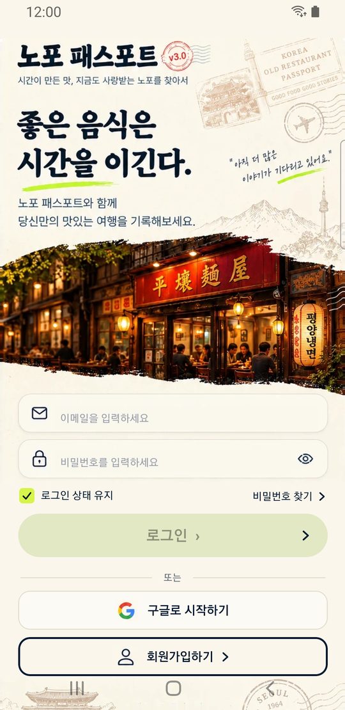 | 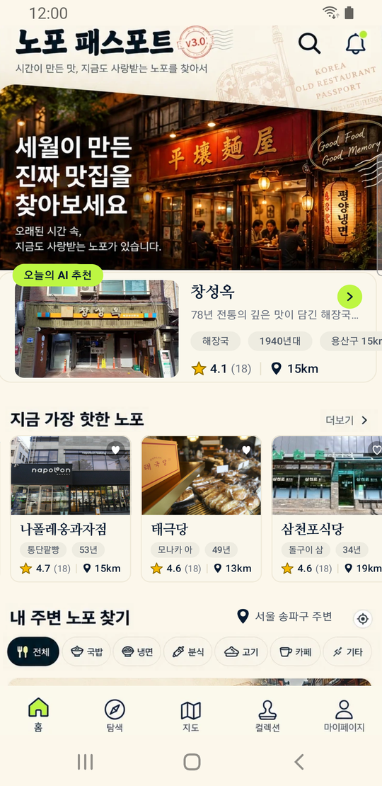 | 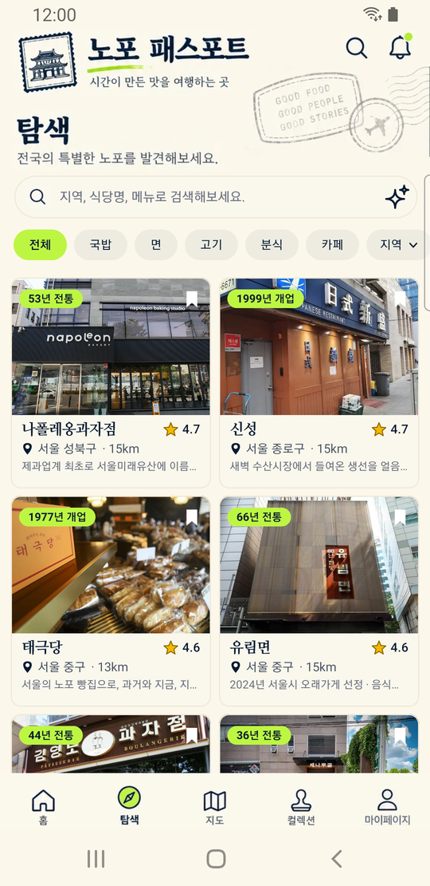 |

| 지도 | 컬렉션(여권) | 마이페이지 | 알림 | 가게 상세 |
|---|---|---|---|---|
| 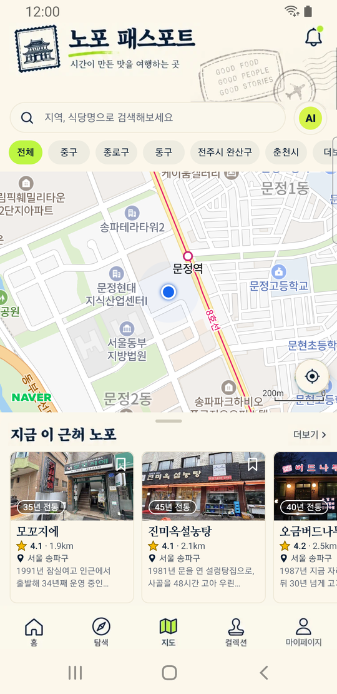 | 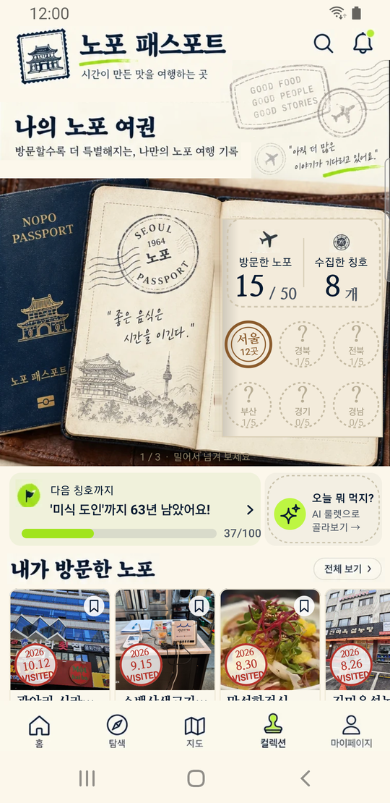 | 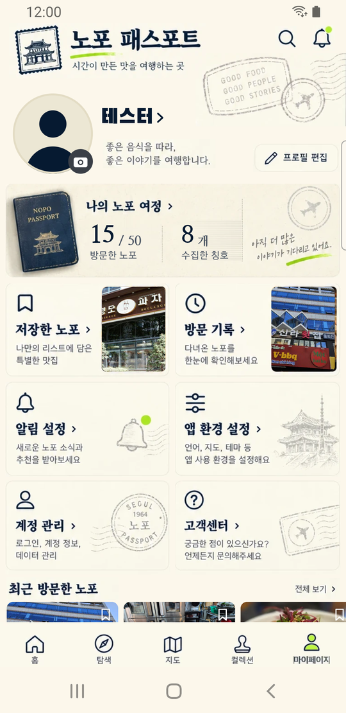 | 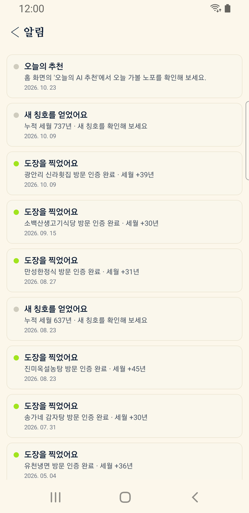 | 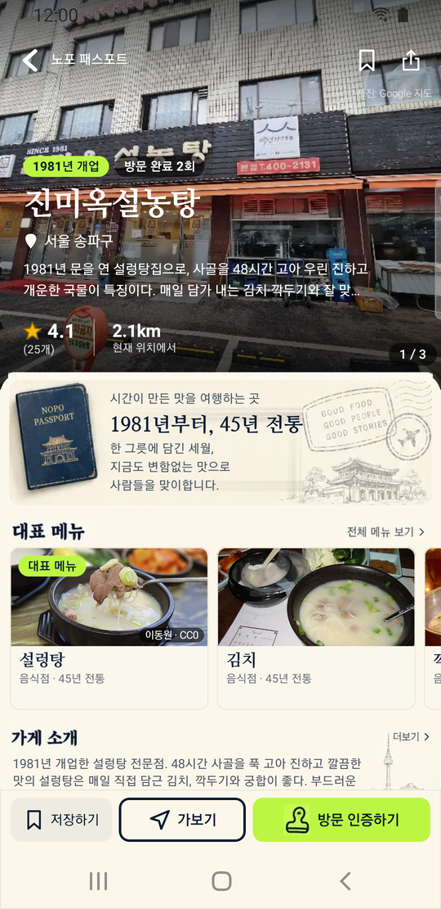 |

| 방문 인증 안내 | 영수증 정보 확인 | 인증 완료 | AI 룰렛 | 룰렛 결과 |
|---|---|---|---|---|
| 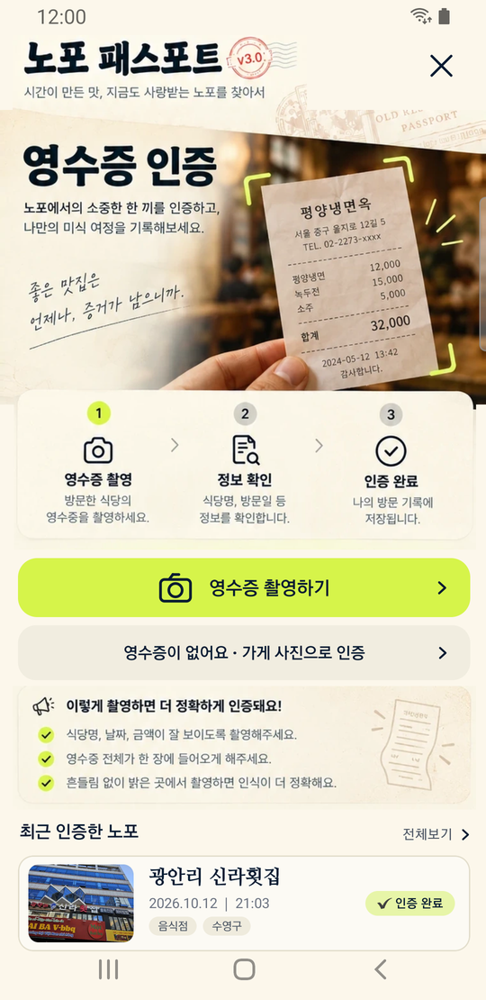 | 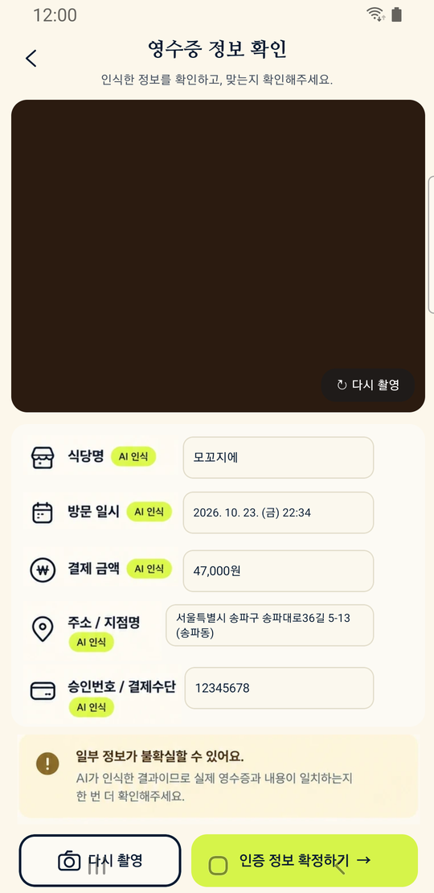 |  |  | 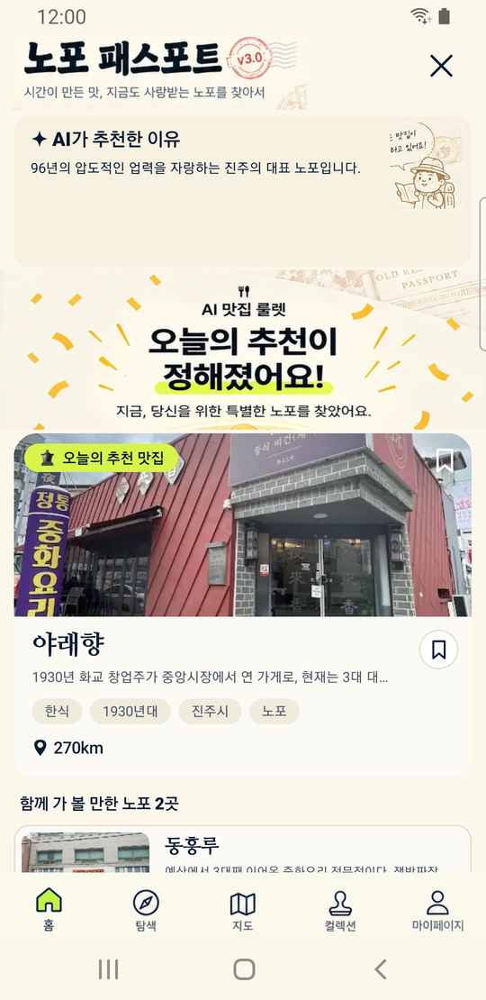 |

| AI 도우미 | 설정 | 권한 관리 | 도움말 센터 |
|---|---|---|---|
| 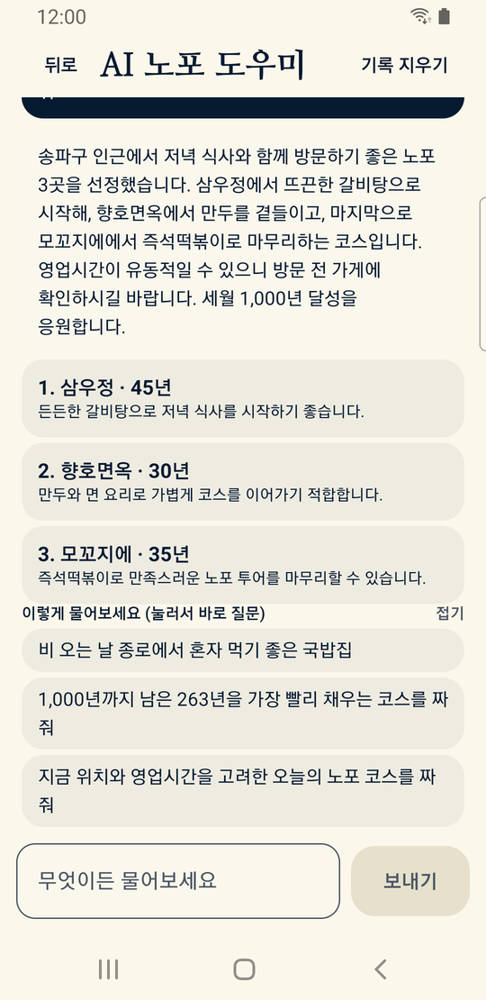 | 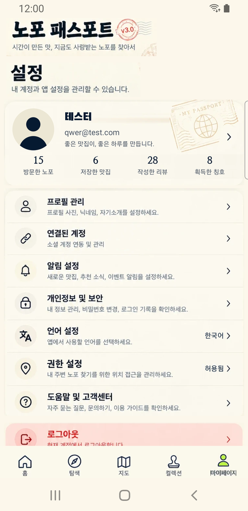 | 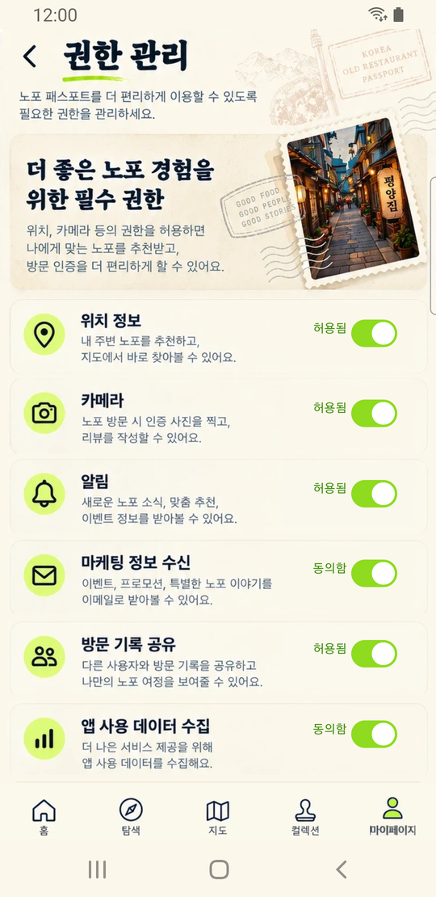 | 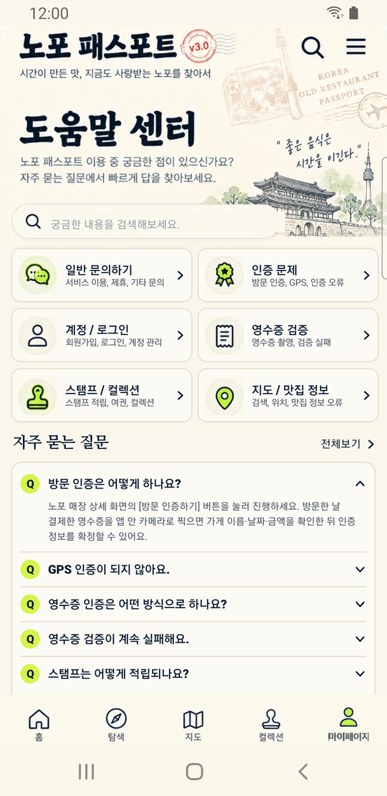 |
